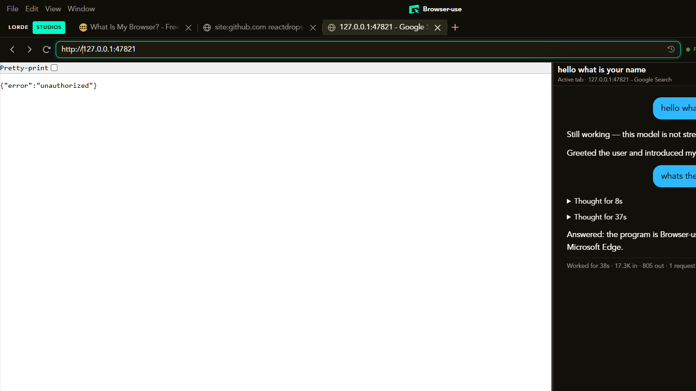

# Browser-use

<p align="center">
  
</p>

<h1 align="center">Browser-use</h1>

<p align="center">
  A visible desktop browser and agent workstation for Windows, built for coding agents, MCP clients and hands-on browser automation.
</p>

<p align="center">
  <a href="https://github.com/LordeStudios/Browser-use/releases/latest"></a>
  
  
</p>

---

Browser-use gives you a real Chromium browser on your desktop with a full automation runtime around it: managed tabs, DevTools protocol control, DOM snapshots, screenshots, native input, an agent chat panel, an MCP server for coding agents, and a terminal. Everything runs locally on your machine.

It is an Electron desktop application with a packaged Chromium runtime, a node terminal and an optional bridge to Android devices.



## Install from npm

The command line and the web interface ship as one npm package and work on Windows, macOS and Linux:

```bash
npm install -g lorde-browser-use

browser-use              # terminal interface
browser-use gui --open   # web interface at http://127.0.0.1:4200, no desktop app
browser-use run "open example.com and summarise the page"
browser-use doctor       # check node, browser and GUI status
```

The package is self-contained and does not install Electron. The desktop application below is a separate
Windows build.

## Download the desktop app

Windows 10 and 11, x64. The same page also carries the command line package.

| Asset | Size | Type |
|---|---|---|
| [Browser-use-0.4.1-setup.exe](https://github.com/LordeStudios/Browser-use/releases/download/v0.4.1/Browser-use-0.4.1-setup.exe) | 149,761,179 bytes (142.8 MB) | NSIS installer with desktop and start menu shortcuts |
| [Browser-use-0.4.1-portable.exe](https://github.com/LordeStudios/Browser-use/releases/download/v0.4.1/Browser-use-0.4.1-portable.exe) | 149,538,052 bytes (142.6 MB) | Portable build, runs without installing |
| [lorde-browser-use-0.4.1.tgz](https://github.com/LordeStudios/Browser-use/releases/download/v0.4.1/lorde-browser-use-0.4.1.tgz) | 16,317,405 bytes (15.6 MB) | npm package with the command line and web interface |

SHA-256 checksums (also in [`RELEASE-CHECKSUMS.txt`](RELEASE-CHECKSUMS.txt) and on the release page):

```
d7ae74eddf2f513efb577676db5da0de4c9201267bf4c79ed5966851b03d09d3  Browser-use-0.4.1-setup.exe
00b81cb4d5e7c6a9f5f359d232bf953aa32f2ba9bf582008afa1da741dd11343  Browser-use-0.4.1-portable.exe
```

## Features

- **Visible Electron browser application** with persistent managed tabs, a tab strip and full browser controls.
- **Chromium DevTools Protocol automation**: navigation, DOM snapshots, element picking, screenshots, console and network diagnostics.
- **Native input dispatch**: pointer, keyboard, scroll, drag and text input into real pages.
- **MCP server for agent clients**: connect Claude Code, Codex and other MCP-compatible agents. Session based transport over loopback HTTP with explicit tab binding and a short-lived pairing flow. Settings includes a generated configuration for Claude Code.
- **Agent workstation**: plans, approvals, recovery, evidence tracking and progress visibility in the chat panel, with vision aware model routing and text-only fallback.
- **Provider connections**: Ollama, cloud and OpenAI-compatible endpoints, configured per session.
- **Browser-only and AGI computer-control modes**: in AGI mode the agent can also observe and drive the native Windows desktop, with a terminal, clipboard, screenshots and recordings.
- **Android integration where configured**: paired Android devices with an ADB and scrcpy based stream (ADB platform-tools are bundled).
- **Two distribution formats**: a standard Windows installer and a fully portable build.

## Installation

### Installer

1. Download `Browser-use-0.3.6-setup.exe` from the [releases page](https://github.com/LordeStudios/Browser-use/releases/latest).
2. Run it and follow the wizard. You can change the installation directory.
3. Launch Browser-use from the desktop or start menu shortcut.

### Portable

1. Download `Browser-use-0.3.6-portable.exe`.
2. Run it. The application starts directly; no installation step is required.

Verify your download against the SHA-256 checksums above before running.

## System requirements

- Windows 10 (1809 or newer) or Windows 11, 64 bit.
- About 462 MB of disk space for the installed application (plus space for browser profiles, recordings and downloads).
- 8 GB of RAM recommended for comfortable agent and browser workloads.
- An internet connection for the pages you automate and for cloud model providers, if used.

## Compatibility

- Windows 10 and Windows 11, x64 only.
- Works with any website accessible from Chromium.
- MCP clients: any client speaking the Model Context Protocol over streamable HTTP, including Claude Code and Codex CLI.
- Android device integration requires a device with USB debugging enabled (API level 23 or newer for the node protocol).

## Roadmap

- **Code signing.** The current binaries are not signed; Windows SmartScreen may show a warning on first run. Signing is planned for a future release.
- **Android companion refinements.** The host side of node pairing and the scrcpy-based device stream are implemented today; setup is being simplified for a future release.

## Release history

See the [releases page](https://github.com/LordeStudios/Browser-use/releases) for versioned downloads and notes. Changes are tracked in [`CHANGELOG.md`](CHANGELOG.md).

## Security

If you discover a vulnerability, please use [GitHub's private vulnerability reporting](https://github.com/LordeStudios/Browser-use/security/advisories/new) rather than a public issue. Do not include credentials, pairing codes or working exploit details in public posts.

Browser-use controls visible browser tabs and, in AGI mode, native computer surfaces. Use explicit pairing, tab binding and approval controls, and do not automate sensitive accounts or irreversible actions without supervision.

## Support

- Questions and help: the [issue tracker](https://github.com/LordeStudios/Browser-use/issues) (please search before opening a new issue).
- Bug reports: [open an issue](https://github.com/LordeStudios/Browser-use/issues/new) with your Windows version, installation type and the affected MCP or provider surface.
- Product site: [studios.lordemaximus.com](https://studios.lordemaximus.com)

## Publisher

**Lorde Studios.** Official organization: [github.com/lordestudios](https://github.com/lordestudios).

Browser-use is proprietary software. This repository distributes builds and documentation only; the implementation source is not public. Third party components keep their own licences, including Electron (MIT), Playwright (Apache-2.0) and the bundled Android platform-tools (see the notices inside the application folder).
