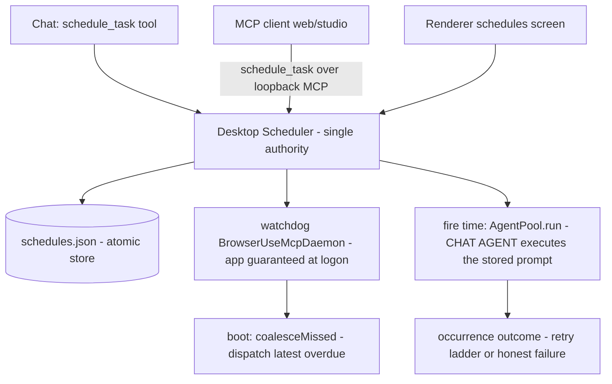

# Browser-Use v2 — Flow Chart

Architecture source of truth for the professionalized browser-use agent. Reference
disciplines: Cline SDK loop (`github.com/cline/cline`, Apache-2.0) and the in-repo
proven port `studios/public/Apps/lorde-design-studio/src/lorde-ai-v2/engine/`.
Backed-up pre-v2 code: `backups/browser-use-2026-09-16/`.

---

## 1. Process flowchart (ASCII)

```
                 ┌────────────────────────────────┐
                 │ Run source                     │
                 │  • Chat composer (PC mode)     │
                 │  • AgentPool background run    │
                 │  • Schedule fire (cron/every)  │
                 │  • MCP browser_agent_start     │
                 └───────────────┬────────────────┘
                                 v
                 ┌────────────────────────────────┐
                 │ DesktopChatAgent.start()       │
                 │  budgets: decisions/wait/step  │
                 └───────────────┬────────────────┘
                                 v
        ┌──────────────────────────────────────────────┐
  ┌────>│ while status == running                      │
  │     └──────┬───────────────────────────────────────┘
  │            v
  │     ┌────────────────────────────────────┐
  │     │ deliverSteering (queued messages)  │
  │     └───────────────┬────────────────────┘
  │                     v
  │     ┌────────────────────────────────────┐
  │     │ observeRun: settle + DOM snapshot  │
  │     │ (+ screenshot / computer observe)  │
  │     └───────────────┬────────────────────┘
  │                     v
  │     ┌────────────────────────────────────┐
  │     │ provider.complete (wire.js)        │──> one seam:
  │     │  protocol = descriptor.protocol    │    openai-compat |
  │     │  retry.js: 3 attempts, only-if-    │    anthropic | ollama |
  │     │  nothing-emitted, 1s→15s           │    responses
  │     └───────────────┬────────────────────┘
  │                     v
  │            ┌─────────────────┐
  │            │ finishReason == │
  │            │     error?      │
  │            └───┬─────────┬───┘
  │         yes    │         │ no
  │                v         v
  │     ┌───────────────┐  ┌───────────────────────────────┐
  │     │ emitted       │  │ toolCalls?                    │
  │     │ nothing &&    │  └───┬─────────────────────┬─────┘
  │     │ retryable &&  │  yes │                     │ no
  │     │ attempt < 3   │      v                     v
  │     └───┬───────┬───┘  ┌──────────────────┐  ┌──────────────────────┐
  │         │       │      │ executeAction    │  │ text-only turn:      │
  │   yes   │   no  │      │ map dispatch →   │  │ completion reminder  │
  │         v       v      │ tool cards, out- │  │ if terminal tool     │
  │   ┌──────────┐ ┌────┐ │ come evidence,   │  │ required, else run   │
  │   │ backoff  │ │fail│ │ approval gates   │  │ completes with text  │
  │   │ 1s..15s  │ └─┬──┘ └────────┬─────────┘  └──────────┬───────────┘
  │   └────┬─────┘   │             v                       │
  │        └─────────┘    ┌──────────────────┐            │
  │          (retry)      │ progress guards: │            │
  │                       │ fingerprint diff,│            │
  │                       │ coordinator loop │            │
  │                       │ detection, replan│            │
  │                       └────────┬─────────┘            │
  │                                v                      │
  │                       ┌──────────────────┐            │
  │                       │ browser_done     │──→ run-    │
  │                       │ evidence gate →  │    finished│
  │                       │ run-finished     │            │
  └───────────────────────┴──────────────────┴────────────┘
```

## 2. Mermaid — schedule authority



## 3. Provider seam (one contract)

- `providers/descriptors.cjs` — catalog: id, label, protocol (openai-compat | anthropic | ollama | responses), endpoint default, auth kind.
- `providers/wire.cjs` — `streamTurn({descriptor, connection, messages, tools, options})` → `{ content, reasoning, toolCalls, finishReason, emitted, usage }`. Reasoning normalized to `<think>` display segments for every protocol.
- `providers/retry.cjs` — Cline discipline: retry a failed turn ONLY when it emitted nothing; 3 attempts; backoff 1s/2s/4s (cap 15s); hard errors (401/403/400/402/404, quota-429) and image rejections fail fast.
- `prompts/system-prompt.cjs` — the single system prompt; tool descriptions live only in `computerCatalog.cjs`.

## 4. Tool outcome contracts (friction fixes)

| Tool | Old behavior | v2 contract |
|---|---|---|
| focus (window) | boolean that could lie | `{verified, foregroundWindow}` — always reports the actually-verified foreground |
| computer_window | list/focus only | + `clearForeground` action (minimize fullscreen/media windows by class/ex-style) |
| browser_click_element | "settled" ack, silent no-ops | + post-click evidence: URL change, DOM element-count delta, navigation-started flag |
| computer_keyboard | fires into whatever is focused | optional verified `windowId` guard (focus-verify → SendInput) |
| computer_terminal read | raw pages | + last-line text + running flag; external windows → `computer_screenshot` documented |
| tool help | traps discovered by crash | Add-Type/.ps1 trap, tab-vs-desktop coordinates, spinner-title caveat documented in schemas |

## 5. Removals vs pre-v2

| Pre-v2 | v2 |
|---|---|
| RETRY_DELAYS_MS 20s..10m, resets forever | bounded Cline retry (3 attempts, only-if-nothing-emitted) |
| Two system-prompt variants | one `prompts/system-prompt.cjs` |
| `providerContract.cjs` {ollama, cloud} only | `descriptors.cjs` full catalog |
| Triple context serialization per decision | context built once per decision |
| Chat history checkpoint on every event | throttled checkpoints (2 s + terminal events) |
| Legacy `src/` generation (gen-1 loop, extra MCP servers) | retired; `deviceProfiles` moved to desktop; studio relay repointed to desktop MCP |
| 92 MB committed binary, debug dumps, root logs | untracked/cleaned; build script kept |
