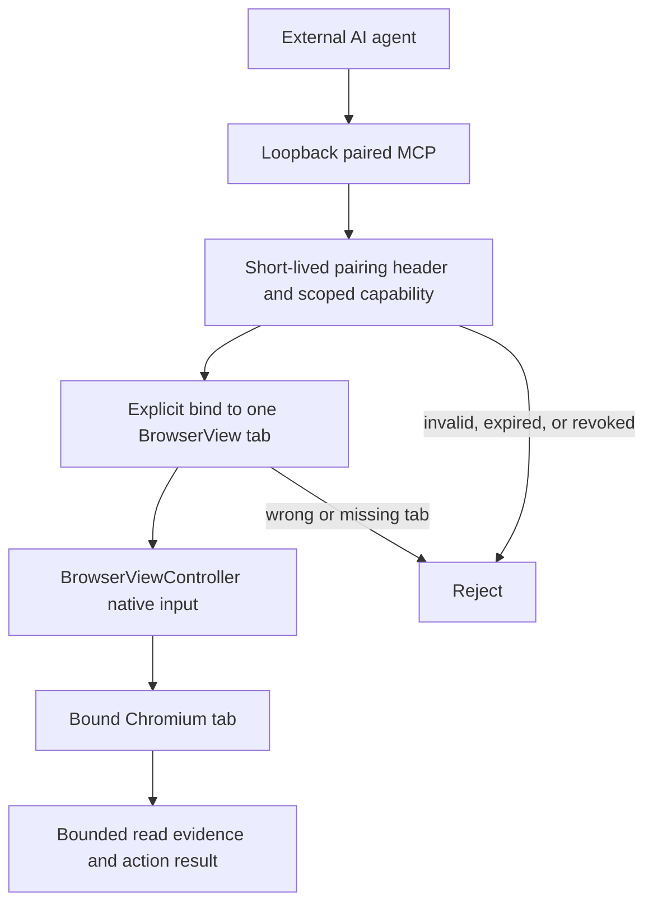
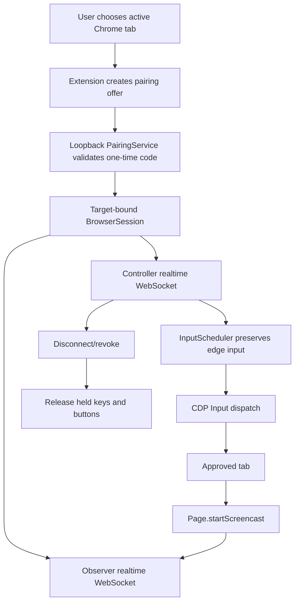
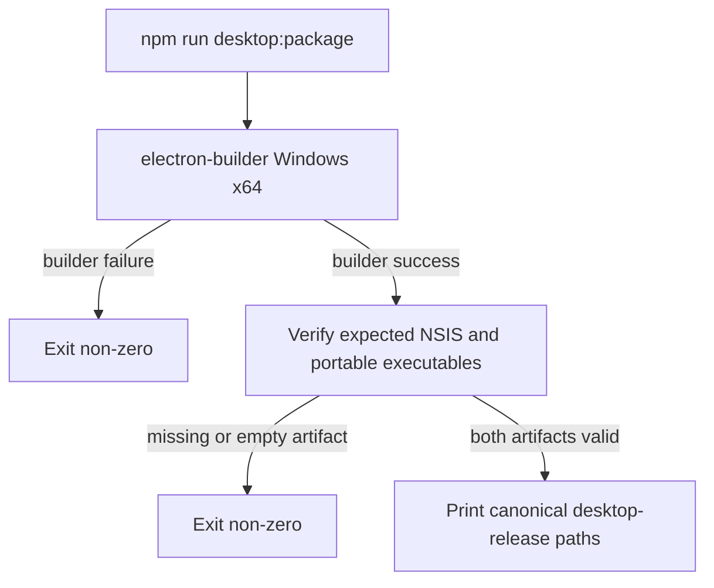
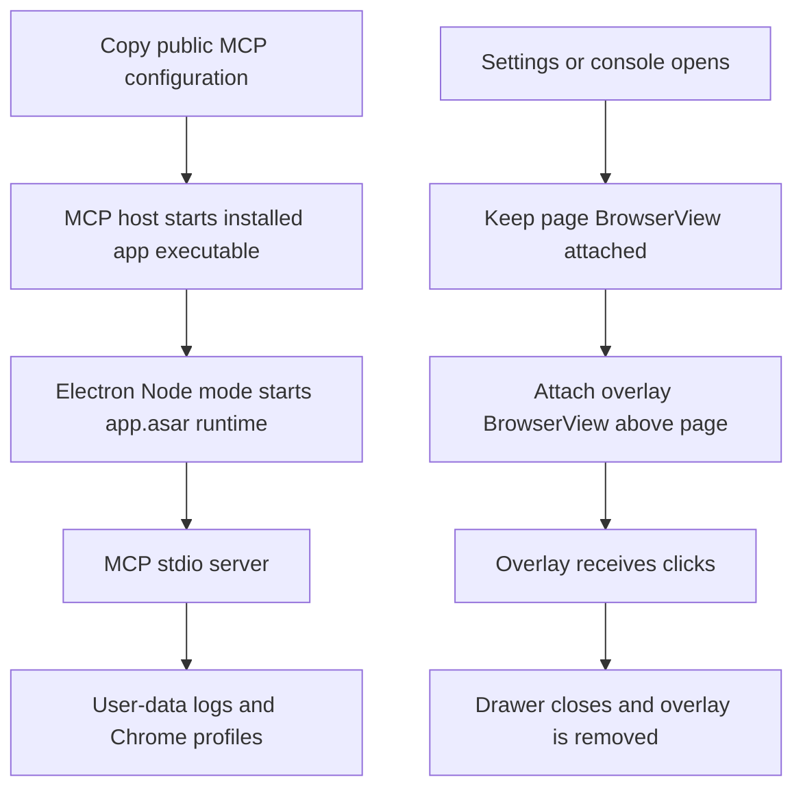
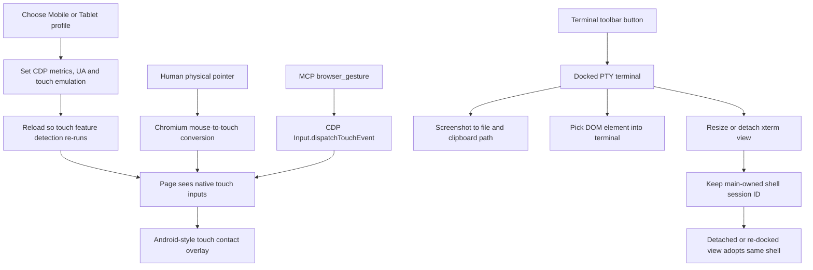
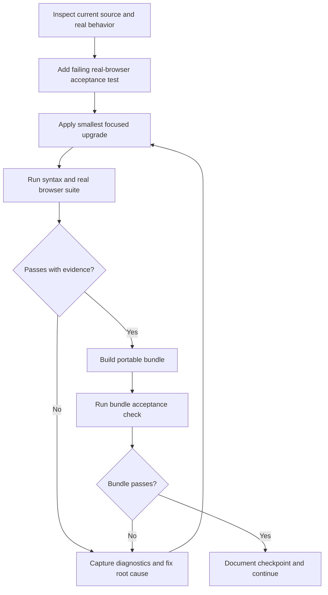

# Browser-use automation runtime — flowchart

## Purpose

This document maps the local Browser-use runtime and Desktop application. The system lets an AI agent inspect and operate an explicitly bound Browser-use desktop tab through a loopback, paired MCP bridge or CLI commands. The desktop bridge never exposes a direct debugging endpoint, requires a short-lived reusable pairing header plus explicit tab binding, grants every MCP tool at pairing, and delivers pointer, keyboard, text, wheel, drag, and touch gestures through Chromium/Electron native input without inserting page HTML or JavaScript.

## Current flow

```text
+-----------------------------------------------------------------+
|                    EXTERNAL AI AGENT                            |
+-----------------------------------------------------------------+
                                |
                                v
               +----------------------------------+
               | LOOPBACK PAIRED MCP              |
               | - short-lived reusable header     |
               | - scoped capability token        |
               +----------------+-----------------+
                                |
                                v
               +----------------------------------+
               | EXPLICIT TARGET SELECTION        |
               | - bind exactly one BrowserView   |
               | - all MCP tools already enabled  |
               +----------------+-----------------+
                                |
                                v
               +----------------------------------+
               | ELECTRON BROWSER CONTROLLER      |
               | native mouse/key/text/gesture    |
               | no page overlay or code injection|
               +----------------+-----------------+
                                |
                                v
               +----------------------------------+
               | BOUND CHROMIUM TAB               |
               | trusted native input pipeline    |
               +----------------------------------+
```



## Required upgraded interaction flow

```text
+---------------------------+
| Request: browser.click... |
+-------------+-------------+
              |
              v
+---------------------------+
| Resolve target safely     |
| CSS selector / coords     |
| viewport + visibility     |
+-------------+-------------+
              |
              v
+---------------------------+
| CDP Input.dispatch...     |
| OS/browser-level event    |
| no page-JS value rewrite  |
+-------------+-------------+
              |
              v
+---------------------------+
| Wait for evidence         |
| lifecycle / mutations /   |
| console / failed network  |
+-------------+-------------+
              |
              v
+---------------------------+
| Return action trace       |
| before/after + diagnostics|
+---------------------------+
```

## Paired realtime interaction flow

The realtime path controls an explicitly paired browser target. It is distinct from MCP orchestration: MCP creates, reports, or revokes sessions; a dedicated loopback WebSocket carries ordered input and transient visual frames. No frame is written to disk in the realtime path, and pointer visualization is a viewer responsibility rather than a target-page DOM mutation.

```text
+---------------------------+
| User approves one tab     |
| Browser-use extension     |
+-------------+-------------+
              |
              v
+---------------------------+
| Loopback pairing service  |
| one-time code + TTL       |
+-------------+-------------+
              |
              v
+---------------------------+
| Target-bound session      |
| controller / observer     |
+-----+----------------+----+
      |                |
      v                v
+-----------+   +------------------+
| Input WS  |   | CDP screencast   |
| key/mouse |   | transient frames |
+-----+-----+   +--------+---------+
      |                  |
      +--------+---------+
               v
+---------------------------+
| Exact approved Chrome tab |
+---------------------------+
```



### Realtime invariants

1. A session cannot guess a browser target: its browser instance, tab, and CDP target must all match pairing metadata.
2. Only one controller can send input. Observers receive frames but cannot mutate input state.
3. Pointer movement may coalesce under pressure; pointer/key edges never coalesce away.
4. Input bypasses selector lookup, synthetic DOM events, page cursor injection, action sleeps, and disk-backed telemetry.
5. A disconnect, expiry, revocation, or target fault releases every held key and mouse button before closing the session.
6. Adaptive screencast frames are binary/transient and acknowledge CDP frames; slow clients receive current frames rather than an unbounded history.

## Electron desktop packaging flow

The Electron desktop build is a separate release path from the Node/MCP bundle. A successful desktop package command must produce the documented Windows executable artifacts or fail with a non-zero exit status.

```text
+---------------------------+
| npm run desktop:package   |
+-------------+-------------+
              |
              v
+---------------------------+
| electron-builder: Windows |
| x64 NSIS + portable       |
+-------------+-------------+
              |
       +------+------+
       |             |
       v             v
+--------------+ +----------------+
| Builder error| | desktop-release |
| non-zero exit| | *.exe artifacts|
+--------------+ +--------+-------+
                         |
                         v
                +----------------+
                | Verify exact,  |
                | non-empty EXEs |
                +--------+-------+
                         |
              +----------+----------+
              |                     |
              v                     v
      +---------------+   +-------------------+
      | Missing: fail |   | Report paths: pass|
      +---------------+   +-------------------+
```



## Public desktop MCP and drawer interaction flow

The public desktop application copies a normal MCP host configuration. The host launches the installed Browser-use executable in Electron's Node mode when it connects, so it does not require a repository checkout or a system `node` executable. Runtime logs and browser profiles are stored under Electron's per-user data directory.

```text
+----------------------------+
| User copies MCP JSON       |
+-------------+--------------+
              |
              v
+----------------------------+
| MCP host connects          |
+-------------+--------------+
              |
              v
+----------------------------+
| Installed Browser-use .exe |
| ELECTRON_RUN_AS_NODE=1     |
+-------------+--------------+
              |
              v
+----------------------------+
| app.asar/src/index.js      |
| MCP stdio server            |
+-------------+--------------+
              |
              v
+----------------------------+
| User-data logs and profiles|
+----------------------------+

+----------------------------+
| Settings or console opens  |
+-------------+--------------+
              |
              v
+----------------------------+
| Keep page BrowserView      |
| attached and laid out      |
+-------------+--------------+
              |
              v
+----------------------------+
| Attach overlay last above  |
| page; overlay owns input   |
+-------------+--------------+
              |
              v
+----------------------------+
| Drawer closes: remove      |
| overlay, page stays live   |
+----------------------------+
```



## Native pointer constraint

CDP can drive Chrome's real input pipeline, but CDP itself cannot reliably control or capture a host OS cursor. The browser tool must therefore never inject a fake cursor into the tested page. Its accurate action point is the CDP input coordinate, reported in the action trace. If a visible host-native cursor is required for a headed demonstration, it must be provided by an optional desktop-native bridge, outside the page DOM, and must be clearly reported as available/unavailable rather than simulated.

## Device modes and terminal flow

Browser-use can turn the active native BrowserView into a real mobile or tablet
surface. This is not a scaled desktop preview: Chromium receives a device
viewport, pixel ratio, user-agent client hints, touch feature detection, and
real touch contacts. While a device profile is active, Chromium converts a
person's physical mouse into trusted touch input before the page observes it;
MCP pointer tools refuse and MCP uses `Input.dispatchTouchEvent` for every
agent gesture. Contact feedback, if ever added, must be rendered by trusted desktop chrome rather than injected into the tested document.

```text
+-------------------+       +-----------------------------------+
| Device profile    | ----> | CDP Emulation                     |
| Mobile / Tablet   |       | metrics + UA + touch + reload     |
+---------+---------+       +----------------+------------------+
          |                                  |
          v                                  v
+-------------------+              +----------------------------+
| Human hardware    |              | Connected MCP host         |
| mouse / trackpad  |              | browser_gesture            |
+---------+---------+              | tap / swipe / pinch / 3F   |
          |                        +-------------+--------------+
          v                                      |
+-------------------+                            |
| Chromium converts | <--------------------------+
| pointer -> touch  |   Input.dispatchTouchEvent
+---------+---------+
          |
          v
+-------------------+      +-------------------------------+
| Tested page sees  | ---> | touchstart / touchmove /       |
| touch only        |      | touchend + pointerType=touch   |
+-------------------+      +-------------------------------+
          |
          v
+-------------------+
| Touch overlay     |
| circle per contact|
+-------------------+

+-------------------+       +-----------------------------------+
| Terminal button   | ----> | Docked xterm surface              |
+-------------------+       | PTY -> piped-shell fallback       |
          |                 +----------------+------------------+
          v                                  |
+---------+---------+                        v
| Resize / detach   |              +----------------------------+
| bottom dock       |              | Screenshot: PNG path + image|
+---------+---------+              | Select: page element selector|
          |                        +----------------------------+
          v
+-------------------+
| Move xterm view;  |
| retain same shell |
| session and state |
+-------------------+
```



### Device-mode invariants

1. A mobile or tablet profile uses CDP `Input.dispatchTouchEvent`; MCP mouse
   movement/press/release calls fail with an actionable gesture alternative.
2. Human hardware pointer input is converted by Chromium before the document
   sees it. Compatibility click events may follow a tap, as on a real device,
   but all pointer events report `pointerType: "touch"`.
3. Device mode reloads the page after emulation is applied, because
   `ontouchstart` and similar capability checks are decided at document create
   time.
4. Gesture contacts must stay within the profile's CSS viewport and use no more
   than five concurrent points.
5. The terminal owns a real PTY when available. The piped-shell fallback is
   explicitly labelled and remains usable for ordinary commands.
6. Detaching or re-docking changes only the xterm presentation; the main-owned
   shell retains its session ID, process state, and history until explicit reset,
   disposal, natural exit, or app shutdown.
7. Screenshot paths are written under Electron user data, copied as clipboard
   text alongside the PNG bitmap, and printed to the terminal.

## Background multi-tab control

The visible selected tab is human presentation state. Background agent and MCP
operations address explicit target/bound tab IDs without calling `showTab()`,
stealing focus, or replacing the visible BrowserView. Detailed ownership and
background-capture routing lives in `desktop/mcp/backgroundTabControl_flow_chat.md`.

## Invariants

1. The tested document must not be mutated by input delivery or automation visualization; no cursor or touch overlay is injected.
2. Desktop external-agent interaction addresses the explicitly requested tab. The selected BrowserView uses Electron native input; an explicitly addressed background BrowserView uses CDP `Input.dispatchMouseEvent`, `Input.dispatchKeyEvent`, or `Input.insertText` and must never steal focus or replace the visible tab. Touch profiles use CDP `Input.dispatchTouchEvent`.
3. Every action returns bounded evidence: elapsed time, target/location, current page, console delta, and failed-request delta.
4. Network and console records are bounded in memory and persisted to session artifacts.
5. MCP tool schemas must describe required/optional inputs correctly.
6. A packaged build must contain every runtime module it imports and never overwrite source tests or project code.
7. Browser acceptance tests exercise a genuine Chromium process and local HTTP fixtures, not mocked CDP calls.

## Upgrade checkpoint loop


