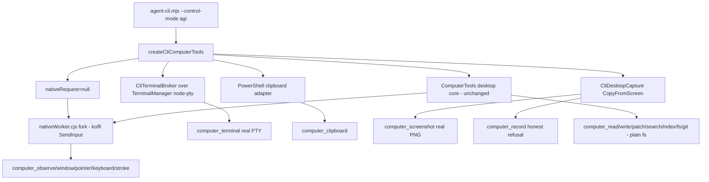

# cli/computerToolsBackend.cjs — flow chat

Headless CLI computer-tools backend: replaces `createHeadlessComputerToolsStub`
(cli/stubs.cjs) with a REAL backend for `--control-mode agi` runs. Owner
directive: the CLI has NO tool permission gates — every `computer_*` tool is
either really implemented or fails with an honest, exact blocker (never a
generic stub refusal).

## ASCII flow

```
+---------------------------- agent-cli.mjs / --control-mode agi ----------------------------+
| getComputerTools: () => createCliComputerTools()          (was: headless stub)             |
+-------------------------------------------+-----------------------------------------------+
                                            v
+--------------------- cli/computerToolsBackend.cjs : createCliComputerTools() --------------+
|  reuses desktop/computer/computerTools.cjs (ComputerTools) unchanged, injecting:            |
|                                                                                             |
|  terminal: CliTerminalBroker  -- in-process wrapper over TerminalManager (node-pty)         |
|      create/snapshot/writeInput/sendInput/refresh/dispose/recover/backendInfo               |
|      sendInput polls outputRevision / expected literal (TerminalBrokerClient 'send' port)   |
|  clipboard: PowerShell Get-Clipboard / Set-Clipboard (execFileSync, sync like Electron)     |
|  capture:   CliDesktopCapture                                                               |
|      displays(): GetSystemMetrics(76..79) physical virtual-desktop bounds                   |
|      screenshot(): PowerShell CopyFromScreen -> PNG file -> base64 + sha256 + PNG IHDR dims |
|      record(): honest refusal (needs the Electron capture renderer + mediabunny muxer)      |
|  nativeRequest: null  ->  ComputerTools forks desktop/computer/nativeWorker.cjs (koffi,     |
|      user32 SendInput) with plain node — pointer/keyboard/window/observe work headless      |
|  workspaceGuard: WorkspaceChangeGuard (plain fs + git — headless-safe, unchanged)           |
+-------------------------------------------+-----------------------------------------------+
                                            v
                        ComputerTools.execute(tool, input, owner, {signal})
   computer_read/write/patch/search/index/fs/git  -> plain fs / rg / git binary (already real)
   computer_terminal                              -> CliTerminalBroker (real PTY)
   computer_clipboard                             -> PowerShell adapter
   computer_screenshot                            -> PowerShell CopyFromScreen adapter
   computer_observe/window/pointer/keyboard/stroke-> nativeWorker fork (koffi)
   computer_record                                -> honest refusal (Electron-only)
```

## Mermaid



## Honest unavailability (owner decisions documented in code)

- `computer_record`: the desktop implementation (`desktopCapture.cjs`) muxes MP4/WebM
  fragments through an Electron hidden BrowserWindow renderer (`capture.html` +
  mediabunny). No Electron shell exists in the CLI runner, so recording is refused
  with an exact blocker; screenshots (CopyFromScreen) remain fully available.
- `src/browser/nativePointer.js` was evaluated and NOT needed: it is a
  PowerShell SetCursorPos bridge whose only Electron coupling is a `browser.evaluate`
  window-metrics lookup; the CLI's pointer path goes through `nativeWorker.cjs`
  (koffi SendInput, probed working in plain Node), which is strictly more capable.
