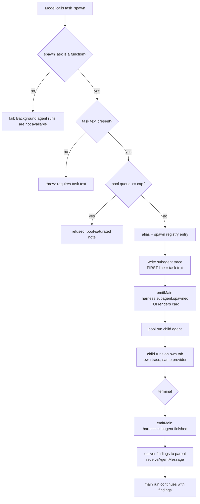
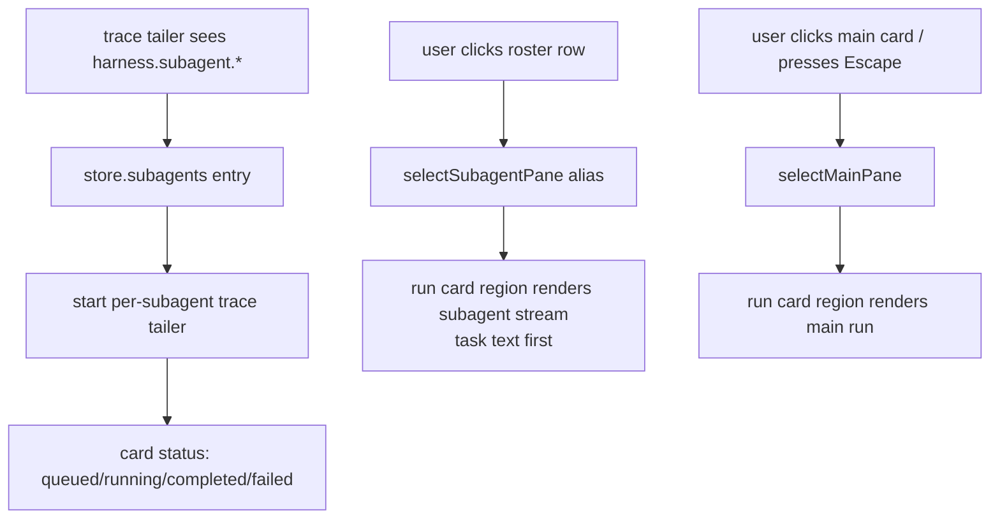

# Subagent support — CLI (agent-cli + TUI) and desktop prompt-first display

Gen-8: task_spawn works in the headless CLI, the TUI renders clickable subagent
cards, and BOTH surfaces (CLI TUI pane + desktop subagent tab feed) show the
spawning task text as the FIRST visible entry of every subagent.

## 1. Defect A — task_spawn dead in the CLI (root cause + fix)

`desktopChatAgent.cjs:4129-4131` dispatches `task_spawn` through
`run.spawnTask`; the desktop injects `spawnBackgroundTask` (main.cjs:576) but
`cli/agent-cli.mjs` passed `spawnTask: null` → every model call failed with
"Background agent runs are not available in this session."

Fix: new `cli/cliSubagents.cjs` — an Electron-free subagent runtime reusing
`desktop/agent/agentPool.cjs` (pure module, no Electron), with nested
in-process DesktopChatAgent children sharing the CLI's controller/tabs.

```
+--------------------+     task_spawn call      +---------------------------+
| model decision     | -----------------------> | desktopChatAgent          |
| (tool: task_spawn) |                          | executeAction 4129        |
+--------------------+                          | run.spawnTask(input, run) |
                                                +------------+--------------+
                                                             |
                                                             v
+---------------------------------------------------------------------------+
| cliSubagents.spawnTask(input, run)                                        |
|  1. task empty? -> throw 'requires task text'                             |
|  2. pool saturated (queue >= cap)? -> { refused, reason:pool-saturated }  |
|  3. alias from NAME POOL (closed names recycle)                           |
|  4. outDir/subagents/<NN>-<alias>/trace.jsonl created;                    |
|     FIRST LINE = {type:'harness.subagent.task', task}   <-- Feature C     |
|  5. spawnRegistry[spawnId] = {alias,status:'queued',...}                  |
|  6. emitMain(harness.subagent.spawned)  -> TUI card appears               |
|  7. pool.run({task, alias, provider: run.provider, retain:false})         |
+------------+--------------------------------------------------------------+
             | AgentPool.dispatch (cap-bounded queue)
             v
+-----------------------------------------------------------+
| child DesktopChatAgent (in-process)                       |
|  own tab: allocateTab -> background CDP tab (no steal)    |
|  emit -> its own trace.jsonl                              |
|  provider: same config as the parent run                  |
|  spawnTask/subagentApi/messageApi: same runtime (nesting) |
|  NO worktree (CLI keeps the shared tree; desktop-only)    |
+------------+----------------------------------------------+
             | terminal snapshot
             v
+-----------------------------------------------------------+
| settle: status completed|failed, findings summary         |
|  emitMain(harness.subagent.finished {alias,status,        |
|            summary,error})          -> TUI card updates   |
|  deliverFindings: parent receiveAgentMessage(...)         |
|    parent = getAgent() or pool instance by parentRunId    |
|    not delivered -> still in the main trace (findings ev) |
+-----------------------------------------------------------+
```

Keep-alive: if subagents are still active when the MAIN run reaches its
terminal state, agent-cli waits (`waitForAll`, cap
BROWSER_USE_CLI_SUBAGENT_WAIT_MS default 10 min) before teardown; the signal /
force-exit paths cancel the pool first.

Mermaid:



## 2. Feature B — TUI subagent cards + click-to-switch

The TUI's existing 250ms trace tailer picks the lifecycle events up; each
subagent also gets its OWN trace tailer writing into its entry.

```
trace.jsonl (main)                       subagents/<NN>-<alias>/trace.jsonl
  harness.subagent.spawned  ----------->  TUI: subagents[] += {alias, task,
  harness.subagent.status/finished        status, tracePath, tail{}}
        |                                        |
        |                              250ms tail: tool.started/tool.result/
        v                              assistant.thinking/recovery.lastError
  store.subagents[], store.activeSubagent
        |
        v
  FullScreenApp fixed layout (rows):
    header(3) / history / runCard(5) / subagent roster (1 row each) /
    notice / menu / prompt / footer
    - main card row region click  -> selectMainPane()   (or Escape)
    - roster row click            -> selectSubagentPane(alias)
    - active pane's card renders THAT subagent: FIRST line = its task text
      (Feature C), then inFlight/tools/thinking/lastError from its tail
  InlineApp: roster lines render non-clickable under the live card.
```



## 3. Feature C — task text first on BOTH surfaces

- CLI: `harness.subagent.task` is the first line of the subagent's trace; the
  TUI's subagent pane renders the task text as the pane's first content line.
- Desktop: `state.agent.subagents` already carries each roster entry's `task`
  (main.cjs:1982). `renderSubagentTabs()` (renderer/app.js) seeds every new
  alias's feed buffer with a synthetic `{type:'spawn.task', task}` event
  BEFORE any run events, and `renderSubagentEvent` renders it as a user-style
  message — the feed's first card is always what the subagent was asked to do,
  on replay too.
