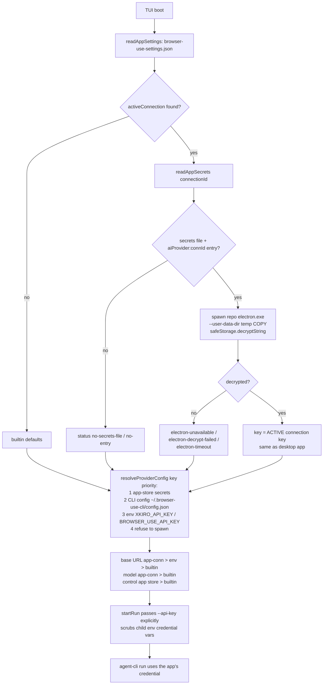

# cli/tui/appConfig.mjs — flow chart (provider resolution + secrets decrypt)

Module contract: resolve the provider (base URL / model / API key / control mode)
for TUI-spawned agent-cli runs from the browser-use desktop app's OWN stores —
the same fields, the same lookup, the same decryptor the app uses
(desktop/main.cjs `activeProviderConfig` + `store/credentialStore.cjs`) — with
honest fallbacks. `~/.claude/settings.json` is NEVER consulted.

## ASCII flow

```
                    +-------------------------------+
                    | TUI boot (cli/tui.mjs)        |
                    +---------------+---------------+
                                    |
                                    v
        +---------------------------+------------------------------+
        | readAppSettings()  ->  %APPDATA%/browser-use/            |
        |                         browser-use-settings.json        |
        +---------------------------+------------------------------+
                                    |
                                    v
                    +-------------------------------+
                    | activeConnection(settings)    |
                    | aiChatProvider + aiChatConnectionId
                    | must match an aiConnections entry
                    +---------------+---------------+
                                    |
             +----------------------+----------------------+
             | connection found?                           |
            NO                                            YES
             |                                             |
             v                                             v
   (builtin defaults)              +--------------------------------------+
                                   | readAppSecrets({connectionId})       |
                                   | (async)                              |
                                   +------------------+-------------------+
                                                      |
                                                      v
                              +-------------------------------------------+
                              | secrets file readable?                    |
                              |  NO -> 'no-secrets-file'                  |
                              | entry aiProvider:<connId> present?        |
                              |  NO -> 'no-entry'                         |
                              +-------------------+-----------------------+
                                                  |
                                                  v
                  +-----------------------------------------------------+
                  | decryptAppSecrets via the REAL decryptor:           |
                  |  electron.exe (repo node_modules/electron/dist)     |
                  |  --user-data-dir=<tmp COPY of Local State + secrets>|
                  |  safeStorage.decryptString  (the app's own call)    |
                  +---------------------+-------------------------------+
                                        |
             +--------------------------+---------------------------+
             | decrypted?                                           |
            NO                                                     YES
             |                                                      |
             v                                                      v
   status: 'electron-unavailable'              status: 'decrypted'
           | 'electron-decrypt-failed'          key = ACTIVE connection key
           | 'electron-timeout'                 (identical to the app's
           | (detail kept for /doctor)           credential at runtime)
             |                                                      |
             +----------------------+-------------------------------+
                                    |
                                    v
              +-------------------------------------------+
              | resolveProviderConfig(...) — key priority |
              |  1. app-store secrets (decrypted)         |
              |  2. CLI config file ~/.browser-use-cli/   |
              |     config.json (owner-provided /key)     |
              |  3. env XKIRO_API_KEY / BROWSER_USE_API_KEY
              |  4. none (startRun refuses to spawn)      |
              +---------------------+---------------------+
                                    |
        base URL: app connection > env XKIRO_BASE_URL > builtin
        model:    app connection > builtin
        control:  app agentControlMode > builtin
                                    |
                                    v
                    +-------------------------------+
                    | startRun: --api-key <resolved>|
                    | child env XKIRO_API_KEY /     |
                    | ANTHROPIC_AUTH_TOKEN /        |
                    | XKIRO_BASE_URL scrubbed       |
                    +---------------+---------------+
                                    |
                                    v
                    +-------------------------------+
                    | agent-cli: --api-key wins its |
                    | own chain; ambient vars gone  |
                    +-------------------------------+
```

## Mermaid



## Failure modes this design closes

1. Ambient/stale `XKIRO_API_KEY` shadowing the app's funded key (the 2026-10-12
   402/429 runs) — the child env is scrubbed and the resolved key is passed
   explicitly; env is the LAST resolution step, not the first.
2. The TUI resolving a DIFFERENT connection's key than the app (····13f9 vs the
   active ····eb72) — the lookup is now byte-identical to
   `desktop/main.cjs: activeProviderConfig()` (settings.aiChatConnectionId ->
   secrets `aiProvider:<id>` -> safeStorage decrypt).
3. Silent headless inability to decrypt — every failure has an honest named
   status surfaced in /doctor, and the owner can always override with a key
   stored in the CLI's own config file (`/key <secret>`), never claude-code,
   never env.
