# browser-use TUI + global command registration — flow chat

## 10. Owner-feedback round 2: browser-use-config-only + /model picker + paste fix (2026-10-12)

- **CLAUDE-CODE PURGE:** ~/.claude/settings.json is removed from the resolution
  chain ENTIRELY. Resolution is browser-use config only: (1) the app's settings
  store (active connection baseUrl/model/customModels + agentControlMode) and
  its secrets store, (2) explicit env exports (XKIRO_API_KEY /
  BROWSER_USE_API_KEY / XKIRO_BASE_URL), (3) built-in defaults. /doctor prints
  "config source: browser-use app stores ONLY" and tests the resolved key's
  funding with the gateway probe. readAppSecrets() honestly reports its
  status: the DPAPI half (koffi CryptUnprotectData on Local State's
  os_crypt.encrypted_key) works headless, but Electron 43's os_crypt_async
  AES-GCM payload layout did not verify under any tried layout — reported as
  `dpapi-key-ok-blob-undecryptable`, never faked.
- **/model PICKER:** bare `/model` opens the SAME completion-menu UI as slash
  commands (SuggestionsDisplay pattern) with the full session catalog as
  navigable options — pricing hint + source per option, arrows move, TAB
  stages, Enter selects (executes `/model <id>`, menu closes, only
  "model set to <id>" prints), Esc dismisses. /models remains the explicit
  text listing (aligned columns). The 129-line Static dump is gone.
- **PASTE FIX (pre-existing, root-caused under ConPTY):** terminals deliver a
  paste as ONE multi-char chunk; ink does NOT treat the embedded \r\n as
  Enter, so pasted tasks/commands filled the buffer with control characters
  and never submitted. useInput now splits chunks containing \r\n into lines
  and submits each through the normal dispatch. Proven with node-pty ConPTY
  captures (first-screen, model-picker, escape-cancel + spawn-env proof).
- **Polish:** banner/info/prompt/footer share one 2-column gutter; footer out
  root shows its basename (no mid-word wraps); formatElapsed clamps negative
  stale-tick values; aligned columns in /models.

### Resolution order (browser-use config ONLY)

```
base url / model / custom models / control mode:
  1. app store  %APPDATA%/browser-use/browser-use-settings.json
     (aiChatProvider + aiChatConnectionId -> ACTIVE aiConnections entry,
      agentControlMode)
  2. env override XKIRO_BASE_URL
  3. builtin defaults (https://api.xkiro.com/v1, z-ai/glm-5.3-flash, browser)
api key:
  1. app secrets store (browser-use-secrets.json) when its os_crypt_async
     payload verifies headless (honest status reporting; DPAPI half works)
  2. explicit env exports XKIRO_API_KEY / BROWSER_USE_API_KEY
  3. none -> /run refuses, /doctor reports (never fabricates)
child env: XKIRO_API_KEY / ANTHROPIC_AUTH_TOKEN / XKIRO_BASE_URL scrubbed;
agent-cli gets --api-key/--base-url explicitly + BROWSER_USE_CLI_ENV_PROOF
writes a spawn-env proof file when the var is set.
```

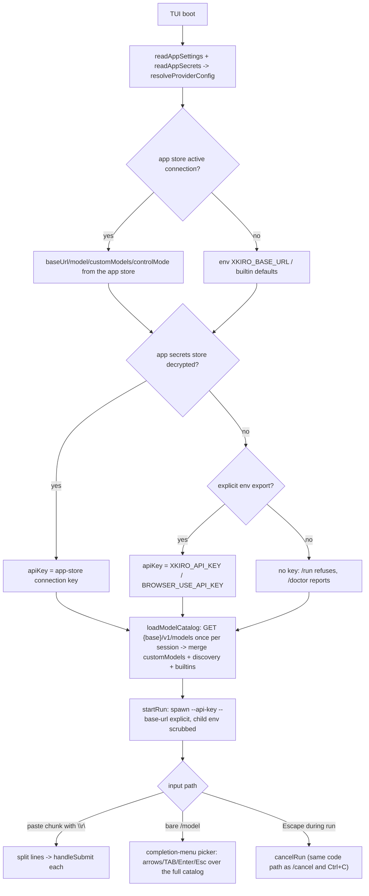


## 9. App-config-first resolution + defect-fix round (2026-10-12)

New module `cli/tui/appConfig.mjs` (pure, unit-tested) + fixes to tui.mjs /
App.mjs / theme.mjs:

- **Credential fix (defect 1):** startRun used to spawn agent-cli with
  `env: process.env`, so a DRAINED shell XKIRO_API_KEY shadowed the funded
  ~/.claude/settings.json key inside agent-cli's priority chain (--api-key >
  XKIRO_API_KEY env > settings.json) — runs burned 402/429s with zero tool
  calls ("spins forever with no reply"). Now startRun resolves the funded
  credential once at boot and passes `--api-key` / `--base-url` EXPLICITLY on
  the spawn args; `scrubCredentialEnv` strips XKIRO_API_KEY /
  ANTHROPIC_AUTH_TOKEN / XKIRO_BASE_URL from the child env. A dim proof line
  prints the winning key source (masked, last 4 only).
- **Banner order (defect 2):** the banner lived in the re-rendered section
  below `<Static>`, so history growth pushed the header BELOW run output. The
  banner is now the FIRST Static entry (`items: [banner, ...history]`) and can
  never move.
- **Escape cancels (defect 3):** Escape while `state.run` is live routes to
  `controller.onEscape` -> `cancelRun()` — the same confirm-free /cancel code
  path. At idle Escape still clears the buffer. Documented in /help tips and
  /cancel's description.
- **Full model catalog (defect 4):** `loadModelCatalog()` fetches
  `GET {base}/v1/models` with the funded key ONCE per session (kicked off at
  boot, cached), merges app customModels + gateway discovery + built-ins via
  `mergeModelCatalog`; `/model` completion and the new `/models` command serve
  the merged list (pricing tiers rendered when the gateway ships them). Fetch
  failure falls back to built-ins with a dim notice — never a hard error.
- **Desktop palette (defect 5):** theme.mjs now maps to the browser-use
  desktop app's dark chrome (desktop/renderer/chrome-theme.css `--bu-*` +
  browser-use-expressive-settings tokens): canvas #060b0d, text #edf2f2,
  muted #8b9699, accent lime #c8ff00, warning #e0af68, danger #ef4f64,
  outline-variant #20272a borders. Success/info do not exist in the app CSS —
  derived mint/cyan harmonized with the teal chrome (documented in-file).
- **Retry context (defect 6):** VERIFIED NOT A DEFECT — the provider's retry
  ladder (openAiCompatibleProvider.cjs, attempt 1..2) replays the SAME request
  and only `ledger.observeUsage`/`ledger.accept` append to the turn ledger on
  SUCCESS; ProviderTurnLedger.compact() (providerTurnLedger.cjs) bounds the
  wire with compaction thresholds + size-bounded eviction. The trace's 2.7M
  "cumulative context tokens" is `metrics.providerContextTokens` — a
  by-design cumulative SUM over all requests, not growing context.

### Resolution order (app-config first)

```
base url / model / custom models / control mode:
  1. app store  %APPDATA%/browser-use/browser-use-settings.json
     (aiChatProvider + aiChatConnectionId -> ACTIVE aiConnections entry,
      agentControlMode) — desktop/main.cjs:1132 DEFAULT_SETTINGS, :1520
      normalizedConnections, :1564 activeProviderConfig
  2. ~/.claude/settings.json env.ANTHROPIC_BASE_URL (+ /v1 appended)
  3. builtin defaults (https://api.xkiro.com/v1, z-ai/glm-5.3-flash, browser)
api key:
  1. app connection key — ELECTRON-ONLY: Electron safeStorage
     (desktop/store/credentialStore.cjs over userData/browser-use-secrets.json)
     is genuinely unreadable headless
  2. ~/.claude/settings.json env.ANTHROPIC_AUTH_TOKEN  <- the funded key
  3. shell XKIRO_API_KEY / ANTHROPIC_AUTH_TOKEN (possibly drained; /doctor
     warns when the shell key differs from settings.json's)
child env: XKIRO_API_KEY / ANTHROPIC_AUTH_TOKEN / XKIRO_BASE_URL scrubbed.
```

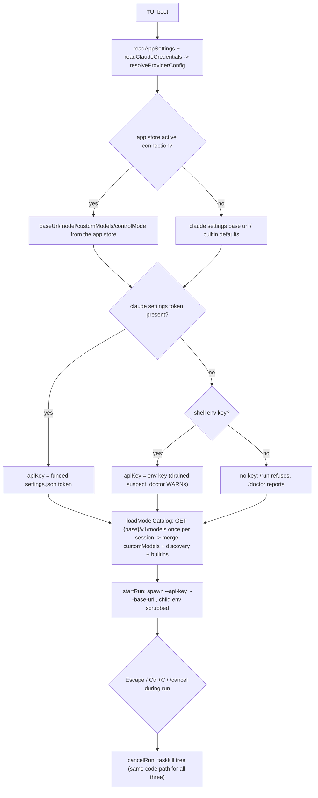


Module map (all new files live under `cli/`; the only pre-existing file touched is
`package.json`, additively):

```
cli/browser-use.js        ESM entry (package "type": "module"). Dispatch: tui | run | help | version.
cli/tui.mjs               TUI bootstrap: session state, run lifecycle, doctor, history -> Ink app.
cli/tui/App.mjs           THE INK APP (graphics tier). h=React.createElement, zero-build.
cli/tui/theme.mjs         Lime-on-dark tokens (qwen ColorsTheme shape, Accent #c8ff00) + helpers.
cli/tui/store.mjs         Observable store the App renders via useSyncExternalStore.
cli/tui/registry.mjs      PURE command registry + readline completer (unit-tested, shared).
cli/tui/tui.test.mjs      node:test suite (registry, completer, ink-testing-library renders).
cli/tui/.history          Runtime file: last 200 REPL lines (created on first use).
cli/tui_flow_chat.md      This document.
package.json              + bin {browser-use, browser, lorde} + deps ink@7.0.3 react@19.2.0
                          ink-spinner@5.0.0 (+devDep ink-testing-library@4.0.0).
```

## 8. Ink graphics tier (2026-10 rebuild — replaces the readline rendering)

The readline REPL is gone; `cli/tui.mjs` is now a thin bootstrap that keeps ALL
of the old behavior (session state, the 22 slash commands with identical
semantics, spawn/tail/summary run lifecycle, doctor, .history, exit flow) and
drives an observable store instead of printing to stdout. Rendering ports the
qwen-code graphics tier (reference read-only: F:/qwen-code-main):

- Layout = qwen DefaultAppLayout: `<Static>` history on top (user lines,
  command output, run summaries stream to terminal scrollback), then the live
  composer (banner header, notice, live-run pane, completion popup, prompt
  line, footer) pinned below.
- Header = qwen Header: lime ASCII banner + bordered info panel (title,
  version, hints).
- Completion popup = qwen SuggestionsDisplay: `> ` active marker, 5-row window
  with ▲/▼ overflow markers and an (n/total) counter, label + dim description
  columns. Data comes from the SAME registry completer (prefix-first then
  mid-word; completeArg for /model and /provider). Navigation = qwen
  InputPrompt semantics: arrows move the selection, TAB completes into the
  buffer, Enter accepts (and executes zero-arg commands — the perfect-match
  rule), Esc clears the buffer, non-menu up/down walk the .history file.
- Theme = cli/tui/theme.mjs, qwen's token shape (Background/Foreground/Gray/
  Accent/AccentDim/Danger/Warn/Ok/Info/Border), Accent = LIME #c8ff00
  (browser-use's orange/blue), truecolor hex everywhere.
- Live run pane: border box while a run is active — one-line tool entries
  (icon + tool + ms + ok/fail badge, Claude Code tool-line style) fed by a
  250ms trace.jsonl tail (tool.started -> spinner in flight, tool.result ->
  badge line, assistant.thinking -> thinking snippet), plus ink-spinner while
  a decision/tool is in flight.
- Footer = qwen Footer: dim one-liner (model · provider · clock · out-root);
  while running: spinner + elapsed + last tool.
- Ctrl+C: run active -> cancel + notice; idle -> first press arms "press
  Ctrl+C again to exit" (2.5s window), second exits; a pending y/n question is
  answered negatively instead.

```
+---------------------------------------------------------------+
| <Static> history (terminal scrollback, immutable entries)      |
|   user echo | output | rows | runStart | runSummary | tools    |
+---------------------------------------------------------------+
| Banner (lime ASCII + bordered version/hints panel)  [pinned]  |
| notice? (warn/err, 5s auto-clear)                              |
| live run pane? (tool lines + spinner + thinking)               |
| completion menu? (5-row window, ▲▼, (n/total))                 |
| prompt: browser-use▸ <text with lime block cursor>             |
| footer: model · provider · clock · out | spinner+elapsed+tool  |
+---------------------------------------------------------------+
```

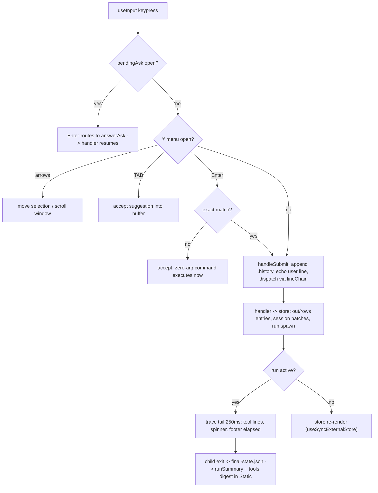

Command dispatch/run-lifecycle sections 1-7 below still describe the behavior
the bootstrap implements; only the RENDERING (section 2's readline loop)
changed — the handler semantics are byte-identical.

## 1. Entry dispatch (`cli/browser-use.js`)

```
+---------------------------+
| argv = process.argv[2..]  |
+------------+--------------+
             v
+---------------------------+     yes
| argv empty or "tui"?      |--------------> import('./tui.mjs')  (REPL)
+------------+--------------+
             | no
             v
+---------------------------+     yes     print CLI command list (run/help/version/tui)
| argv[0] in {help,--help,  |--------------> exit 0
|  -h}                      |
+------------+--------------+
             | no
             v
+---------------------------+     yes     read toolRoot/package.json -> print version
| argv[0] == version        |--------------> exit 0
+------------+--------------+
             | no
             v
+----------------------------------------+
| RUN ROUTE ("run" keyword stripped;     |
| any argv -> run).                      |
|  partition argv: --flags pass through; |
|  positionals joined -> --task "..."    |
|  spawn: node cli/agent-cli.mjs <flags> |
|         --task <joined>                |
|  stdio: inherit (live stream)          |
|  exit with child's exit code           |
|  (0 completed | 2 cancelled | 1 failed)|
+----------------------------------------+
```

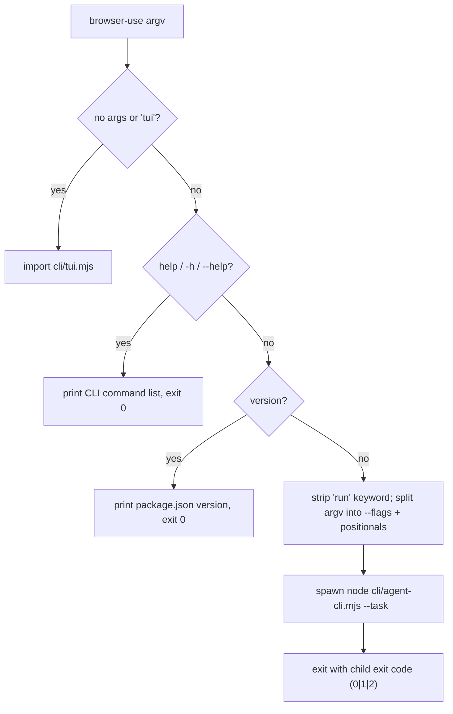

## 2. REPL loop (`cli/tui.mjs`)

```
+-----------------------------------+
| startup: banner (ANSI), read      |
| cli/tui/.history (<=200 lines),   |
| print dim hint line (model/clock),|
| rl.prompt()                       |
+----------------+------------------+
                 v
+-----------------------------------+  no
| line starts with '/'?             |------> echo task hint, prompt again
+----------------+------------------+
                 | yes
                 v
+-----------------------------------+
| split name + argstring            |
| cmd = registry.get(name)          |
|  miss -> red "Unknown command     |
|           /x — /help for the list"|
|  hit  -> try { cmd.handler }      |
|          catch -> red one-line    |
|          error (REPL never dies)  |
+----------------+------------------+
                 v
        append line to .history (cap 200)
        print dim hint line, rl.prompt()
```

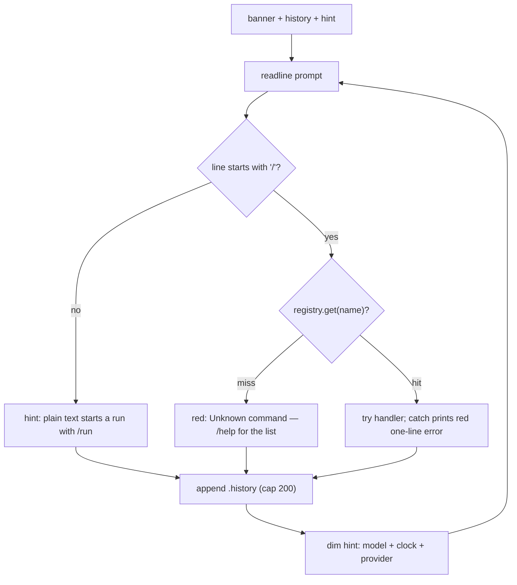

## 3. Completer algorithm (`cli/tui/registry.mjs`, pure)

```
completer(line):
  strip leading whitespace
  line does not start with '/'        -> no completions
  line contains a space (after '/name')
      cmd = get(name); cmd.completeArg?
        -> suggest cmd.completeArg(lastWord) filtered by prefix
      else -> no completions
  else fragment = line after '/':
      fragment ''   -> ALL command names (the "/ + TAB lists everything" rule)
      fragment  n   -> [startsWith(n) first, then includes(n) mid-word]
                       returned as '/name' entries
```

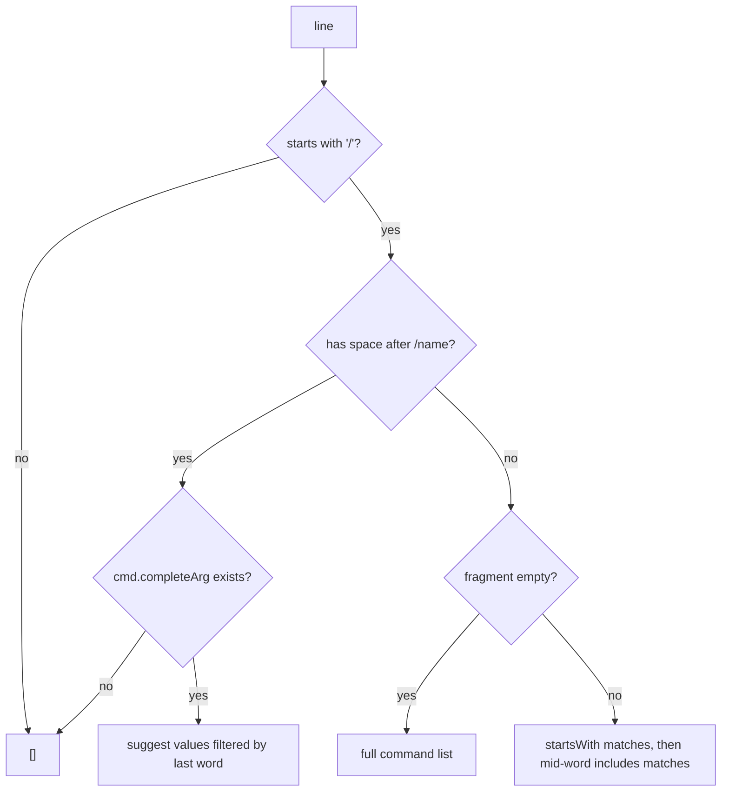

## 4. Run lifecycle (spawns `agent-cli.mjs`, TUI stays responsive)

```
+-----------------------------------+
| /run [task]                       |
|  task empty -> prompt "task>"     |
|  run already active -> refuse     |
+----------------+------------------+
                 v
 outDir = <outRoot>/<YYYYMMDD-HHMMSS>
 spawn node cli/agent-cli.mjs
   --task --model --provider-id [--url]
   [--system-file] [--max-seconds]
   [--max-steps] [--max-recoveries]
   --out-dir outDir --run-id <dirname>
 stdout/stderr piped -> streamed live
 trace.jsonl grows under outDir
+----------------+------------------+
                 v
+-----------------------------------+  exit event
| /status while running: elapsed +  |------------------+
| last tool.started from trace tail |                  v
+-----------------------------------+  +---------------------------------+
| /cancel: taskkill /PID <pid> /T /F|  | read outDir/final-state.json    |
|  (Windows tree kill)              |  | print badges: status, success   |
+-----------------------------------+  | (exit 0), verified (result.     |
                                       | .verified), decisions, tools,   |
                                       | elapsed; record lastRun=outDir  |
                                       +---------------------------------+
```

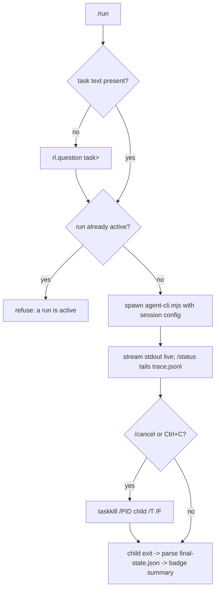

Exit codes mirror agent-cli: 0 completed, 2 cancelled/clock, 1 failed.

## 5. Exit flow (`/exit`, `/quit`, Ctrl+C)

```
+------------------------------+
| /exit | Ctrl+C (idle x2)     |
+--------------+---------------+
               v
+------------------------------+
| run active? -> /cancel first |
+--------------+---------------+
               v
   confirm "exit? (y/n)" via rl.question
      y -> close rl, flush .history, exit 0
      n -> back to prompt
```

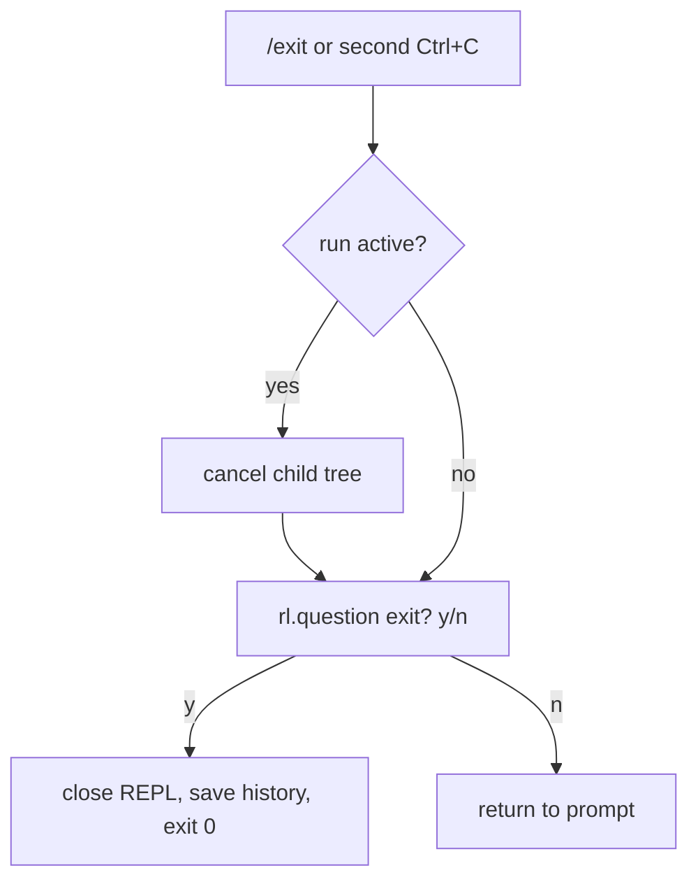

## 6. /doctor

```
read ~/.claude/settings.json env ->
  check1: ANTHROPIC_BASE_URL present
  check2: ANTHROPIC_AUTH_TOKEN present
  check3: GET <base>/v1/models  (Bearer + x-api-key, 8s timeout)
           fail -> POST /v1/messages 1-token probe
  print PASS/FAIL per check (green/red badges)
```

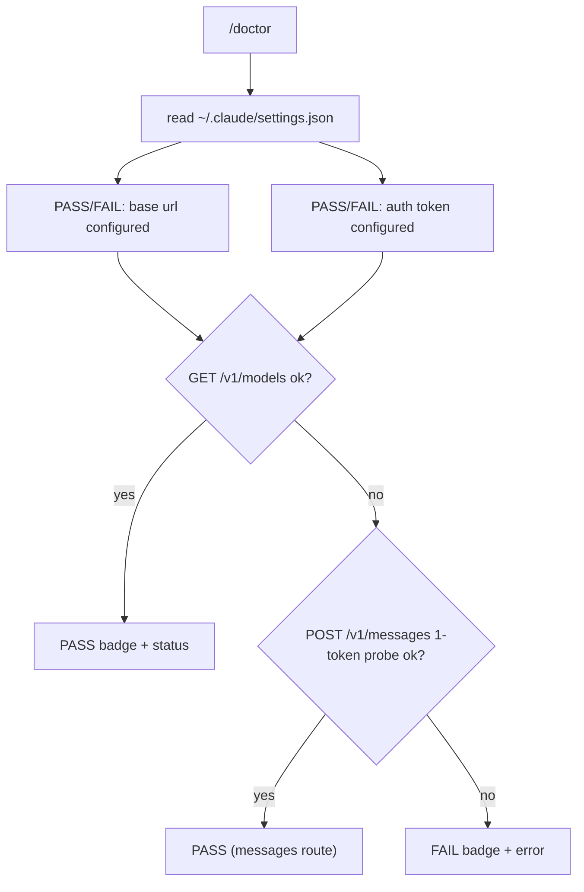

## 7. Global registration

```
package.json += bin {browser-use, browser, lorde} -> cli/browser-use.js
             += scripts."install-cli": "npm link"
route A (primary):  npm link  -> %APPDATA%\npm shims (.cmd, .ps1, bash) -> PATH
route B (fallback): manual shims in %LOCALAPPDATA%\Programs\browser-use-bin
                    (name.cmd for cmd/PowerShell, extensionless for Git Bash),
                    setx PATH if needed
collision check BEFORE: where.exe browser | lorde | browser-use
  found at build time: browser + lorde = free; browser-use = the pre-existing
  tools/browser-use/browser-use.bat|.exe (src/index.js runner) on PATH.
```

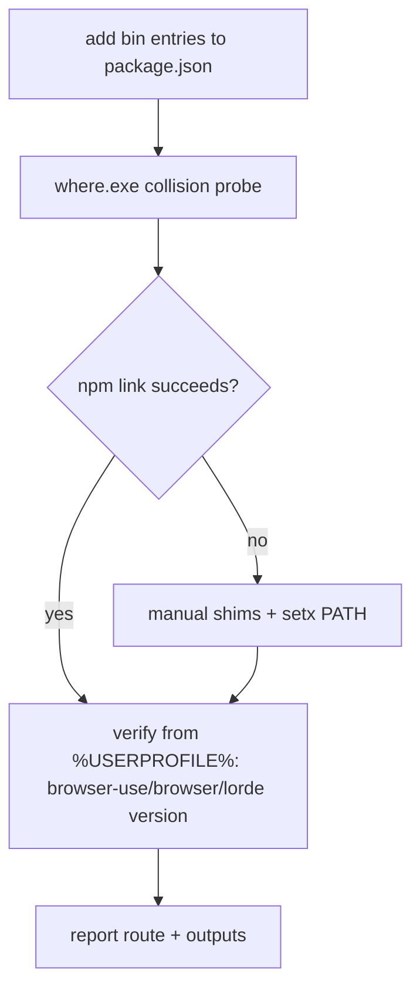

## 11. gen8 UI rebuild: the full-screen alt-screen renderer (2026-10-13)

The TUI now has TWO screen modes behind ONE app contract (`cli/tui/App.mjs`
exports `App({controller})`; `controller.screenMode` picks):

- **FULL** — `FullScreenApp`: Ink 7's native `alternateScreen` render hosts
  ONE framed layout (defect 1: no more floating fragments — the banner is
  replaced by a persistent header; history, live run card, composer and
  footer are fixed regions of a single frame):
  - `cli/tui/screen.mjs` (pure) — `detectScreenMode` gates FULL on a real
    interactive TTY of usable size (>=12 rows, >=60 cols, not CI/dumb term,
    `BROWSER_USE_TUI_FULL=0` opts out); `parseMouseEvent` decodes SGR mouse
    sequences exactly as Ink's useInput delivers them (leading ESC stripped).
  - `cli/tui/historyView.mjs` (pure) — the store's immutable entries become
    styled lines with DETERMINISTIC wrapping (`wrapText`, `entryToLines`,
    `historyToLines`) so the viewport window (`windowLines`) is exact and
    unit-tested. The history region renders exactly `historyRows` lines.
  - Fixed region heights make mouse row-mapping exact: header 3, live run
    card 5 (when a run is active), menu rows = min(items,5) + 1 status row
    when scrollable, prompt 1, footer 1; the history region takes the rest.
  - Mouse: bootstrap writes MOUSE_ENABLE (`?1000h ?1002h ?1006h`) around the
    render and MOUSE_DISABLE on every exit path (ConPTY consumes input-mode
    sequences, so the PROOF is live: wheel scrolls the history window,
    clicking a menu row selects AND executes it — PTY-captured in
    `cli/tui-capture.mjs`). Wheel-up pages back (bottom-anchored offset
    grows), wheel-down returns to the pinned bottom; PgUp/PgDn do the same.
  - Inline fallback: anything that fails the FULL gate renders the classic
    Static layout (`InlineApp`) — unchanged behavior, the tests cover it.

- **RUN LIFECYCLE (defects 2+3):**
  - The duplicate-start race is dead: `startRun` used to check
    `if (child)` only AFTER `await credentialsReady` (the electron
    safeStorage decrypt — seconds), so every submission queued in that
    window spawned its own agent-cli within the same second (four pids, one
    run-id stamp). A SYNCHRONOUS `runStarting` flag now flips before the
    first await and the out-dir is collision-suffixed; the second submission
    is refused with the honest "already starting" error. PTY proof:
    `duplicate-start-guard.log` (staged slow decrypt + two rapid submissions
    -> exactly ONE run dir).
  - NO process plumbing is user-visible: no pid lines, no spawn lines, no
    run-start history line — the live run panel is the ONE card per run.
  - Startup latency: the run card renders the MOMENT the task is submitted
    with the phase NAMED (`resolving credentials…` -> `launching browser…`
    -> live trace events); agent-cli kicks Chrome CONCURRENTLY with its
    module loads (`harness.boot` trace events measured: modules 19ms,
    chrome 1418ms, tab 1771ms — `cli/captures/boot-latency-trace.jsonl`).

- **WORKING REPO (defect 4):** `session.cwd` defaults to `process.cwd()` of
  the INVOCATION (never the tool root, never a hard-coded repo); `/cd <dir>`
  pins it (shown in header + footer + /config at all times); runs spawn with
  `cwd: session.cwd` and pass `--cwd`/`--workspace` to agent-cli, which
  declares it as the run's workspace contract. `browser-use run` one-shots
  do the same from `cli/browser-use.js`. The `desktopChatAgent` promotion
  rule ("a declared workspace is file work") applies unchanged.

```
+----------------------------------------------------------------------+
| >_ browser-use v0.3.6                              z-ai/glm-5.3-flash|  <- header (3)
| model ... * provider ... * repo F:\invocation-dir * headless         |
|======================================================================|  <- rule
|  history window (exactly historyRows lines of pre-wrapped entries)   |
|  ... wheel-up scrolls back, wheel-down returns to the pinned bottom  |
|----------------------------------------------------------------------|
|  > run run-2026-...   12.3s        task snippet...                   |  <- live card (5)
|  . resolving credentials... / launching browser... / in flight...    |
|  last tool / thinking / connection error                             |
|  esc cancels * <working repo>                                        |
|----------------------------------------------------------------------|
|    > /cancel        the cancel command        (menu, <=5+1 rows)     |  <- menu
|----------------------------------------------------------------------|
|  browser-use> _                                                      |  <- prompt (1)
|  model ... * provider ... * repo <basename> * headless * clock * out |  <- footer (1)
+----------------------------------------------------------------------+
```

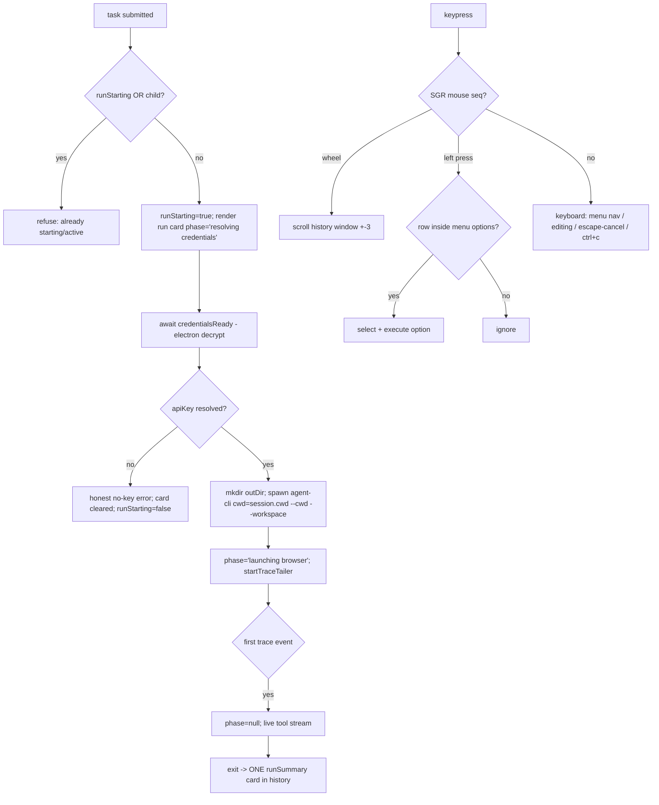

## 11. Four TUI upgrades (2026-10-13): === sandwich, boxed banner title, persistent subagent cards, hover + cursor

Files: `tui/historyView.mjs` (line model), `tui/App.mjs` (Banner + FullScreenApp
mouse layer), `tui/screen.mjs` (motion sequences), `tui.mjs` (spawn wiring).
Tests: `tui/tui.test.mjs` (UPGRADE 1/3/4 sections) + `tui/fullscreen.test.mjs`
(updated sandwich assertions). PTY proofs: `tui-capture.mjs` scenarios
`scenarioBannerBoxedTitle`, `scenarioUserSandwich`, `scenarioHoverAndClick`,
`scenarioSubagentHistoryCard` -> `cli/captures/*.log`.

**UPGRADE 1 — `===` sandwich around user submissions.** The full-screen line
model renders every `kind:'user'` entry as THREE parts: a terminal-width
`====…====` bar, the untouched `browser-use▸ <text>` echo, and the bar again
(uid-keyed `u-<id>-top#n` / `u-<id>#n` / `u-<id>-bottom#n`; bar color
theme.AccentDim). Scroll math shifts (4 lines per `/task` submission).

```
+----------------------------+
| ========================== |  <- bar (terminal width)
| browser-use> buy shoes ... |  <- user text, untouched
| ========================== |  <- bar (terminal width)
| [run output / error ...]   |
+----------------------------+
```

**UPGRADE 2 — boxed banner title.** The info panel title renders
`|browser-use| (v0.3.6)`: the two pipes in the lime accent (theme.Accent,
bold), the name in bold primary, the version label unchanged. The full-screen
header keeps its own `▸_ browser-use` heading.

**UPGRADE 3 — persistent subagent history cards.** A spawn now does TWO store
writes: the live `subagents` record (as before) AND a `kind:'subagent'`
history entry below the user's `===` sandwich. The card line is
` ▸ subagent <alias> — <status>` with a `subagent-history#<alias>#<n>` key;
`entryToLines(entry, width, ctx)` resolves the status from the LIVE
`ctx.subagents` record each render, so status updates flow into the card
while the run is active and the card survives run end (the store keeps the
subagents array after finishRun).

**UPGRADE 4 — hover, cursor placement, click.** The frame-anchor map: every
render rebuilds `anchorMapRef.current` — one `{row,key,type,alias,index}`
per clickable row (menu/picker rows, the live roster, the main run card, and
the persistent subagent card lines inside the history window). Motion events
(`?1003` any-motion, decoded by parseMouseEvent as kind 'motion') hit-test
that map; only a hovered-row CHANGE writes `state.hover` (change-gated — the
every-pixel motion stream never floods the renderer). A hovered row that
leaves the screen clears the hover (staleness effect). Rendering applies the
hover styling (lime + bold + `◂` pointer) at render time so the line model
stays pure. ?1003h/?1003l are toggled by an effect while/only-when clickable
rows exist, written to the REAL process.stdout (not ink's frame stream), and
restored on every exit path (`MOUSE_DISABLE + MOTION_DISABLE`). The terminal
cursor parks on the hovered row (`ESC[{row};1H` + show) and hides otherwise.

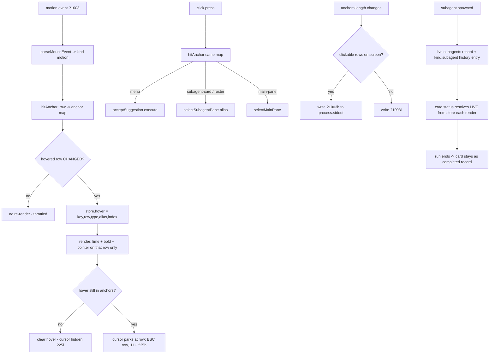

## 12. gen8 UNIFICATION (2026-10-13, final): ONE coherent TUI assembled from the three campaign arms

The botched /MIR left `cli/` a mix of the stale pre-campaign TUI and later
additions. The unified build below is what now ships in `cli/` — assembled on
**gen8-arch2's architecture** (native Ink 7 `alternateScreen`, the pure
`historyView.mjs` line model, `screen.mjs` mode detect + SGR parse) with the
other arms' wins ported in, plus the queue/subagent backends that were already
intact on E:.

### What came from where

| Piece | Source | Where it lives now |
|---|---|---|
| Full-screen base: `screen.mjs` detect, `historyView.mjs` line model, fixed-height `FullScreenApp`, boot-latency trace (`harness.boot.*`) | gen8-arch2 | unchanged files |
| `mouse.mjs`: batched SGR parse (several events per chunk), X10 swallow, frame-anchor geometry, EPIPE-safe enable/disable | gen8-arch1 | `cli/tui/mouse.mjs` (ported), used by the composer |
| Bracketed-paste stripping (`\x1b[200~`/`\x1b[201~`) | gen8-arch1 | composer paste path + plain typing path |
| Same-task dedupe window (`startingTask` silent drop + `failedTask` 2.5s burst guard) | gen8-arch3 | `startRun` in `cli/tui.mjs` |
| Frame-anchor click hit-testing (arch1 yoga geometry, arch3 fixed-layout proof) | arch1+arch3 | `FullScreenApp` anchor map (deterministic row math — the fixed-height layout makes it exact without yoga) |
| Mid-run queue + continuations, subagent runtime + cards, /auth //key, computer-tools wiring | pre-campaign E: (kept intact) | `agentRunQueue.mjs`, `cliSubagents.cjs`, `agent-cli.mjs`, `tui.mjs` |

### Contract decisions (supersede the stale "UPGRADE 1" wording in section 11)

- User submissions render as a **plain `browser-use▸ text` echo** in history —
  NO `===` sandwich around sent messages. The `===` sandwich lives on the
  **composer**: two constant full-width bars bracketing the typing field
  (`COMPOSER_BARS = 2` in the height math).
- Run summaries: a bordered card containing ONLY the reply (failures show the
  `✗` error instead); ONE dim economy line BELOW the card
  (`▸ run <name> <status> · N decisions · N tools · elapsed`). No
  name/status/verified clutter inside the card. (This also fixed a real crash:
  `runSummaryLines` called `uid()` out of scope — every summary render threw,
  which is what hung the queueing E2E.)
- Subagent cards: persistent `▸ subagent <alias> — <status>` history entries
  whose status resolves LIVE from the store record; a live roster under the run
  card (`— click to view` / `— viewing (esc for main run)`) while a run is
  active; click switches panes, Escape returns to main.
- Hover: ?1003h any-motion, change-gated; clickable rows = menu/picker rows,
  subagent history cards, roster rows, main run card; the picker cursor parks
  on the hovered row; hover auto-clears when its row stops being clickable.
  Mouse mode is boot-once: ?1003h (?1000/?1002/?1006 with it) is written ONCE
  by the bootstrap BEFORE ink mounts and ?1003l ONCE on every exit path — the
  App never writes control sequences (per-render toggling interleaved raw
  bytes with ink's frame stream: coordinate garbage over the banner, constant
  repaints — owner fix 2026-10-13). Untracked/ignored motion is decoded and
  dropped in the store; mouse-shaped residue (split SGR sequences, trailing
  fragments) is swallowed by the composer and never reaches the input. ALL
  dynamic content (run card, roster, queue count) renders ABOVE the composer
  sandwich; the footer is static.

### Unified frame layout (fixed heights — the anchor map's source of truth)

```
+------------------------------------------------------+
| header (3)  logo / model / provider / repo / border  |
+------------------------------------------------------+
| history window (H = rows-3-run-roster-menu-4-2)      |  <- windowed,
|  ... plain echoes, cards, summary cards ...          |     scroll offset
+------------------------------------------------------+     from bottom
| live run card OR subagent pane (5, when a run lives) |
| live subagent roster (1 per subagent, run active)    |
| notice (0/1)          completion menu (0/6)          |
| ===================================================  | <- composer bar 1
| browser-use▸ <typing field>                          | <- prompt (1)
| ===================================================  | <- composer bar 2
| footer (1)  elapsed · model · repo · clock · queued  |
+------------------------------------------------------+
```

### Unified submit + click/hover flow

```
ASCII:
  submit text
    |
    v
  [run active?] --yes--> queueMessage: dim [queued - text] card
    | no                        + stdin {"type":"queue",...} + footer count
    v                                    | run terminal state
  startRun guard chain                   v
    child? -> refuse             agent-cli runWithQueue continuation
    starting+same task? -> silent dedupe (arch3)
    starting+other task? -> "already starting"
    failed<2.5s same task? -> silent
    v
  run card (resolving credentials...) -> spawn -> trace tailer -> live pane
    v
  summary card (reply | +-- error) + dim economy line

Mermaid:
graph TD
  A[submit] --> B{child active?}
  B -- yes --> C[queueMessage: queued card + stdin control line]
  C --> D[runWithQueue continuation after terminal state]
  B -- no --> E{startingRun?}
  E -- same task --> F[silent drop]
  E -- other task --> G[refuse: already starting]
  E -- no --> H[startRun: card renders immediately]
  H --> I[spawn agent-cli + trace tailer]
  I --> J[live pane: tools / thinking / lastError]
  I --> K[harness.subagent.* -> persistent card + roster + own tailer]
  I --> L[exit -> summary card reply-or-error + economy line]
  M[SGR mouse chunk] --> N[parseMouseEvents batched]
  N --> O{kind}
  O -- wheel --> P[scroll history window]
  O -- motion --> Q[frame-anchor map lookup]
  Q --> R{row changed?}
  R -- yes --> S[store.hover write + cursor parks]
  R -- no --> T[no re-render]
  O -- press --> U[anchor act: menu execute / pane switch / main]
  V[clickable rows 0] --> W[setMotionTracking false: 1003l]
  X[clickable rows > 0] --> Y[setMotionTracking true: 1003h]
```

### Verification state (this unification)

- `cli/tui/fullscreen.test.mjs` 10/10; `cli/tui/tui.test.mjs` 50/50 (+1 opt-in
  smoke skip); `tests/gen8-subagents.test.mjs` 9/9; `tests/cli-computer-backend.test.mjs`
  13/13 (untouched). All suites run sequentially.
- PTY proof: `node cli/tui-capture.mjs` 43/43 checks, exit 0 — captures in
  `cli/captures/` (full-screen frame, boxed banner, plain echo + composer
  sandwich, menu click, wheel, hover+click, subagent card, run card, duplicate
  start guard, /cd pin, inline fallback).
