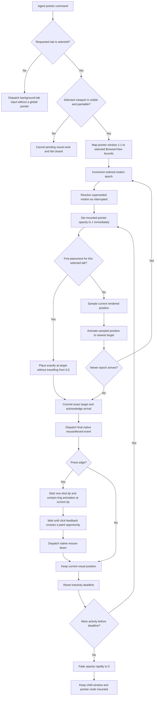

# Desktop agent pointer overlay flowchart

## Purpose

The Browser-use desktop app renders one app-owned agent pointer above the
selected native `BrowserView`. The pointer is not inserted into the controlled
page and never listens to page events. A transparent, input-ignoring child
`BrowserWindow` keeps the visual surface alive across page navigation, DOM
replacement, and renderer changes.

The pointer node is created once with opacity `0` and remains mounted through
normal desktop-window operation. Agent pointer activity raises opacity to `1`
immediately. After one minute of inactivity it fades rapidly back to `0`; inactivity never
deletes, recreates, or resets the node. A genuinely crashed or unresponsive
pointer renderer is hidden and replaced automatically before the next action.

## ASCII process flow

```text
+----------------------------+
| MCP or built-in AI action  |
| mousemove/down/up/wheel    |
+-------------+--------------+
              |
              v
+----------------------------+
| BrowserViewController      |
| validate tab + coordinates |
+-------------+--------------+
              |
              v
+----------------------------+       background tab
| Selected tab?              | ------------------------------+
+-------------+--------------+                               |
              | yes                                          v
              v                                  +------------------------+
 +----------------------------+                  | Native input only;     |
 | Viewport visible?          |                  | do not paint globally  |
 +-------------+--------------+                  +------------------------+
       no      | yes
       |       v
       |  +----------------------------+
       |  | Pointer motion epoch N     |
       |  | cancel stale epoch N - 1   |
       |  +-------------+--------------+
       v                |
+--------------------+  |
| Cancel and fail    |  |
| closed while hidden|  |
+--------------------+  |
                        v
+----------------------------+
| Transparent child window   |
| bounds = BrowserView bounds|
| mouse input passes through |
+-------------+--------------+
              |
              v
+----------------------------+
| Permanently mounted pointer|
| opacity := 1 immediately   |
| animate current -> target  |
+-------------+--------------+
              |
       +------+------+
       |             |
       v             v
+-------------+  +------------------+
| arrival ack |  | inactivity timer |
+------+------+  +--------+---------+
       |                  |
       v                  v
+-------------+  +------------------+
| native move |  | rapid fade to 0  |
| at arrival  |  | node stays alive |
+------+------+  +------------------+
       |
       v
+----------------------------+
| press? start tip + ring    |
| at the exact arrival point |
+-------------+--------------+
              |
              v
+----------------------------+
| painted feedback ack, then |
| native down and safe up    |
+----------------------------+
```

## Runtime flow



## Motion algorithm

Only one motion state exists:

```text
state = {
  tabId, epoch, operationId, paintToken,
  currentX, currentY,
  startX, startY,
  targetX, targetY,
  startedAt, durationMs,
  pressed, lastActivityAt
}
```

For each animation frame:

```text
distance = sqrt((targetX - startX)^2 + (targetY - startY)^2)
durationMs = clamp(140 + distance * 0.35, 140, 360)
t = clamp((now - startedAt) / durationMs, 0, 1)
eased = 1 - (1 - t)^5
currentX = startX + (targetX - startX) * eased
currentY = startY + (targetY - startY) * eased
```

When a newer target arrives, the state machine samples the current rendered
position at that instant and uses it as the next start. The old epoch cannot
write another frame or dispatch its stale final native move.

## Visibility and click loops

- **Activation loop:** every accepted move, down, up, or wheel command cancels
  the old inactivity token and sets opacity to exactly `1` with no fade-in.
- **Built-in AI loop:** `browser_mousemove` is a first-class, non-mutating
  action grounded in the latest visible viewport. It uses the same cancellable
  controller path as MCP movement, so a model can visibly park the pointer
  without faking placement with a click or drag.
- **Inactivity loop:** after a full 60-second idle hold, opacity transitions
  quickly to `0`. The child window, pointer node, and last coordinate remain
  intact.
- **Click loop:** native down waits for the pointer arrival acknowledgement,
  starts one independent tip compression/rebound animation and one contact ring
  at the exact current coordinate, waits for that state to paint, and only then
  dispatches native down. Native up does not create a second click animation.
- **Layout loop:** move, resize, maximize, restore, drawer, terminal, and device
  changes recompute both the selected `BrowserView` and child pointer bounds.
  A settled pointer outside a shrunken viewport is clamped visibly inside it;
  pending input continues only when its exact coordinate remains valid. During
  a valid mid-motion shrink, the sampled current point is clamped into view and
  the same operation is rebased toward its still-exact destination. A completed
  low-level down that is still held is explicitly released before a size change,
  because its old coordinate cannot remain 1:1 with a different viewport.
- **Selection loop:** switching tabs hides and reinitializes only the visible
  pointer state. Background-tab input never paints over the selected page.
- **Recovery loop:** readiness and paint acknowledgements are bounded. A hung or
  crashed child renderer is hidden immediately and replaced, so its last frame
  cannot freeze over the page or release a late native action.
- **Cancellation loop:** per-session, per-tab, and global generations prevent a
  revoked run, closed tab, or shutdown from committing an awaited late press.
  The exact active operation id is also sent to the overlay, which samples and
  freezes only that trajectory; an older session cannot cancel a newer one.
- **Drag loop:** long drags are normalized into painted segments of at most
  `300ms`, below both the renderer's `360ms` motion ceiling and acknowledgement
  timeout. This keeps opacity active and native hit-testing aligned for the
  full requested gesture duration.

## Invariants

1. The controlled page contains no Browser-use pointer nodes, styles, scripts,
   listeners, or visualization calls.
2. One transparent child `BrowserWindow` and one pointer DOM node exist during
   healthy operation; only a crashed or unresponsive pointer renderer is
   replaced, never the controlled page.
3. The child window is frameless, focusless, click-through, and bounded exactly
   to the selected native browsing viewport, so visual `(x, y)` equals native
   input `(x, y)`.
4. Only ordered main-process pointer messages can change the visual pointer.
5. A newer motion epoch always wins. Superseded animation frames and native
   final moves cannot reappear later.
6. First placement never travels from `(0, 0)`. Later movement starts at the
   currently rendered point, including when a previous movement is interrupted.
7. Opacity becomes `1` immediately on activity, stays visible for one minute,
   and then rapidly becomes `0`. Visibility never controls node lifetime.
8. Click feedback originates at the current pointer tip after arrival and is
   independent from the movement transform.
9. Navigation and page DOM replacement cannot detach the pointer because the
   pointer belongs to a separate app-owned renderer.
10. Pointer visualization failures time out safely; they cannot leave a mouse
    button held or redirect input to another tab.
11. Every native drag coordinate waits for that exact visual coordinate to
    paint; page hit-testing never runs ahead of the visible pointer.
12. Ending a session releases every tracked native button and clears visual
    pressed state without moving the pointer to the recovery `(0, 0)` point.
    A selected and paintable surface may use Electron native input. Hidden,
    minimized, invalidated, detached, or background cleanup uses the exact
    tab-scoped CDP channel, because selection alone does not prove a Windows
    compositor surface exists. A pending cleanup marker suppresses the caller's
    matching late up only after delivery succeeds. Cleanup also joins an
    ordinary asynchronous CDP release already in flight and retries only if
    that first delivery rejects, so one physical edge produces one page event.
    A new press of the same owner, tab, and button waits for that release to
    settle before it can be tracked or dispatched; an older completion can
    therefore never erase the state of a newer held press. Its operation token
    is captured before the wait, so revocation cannot resume it under a fresh
    post-cancellation generation.

## Verification contract

- A real Electron test inspects the dedicated pointer child renderer.
- A paired MCP action must still produce trusted page input.
- Movement must expose multiple monotonic rendered positions, settle at the
  newest coordinate, and remain there after an interrupted epoch's deadline.
- Opacity must be `1` immediately after activity and `0` after the bounded idle
  plus fade interval, while node identity remains unchanged.
- Navigation and full page DOM replacement must preserve the pointer renderer
  and pointer node identities.
- Drawer resize, minimize/restore, and viewport shrink must keep bounds aligned,
  clamp an old edge position or mid-motion current point, and cancel only input
  whose exact destination is invalid.
- A forced pointer-renderer crash must hide the stale frame, replace the child
  surface, and make the first subsequent action immediately visible. Capture the
  failed window's visibility from its `render-process-gone` event after the
  production handler, then assert its destruction and the replacement's distinct
  WebContents identity. Polling the currently registered child can miss the short
  hidden interval and mistake a healthy replacement for the crashed frame.
- Revoking a real paired session during movement must freeze the pointer at its
  sampled current point; revoking after standalone down must produce one trusted
  release edge and clear visual pressed state.
- A CDP-delivered background-tab down followed by revocation must receive one
  trusted release in that same detached tab and no duplicate release.
- A selected Electron-native down followed by minimize or hide must receive one
  trusted CDP cleanup release while hidden; its planned late up is consumed.
- A long drag requested with too few steps must be subdivided so no visual
  segment can idle or fade before the next native drag coordinate.
- Page inspection must always find zero Browser-use cursor nodes.
