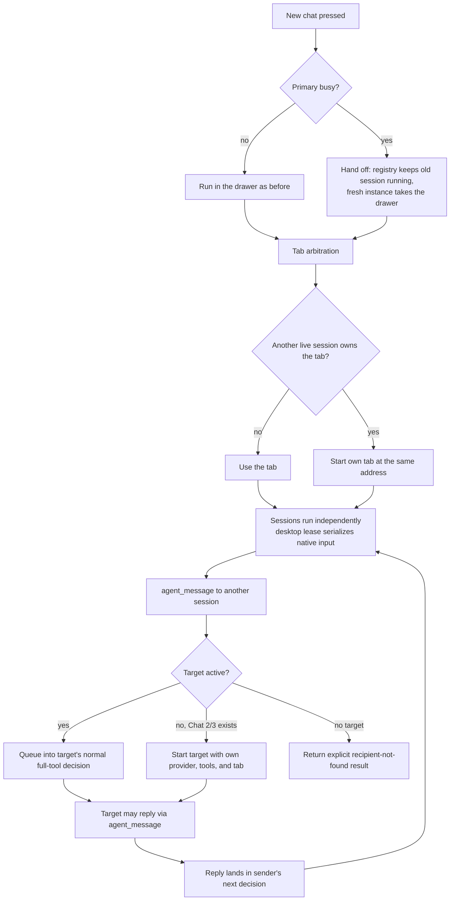

# Live sessions, tab arbitration, agent_message — Flowchart

## Purpose
ChatGPT-style sessions: every chat is an independent instance. Starting a new
chat never kills the previous one — the busy conversation is HANDED OFF to a
live-session registry and keeps running with its own tab and tools while a
fresh instance takes the drawer. Sessions coordinate through `agent_message`
instead of fighting for tabs, files, or device control.

## Agent identities

- `agent1` = Chat 1, the primary drawer.
- `agent2` = Chat 2, the first independent chat.
- `agent3` = Chat 3, the second independent chat.
- `any` rotates through the other live identities instead of repeatedly selecting the first target.
- An incoming message wakes a passive `browser_wait`; the next normal decision receives it with full tools.

## Participants
- `desktop/main.cjs` — `chatSessions` registry (handed-off instances), busy-primary handoff in `agent-start`, tab arbitration (`findLiveTabOwner`), `agentMessageHub`, `liveSessions` in state, console entries.
- `desktop/agent/desktopChatAgent.cjs` — `agent_message` tool and `receiveAgentMessage` inbox; messages enter the receiver's normal full-tool decision context.
- `desktop/agent/agentPool.cjs` — pre-existing parallel background instances (task_spawn), tab-scoped browser parallelism, and a short native-focus lease only for physical desktop input.
- `desktop/renderer/app.js` — live sessions at the top of the history drawer; `agent.message` transcript cards.

## Process flow (ASCII)

```
  new chat pressed while primary is BUSY
  +------------------------------------+
  | agent-start (main.cjs)             |
  +----+-------------------+-----------+
       |                   |
       v                   v
  +----------------+  +---------------------------+
  | primary idle ->|  | primary busy -> HANDOFF:  |
  | run as before  |  | chatSessions.set(id, inst)|
  +----------------+  | fresh instance takes the  |
                      | drawer; old session keeps |
                      | running, tools intact     |
                      +---------------------------+
       |
       v
  +------------------------------------+
  | tab arbitration: does another live |
  | session own the requested tab?     |
  +----+--------------------------+----+
     no|                       yes|
       v                          v
  use the tab as asked   create OWN tab at the same
                         address; console: "[Sessions]"
       |
       v
  runs proceed (desktop lease serializes native input)

  agent_message (model tool, risk read)
  +------------------------------------+
  | run.messageApi.send(from, to, text)|
  +----+--------------------------+----+
       v
  +------------------------------------+
  | hub finds live target by id prefix |
  | or 'any'                           |
  +----+--------------------------+----+
     no|                       yes|
       v                          v
  {sent:false, note}     target.receiveAgentMessage
       |                       |
       |                       v
       |             inbox += entry (<=6 kept)
       |             publish 'agent.message'
       |                       |
       |             active target: next full-tool decision
       |             idle Chat 2/3: start full-tool run on own tab
       |                       |
       |             receiving agent may reply via hub
       |             sender's next decision context
       |             carries agentMessages ONCE
       +---------------------------+
```

## Mermaid flow



## Guarantees
- Starting a new session never cancels or disturbs a previous one; every live session keeps its own tab, plan, and tool access.
- Tab fights are impossible at start: an owned tab is never reused — the new session gets its own tab at the same address.
- Replies are reply-flagged and never auto-answered again, so messaging cannot loop.
- Messages are delivered into exactly ONE decision context, then cleared; the inbox and hub never cross IPC in run snapshots.
- Active messages enter the receiver's normal full-tool decision context; idle Chat 2/3 instances start a real independent run with their own provider, tools, and tab.
- Browser tab/file/terminal work coexists per agent; only physical desktop focus is serialized. Waiting agents receive a focus request/availability message and continue automatically.
