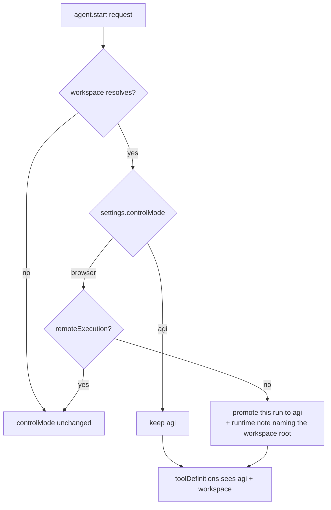
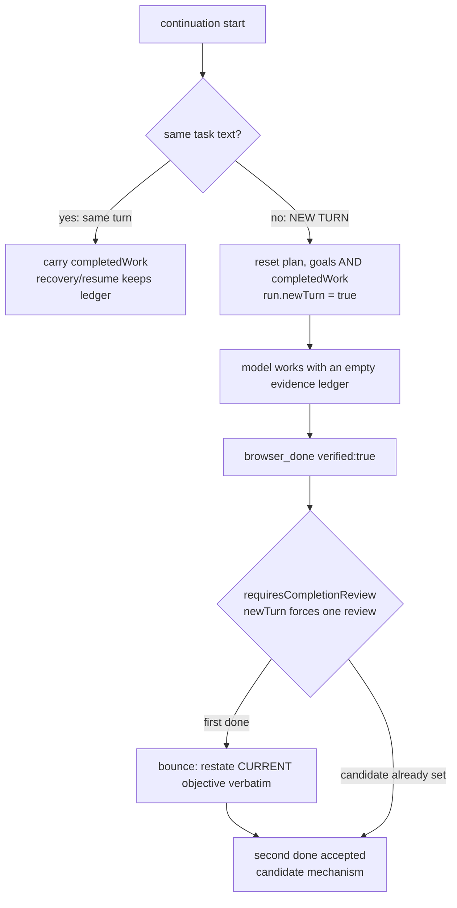

# Agent Coding Gating, Turn Boundary & Context Budgets — Flow Chat

Covers the repair of the 2026-10-01 failure report: a "fix favourites" run lost its
computer tools, ran on the wrong playbook, concluded by reporting the *previous*
task's (effects) fix, and patched files it had only seen through truncated reads.

## 1. Coding-task detection (one shared detector)

```
+---------------------------+        +-------------------------------+
| User task text + optional |        | isCodingTask(task, workspace) |
| workspace path            +------->+  (computerCatalog.cjs)        |
+---------------------------+        +---------------+---------------+
                                                     |
        keyword regex (code|file|patch|edit|...)     |  workspace.root declared
        +--------------------+----------------------+--------------------+
        | yes                                     | yes                      |
        v                                         v                          v
+----------------+                    +---------------------+    +--------------------+
| toolDefinitions|                    | agiPromptForTask -> |    | codingCheckSatisfied|
| coding subset  |                    | "Native coding mode"|    | (test/check gate)   |
| of computer_*  |                    | playbook            |    |                     |
+----------------+                    +---------------------+    +--------------------+
```

Before the repair, each site ran its own copy of the keyword regex. A task like
"fix the favourites toggle" matched none of the keywords, so:

- browser-mode run -> ZERO computer_* tools (every file action failed with
  "Computer tools require AGI mode");
- agi-mode run -> full pointer/3D playbook instead of the coding rules;
- the workspace path the user pasted into the task was ignored everywhere.

After: one exported `isCodingTask(task, workspace)`; a declared workspace root
counts as coding everywhere.

## 2. Workspace promotion (browser -> agi for this run)



## 3. Turn boundary evidence reset



Root cause of the wrong-task completion: `createCoordinatorState` was seeded with
the closed task's `completedWork`, so the new run's `evidenceVerified` gate was
satisfied by mutations the new task never performed.

## 4. computer_* output compaction budget

```
tool result (executor output)
        |
        v
compactComputerOutput(output, tool)
        |
        +-- computer_read -> content budget 64k chars (whole-file reads survive)
        +-- everything else -> shared 16k budget, arrays capped at 64
        |
        +-- on trim: contextTruncation entry now carries an actionable note
            ("re-read with offset past the last retained line")
```

Before: the shared 16k bound silently cut a 1,211-line read to roughly a third
while the executor metadata still said `truncated: false` — the model believed
it had read the whole file and patched context it had never seen, which is also
where the failing computer_patch errors came from.

## 5. Poisoned conversation (context management)

Reported: a long chat fails; after that, every new message in that chat fails
too — even after restarting Browser-use — until a new chat is started.

```
turn 1 stored request embeds history: <entire run history blob>
        |  (providerTurnLedger.begin -> accept stores it forever)
        v
every later wire message replays the blob          <- grows with chat length
        |
compaction tries to summarize it
        |-- summary request oversized -> gateway 403/413 -> throw
        |-- or single group > summaryBudget -> CONTEXT_BUDGET_BLOCKED
        v
failOpen: trims only by TURN COUNT (maxTurns)      <- size never bounded
        v
decision request still oversized -> provider error -> silent recovery loop
        v
checkpoint snapshot preserves the poison           <- restart does not heal
```

Repairs (providerTurnLedger.cjs):

1. `begin()` stores a bounded request: the live first request still carries the
   full history for that one decision, but the STORED blob replaces it with
   `historyOmitted: true, historyEntries: N` — the ledger replays the real
   turns itself.
2. `normalizeLedgerSnapshot()` strips embedded `history` from restored turns,
   so existing poisoned checkpoints heal at load time.
3. `failOpen()` is now size-aware: when compaction fails, oldest turns are
   evicted until the wire fits the byte floor (not just until maxTurns).
4. Summary input is field-bounded (`summarizeSafe`, 4k strings), so one giant
   group can no longer make every future compaction attempt fail, and the
   summary request itself stays small enough for size-gated gateways.

## 6. Effort demotion on low-yield speculation ("larping")

Reported: long speculative "Thought for 45s" monologues before every action,
and slow investigation even when the user supplied all the details.

```
run starts (auto) -> effortTier = advanced
        |
OpenAI-compatible route: advanced OMITS reasoning_effort
        v
provider's own (unbounded) reasoning budget per decision   <- 30-60s each
        |
before: only the MODEL could step the ladder down
        (models never request demotion; needSignals was ignored)
        v
now: per-decision thinking delta measured (accumulator is cumulative,
     so use length - thoughtBaseChars)
        |
low-yield decision = NO executable action at all
 (empty response, plan-only, or >16k thinking chars without one)
        |
2 consecutive low-yield decisions -> tier demoted one rung
 (advanced -> standard -> minimal; reset by any executable decision)
```

Real work is never penalized: a long-thinking investigation that ends in a
read/click/patch is an executable decision and never counts as low-yield, and
the terminal done decision is excluded too.

## 7. Evidence economics: index once, read once, never re-pay

Reported: `computer_read`/`computer_search` made the agent slow — ~40 provider
round trips before the first patch, re-reading files it had already read.

The tool EXECUTION was never the bottleneck (ripgrep is millisecond-scale);
the cost is provider round trips plus re-purchased evidence. Design after
aider's repo map (https://aider.chat/docs/repomap.html):

```
decision 1 (evidence batch, ONE round trip)
  computer_index  -> repo map: every file + symbols + line numbers
                     (bounded chars; per-file cache keyed by mtime+size,
                      so rebuilds after edits re-read only changed files)
  computer_search -> ONE exact-symbol query
decision 2
  computer_read   -> smallest section holding the cause
decision 3
  computer_patch  -> the fix
```

Supporting mechanics:

- `computer_index` (new tool, coding subset): walk-once symbol map with
  `file=<path>` single-file outline mode and a character budget; session
  cache makes rebuilds incremental.
- Session read ledger (`computer_read`): a re-read of unchanged content
  carries `notice: "Unchanged since your earlier read covering lines X-Y…
  quote that held evidence instead of re-reading"` (content-hash keyed).
- Repeat-search memory (`computer_search`): an identical query is flagged as
  held evidence — catches near-duplicate query loops that the
  five-identical-results guard never sees.
- Consulted-evidence ledger: every read/search/index lands in
  `workingMemory.consulted` (bounded, preserved across continuation), and the
  coding playbook tells the model NEVER to re-read or re-search a ledger
  entry unless its own mutation changed the file. (boundedRequestContext
  carries the ledger through to the real request.)

## 7b. computer_index v2: a real per-line inverted index

User direction (after the map-only version failed on the real repo):
"programs like Listary make indexes and return results as fast as possible —
per-file line level, not just file names — joined with sorting, filters and
ranking so tool counts become near-singular. And do NOT drop the docs — some
of them cover real persistent bugs."

```
build (once per session, incremental after)
  walk workspace -> every text file (docs, code, css, json, logs)
  per file: cache {mtimeMs, size, lines, tokens-per-line}
  postings: token -> [packed file-id:line]   (ints, memory-compact)
  changed file (mtime+size) -> drop its old postings, re-tokenize it only

query=<terms>  ->  ranked file:line hits WITH snippets
  rarity-weighted tokens (rare token localizes, common token is boilerplate)
  AND-semantics: a line must match >= half the terms
  compound tokens indexed with parts: "aspect-ratio" answers "aspect ratio"
  minified lines (>2000 chars) skipped — they match everything
  warm queries: ~100ms across ~1700 files; cold build: ~4s

map mode (no query) -> structural overview, goal-ranked, DOCS COMPETE EQUALLY
  (demoting docs hid the persistent-bug history the user wrote down — never
   again; omission is stated per-directory instead)
```

## 8. Laya delivery and ranking (the silent layer)

Reported: Laya "isn't being utilized in its strongest areas (ranking); when
on, why isn't it on?"

Two silent drops, both now fixed:

```
agent.verifyWithLaya(run, observation)
        |  verifier.verify({observation, action, domain, task})
        v
layaDecision.verify  ->  ONE predict per observation
        |-- browser: page_changed / effect_visible / needs_attention (noul)
        |-- NEW  best_next_target (choice): goal-overlap RANKING of the
        |        observation's candidate controls against run.task
        |        (engine bestActionAnswer: overlap + launch-first + margin
        |         -> calibrated confidence; below 0.6 = omitted)
        v
run.layaVerification = {brain, tookMs, answers}
        |
BEFORE: provider.complete() signatures did not even accept the parameter —
        the answers were computed, published to the console, and dropped.
AFTER:  layaVerification is threaded through all three providers into
        boundedRequestContext and rides on the next decision as an advisory,
        self-describing annotation.
```

Also fixed in the same pass: boundedRequestContext rebuilt `workingMemory`
from scratch, silently dropping the consulted-evidence ledger.

## 9. chat_compact tool + /compact /goal /plan

```
MODEL:  chat_compact {reason}  -->  forceCompactRun(run)
USER:   /compact               -->  forceCompactRun(run)   (immediate)
USER:   /goal <a; b>           -->  applyPlanUpdate(goals)  -> steerNow announce
USER:   /plan <a; b>           -->  applyPlanUpdate(plan)   -> steerNow announce
USER:   /anything-else         -->  passthrough as a normal steer

forceCompactRun -> ledger.compact({force: true, summarize: provider.summarizeFor})
  - force bypasses the 90% fill threshold
  - every exit path returns {compacted, turnsBefore, turnsAfter}
  - objective is pinned and never compacted away
  - unknown-slash passthrough must NOT re-enter the interceptor (steerNow)
```
