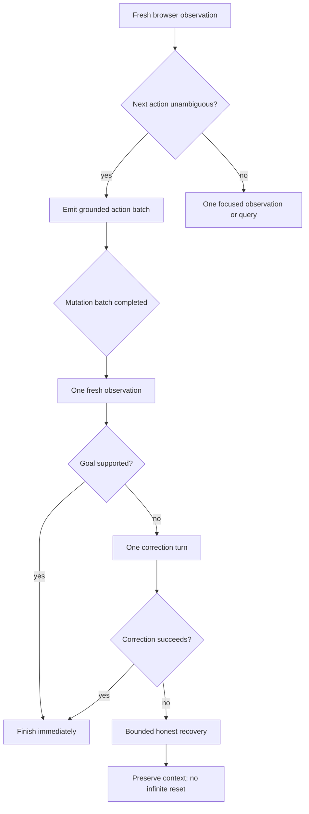

# Browser-use fast-path and bounded recovery flow

## ASCII flow

```
+-----------------------------+
| Fresh browser observation   |
+--------------+--------------+
               v
+-----------------------------+
| Is next action unambiguous? |
+---------+-------------------+
          | yes
          v
+-----------------------------+
| Emit 1..N grounded actions  |
| already supported by state  |
+--------------+--------------+
               v
+-----------------------------+
| Observe only after mutation |
| batch, unless task is done  |
+--------------+--------------+
               v
+-----------------------------+
| Done supported by evidence? |
+---------+-------------------+
     yes  |          no
          v           v
+---------+---+   +---+------------------+
| Finish now  |   | One correction turn |
| no review   |   | with fresh evidence |
+-------------+   +----------+-----------+
                              v
                    +---------+----------+
                    | Bounded recovery   |
                    | no infinite resets |
                    +--------------------+
```

## Mermaid



## Invariants

1. Browser tasks do not receive native-app, CAD, terminal, or drawing instructions unless they use native computer tools.
2. A clear next action is executed immediately; no mandatory plan, research, or redundant observation is inserted.
3. Actions that are already grounded may be batched. Dependent actions wait for their required fresh result.
4. A mutation batch gets one fresh observation. Verification is evidence, not an additional planning ceremony.
5. Duplicate coordinates and duplicate indexed mutations are not dispatched again against unchanged evidence unless the model explicitly marks `repeat:true` with a distinct expected outcome.
6. Recovery preserves the full task context but has a finite correction budget. It does not reset indefinitely.
7. Simple browser tasks finish as soon as the observable requested outcome is present.
8. Interaction memory keeps layout identity separate from content identity; resize/zoom/window changes invalidate geometry, while opponent/content changes preserve it.
9. Coordinate actions are grounded against the current interaction frame; a resize is carried into the next observation instead of triggering blind retries or full task remapping.
