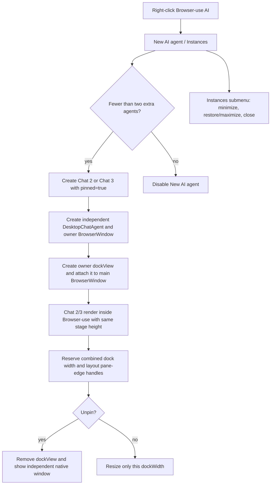
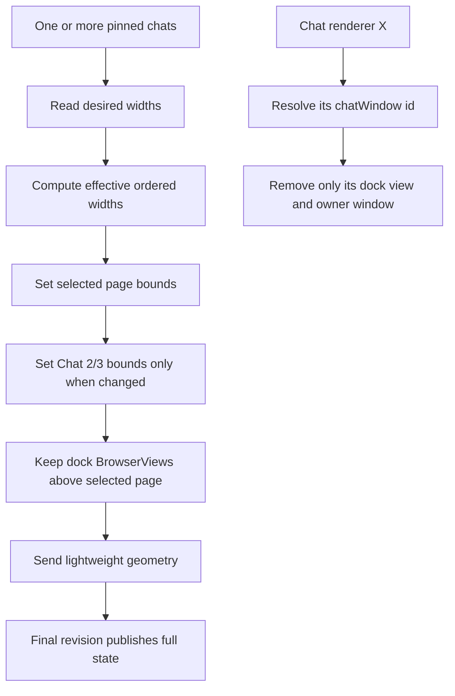

# Independent chat instances and docking flow

## Design inputs

The docking surface follows the existing JEV/Laya onboarding contract in
`layaDecision_flow_chat.md`: shared configuration is read-only application
context, while each agent keeps an independent typed decision/task history.
JEV is an optional decision brain (`bundled` fallback, two-second non-blocking
budget, fail-silent degradation); it does not own window geometry or merge
conversation histories.

## ASCII

```
+------------------------------+
| Right-click Browser-use AI   |
+---------------+--------------+
                v
+------------------------------+
| New AI agent / Instances     |
+---------------+--------------+
                v
+------------------------------+
| Extra count < 2?             |
+------------+-----------------+
 yes         | no
  v          v
+---------+  +----------------+
| Create  |  | Disable New    |
| Chat 2/3|  | AI agent       |
+----+----+  +----------------+
     v
+------------------------------+
| New agent gets dockView +    |
| pinned=true; native window   |
| stays hidden as owner        |
+-------------+----------------+
              v
+------------------------------+
| Browser-use | Chat 2 | Chat 3|
| BrowserViews, same height,  |
| visible pane-edge handles   |
+-------------+----------------+
              v
+------------------------------+
| Browser stage reserves every |
| pane; each dockWidth is      |
| independent and non-overlap  |
+-------------+----------------+
              | unpin
              v
+------------------------------+
| Remove dockView; show the   |
| same native resizable window |
+------------------------------+
```

## Mermaid



## Invariants

1. Chat 1 starts docked. New Chat 2 and Chat 3 instances start pinned inside
   Browser-use as main-window BrowserViews; their owner windows stay hidden.
2. Every pinned chat has its own BrowserView, dockWidth, pane-edge resize handle,
   and independent transcript/agent instance. Resizing one pane never changes
   another pane's width.
3. The browser stage reserves the primary pane plus every pinned extra pane,
   lays them out at the same top/bottom bounds, and never overlaps them.
4. Unpinning removes only that chat's BrowserView and shows the same native
   resizable owner window; provider settings, skills, knowledge, task, and
   transcript survive the move.
5. There are at most three total agents: the primary plus Chat 2 and Chat 3.
6. The main Browser-use context menu exposes New AI agent and Instances. The
   chat header context menu exposes New AI agent, minimize, restore/maximize,
   and close. The pin icon is the explicit docking control.
7. Optional JEV/Laya decision assistance remains fail-silent and non-blocking:
   a brain failure falls back to bundled decisions and never changes docking
   ownership or conversation isolation.

## Stable dock geometry and per-instance close ownership

```text
+----------------------------+
| Desired widths for all     |
| visible pinned instances   |
+-------------+--------------+
              v
+----------------------------+
| Compute effective widths   |
| once, preserving order     |
+-------------+--------------+
              v
+----------------------------+
| Browser page ends at Chat  |
| 1 edge; Chat 2/3 follow   |
+-------------+--------------+
              v
+----------------------------+
| Update bounds in place and |
| broadcast geometry only    |
+-------------+--------------+
              v
+----------------------------+
| Final resize revision      |
| publishes complete state   |
+----------------------------+

Each renderer owns its chatWindow id.
Its X resolves that id and never calls Chat 1's drawer close route.
```


