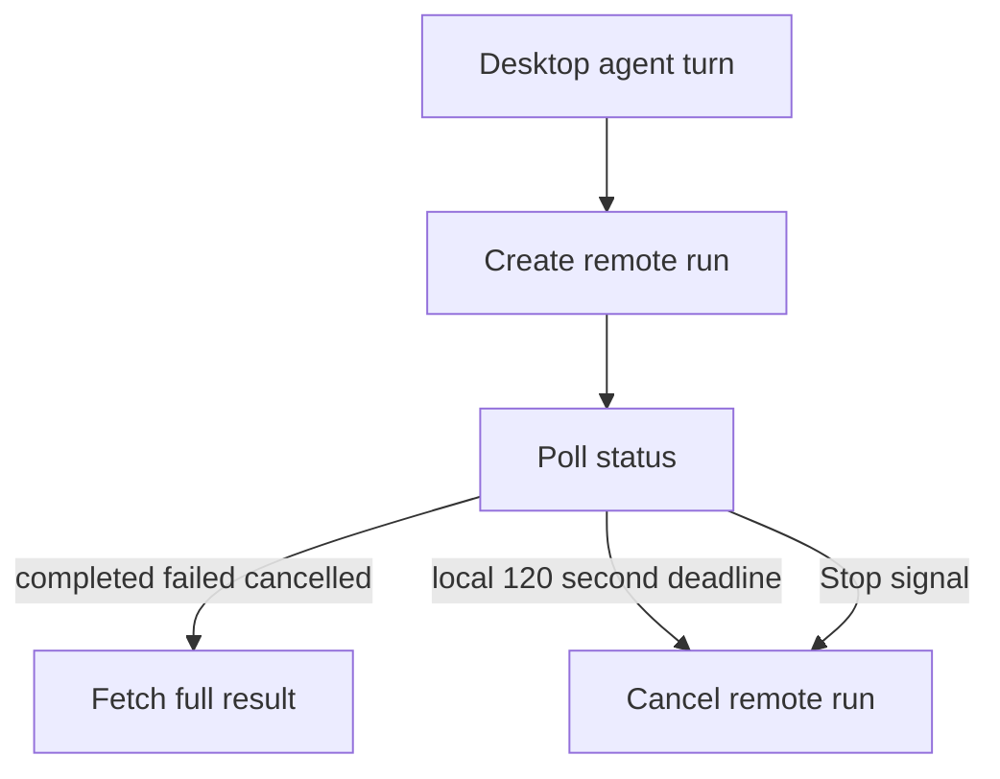
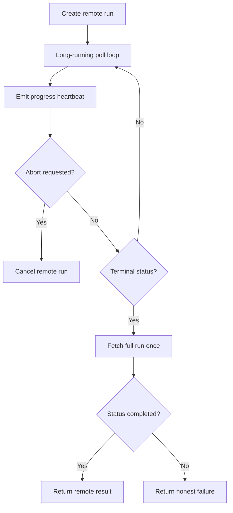

# Browser Use Cloud provider flowchart

## Purpose

Map the remote Browser Use run lifecycle, long polling, cancellation, progress, and terminal results used by Desktop agent chat.

## Current flow before repair

```text
+----------------------+
| Desktop agent turn   |
+----------+-----------+
           |
           v
+----------------------+
| Create remote run    |
+----------+-----------+
           |
           v
+----------------------+
| Poll every 2 seconds |
+----+------------+----+
     |            |
     | 120s       | terminal
     v            v
+----------+   +------------------+
| Cancel   |   | Fetch full result|
+----------+   +------------------+
```



## Repair contract

```text
+---------------------------+
| Create remote run         |
+-------------+-------------+
              |
              v
+---------------------------+
| SDK-compatible long wait  |
| - configurable deadline   |
| - progress heartbeat      |
| - abort-aware polling     |
+------+------+-------------+
       |      |
       |      +----------------------+
       v                             v
+--------------------+       +------------------+
| Terminal run state |       | Explicit Stop    |
| fetch once         |       | cancel remotely  |
+--------------------+       +------------------+
```



The remote poll limit defaults to the installed SDK long-run contract, and every successful status poll resets the local agent's dead-air deadline. The local absolute deadline exceeds the cloud deadline. Explicit Stop cancels the remote run; a real deadline reports a failed result without pretending it completed.
