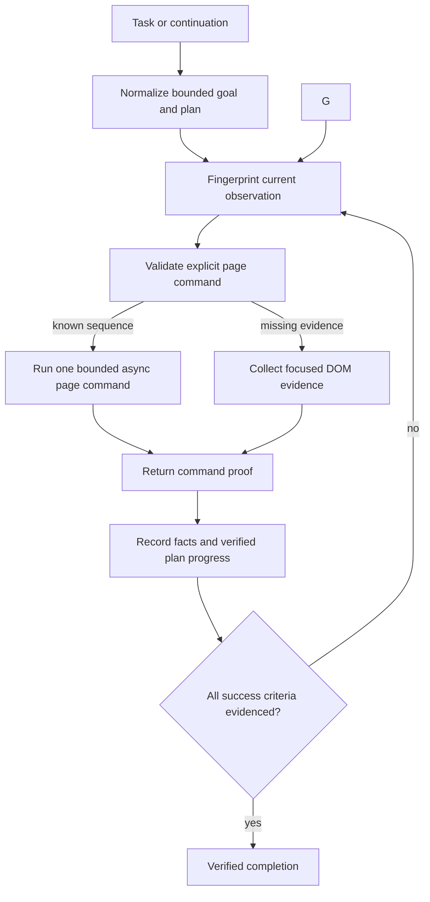
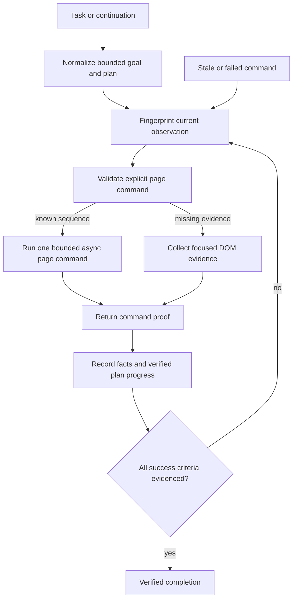
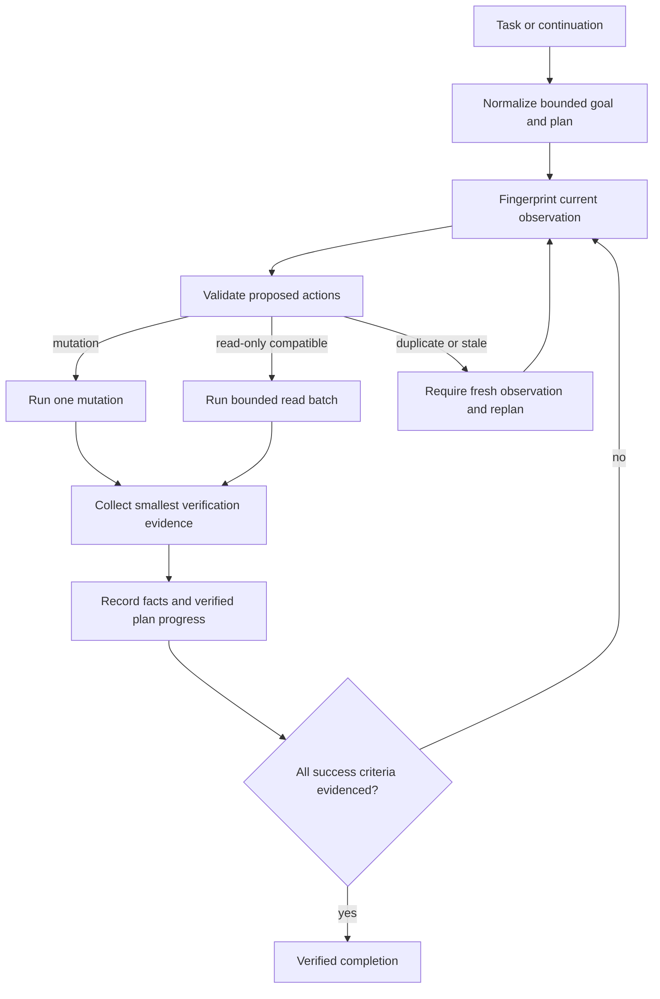
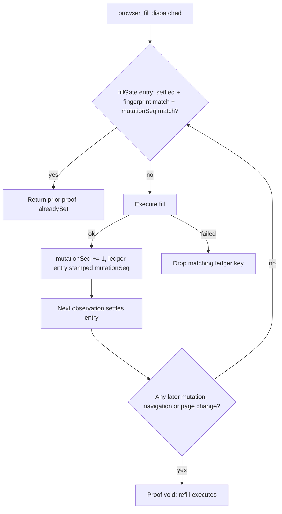
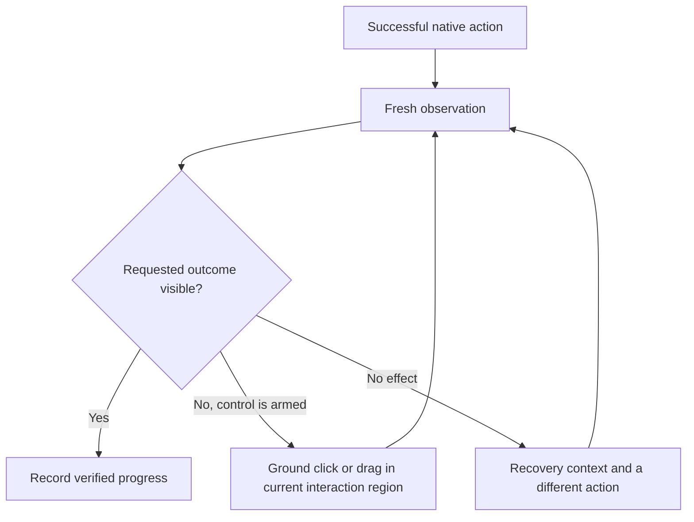

# Desktop Agent Coordinator Flowchart

## Purpose

`desktopAgentCoordinator.cjs` is a pure, bounded policy layer. It keeps task facts, validated plan progress, observation revisions, action fingerprints, and goal evidence without controlling Electron or browser input.

```text
+-------------------------+
| New task / continuation |
+-----------+-------------+
            v
+-------------------------+
| Normalize goal + plan   |
| Keep bounded facts      |
+ Keep completed work     |
+ Keep prior reasoning    |
+-----------+-------------+
            v
+-------------------------+
| Classify observation    |
| fingerprint / revision  |
| confirm exact action     |
| effect, not goal effect  |
+-----------+-------------+
            v
+-------------------------+
| Validate proposed batch |
+----+----------------+---+
     |                |
 mutation/read      duplicate/stale/already applied
     v                v
+----------------+ +------------------+
| One action then| | Invalidate state, |
| verification   | | require replan    |
+-------+--------+ +------------------+
        v
+-------------------------+
| Record evidence, advance|
| plan only when verified |
+-----------+-------------+
            v
+      goal proven?
+        |       |
+       yes      no
+        v       v
+   complete   next decision
```





<!-- legacy diagram retained below for history -->


## Request accounting

See [Agent request and evidence efficiency](efficiency_flow_chat.md) for the additive metrics algorithms and ASCII/Mermaid routes. Outer decisions and actual HTTP attempts are counted separately; per-call monotonic durations never reuse cumulative thinking-card time. Only bounded, payload-free request summaries are retained.

## Native evidence extension

The shared computer catalog classifies native read/mutation operations using
the action argument. Desktop observations fingerprint only the visible
foreground window's identity/geometry plus a window-scoped image hash when the
capture matches it, so unrelated windows, the pointer position, or merely
taking another screenshot cannot manufacture progress or confirm a mutation.
Every member of a batched native mutation settles against the next
observation's foreground-window evidence; unknown (no comparable crop) is
never confirmed as effect. Native action identity is a structured shape hash
(action, windowId, 4px click cell, exact drag/scroll/stroke geometry, hashed
text) so duplicate advisories stay meaningful for native input. These are pure
evidence helpers inside the coordinator: they never block, latch or intercept
a model action. Browser-only fingerprints and advisory duplicate handling
remain unchanged.

## E3 idempotent-fill ledger (gen2 enforcement)

The fill ledger remembers successful `browser_fill` calls keyed by (target
identity hash, exact value digest) so a genuinely redundant refill of an
already-set field returns the prior proof instead of re-executing. The proof is
valid ONLY while the fill's own read-back is still the newest page evidence:
the gen2 preflight showed a ledger entry surviving a navigate-away →
navigate-back cycle (the reloaded form was empty, but the whole-page
fingerprint does not carry input values, so the "page unchanged" check passed
vacuously) and blocking the legitimate refill with `alreadySet`. The mutation
sequence closes that gap.

```text
+---------------------------+
| browser_fill dispatched   |
+-----+---------------------+
      v
+---------------------------+     yes
| fillGate: ledger has key? +------------> return prior proof
| effectObserved            |             (alreadySet) — only while
| appliedFingerprint == now |             mutationSeq unchanged
| mutationSeq == fill's seq |
+-----+---------------------+
      | no
      v
+---------------------------+     ok
| execute fill on the page  +--> recordAction: ok?  -> seq += 1,
+-----+---------------------+       ledger entry { key,       entry.mutationSeq = seq
      | failed                      beforeFingerprint,
      v                             effectObserved=false,
+---------------------------+       appliedFingerprint=null }
| failed fill: drop ledger  |
| entries with the same key |      next observation (recordObservation):
+---------------------------+      settle entry -> effectObserved=true,
                                   appliedFingerprint = fingerprint

Invalidation (the proof dies, the refill executes):
  - any later successful mutation   -> state.mutationSeq advances
  - navigation / tab switch         -> bumpNavigationEpoch clears the ledger
  - failed same-(target,value) fill -> recordAction drops the matching key
  - page change since application   -> appliedFingerprint !== fingerprint
```



## Invariants

1. Coordinator state is bounded, serializable, and contains no screenshot bytes, raw typed text, credentials, or raw selectors.
2. A mutation is an observation barrier; dependent actions require new verification evidence.
3. Element indexes never define an action identity; stable target metadata and
   normalized executable inputs do. Human-readable annotations (`title`,
   `description`, `reason`, and `label`) are excluded because changing prose
   cannot make an already-applied operation new.
4. Every successful mutation is recorded in a task-wide semantic ledger,
   independent of volatile DOM fingerprints and unrelated intervening actions.
   The same mutation cannot run again implicitly anywhere in the current task.
   A task that genuinely requires another identical unit must set `repeat: true`
   and supply a distinct expected outcome for that new state.
5. A completion claim is verified only when current evidence covers the stated goal.
6. A stale, unchanged, or already-applied action becomes recovery context and
   cannot be blindly retried.
7. Native dispatch success and an observation fingerprint change prove only the
   exact action effect. They never prove the user's higher-level outcome. A
   selected or pressed placement control must be followed by the grounded
   canvas click or drag that creates the requested object, then freshly observed.
8. The coordinator retains a bounded, human-readable completed-work ledger
   separate from volatile DOM indexes and the recent transcript. Post-action
   observations update each entry with whether an effect was actually visible.
9. A strategy checkpoint clears only consecutive-recovery counters. It never
   clears the original goal, conversation context, completed-work ledger, or
   latest verified observation.


