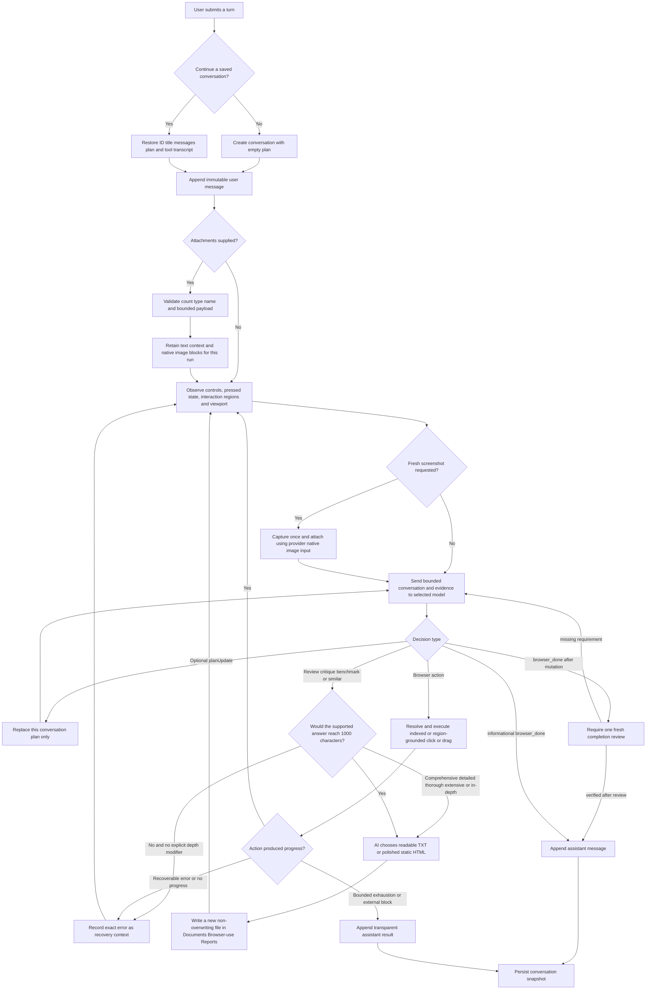
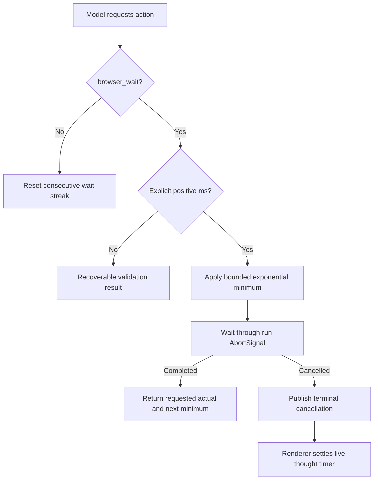
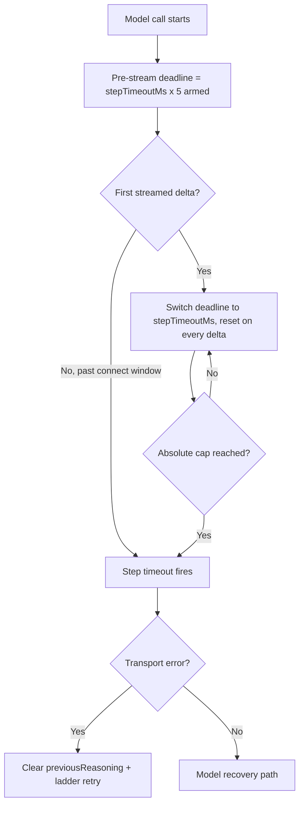
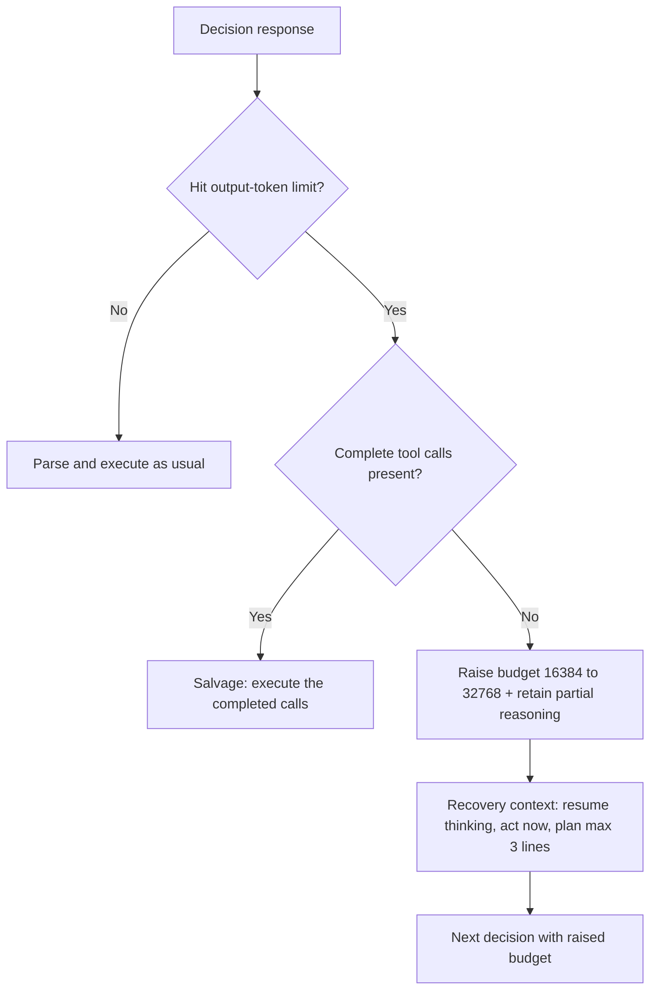
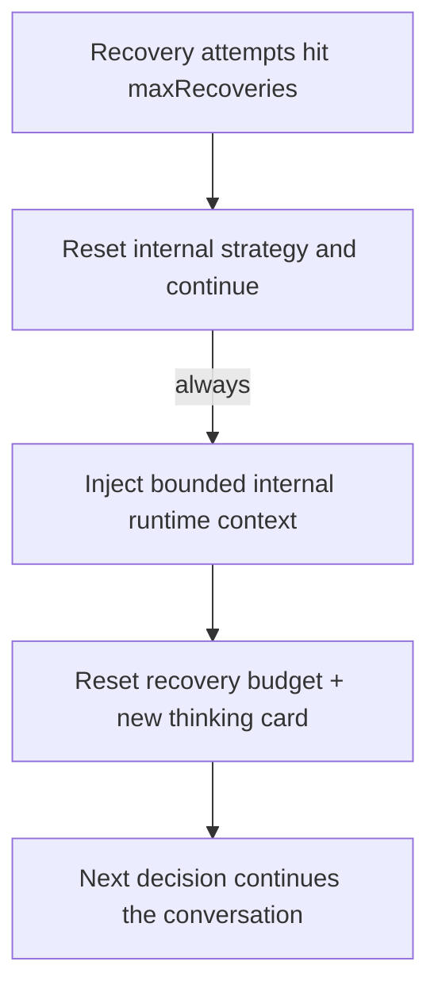
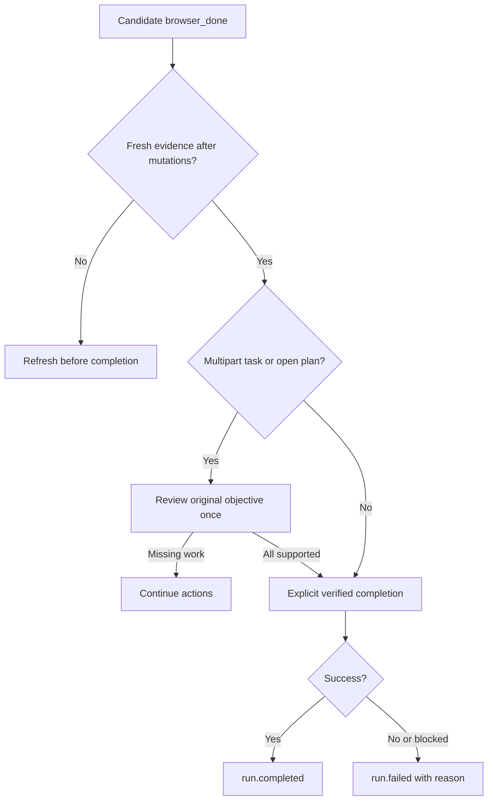
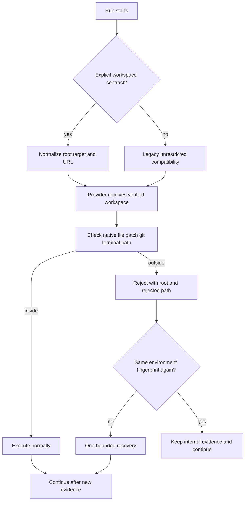
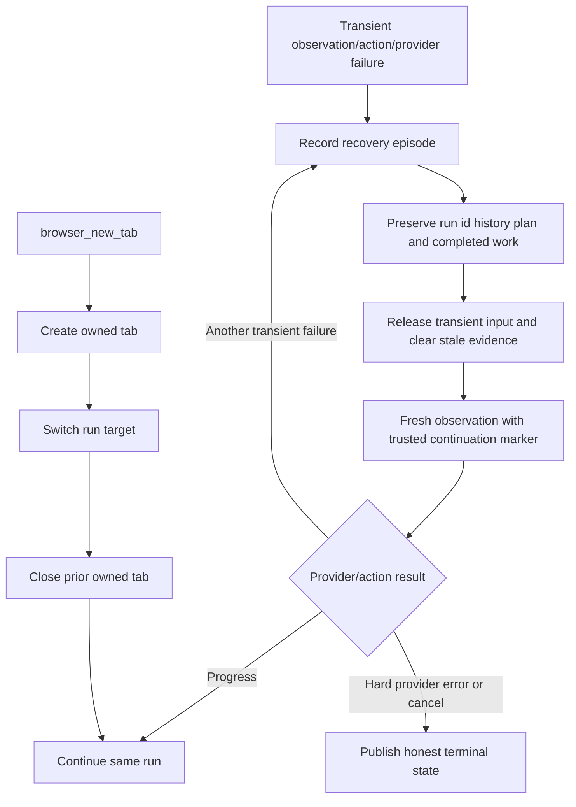
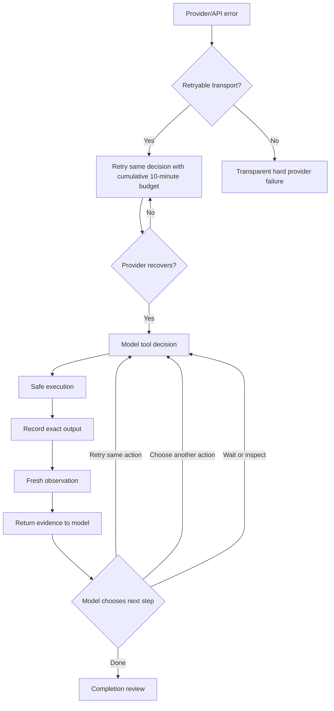
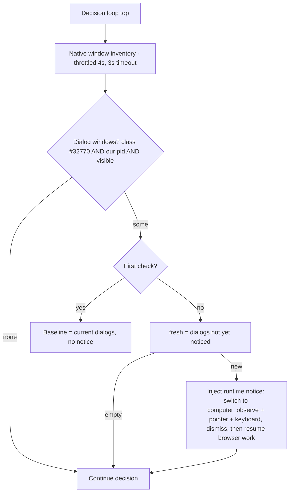

# Desktop Chat Agent Flowchart

## Efficiency follow-up

[Agent request and evidence efficiency](efficiency_flow_chat.md) maps mode-aware startup, restored observation domain, independent decision/request timers and first-tool timing. Existing permissions, model-owned planning and browser-only behavior are retained.

## Purpose

The desktop chat agent is a general observe-decide-act loop. It does not contain
site-specific routines or benchmark shortcuts. Every user turn is interpreted
by the selected model with the same bounded conversation, browser evidence,
tool history, and recovery contract. Explicit long-form report requests expose
one constrained file-output capability; they do not bypass model reasoning.

```text
+---------------------------+
| User submits a chat turn  |
+-------------+-------------+
              v
+---------------------------+
| New chat or saved chat?   |
+------+----------------+---+
       | new            | saved
       v                v
+--------------+   +-----------------------+
| Empty plan   |   | Restore messages,     |
| New ID/title |   | title, plan, tools, ID|
+------+-------+   +-----------+-----------+
       +-----------------------+
                   v
+---------------------------+
| Append immutable user turn|
+-------------+-------------+
              v
+---------------------------+
| Normalize bounded attached|
| text and image files      |
+-------------+-------------+
              v
+---------------------------+
| Fresh controls, semantic  |
| states, regions + viewport|
+-------------+-------------+
              v
+---------------------------+
| Optional visual evidence  |
| attached to provider turn |
+-------------+-------------+
              v
+---------------------------+
| Model returns one bounded |
| structured decision       |
+----+-----------+----------+
     |           |                  |
  action       done/error       long report
     |           |                  |
     v           v                  v
+------------+ +----------------+ +---------------------+
| Execute one| | Persist result | | Validate large TXT  |
| click/drag | | or recover     | | or static HTML only |
| + observe  | | with evidence  | +----------+----------+
+------+-----+ +-------+--------+            v
       |               |          +---------------------+
       |               |          | Write new file under|
       |               |          | Documents reports   |
       |               |          +----------+----------+
       +---------------+---------------------+
                  v
       +----------------------+
       | Save same conversation|
       +----------------------+
```

```text
+---------------------------+
| Declared model reasoning  |
+-------------+-------------+
              v
+---------------------------+
| Keep bounded internal     |
| working-memory tail       |
| (never a visible plan)    |
+-------------+-------------+
              v
+---------------------------+
| Reconcile with fresh page |
| + durable completed work  |
+-------------+-------------+
              v
+---------------------------+
| Next decision continues   |
| or changes strategy       |
+---------------------------+
```



## Cancellation and bounded wait lifecycle

2026-09-11 wait fix: the escalation floor applies only from the SECOND
consecutive wait (the first wait honors the model's exact ms). A wait whose
page is still loading returns as soon as navigation settles (bounded by the
requested ms) and reports `settled:true`; an idle page sleeps the full
requested duration so animation/lazy-content waits stay honest. The result
reports the true `requestedMs` separately from `waitedMs`, plus
`stillLoading:true` when the page kept loading after the wait.

```text
+---------------------------+
| Model requests an action  |
+-------------+-------------+
              |
              v
+---------------------------+
| browser_wait requested?   |
+------+--------------------+
       | no                         | yes
       v                            v
+-------------------+     +-----------------------------+
| Reset wait streak |     | Require explicit positive ms|
+-------------------+     +--------------+--------------+
                                        |
                                        v
                         +-----------------------------+
                         | Page loading? return early  |
                         | when it settles (bounded)   |
                         | else bounded wait ladder    |
                         | 0.5, 1, 2, 4, 8, 10 seconds |
                         | (second wait of a streak+)  |
                         +--------------+--------------+
                                        |
                              +---------+---------+
                              |                   |
                            abort              complete
                              v                   v
                    +----------------+  +----------------------+
                    | Cancel wait and|  | Publish actual wait  |
                    | terminal run   |  | + next minimum       |
                    +-------+--------+  +----------+-----------+
                            |                      |
                            +----------+-----------+
                                       v
                    +--------------------------------+
                    | Renderer settles thought timer |
                    | and retains terminal duration  |
                    +--------------------------------+
```



## Transport retry ladder

A failed model decision is classified before recovery: permanent provider
blocks (auth/billing/model-unavailable) fail the run immediately; transport
failures (fetch/ECONN/socket, timeouts, 429/5xx, rate limits) replay the SAME
decision after an increasing wait — 20s, 40s, 1m, 2m, 3m, 4m, 5m, 6m, 8m, 10m
(desktop/agent/backoff.cjs) — with a user-visible retry notice, without
consuming the model recovery budget or engaging strategy resets. The counter
resets on every successful decision, so scattered one-off failures across a
conversation never accumulate toward a stop. When the ladder is exhausted the
run does NOT end: the counter resets, the user is told, and the run keeps
waiting on the longest interval (10m) — a long outage never kills the chat.

### Transient connection notices

Retry notices are published as `assistant.message` events with
`transient: true`. The renderer shows them in a dedicated pulsing strip
above the composer instead of permanent transcript cards, and clears the
strip when the connection demonstrably works again: first streamed thought,
`thinking.completed`, any executed tool result, a real (non-transient)
reply, or a terminal run state.

### Dead-air model timeout (progress-aware step timeout)

`withinStepTimeout` is a dead-air detector, not a ceiling on legitimate work.
A model that is thinking correctly is never killed by a timer; the retry
ladder is reserved for actual transport faults and API error codes
(429/5xx/connection failures) — never for long reasoning:

- **Pre-stream (time-to-first-token)**: a reasoning model may legitimately
  stay silent before its first streamed token. The pre-stream window is
  `stepTimeoutMs x 5` (450s at the default; configurable via
  `modelConnectMs`), never the flat step deadline.
- **Streaming**: every streamed delta (thinking or output — the
  `onStream`/`onProgress` channels) resets the step deadline. A reasoning
  model thinking for minutes is progress, not a hang, and is never killed
  mid-stream.
- An absolute cap (`stepTimeoutMs x 20`, overridable via
  `stepAbsoluteTimeoutFactor` for tests) still ends a stream that trickles
  forever or feeds only keep-alives.
- Observation and tool-execution phases pass no progress callback and keep
  the exact flat `stepTimeoutMs` behavior.

When a genuinely dead connection (dead air past its window, connection reset
mid-think) triggers a transport retry, the truncated thinking fragment in
`workingMemory.previousReasoning` is cleared first: replaying the model's own
unfinished thought biased retries into re-deriving ever-longer thoughts (the
observed 90s -> 3413s spiral that exhausted the ladder). The retry restarts
its reasoning fresh against the same observation.



## Planning-budget loop (output-token cut-off)

Reasoning + plan + actions share one output budget (4096 by default on every
path). A reasoning model that plans heavily hits the cap mid-thinking: the
response ends with `finish_reason: length` (Chat), `stop_reason: max_tokens`
(Anthropic) or `status: incomplete, reason: max_output_tokens` (Responses),
no executable action exists, and the decision is discarded. The old recovery
prompt ("issue an executable action") then made the model re-derive the same
oversized plan into the same cap — thinking again and again, never executing,
"exhausting its budget and forgetting it did so".

The loop is broken at both ends:

- **Provider**: a cut-off is detected on all three paths. The Responses path
  (reasoning models) starts at a realistic 16384-token decision budget — a
  plain-chat-sized budget guarantees a mid-think cut-off — and raises
  progressively (16384 -> 32768) when a cut-off still happens. The partial
  reasoning (with its encrypted continuity blob) is retained and replayed
  into the next decision, so the model RESUMES its interrupted thinking
  instead of re-deriving it from scratch — that retention is what fixes the
  "exhausts its budget and forgets it did so" half of the loop. The failure
  surfaces as a distinct `DECISION_OUTPUT_BUDGET` error — never as a repair
  round trip (a smaller budget cannot fix a budget problem) and never as
  narration scolding. A tool call whose arguments JSON was truncated by the
  cap is dropped, never executed with silently-empty input.
- **Agent**: the recovery context names the condition exactly — "your
  previous decision was cut off by the output-token limit while you were
  still reasoning or planning … The output budget has been raised and your
  partial reasoning was retained — continue it where it stopped … Emit at
  most three short plan lines and include the next executable action in this
  same decision." Cut-offs consume recovery attempts, so a truly
  pathological recovery remains steerable and cancellable.
- **Prompts** (all providers + AGI mode): thinking is brief and incremental
  by rule — never draft file contents, code, scripts, or scene data inside
  the reasoning channel; produce them with tools, one grounded step at a
  time. This prevents the 600s+ in-head monologues that made the budget
  race likely in the first place.



## Web search, fetch, scheduling and spawned runs

Additive chat tools (all risk `read`):

- `browser_search {query, maxResults?}` — composes a Google search in the
  run's tab (shared `BrowserViewController.search`), returns bounded organic
  result titles/hrefs, or a rendered-page notice (consent/captcha) with sample
  elements when nothing organic was collected. It navigates, so the
  coordinator treats it as a page mutation for observation barriers.
- `browser_fetch {url, maxLength?}` — Node-side bounded text fetch (no CORS,
  no page interference): 15s timeout, 1MB read cap, text/html/json only,
  scripts/styles stripped, body capped at maxLength (default 20000). No
  summarization: the model reasons over raw text.
- `schedule_task {action, ...}` — create/list/pause/resume/remove durable
  scheduled jobs (see desktop/schedule/scheduler_flow_chat.md). Ask mode
  confirms `create` up front; unattended mode follows the run's own mode.
- `task_spawn {task, label?}` — enqueue an isolated parallel background agent
  run through the agent pool; it publishes events under its own conversation
  id and never steals the visible chat.

## AGI tool attachment

AGI adds the shared nine-tool catalog without changing the observe/decide/batch
loop or model-call budget. Existing Full access executes native tools directly;
Ask uses the existing approval card. Native actions switch the next existing
observation to desktop/window evidence and, after GUI mutations, a fresh desktop
image. Browser actions switch back to browser evidence. Images remain ephemeral,
not persisted transcript bytes. Native command/file results retain actual output
and exit/change evidence. Runtime callbacks never cross Electron serialization.
Stop and scope downgrade clean only the run's native owner. Successful turn
settlement releases held input but keeps explicitly started jobs/recordings for
follow-up rather than immediately undoing a start-server/start-recording task.
Routing and native algorithms: `../computer/computerTools_flow_chat.md`.

## Conversation ownership

- `messages` is an ordered list of immutable `{ role, content, at }` records.
- `title` is mutable metadata and never substitutes for or edits a message.
- `plan` belongs to the conversation ID. It begins empty and changes only when
  the model intentionally returns `planUpdate` or calls `update_plan`. The model
  decides whether a run needs tasks, how many are useful, and may add, update,
  remove, reorder, skip, or clear them through stable task IDs.
- `history` is the bounded action transcript, separate from conversational
  messages.
- A follow-up can resume either the current terminal run or a persisted history
  snapshot. Both paths preserve the same conversation ID and context.

## Invariants

1. No task, domain, benchmark, greeting, login flow, or search engine bypasses
   the selected model. Long-report recognition only controls whether the model
   receives the constrained report-output action.
2. The agent never creates a default plan. Absence of `planUpdate` means no plan.
3. Creating a new chat creates a new conversation with an empty plan.
4. Opening history restores exact messages and any saved plan; the title is only
   a label.
5. Recoverable provider and browser errors become bounded evidence for the next
   model decision. They do not invoke task-specific executor code.
6. A page-changing action must be followed by a fresh observation before a
   successful terminal claim.
7. Structured action JSON is protocol data. Only declared reasoning crosses the
   thought stream, and only assistant text crosses the message stream.
8. Persisted data is bounded and redacted before it reaches disk.
9. No-progress accounting is consecutive and evidence-aware. A successful
   interaction resets the passive-read streak, and screenshots never accumulate
   into a terminal failure across intervening progress.
10. Successful mutations enter a task-wide semantic ledger. An identical later
    mutation is treated as already applied even after unrelated actions or DOM
    churn. Repetition is permitted only when the model declares `repeat: true`
    and a distinct expected outcome.
11. Intermediate progress prose may be painted in the live transcript, but it is
    not durable conversation context. Only user turns and terminal assistant
    replies are sent back as conversational messages on later decisions.
12. A requested screenshot is live decision evidence, not transcript payload.
    It is attached once to the next provider turn, redacted from persistence,
    and cannot be captured again until a page-changing action invalidates it.
    Providers that reject image input retry the same decision with DOM evidence.
13. Action metadata is canonicalized before policy checks. `expect` and `repeat`
    are removed from tool input and hoisted to the action envelope even when a
    provider emits them in the wrong JSON location.
14. Live model thought uses a bounded rolling tail, not a bounded prefix. When
    a provider produces excessive reasoning, the user continues to see the
    newest thought instead of an apparently frozen early fragment.
15. Pointer moves, coordinate clicks, and drags are first-class browser actions.
    They must use finite viewport coordinates grounded in the current visible
   page. `browser_mousemove` is non-mutating and places the visible pointer
   without inventing a click or drag; when it is the final requested action it
   can be followed by `browser_done` in the same decision so the chat settles
   instead of waiting in an actionless recovery loop. Provider spellings are
   canonicalized only to an unambiguous declared action before normal input
   validation. The agent never needs a page script merely to place the pointer
   or to place and size an editable object.
16. Action dispatch is not semantic completion. A pressed or selected control
    plus visible placement guidance means the tool is armed; the following
    canvas click or drag, and its fresh observation, are still required.
17. At most one intermediate assistant status message is painted per user turn.
    Later model status prose cannot fill the chat with repeated promises; live
    thought and action cards continue to show ongoing work, and `browser_done`
    owns the terminal reply. A plan-only decision updates the floating task pill
    and continues the same thought stream; it is not an empty-decision recovery
    and does not create its own transcript action.
18. Provider-declared reasoning is retained as a bounded, non-authoritative
    internal working-memory tail for the next decision. It is reconciled with
    fresh evidence and never creates or updates the visible plan by itself.
19. Successful work has a bounded semantic ledger outside the short transcript
    tail, so a long task does not forget older actions when recent history is
    compacted.
20. `maxSteps` and recovery-count thresholds are strategy-checkpoint intervals,
    not terminal results. Reaching one creates explicit recovery context and
    continues; repeated passive reads likewise trigger replanning instead of a
    completed chat.
21. After any page mutation, the first successful `browser_done` is a completion
    proposal. A fresh model review must either identify the next missing action
    or return a verified completion before the run can end.
22. `write_report_file` is exposed when the user requests a critique, review,
    benchmark, stress test, audit, assessment, comparison, or report. The user
    never needs to know about file formats: the model chooses readable TXT or
    polished static HTML when its supported answer reaches 1,000 characters.
    Smaller answers remain normal chat replies.
23. Report output is restricted to `.txt` and static `.html`, bounded to 250,000
    characters, written under `Documents/Browser-use Reports`, and never
    overwrites an existing file. HTML scripts, embedded frames, forms, event
    handlers, refresh directives, and script URLs are rejected.
24. A depth modifier such as comprehensive, detailed, thorough, extensive, or
    in-depth makes the report path mandatory for a report-intent task. A plain
    short request remains under model judgment, subject to the 1,000-character
    file minimum.
25. Matching the connected Lorde AI contract, a turn snapshots bounded image
    attachments as data URLs and every non-image file as text context. Text is
    inserted into the model's structured request context and images use
    the selected provider's native image input. Unsupported or excessive input
    fails before the browser loop begins with a concise user-facing message.
26. Raw attachment contents and image bytes are run-local. Conversation and run
    persistence retain at most safe filename, MIME type, kind, and size metadata.
27. Starting a run returns its live ID to the renderer as soon as it is created;
    terminal results continue through the normal event stream. Stop always
    remains clickable while that ID is being handed off, resolves it through
    current agent state, and targets it. New chat cancels it before clearing the composer, and
    opening or restoring History never replaces the live control target.
28. The renderer accepts transcript, thought, and plan events only for the visible
    conversation ID. New chat retires the outgoing ID before exposing an empty
    conversation, so delayed IPC cannot attach old tasks to the new chat.
29. Every terminal cancellation settles the active thought interval and freezes
    its measured duration; no cancelled card can continue counting.
30. `browser_wait` requires an explicit positive duration (up to 15 minutes).
    Consecutive waits receive cumulative minimums that escalate from 500ms toward
    minutes and reset after another action, so a long-running awaited job is met
    with progressively longer waits instead of rapid polling.
31. A decision whose calls are all waits/polls (`browser_wait`, or read-only
    `computer_terminal` read/list) is patience, not drift: it does not advance
    the checkpoint cadence. It counts against the `maxWaitTurns` ceiling
    (default 600), which stops a forever-waiting run honestly with reason
    `wait_budget_exhausted`. There is NO model-decision budget: productive
    decisions are never counted against a cap, so long-running tasks run to
    completion; a stuck model remains recoverable until provider/API failure or explicit cancellation
    (`maxRecoveries` x fresh re-plan cycles) and the loop detectors.
32. `browser_wait` execution bypasses the step deadline: it is bounded by the
    model's own chosen duration and abortable via the run signal.
33. `steer` accepts a user plan or goals edit: the live list is rewritten
    immediately, a `plan.updated`/`goals.updated` event is published, and a
    typed notice (source `plan_edit`/`goal_edit`) is delivered at the next
    model boundary.

## Fresh re-plan cycles (recovery exhaustion is not a stopper)

When recovery attempts hit `maxRecoveries`, the run no longer terminates with
"could not produce a usable action". Instead the agent stores a fresh
internal runtime context (never a visible assistant message and never a new user request)
telling the model to re-plan from the original goal, resets the recovery budget,
and starts a new thinking card. The chat keeps going. Recovery cycles do not end the chat. Each exhausted recovery budget resets the internal strategy state and continues invisibly from the original user scope. Only provider/API failure or explicit user cancellation ends the run; a truly stuck model remains recoverable through steering or cancellation.



## Multipart completion and truthful terminal outcomes

```text
+------------------------------+
| Candidate browser_done       |
+---------------+--------------+
                v
+------------------------------+
| Fresh action evidence?       |
+---------------+--------------+
                v
+------------------------------+
| Multipart objective or open  |
| plan? Review whole request   |
+-------+----------------------+
        |                    |
   unfinished               supported
        v                    v
+-------------------+   +-------------------+
| Continue acting   |   | Explicit verified |
+-------------------+   | success completes |
                        +-------------------+
```



Provider blocks, budget exhaustion, recovery exhaustion, and unrecoverable errors emit a failed run rather than a successful completion event. Missing `verified` never proves success. Cloud providers supply a progress heartbeat and their own long-run absolute deadline.

## Environment identity and recovery stop invariant

A run may receive an explicit workspace contract. When present, it is part of
provider context and every native file, patch, git, and terminal path is checked
against it before execution. A path outside that contract is never executed.

```text
+--------------------------+
| Run starts               |
+------------+-------------+
             v
+--------------------------+
| Explicit workspace?      |
+------+---------------+---+
       | yes           | no
       v               v
+-------------+   +--------------------+
| Normalize   |   | Legacy unrestricted |
| root/target |   | compatibility path |
+------+------+   +---------+----------+
       |                    |
       v                    |
+---------------------------+
| Provider sees verified    |
| root + target + URL       |
+-------------+-------------+
              v
+---------------------------+
| Native action path check  |
+------+--------------------+
       | inside             | outside
       v                    v
+-------------+   +-------------------------+
| Execute     |   | Reject with root/path   |
| normally    |   | evidence; replan once  |
+------+------+   +------------+------------+
       |                        v
       |              +----------------------+
       |              | Same environment     |
       |              | fingerprint again?  |
       |              +------+-----------+---+
       |                     | no        | yes
       |                     v           v
       |              +----------+  +------------------+
       |              | recover  |  | Continue internally:   |
       |              +----------+  | environment_blocked|
       |                           +------------------+
       v
+---------------------------+
| Continue only after new  |
| evidence or new action   |
+---------------------------+
```



The recovery ladder remains available for genuinely different failures. It does
not multiply identical wrong-root, missing-file, 404, or connection-refused
failures through fresh-restart cycles. Those stop after the second identical
environment fingerprint with the verified workspace and rejected path retained
in the terminal result.

## Same-run recovery and run-owned tabs

```text
+------------------------------+
| Observe / provider / action  |
| fails transiently            |
+--------------+---------------+
               v
+------------------------------+
| Record recovery episode      |
| preserve run, messages, plan |
+--------------+---------------+
               v
+------------------------------+
| Release transient input and |
| discard stale observation   |
+--------------+---------------+
               v
+------------------------------+
| Fresh observation with same  |
| run id, attempt and tab      |
+--------------+---------------+
               v
+------------------------------+
| Provider continues using a   |
| trusted internal marker     |
+--------------+---------------+
               |
               +----------------------+
               |                      |
        executable action       hard provider/cancel
               |                      |
               v                      v
+----------------------+   +---------------------------+
| Mark progress and    |   | Honest terminal outcome   |
| clear transient      |   | with actionable reason   |
| recovery state       |   +---------------------------+
+----------------------+

browser_new_tab:
  create -> switch run target -> record ownership -> close prior run-owned tab
  user-owned tabs remain open
```



## Current contract: model-owned action evidence and API-only retry

This section supersedes older loop-breaker and recovery-exhaustion diagrams above.
The harness reports deterministic results as evidence. It does not decide that a
repeated action, unchanged page, passive wait, empty decision, or failed browser
mutation means the model should cancel or abandon the task.

```text
+--------------------------+
| Model chooses a tool     |
+------------+-------------+
             v
+--------------------------+
| Execute safely and record|
| exact result and evidence|
+------------+-------------+
             v
+--------------------------+
| Fresh observation        |
| no-change stays evidence |
+------------+-------------+
             v
+-------------------------------+
| Model chooses: retry, wait,   |
| alternate action, investigate,|
| or browser_done               |
+-------------------------------+

Provider/API path is separate:

+--------------------------+
| Provider request fails   |
+------------+-------------+
             v
+--------------------------+
| Is transport/API retryable?|
| 429, 5xx, timeout, network |
+------+---------------------+
   yes |                  no |
       v                     v
+-------------------+  +----------------------+
| Same decision,    |  | Hard provider error  |
| increasing waits, |  | auth, billing, model |
| cumulative 10 min|  | or protocol failure  |
+---------+---------+  +----------+-----------+
          |                       |
          v                       v
+-------------------+  +----------------------+
| Resume model turn |  | Transparent failure |
+-------------------+  +----------------------+
```



No deterministic action path increments a terminal recovery budget, invokes an
automatic strategy reset, forces cancellation, or tells the model which action
to choose next. Safety validation, workspace scope, approvals, malformed tool
schemas, authentication, billing, unavailable models, and explicit cancellation
remain harness-owned boundaries.

## Native surface awareness (LORDE_NATIVE_SURFACE_AWARENESS_V365)

An AGI-capable run must not go blind when its own browser action opens a native
OS window (file open/save, print, system dialog). Browser observation is
tab-bound: it cannot see, move, or close native windows. Every decision, before
the model is consulted, the harness diffs the native window inventory against
the run's baseline and injects a runtime notice when a NEW native dialog owned
by the app's own process is on screen. Browser-only runs (no computer tools)
and runs already operating the desktop are exempt.

```
+--------------------+      +---------------------------+      +--------------------+
| Decision loop top  | ---> | Native window enum        | ---> | Dialog windows     |
| (per decision)     |      | computer_window list      |      | class #32770,      |
+--------------------+      | (throttled 4s, 3s cap)    |      | our pid, visible   |
                            +---------------------------+      +---------+----------+
                                                                         |
         +---------------------------------------------------------------+
         v
+------------------+     no      +---------------------------+
| First check?     | ----------> | Baseline := current set   |
+---------+--------+             +---------------------------+
          | yes
          v
+------------------+     no fresh dialogs     +----------------------+
| fresh = dialogs  | ------------------------> | continue (no notice) |
| - baseline       |                           +----------------------+
+---------+--------+
          | fresh dialogs
          v
+----------------------------------------------------------+
| Runtime user notice (source: runtime, never rendered):    |
| NATIVE DIALOG OPEN <title, windowId>                      |
| 1. computer_observe / computer_screenshot                 |
| 2. computer_pointer / computer_keyboard (+window focus)   |
| 3. resume browser tools from a fresh browser_observe      |
| Never finish with a dialog you opened still open.         |
+----------------------------------------------------------+
```



The detection is advisory: it never blocks, never cancels, and never picks the
model's next action — it only makes the blind spot visible. Foreign-process
dialogs are excluded (the agent must not drive windows it does not own).
