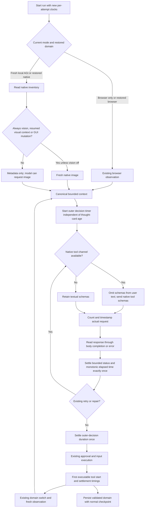
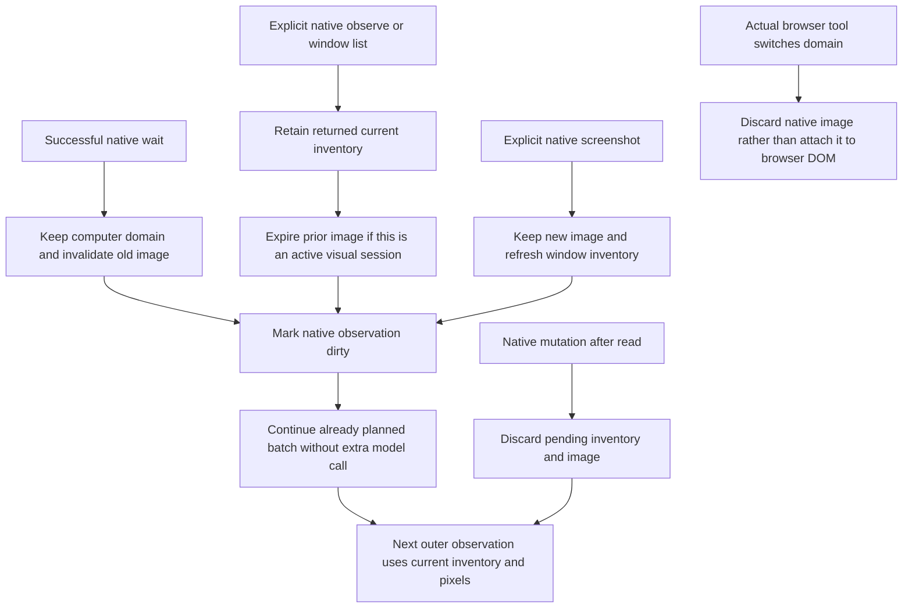
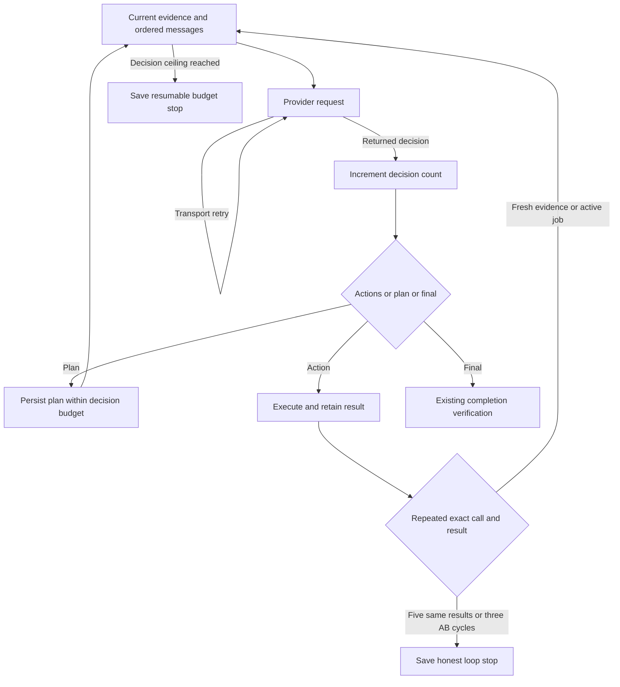
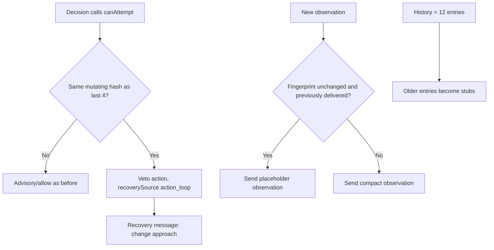
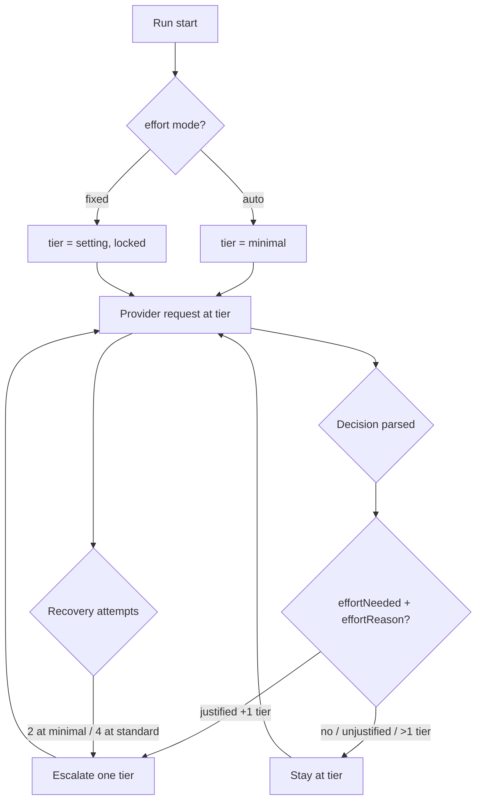

# Agent request and evidence efficiency

Scope: accurate accounting, one schema channel, mode-aware initial evidence, compact model window inventory. No new model loop, task-specific router, timing clamp or permission path.

```text
+---------------------------+
| New / continued local run |
+-------------+-------------+
              v
+---------------------------+
| Current mode + saved      |
| observation domain        |
+------+--------------------+
       | Browser         | AGI/native
       v                 v
+-------------+   +-------------------------+
| Existing DOM|   | Current native inventory|
| observation |   | auto: no startup image  |
+------+------+   | always/resume: fresh img|
       +----------+------------+------------+
                               v
             +----------------------------------+
             | Canonical evidence + tool catalog|
             | Foreground-first window summaries|
             +-----------------+----------------+
                               v
             +----------------------------------+
             | Start ONE outer-decision timer   |
             | Thinking-card timer is separate  |
             +-----------------+----------------+
                               v
             +----------------------------------+
             | Build actual request:            |
             | native tools OR textual schemas  |
             | Count request immediately at fetch|
             +-----------------+----------------+
                               v
             +----------------------------------+
             | Read full response/stream        |
             | finally: time/outcome once       |
             +-----------------+----------------+
                               v
             +----------------------------------+
             | Existing retry/repair if needed  |
             | New request timer; same decision |
             +-----------------+----------------+
                               v
             +----------------------------------+
             | Existing approval and execution  |
             | First-tool start/settlement times|
             | Checkpoint domain, not old images|
             +----------------------------------+
```



Accounting:
- `phaseMs.model += decisionEnd - decisionStart`, not `decisionEnd - thoughtCardStart`. Monotonic elapsed clocks use `performance.now()`; displayed thought age remains separate.
- `providerCalls` retains outer decision count. `providerRequests` counts actual HTTP attempts, including structural repair and existing transport/capability retries.
- First-tool start/settlement timings refer to model-requested executable tools after approval, not automatic observation, task bookkeeping or terminal replies. They measure elapsed time from this execution attempt, including any approval wait; a dispatch settlement is not verified task completion.
- Each request increments one kind counter and settles one outcome; duration extends through body consumption. A capped tail stores only kind/phase/attempt/status/elapsed/request bytes, never headers, prompts, images or secrets. Byte counts are not token counts and elapsed time is not CPU/reasoning time.
- Wire-context projection never mutates canonical context. JSON fallback regains textual schemas automatically; schema repairs retain the same image and mapping.
- Native window projection puts the foreground HWND first, preserves every enumerated identity, retains full geometry for the first eight, and explicitly labels other geometry as omitted. No title-based app selection, no merging of distinct handles. Raw tools and fingerprints retain full data.
- Fresh local AGI defaults to native metadata; auto vision avoids an unconditional startup screenshot. Browser-only behavior remains unchanged. Continuation keeps a validated saved domain subject to current scope; legacy target URL provides a compatibility hint. No persisted screenshot is replayed.

## Native wait/read evidence lifecycle follow-up

A native task can use the existing bounded browser_wait timer without intending to switch applications. That wait must preserve the native domain, expire pre-wait pixels, and supply refreshed native evidence on the next existing decision. Explicit native inspection and screenshots must likewise replace stale top-level window metadata, not merely append a newer tool result beneath an older authoritative observation.

```text
+-------------------------+
| Native wait/read/image  |
+------------+------------+
             v
+-------------------------+
| Keep native domain      |
| Mark observation dirty  |
| Expire old image if read|
+------------+------------+
             v
+-------------------------+
| Finish remaining batch  |
| No forced provider turn |
+------------+------------+
             v
+-------------------------+
| Reuse returned inventory|
| or inspect current one  |
| Keep newly captured image|
+------------+------------+
             v
+-------------------------+
| One coherent next input |
| IDs + current pixels    |
+-------------------------+
Actual browser action -> clear native picture before switching domain.
```



Do not make a native timer depend on a live browser tab. Native observation refresh does not imply task progress; a screenshot is not proof that an application finished processing input. Browser-only wait semantics and existing wait bounds/cancellation remain unchanged. Test this lifecycle with changing window IDs and image markers, not application-specific names or coordinates.

Verification: tests/agent-efficiency.test.mjs, tests/native-evidence-lifecycle.test.mjs and existing native/provider/storage suites; actual isolated Electron compositor, native fixture and local deterministic provider. A real-model automatic-approval benchmark remains separately permission-gated.

## Corrected continuity and run bounds (2026-09-13)

The earlier quick-win section below is historical, not the current contract.
Request probes proved that suppressing observation content in stateless requests
removed the only current element indices; the sampled mutation fingerprint is
not a complete observation identity. Always send compact current evidence.

The new checks are in `tests/agent-continuity-regressions.test.mjs`. An opt-in
real-model fixture is `tests/live-agent-continuity-e2e.mjs`: launch the actual
Electron entrypoint with temporary APPDATA/LOCALAPPDATA/user-data-dir and an
ephemeral local HTTP page; configure the existing environment credential in
that isolated profile; send a task through the chat UI; independently count
correct form submissions; await a terminal snapshot and verify the receipt.
No existing browser session, saved chat, or credential file is read. A 240s
verification deadline cancels this test's own run; it is not a product timeout.
Screenshots and sanitized run summaries are saved under the reported temporary
evidence directory. No live-provider result is implied by unit-test success.

Qwen reference: `packages/core/src/core/llm-chat.ts:getRequestHistory` preserves
curated turns; `services/loopDetectionService.ts` separates always-on exact-call,
shell stagnation, and turn-cap checks from opt-in heuristics. Its canonical
repeat key includes complete, sorted arguments. Do not copy an isolated
threshold without its history and result-handling prerequisites.

```text
Current observation + ordered messages --> bounded provider request (always)
Model response --> count decision --> plan/action/final
Transport retry / observation / checkpoint --> no decision consumed
Action result --> compare exact call + result for evidence-reading tools
             | new result / active job / proven change --> continue
             | 5 identical or 3 AB cycles of identical results --> save + stop
             v
Decision ceiling --> save unsuccessful result (conversation remains resumable)
```



Implementation boundaries: UI mutations and screenshots are not declared stuck
from identical metadata; dynamic jobs in running/queued states do not count as
identical completed reads. An unrelated browser fingerprint cannot attest to
terminal/file progress. Internal recovery is guidance, not a new user objective.
The decision counter includes plan-only and malformed completed responses, not
network retries, observation passes or checkpoints. Regression tests must prove
these distinctions in addition to the normal provider suites. No live-model
performance claim follows from deterministic transport/loop fixtures.

## Historical quick wins (superseded where contradicted above)

Four additions modeled on qwen-code's loop-detection and context hygiene:

1. **Hard loop circuit breaker** (`desktopAgentCoordinator.cjs`,
   `LOOP_DETECTION_THRESHOLD = 5`). `canAttempt` now counts consecutive
   identical mutating action hashes (fingerprint-independent). Crossing 5
   vetoes the action: it never executes, and the agent records
   `recoverySource: 'action_loop'` and schedules invisible internal recovery with an in-band
   "loop detected — change approach" message. The streak then restarts, so a
   still-stuck agent re-triggers per threshold steps until recovery exhaustion
   internal recovery never ends the run. Re-tests continue after invisible strategy resets;
   advisory-only, unchanged.
2. **Unchanged-observation placeholder** (`boundedRequestContext` /
   `desktopChatAgent.cjs`). `recordObservation`'s `changed` flag is stored on
   the run (`lastObservationChanged`) and passed to providers as
   `observationUnchanged`. When true (and only after a decision has actually
   been delivered to the model — the flag resets on every successful decision
   so a transport retry never replays a placeholder the model never received),
   the full observation payload is replaced by `{unchangedSinceLastDecision,
   url, note}`. This kills the largest per-step repetition cost.
3. **History stubs** (`boundedRequestContext`). Entries older than the 12-entry
   detail window collapse to `{step, tool, outcome: '[older action — details
   cleared…]'}` instead of being dropped; the model keeps the step/tool record
   at near-zero cost while `doneList` carries confirmed outcomes.
4. **Token estimator metric**. Provider call sites add
   `metrics.providerContextTokens` (~bytes/4) alongside the existing
   `providerContextBytes`, making context growth visible in window-sized units.

```
+--------------------+   identical hash x5    +---------------------+
| canAttempt(hash)   |----------------------->| VETO + loop message |
| (mutating action)  |                        | recovery replan     |
+--------------------+                        +---------------------+
         | unchanged fingerprint
         v
+---------------------------+
| observation placeholder   |
| {unchangedSinceLastDecision, url, note} |
+---------------------------+
```



Tests: `tests/desktop-ollama-provider.test.mjs` (stub contract, budgets),
`tests/agent-efficiency.test.mjs`, `tests/desktop-ai-chat-agent.test.mjs`
(63/7 unchanged documented baseline). `LOOP_DETECTION_THRESHOLD` is exported
for tests.

## Reasoning effort ladder (agent effort control)

The chat agent defaults to deep reasoning, which overthinks fast back-and-forth
tasks. The mode/permissions pill gains an Effort section: Auto (default),
Minimal, Standard, Advanced. Advanced is byte-for-byte the previous behavior.

```
+-------------------------------+
| run starts                    |
| settings.effort from pill     |
+---------------+---------------+
                v
+-------------------------------+
| effort == auto?               |
+-------+----------------+------+
        |                |
       no               yes
        |                |
        v                v
+----------------+ +---------------------------+
| tier = setting | | tier = minimal (HARD      |
| (never         | | START; every new run      |
| changes)       | | restarts at minimal)      |
+-------+--------+ +------------+--------------+
        |                       |
        v                       v
+--------------------------------------------------+
| provider request uses tier:                      |
|  ollama:      think:false + num_predict floor   |
|               (minimal 1536 / standard 2048 /    |
|                advanced 4096)                    |
|  openai-compat: reasoning_effort low/medium/(none)|
|  responses:   reasoning.effort low/medium/(none) |
|  anthropic:   thinking omitted (min) / 1024      |
+--------------------------------------------------+
        ^                       |
        |                       v
+-------+--------------------------+-------------+
| escalation (auto only, ONE tier per step,     |
| never downward mid-run):                      |
| 1. model sets effortNeeded(+effortReason):    |
|    reason REQUIRED; advanced additionally     |
|    requires a prior objective need signal     |
| 2. harness safety net: every 2 consecutive    |
|    recovery attempts at minimal -> standard;  |
|    every 4 at standard -> advanced            |
+-----------------------------------------------+
```



Invariants:
1. Fixed Minimal/Standard/Advanced never change mid-run and ignore
   `effortNeeded` entirely; Advanced is exactly the previous behavior.
2. Auto always starts at minimal on every new run; escalation is one tier per
   step, never downward mid-run, and never without an effortReason from the
   model or an objective harness signal (recovery attempts).
3. Providers only receive the resolved tier — the policy lives in
   DesktopChatAgent, not in any provider.
