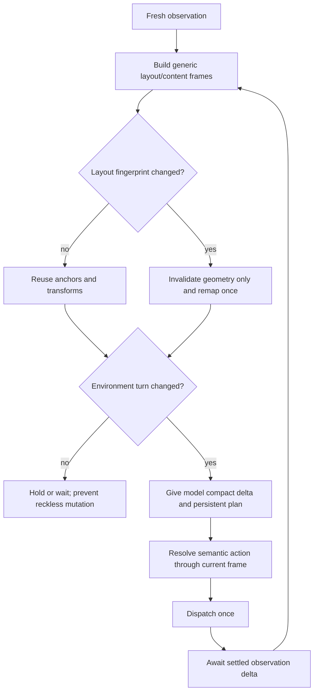

# Generic interaction memory flow

## ASCII

```
+----------------------+
| Fresh observation    |
+----------+-----------+
           v
+------------------------------+
| Build layout/content frames  |
| from stable visible evidence |
+--------------+---------------+
               v
+------------------------------+
| Compare with remembered      |
| layout, content, turn, wait  |
+---------+--------------------+
          | layout unchanged
          v
+------------------------------+
| Reuse anchors/transforms     |
| do not remap the surface     |
+--------------+---------------+
               v
+------------------------------+
| Is environment turn changed?|
+---------+--------------------+
   no     |          yes
          v           v
+---------+------+ +---+----------------+
| hold/reobserve  | | give model delta  |
| no reckless act | | and plan context  |
+-----------------+ +--------+-----------+
                             v
                   +---------+----------+
                   | semantic action    |
                   | resolves via frame |
                   +---------+----------+
                             v
                   +---------+----------+
                   | dispatch once      |
                   | await settled delta|
                   +--------------------+
```

## Mermaid



## Invariants

1. Layout identity and content identity are separate. A changing game state does not invalidate the board/window geometry.
2. Stable anchors and coordinate transforms survive content changes and are invalidated only by layout changes or contradiction.
3. A mutation is not a completed action until a settled observation confirms its expected state delta.
4. A model does not act during an unchanged environment turn unless the user explicitly requested a repeat.
5. The kernel stores generic surface/anchor/turn metadata; it does not contain chess, canvas, or program-specific rules.
6. Laya may classify deltas and continue mechanical actions, but strategic choices remain with the primary model.
