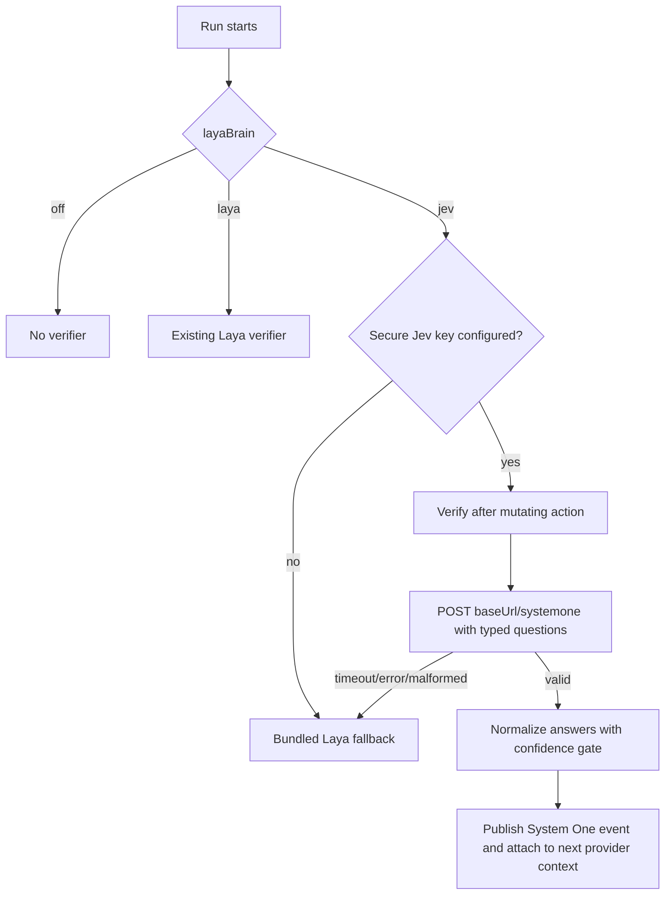
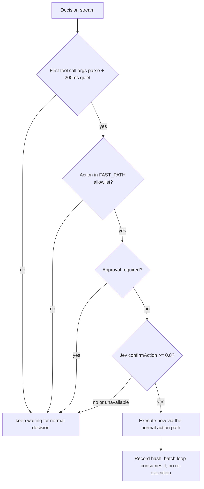

# Jev System One Verifier Flow

## Purpose

Route Browser-use's optional System One verification pass through TypeSafe Jev
when the user selects Jev and has configured a secure API key. Preserve the
existing non-blocking Laya verification contract and fall back to the bundled
Laya engine when Jev is unavailable.

## Plain ASCII flow

```text
+---------------------------+
| Run starts                |
+-------------+-------------+
              v
+---------------------------+
| layaBrain = off/laya/jev  |
+------+-------------+------+
       |             |
     off           laya
       |             |
       v             v
 no verifier   bundled/sidecar Laya
                     |
                   jev
                     v
        +---------------------------+
        | Secure Jev key configured?|
        +------------+--------------+
                     | no
                     v
             bundled Laya fallback
                     |
                    yes
                     v
+---------------------------------------------+
| Verify only after a fresh mutating action   |
| (never blocks provider decision)             |
+----------------------+----------------------+
                       v
+---------------------------------------------+
| POST {baseUrl}/systemone                   |
| Authorization: Bearer <secure key>         |
| state + model + typed questions             |
+----------------------+----------------------+
                       v
              +----------------+
              | Valid response?|
              +-----+----------+
                    | no/timeout
                    v
             bundled Laya fallback
                    |
                   yes
                    v
+---------------------------------------------+
| Normalize answers and confidence >= 0.6     |
| attach brain/tookMs/answers to next prompt  |
+---------------------------------------------+
```

## Mermaid `graph TD`



## Contract and safety invariants

- Default brain is `off`; existing runs remain unchanged until selected.
- Default Jev base URL is `https://api.typesafe.ai/v1`; model is `jev-latest`.
- The API key lives only in Electron secure storage under `jevApiKey`.
- Renderer receives only configured/masked status, never the key.
- Jev requests use `Authorization: Bearer`, never query parameters or logs.
- Verification is fire-and-forget from the agent decision path and cannot block,
  fail, or terminate the run.
- Jev failures fall back to the bundled Laya engine; they do not trigger agent
  recovery or change the user's selected brain.
- `off`, `laya`, and `jev` are persisted as `layaBrain`; legacy `layaEnabled`
  values migrate to `laya`/`off`.

## Fast path (LORDE_FAST_PATH) — execute as soon as the model decides

The model often streams its first tool call early and then keeps narrating.
The fast path executes that decided action immediately instead of waiting for
the decision to finish:

```text
+----------------------------------------------+
| Decision stream running (model narrating)    |
+---------------------+------------------------+
                      v
+----------------------------------------------+
| First tool call's arguments parse as JSON    |
| AND stream quiet >= 200ms debounce           |
| (a JSON prefix never parses as complete)     |
+---------------------+------------------------+
                      v
+----------------------------------------------+
| Agent gate: allowlist only                   |
| browser_click / browser_scroll /             |
| browser_mousemove / browser_query /          |
| browser_extract                              |
+---------------------+------------------------+
                      v
+----------------------------------------------+
| Jev confirmAction: one typed noul question   |
| "execute immediately now, correct +          |
| non-destructive?"  (gate 0.8)                |
+-----+--------------------------+-------------+
      |no / unavailable           |yes
      v                           v
 wait for normal decision   execute immediately
 (fail-closed)              via the normal action path
                            (records, publishes, marks hash)
                                      |
                                      v
                      decision finishes; the batch loop
                      sees the recorded hash and skips the
                      duplicate execution
```



Safety invariants:

- The model remains the decider; Jev only confirms and the harness executes.
- Allowlist is hard: never type/fill, navigation, terminal, file, or patch
  actions; never anything requiring human approval.
- One eager action per decision; the action hash is consumed by the batch
  loop, so a decision replay cannot double-execute.
- Jev unavailable or below gate = fail-closed: nothing executes early and the
  run behaves exactly as with the fast path off.
- `BROWSER_USE_FAST_PATH=off` disables the whole path; `BROWSER_USE_FAST_PATH_GATE`
  tunes the noul gate (default 0.8); `BROWSER_USE_FAST_PATH_DEBOUNCE_MS` tunes
  the stream-quiet window (default 200).
