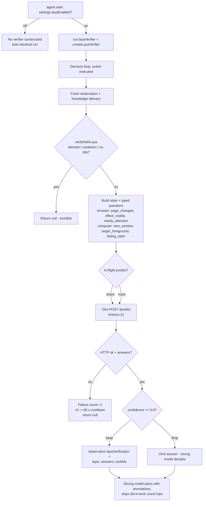
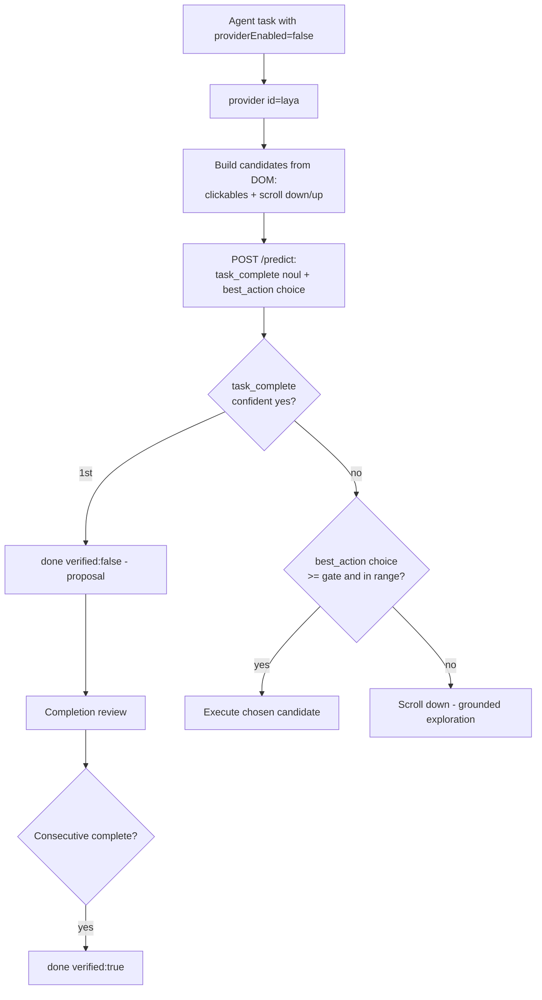
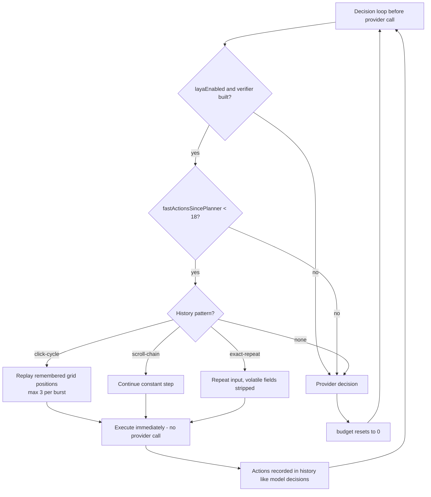

# layaDecision — Flow Chart (Laya decision layer, opt-in)

## Purpose

Laya is a **System One accelerator**: a local English-only sidecar (ModernBERT
checkpoint served by `laya-server/server.py`, 127.0.0.1:8765) that answers
typed mechanical confirmation questions about a fresh observation in a single
forward pass (~33 ms). The strong API model (e.g. GPT-6 Astra) keeps FULL
planning authority and keeps emitting every tool call; Laya only rides along
on the observation as calibrated typed annotations, so the strong model skips
whole "did the effect land?" decisions. Opt-in via the Browser-use settings
toggle (`layaEnabled`, default **off**) so weak machines are unaffected.

## Invariants

- INV-L1 **Fail silent**: any sidecar failure, timeout, or abort degrades to
  exactly the previous behavior. The accelerator never touches the run.
- INV-L2 **Confidence gate**: answers below 0.6 confidence are omitted —
  the strong model decides those as it always did. A confident NO is still
  a valid typed answer.
- INV-L3 **One pass per observation**: identical in-flight predictions share
  one HTTP call.
- INV-L4 **Never blocking**: the verify runs CONCURRENTLY with the provider
  call and its settled annotation rides on the NEXT decision's observation
  (`context.layaVerification`). The first decision and read-only/wait actions
  verify nothing (no mechanical effect to confirm). A CPU sidecar slower than
  the sidecar timeout (2s: a CPU checkpoint answers warm in ~490ms, GPU in ~33ms) therefore costs a decision ZERO latency - awaiting it
  inline was measured as a dead silent stall before every decision.
- INV-L4b **Sidecar protection**: two consecutive timeouts park the HTTP path
  for 60s (the bundled engine answers instantly) - aborted predicts still
  execute server-side, so an unbounded retry loop would queue torch jobs and
  saturate a core.
- INV-L5 **Off = byte-identical**: with `layaEnabled=false` no verifier is
  even constructed; runs behave exactly as before.
- INV-L6 **IPC safety**: the verifier function never enters `serializeRun`.

## Visual flow

```text
+---------------------+      settings.layaEnabled=true       +---------------------------+
| agent.start(run)    | -----------------------------------> | run.layaVerifier =        |
| (off: never built)  |                                      | createLayaVerifier(...)   |
+---------------------+                                      +---------------------------+
                                                                        |
+---------------------+     fresh observation after action             v
| decision loop       | -----------------------------------> +---------------------------+
| (after knowledge    |                                      | verifyWithLaya(run, obs)  |
|  delivery)          |                                      +---------------------------+
+---------------------+                                                |
                                                                        v
                                    +-----------------------------------------------+
                                    | gate: signal aborted? cooldown? no obs?       |
                                    +-----------------------------------------------+
                                         | yes                    | no
                                         v                        v
                                   [return null]        +----------------------+
                                   (invisible)          | build state + typed  |
                                                        | questions (browser:  |
                                                        | page_changed /       |
                                                        | effect_visible /     |
                                                        | needs_attention)     |
                                                        | (computer:           |
                                                        | new_window /         |
                                                        | target_foreground /  |
                                                        | dialog_open)         |
                                                        +----------------------+
                                                                         |
                                                                         v
                                                   +--------------------------------+
                            POST /predict 8765     | one shared in-flight predict   |
                            <-------------------+ | (timeout 2s abort — GPU ~33ms, CPU ~490ms warm)         |
                                                 +--------------------------------+
                                                                         |
                                     +----------------------------------------------------+
                                     | HTTP ok + payload.answers?                          |
                                     +----------------------------------------------------+
                                          | no (fail x3 -> 60 s cooldown)   | yes
                                          v                                 v
                                    [return null]                 +----------------------+
                                    (invisible)                   | confidence >= 0.6?   |
                                                                  | keep typed answer;   |
                                                                  | drop the rest        |
                                                                  +----------------------+
                                                                           |
                                                                           v
                                                            +-------------------------------+
                                                            | observation.layaVerification  |
                                                            | = { layer, answers, tookMs }  |
                                                            +-------------------------------+
                                                                           |
                                                                           v
                                    +-----------------------------------------------------+
                                    | strong model decision: plans with the annotations,  |
                                    | skips "did it work?" round trips it can trust       |
                                    +-----------------------------------------------------+
```

## Mermaid flow



## Module map

| File | Role |
| --- | --- |
| `desktop/agent/layaEngine.cjs` | **Bundled System One engine (in-process, zero dependencies)**: goal-token scoring, launch-target parsing, state-diff verify answers, completion evidence checks |
| `desktop/agent/layaDecision.cjs` | Verifier client: question templates, state builders (with internal prev-state digest), confidence gate, sidecar-first + engine-fallback, brain labeling |
| `desktop/agent/layaProvider.cjs` | Standalone policy provider: browser click/scroll candidates, computer launch/focus/observe candidates, launch+waitMs co-emission, completion double-confirm |
| `laya-server/server.py` | OPTIONAL external sidecar (real checkpoint), `GET /health`, `POST /predict` — never required |
| `desktop/agent/desktopChatAgent.cjs` | `verifyWithLaya(run, observation)` in the loop; `layaVerifierFactory` constructor option; `serializeRun` exclusion |
| `desktop/main.cjs` | `layaEnabled` / `layaEndpoint` (empty = bundled engine only) / `providerEnabled` settings, run-start injection, laya branch in `createProvider` |
| `tests/desktop-laya*.test.mjs` | 26 tests: engine answers, verifier contract, provider flows, agent wiring, IPC safety |

## Brain selection (one system)

```text
layaEndpoint set?  -->  try sidecar  -->  ok      --> brain: 'sidecar'
   (optional)                       \-> failed   --> bundled engine, brain: 'bundled'
no layaEndpoint    -->  bundled engine directly        brain: 'bundled'
```

The bundled engine never fails, so the run can never be stranded by a missing
external process. `laya.brain` on every decision/verification records which
brain answered.

## Standalone mode (provider disable, `providerEnabled=false`)

When the Provider section in the agent menu is set to **Off — Laya drives**,
the agent's commands go straight to Laya (`desktop/agent/layaProvider.cjs`).
This is the pure System One stress-test loop: the strong API model is not in
the loop at all.

```text
+--------------------+     observation.dom      +------------------------------+
| decision loop      | -----------------------> | candidateActions:            |
| (provider = laya)  |                          | clickable elements -> click  |
+--------------------+                          | + scroll down/up (grounded)  |
                                                +------------------------------+
                                                              |
                                                              v
                                    POST /predict { state: task/url/title/candidates,
                                                    questions: task_complete(noul),
                                                               best_action(choice) }
                                                              |
                                    +----------------------------------------------------+
                                    | task_complete confident-yes?                        |
                                    +----------------------------------------------------+
                                       | yes                          | no
                                       v                              v
                             1st: done(verified:false)    choice >= gate && in range?
                             2nd consecutive: done(           | yes            | no
                               verified:true)                 v                v
                             (completion review         execute the      scroll down
                              double-confirm)           chosen action    (grounded
                                                                         exploration;
                                                                         no-progress guard
                                                                         enters internal recovery
                                                                         and returns to planner)
```

Key differences from the verify layer:

- **Loud failures**: an unreachable sidecar surfaces immediately with the
  start command — Laya is the planner here, so silent degrade is wrong.
- **Completion double-confirm**: the first "complete" answer is a proposal
  (verified:false) for the agent's completion review; a consecutive second
  one verifies. New work resets the proposal.
- **Typing is out of scope**: free-text authoring stays a strong-model skill;
  standalone Laya clicks visible controls and scrolls.
- **Silent-launch discipline**: after a launch whose waitMs list found no new
  window, the next decision's first candidate is "wait again for the target's
  window" — repeating the same trigger is demoted, never rewarded. Launch
  waits use the full 30s catalog cap (Store apps like Win11 Notepad can take
  25s+ on first paint).
- **Settings**: `providerEnabled` (default true), normalized in saveSettings,
  routed in the agent-run IPC handler before any provider/credential gates.



## Full open-weight model — user-consent gated (`desktop/agent/layaRuntime.cjs`)

The real Laya checkpoint (Apache-2.0, `convaiinnovations/laya` on HuggingFace,
~850MB weights) needs the Python ML stack — torch alone is ~500MB installed.
Nothing is pre-packaged and nothing provisions automatically. The dialogue in
**Settings > Laya - full open-weight model** drives everything:

```text
user opens Settings
        |
        v
checkDependencies():
  Python >= 3.8 found?  (py -3 / python / python3 --version)
  NVIDIA GPU?           (nvidia-smi; memoized) -- yes: CUDA torch build preferred,
                          CPU-only torch honestly FAILS the gate until upgraded:
                          pip install torch --index-url https://download.pytorch.org/whl/cu124
                          no GPU: CPU torch is legitimate, no CUDA gate
  packages present?     (find_spec probe: laya, fastapi, uvicorn, torch, transformers)
  sidecar /health ok?   (already running wins)
        |
        +-- all detected --> "Download the full Laya model" CLICKABLE
        |                        | click = consent
        |                        v
        |                   spawn laya-server/server.py (detected python)
        |                   weights download from the hub on first start
        |                   poll /health -> ready -> layaEndpoint set ->
        |                   verify/standalone brains route to the checkpoint
        |
        +-- anything missing --> button LOCKED; checklist shows exactly what
                                 is missing and the single install command:
                                 pip install laya fastapi "uvicorn[standard]"
```

Key points:

- **Consent only**: nothing downloads or spawns until the user clicks the
  now-unlocked download button in Settings. Auto-triggers in saveSettings and
  the agent-run path were removed.
- **Bundled JS engine is the fallback at every stage**: without consent,
  during the weights download, and forever after any failure. Runs never wait
  on, fail because of, or auto-trigger this path.
- **`laya.brain`** on every decision/verification records which brain answered
  (`bundled` | `sidecar`).
- Endpoint migration: old builds persisted the sidecar endpoint as a default,
  making every decision probe a dead HTTP server first. Load-time migration
  resets that stale default so bundled-engine-first is restored.

## Fast path (`layaRace.cjs`) — mechanical continuation race

While the strong model is planning, the decision loop first asks the fast path
for a **confident mechanical continuation** of a pattern already in motion.
A hit executes IMMEDIATELY — no provider call, no grace. The planner keeps all
authority: the fast path only continues what history already shows, and every
executed action lands in history like a model decision.

Patterns (in proposal order):

1. **click-cycle** — coordinate clicks (native `computer_pointer` clicks AND
   browser-domain `browser_click` at remembered `{x,y}`; each surface scanned
   separately, never cross-matched) landing on a small fixed set of positions
   in a repeating order. Needs TWO full phase-matched periods, all successful.
   Proposals replay REMEMBERED grid positions in phase order — never
   extrapolated. This is what wins tab games (mole grids) that the planner
   could only bootstrap at its 10-15s decision cadence.
2. **scroll-chain** — constant equal-step scroll (same axis, bounded drift).
3. **exact-repeat** — identical input executed successfully 3 times
   (allowlisted tools only). Volatile observation-derived fields
   (`x`, `y`, `screenshotId`, `coordinateSpace`, `button`) are stripped before
   replay so the executor resolves fresh coordinates.

Termination — the budget invariant:

- **INV-R1 Bounded per grounding**: the fast path may execute at most
  `MAX_FAST_ACTIONS_PER_PLANNER` (= 18) actions after the last real planner
  decision; exhausting the budget returns null and the planner re-grounds
  from fresh pixels. A live pattern keeps "matching" even when the world
  moved on (game over, page changed) because clicks are not progress-guarded
  and a dead surface still dispatches — without the budget the run would
  click a dead board forever and never finish.
- INV-R2 **All-success gating**: one failed action in the scanned window
  breaks the pattern.
- INV-R3 **Narrow surface**: keyboard, scroll, coordinate clicks only.
  No destructive or state-machine tools, no element-index cycles (no
  coordinates to remember), no coordinate extrapolation.



## Sidecar setup (manual, only for the real checkpoint)

```powershell
pip install laya fastapi "uvicorn[standard]"
python laya-server/server.py   # 127.0.0.1:8765, English checkpoint preloaded
```

Everything above runs in-process without it.

## Jev decision provider — implemented switch (design record)

TypeSafe AI's [Jev](https://typesafe.ai/blog/introducing-system-one-models-and-jev)
is the same archetype as laya: typed question in, typed decision + calibrated
confidence out. It is the designated third brain. This section records the
integration contract so the switch can be implemented without rediscovery.

### User-facing switch (settings dialogue)

The System One selector in the settings section and agent-mode menu selects the decision brain:

| `layaBrain` value | Meaning | Extra fields required |
| --- | --- | --- |
| `off` (default) | No verification layer; the strong model retains full authority | none |
| `laya` | Bundled/optional local Laya verifier | `layaEndpoint` only for the optional sidecar |
| `jev` | TypeSafe cloud decision API | `jevBaseUrl`, `jevModelId`, secure `jevApiKey` |

The UI disables `jev` until the secure key is configured. Legacy `layaEnabled`
settings migrate to `layaBrain: 'laya'` or `'off'`; the local sidecar's
bundled fallback remains unchanged.

### Expected fields for the Jev brain

- **Base URL** (`jevBaseUrl`, settings JSON): DEFAULT
  `https://api.typesafe.ai/v1`, but a free-form field — resellers serve Jev
  too (e.g. OpenRouter `https://openrouter.ai/api/v1` with model ids like
  `typesafe/jev-*`). The adapter must NEVER hardcode the TypeSafe domain or
  assume TypeSafe-specific headers: authenticate with the reseller-standard
  `Authorization: Bearer <key>`, treat response *error bodies* as opaque
  text (providers differ), and derive no behavior from the host name.
- **API key** (`jevApiKey`): stored ONLY in the credential store
  (`setProviderCredential` pattern, same as chat providers) — never in
  settings JSON, never logged, never in `serializeRun` output (INV-L6).
  A reseller key is interchangeable with a TypeSafe key; which one works
  is a property of the chosen base URL, not of the app.
- **Model id** (`jevModelId`, settings JSON): free-form string —
  `jev-1` on TypeSafe direct, `typesafe/jev-1` (or the reseller's catalog
  id) via OpenRouter. Never validated against a hardcoded allowlist.
- **Timeout**: reuse the verifier's non-blocking budget (2s; Jev claims
  70–500ms end-to-end, so the budget holds with large margin). Resellers
  add queueing latency — the budget already bounds that, and INV-L1 drops
  to the bundled engine on any timeout or rejection, so a slow or dead
  reseller can never block a decision.

### Adapter contract (`desktop/agent/jevProvider.cjs`)

`createJevVerifier({ baseUrl, apiKey, modelId, fetchImpl })` implements the
same non-blocking verifier surface as `layaDecision.cjs`:

```
input : { state, questions }            (laya's existing state builders)
output: { answers: { <name>: { <type>: value, confidence } }, tookMs, brain: 'jev' }
```

- Map each typed question (noul / choice / score) to Jev's typed-question
  format; parse typed decisions back with their calibrated confidences.
  The request/response mapping must be reseller-agnostic: only the
  typed-decision contract is assumed, never a vendor-specific envelope.
  A reseller that cannot serve a Jev model simply fails the predict →
  bundled engine answers (fail-silent, non-blocking by construction).
- Reuse unchanged: the ≥0.6 confidence gate, strike/cooldown sidecar
  protection, one-shared-in-flight rule (INV-L3), fail-silent degradation
  (INV-L1: any Jev failure → bundled engine answers).
- Jev's RLCD confidences are claimed calibrated; re-tune the 0.6 gate only
  after the A/B contrast battery (paraphrase + keyword-bait tests used to
  characterize laya) passes on the real question set.

### Non-breaking guarantees

- `layaEnabled=false` → no verifier constructed (INV-L5, unchanged).
- `layaBrain: 'jev'` with no key configured → bundled engine, silently.
- The standalone-laya provider path and the layaRace fast path do not touch
  the brain layer.
- Brain selection after the switch:
  `layaBrain=jev && key? -> jev | layaBrain=sidecar && endpoint? -> sidecar | bundled`
