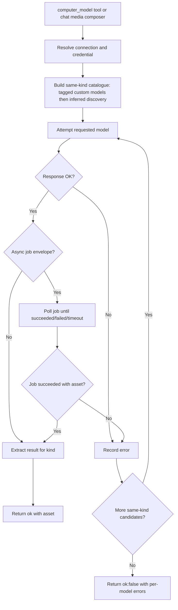

# Media Router flow (`computer_model` + generate-media)

One shared router serves every non-language model request: the chat composer's
direct media generation and the agent's `computer_model` tool. No model ids are
hardcoded in code; the kind of a model is either user-tagged on a custom model
or inferred from the catalogue, and the kind decides the request path.

## Plain-text flow

```text
+---------------------------+
| Request: kind + prompt    |
| (+ optional model, voice, |
|  fileBase64 for stt)      |
+-------------+-------------+
              |
              v
+---------------------------+
| Resolve connection + key  |
| Build same-kind catalogue |
| (tagged custom models,    |
|  then inferred discovery) |
+-------------+-------------+
              |
              v
+---------------------------+
| Candidate 1: requested    |
| model (or first of kind)  |
+-------------+-------------+
              |
              v
+---------------------------+
| POST kind path            |
|  image -> /images/...     |
|  video -> /video/...      |
|  tts    -> /audio/speech  |
|  stt    -> /audio/transc. |
+------+------+-------------+
       | 2xx   | job envelope (202/status=processing)
       |       v
       |  +---------------------------+
       |  | Poll GET <path>/<jobId>   |
       |  | until succeeded/failed or |
       |  | timeout (10s interval)    |
       |  +-------------+-------------+
       |                |
       v                v
+--------------------------------------------------+
| Extract result per kind (lenient JSON recovery:  |
| code-fence strip, deep walk for url/b64/dataUrl, |
| audio bytes -> data URL, text fields for stt)    |
+------+------+-----------------------------------+
       | ok    | failure (HTTP error, malformed
       |       | JSON, no usable payload)
       |       v
       |  +---------------------------+
       |  | Record error; next same-  |
       |  | kind candidate (fallback  |
       |  | cycle, one bounded retry  |
       |  | per transient status)     |
       |  +---------------------------+
       v
+---------------------------+
| Return {ok, kind, model,  |
| asset} | {ok:false,errors}|
+---------------------------+
```

## Mermaid flow



## Invariants

- Kind decides the endpoint; the code contains no model ids and no default
  voice — a TTS voice is sent only when the caller supplies one.
- A failure at any stage is recorded with the model id and a bounded error
  excerpt; the cycle continues to the next same-kind model, so one broken
  catalogue entry never blocks the task.
- Malformed JSON is recovered leniently (fence stripping + deep walk) before a
  candidate is declared failed.
- The agent tool `computer_model` is offered, never forced: the language model
  chooses it when a task needs an asset, exactly like any other tool.
- Results carry provenance (which model produced the asset) so callers can
  report it honestly.
