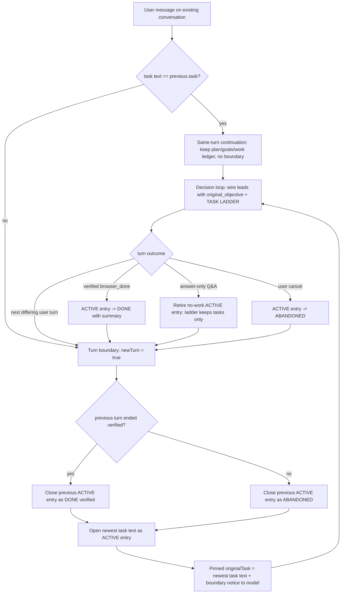

# Objective Ledger (Task Ladder) & Turn-Boundary Classification — Flow

Incident this fixes (transcript `new 36.txt`): a task turn ("its broken DOM 1") was
completed and verified, a pure Q&A turn followed ("whats on the desktop of the
client"), and on the NEXT task turn the model's reasoning cited the CLOSED task as
"Current objective", ran a redundant connection test, and never addressed the new
message. Two defects: (1) the turn boundary / pinned objective only updated when
the PREVIOUS turn had a stored task — so a Q&A turn (and any continuation restored
from a checkpoint predating task persistence) starved the next boundary; (2) the
model saw neither timestamps nor a task ladder, so a two-turns-old objective read
as current.

## Turn-boundary classification (startRun, desktopChatAgent.cjs)

```
+---------------------------+     +------------------------------+
| user submits a message    |     | continuation?                |
| to an existing run        +---->+ previous snapshot loaded      |
+---------------------------+     +---------------+--------------+
                                                  |
                     +----------------------------+---------------------------+
                     |                                                        |
              task text == previous.task text                    task text differs
              (same-turn recovery / resume)                      (NEW TURN, always —
                     |                                            Q&A turn or task turn)
                     |                                                        |
        turnContinuation = true                                    newTurn = true
        keep plan/goals/completedWork;                             close previous ACTIVE ladder entry:
        no boundary notice; ledger untouched;                        done  if previous turn ended verified
        pinned objective unchanged                                   abandoned otherwise
                                                                     open NEWEST task text as ACTIVE
                                                                  setOriginalTask(newest task)
                                                                  boundary notice (short for Q&A-shaped
                                                                  tasks, full for task turns)
```

Rule: EVERY user turn in an existing conversation whose task text differs from the
previous turn's is a turn boundary — regardless of whether the prior turn did
work. Cheap-path economics stay: a Q&A-shaped turn gets a one-line notice and
never becomes a ladder task (its no-work entry is retired on answer-only
completion).

## Objective ledger lifecycle

```
+--------------+   new task text    +----------------+   verified browser_done   +---------------+
| (no ledger)  +------------------->+#1 ACTIVE        +-------------------------->+ #1 DONE       |
+--------------+                    +-------+--------+  outcomeSummary=summary    |  (verified)   |
                                            |                                     +---------------+
                    newest user text differs+--------+     user cancels run
                    (boundary)                       |
                                             v
                                     close #1 done-if-verified-else-abandoned
                                     open #2 ACTIVE  --->  next boundary: close #2, open #3 ...
```

Entry shape: `{ index, task, status: active|done|abandoned, startedAtClock,
closedAtClock, outcomeSummary, verified }`. Bounded to the newest 12 entries.

## Wire rendering (providerTurnLedger.cjs)

- Every user/assistant conversation message rendered to the model is prefixed
  `[HH:MM]` (render-time prefix from the message `at`; deterministic per
  timestamp, so a re-staged message after a failed decision is byte-identical).
- The pinned leading wire message (`original_objective` or `state_snapshot`)
  carries `taskLadder` EVERY decision, newest last:

  `TASK LADDER: #2 06:26 DONE "restart bridge" (verified) · #3 06:29 DONE "its
  broken DOM 1" (verified) · #4 06:36 ACTIVE "full cross-device access plan"`

  plus one rule line: the ACTIVE task is the only objective; a DONE task stays
  done (never re-verify or extend unless the newest message explicitly reopens
  it); an ambiguous newest message is the ACTIVE task.

- The ladder is restored from continuation snapshots (ledger snapshot v1 +
  conversation checkpoint), so it survives app restarts.

## Mermaid: turn boundary + ledger state machine



## Persistence

- Run state: `run.objectiveLedger` (plain data, rides serializeRun).
- Ledger snapshot v1: `objectiveLedger` on `ProviderTurnLedger.snapshot()`.
- Chat history checkpoint: `task`, `turnStartedAt`, `objectiveLedger` persisted
  (`desktop/store/chatHistoryStore.cjs`, wired in `desktop/main.cjs
  onCheckpoint`); the store is corruption-tolerant (quarantine + `.bak`
  fallback) and deliberately unbounded, so history survives every restart.
