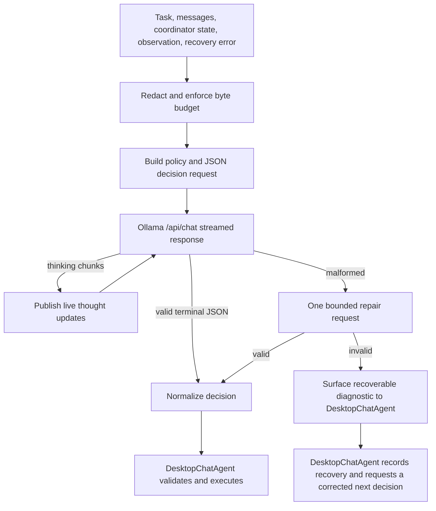

# Ollama Browser Agent Provider Flowchart

## Purpose

The provider converts a bounded browser-agent context into a strict local-model request and normalizes one structured response. It never owns browser control.

```text
+-------------------+
| Agent state input |
+---------+---------+
          v
+-------------------+
| Redact and budget |
| task/messages/error |
| controls + regions  |
| working memory +    |
| completed work      |
+---------+---------+
          v
+-------------------+
| Build strict JSON |
| decision prompt   |
+---------+---------+
          v
+-------------------+
| Ollama completion |
+----+----------+---+
     |          |
 valid JSON   malformed
     v          v
+----------------+  +----------------+
| Normalize       |  | One repair call|
| bounded decision|  +-------+--------+
+----------------+          |
                       +-----+-----+
                       |           |
                     valid       invalid
                       |           |
                       v           v
                +-------------+  +---------------------+
                | Normalize   |  | Surface recoverable |
                | decision    |  | diagnostic to agent |
                +------+------+  +----------+----------+
                       |                    |
                       v                    v
              bounded decision     next bounded agent turn
```



## Invariants

1. The prompt always retains goal, current plan item, newest verification result, and repeat/replan warning before older action detail.
2. Screenshot base64 is sent only through Ollama's ephemeral native `images`
   field when the current decision explicitly requested visual evidence. It is
   excluded from JSON context, recovery history, persistence, and diagnostics.
3. Only one response-repair request is allowed for each decision.
4. A model completion claim is evidence-backed input for the coordinator, not a direct verified result.
5. A previous invalid decision or browser-action error is compact recovery
   context, not user-visible final text. It tells the next model turn to use a
   different grounded action or corrected input.
6. If the one in-provider repair is still malformed, the provider surfaces the
   diagnostic to `DesktopChatAgent`; the agent schedules a bounded recovery
   turn instead of emitting a hard run failure.
7. If a local model rejects image input, the same decision retries with the
   bounded DOM context and no image instead of stopping the run.
8. When recovery marks an action as a semantic duplicate, the next parsed
   decision cannot start with that action; one bounded structural repair must
   select a different grounded action.
9. The provider receives pressed and selected control state plus bounded visible
   interaction regions. It can activate a semantic tool by index and then use
   a coordinate click or drag inside a current region without inventing a page
   script or application-specific selector.
10. Technical dispatch success is not higher-level completion. When the newest
    observation shows an armed control or placement guidance, the provider must
    perform the missing canvas gesture and verify its visible result.
11. The previous reasoning tail is continuity, not evidence. The provider must
    reconcile it with the newest observation and semantic completed-work ledger
    before choosing the next action.
12. A fixed wait is exceptional: every decision already receives a fresh
    observation and navigation already has a bounded settle phase. The provider
    supplies an explicit positive duration and uses one justified longer wait
    rather than repeating 500ms sleeps; the harness enforces bounded escalation.
12. A completion-review recovery is not an error and never becomes a hard stop.
    The provider audits the whole goal, chooses a missing action if any remains,
    and only then returns a verified terminal result.
