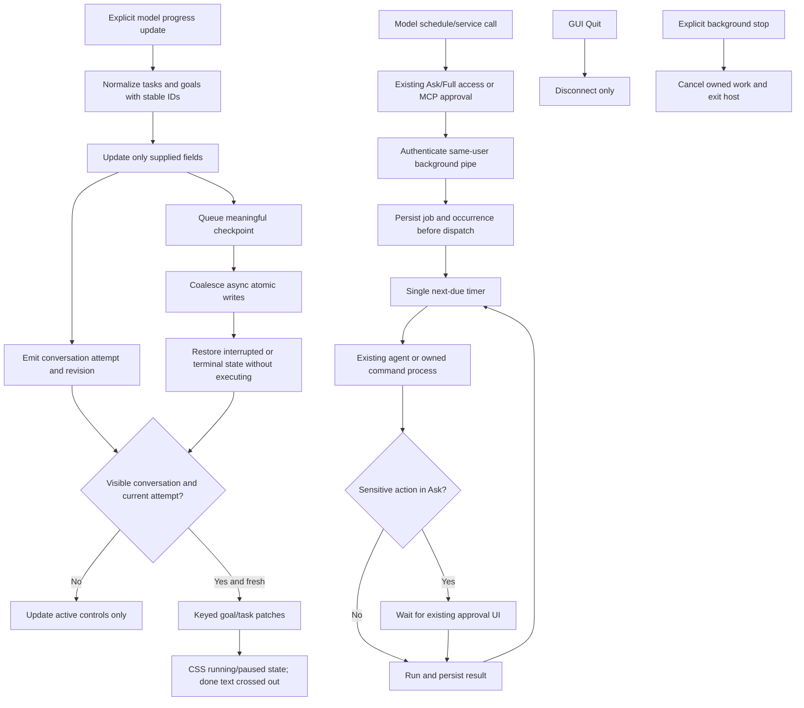

# Model-owned progress and background lifecycle

Progress paths below are implemented and under regression verification. Schedule/service host paths are the approved design only; the background runtime is not implemented yet.

```text
+-----------------------+     +------------------------+
| Model update_plan     |---->| Shared progress schema |
| tasks/goals optional  |     | Stable IDs; max 100    |
+-----------------------+     +-----------+------------+
                                          |
                         +----------------+---------------+
                         v                                v
              +----------------------+         +------------------------+
              | Revisioned event     |         | Coalesced checkpoint   |
              | conversation/attempt |         | atomic async persistence|
              +-----------+----------+         +-----------+------------+
                          v                                |
              +----------------------+                     |
              | Accept visible owner |<---- history -------+
              | and newer revision   |
              +-----------+----------+
                          v
              +--------------------------+
              | Goal left | Tasks right  |
              | Keyed rows, CSS animation|
              +--------------------------+

+----------------------+     +-------------------------------+
| Model schedule/service|--->| Existing permissions + scope  |
+----------------------+     +---------------+---------------+
                                             v
                            +--------------------------------+
                            | Authenticated detached host    |
                            | Own profile, store and jobs    |
                            +----------------+---------------+
                                             v
                            +--------------------------------+
                            | One next-due timer / real child|
                            | Existing agent/provider loop   |
                            +----------------+---------------+
                                             |
GUI Quit --> disconnect, host stays           | Ask --> existing approval UI
Stop background --> cancel/flush/exit         | Result --> owned history
```



User submission responses may select their returned conversation only while the same selection revision remains current. History/New Chat advances that revision; late responses cannot jump the user back or revive retired work. Global snapshots use a separate acceptance entry: a null active-run snapshot is not an instruction to clear the selected conversation. Explicit New Chat/clear remains the only local clearing route. Foreign or stale snapshots cannot replace the visible approval card, goals or tasks; active-run controls use the same revision comparison.

Tasks/goals remain exclusively model-owned. Missing fields preserve state; empty arrays explicitly clear. Completion does not infer done statuses. Progress count is done / total. DOM identity is task ID, not streaming event revision; only changed rows are patched. Checkpoints are meaningful state events, never thinking timers. Cross-attempt ordering uses attempt sequence plus event revision. Stale snapshots cannot replace a selected history conversation.

Background schedules use maintained cron calculations and a capped earliest-due timeout. Occurrence claims are persisted before execution. Interrupted runs are not replayed automatically. Missed ticks are coalesced; services restart only under an explicit bounded model-selected policy. The host owns separate profile/history files, references existing encrypted credentials, and survives GUI Quit. No automatic goal/plan/schedule creation and no new model loop.
