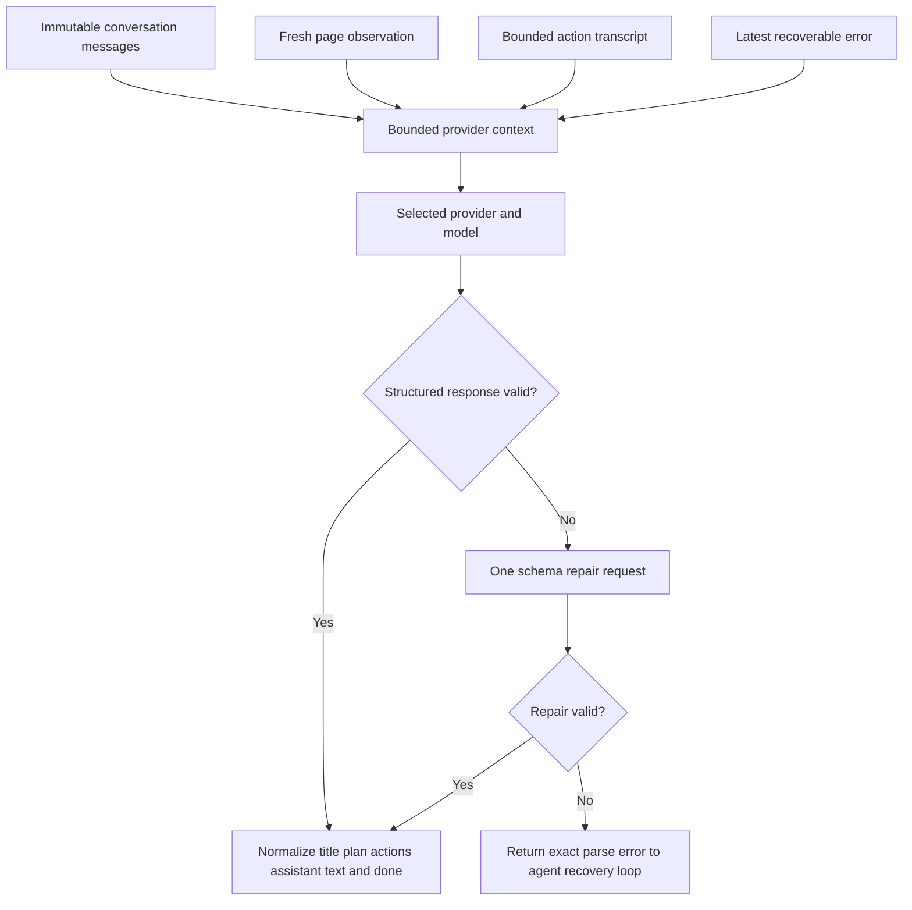
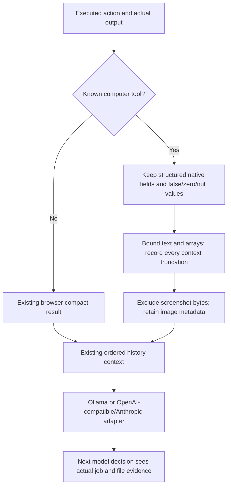
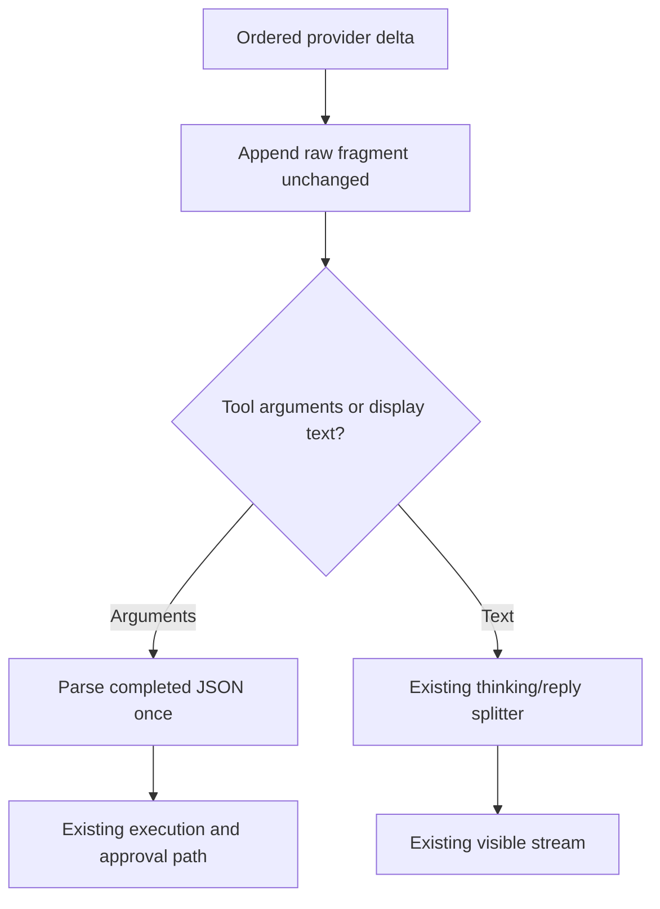
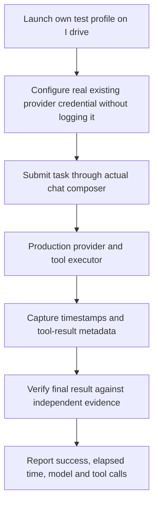
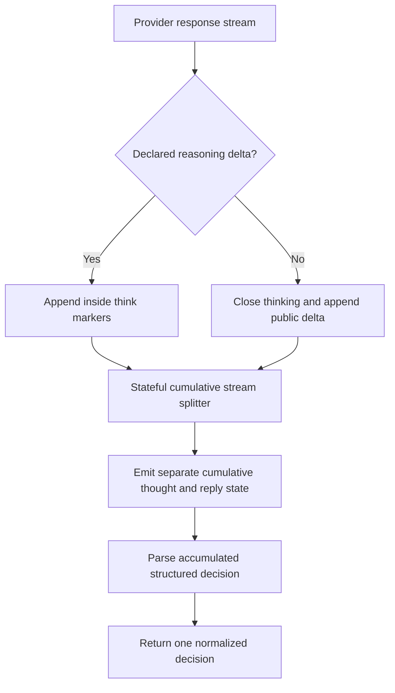

# Desktop Provider Contract Flowchart

## Request efficiency

[Agent request and evidence efficiency](efficiency_flow_chat.md) maps canonical versus wire context and actual HTTP accounting. Native schemas are transmitted in one channel; fallback retains textual schemas. Native window summaries preserve identities and explicitly flag omitted geometry. Retries and repair still use the existing loop.

## General decision contract

```text
+-----------------------------+
| Conversation + observation  |
| + tools + recovery evidence |
+--------------+--------------+
               v
+-----------------------------+
| Selected provider/model     |
+--------------+--------------+
               v
+-----------------------------+
| One structured decision     |
| title? planUpdate? actions? |
| assistantText? done?        |
+------+---------------+------+
       |               |
    valid            malformed
       |               |
       v               v
+-------------+  +----------------------+
| Normalize   |  | One schema repair;   |
| and execute |  | then recovery context|
+-------------+  +----------------------+
```



## AGI catalog extension

Browser-only system instructions are unchanged. AGI appends one short native-tool
awareness paragraph; the existing request carries the shared computer schemas.
OpenAI-compatible and Anthropic native definitions use each tool's exact JSON
schema, while Ollama receives them in its existing structured context/prompt.
The catalog, including the separate native stroke tool, fits the unchanged 40-tool context bound. Native
images use the existing image path with display origin/scale metadata and an owner-bound screenshotId; no extra
provider turn, retry loop or token-budget change is introduced. Native structural
repair preserves that same image, coordinate identity and desktop evidence in
both adapters. A native image rejected by the provider stops with a typed
NATIVE_VISION_UNAVAILABLE outcome rather than reissuing a blind request with an
empty browser DOM; ordinary browser DOM fallback is unchanged.

## Native result continuity repair

```text
+------------------------+   +----------------------------+
| Actual tool result     |-->| Tool-aware history reducer |
| jobId/state/exit/output|   | Browser path unchanged     |
| path/content/scanLimit |   | Native structured evidence |
+------------------------+   +-------------+--------------+
                                          v
                           +------------------------------+
                           | Bounded native text/arrays   |
                           | Explicit context truncation  |
                           | Image bytes: metadata only   |
                           +---------------+--------------+
                                           v
                           +------------------------------+
                           | Existing provider request    |
                           | Read actual evidence; decide |
                           +------------------------------+
```



Confirmed pre-fix defect: the browser-only field projection erased native
`jobId`, `state`, `exitCode`, `output`, `path`, `content`, and `scanLimited`, so the
UI could show a completed result while the next model received `{result:{}}`.
The fix branches on the declared tool identity, not guesses from output shape.
Small native results survive unchanged. Larger evidence is explicitly labelled
with context-only truncation metadata; it must not silently replace an original
partial search with an empty complete result. Images still travel only through
the existing native image transport. This repair adds no model calls, forced
plans, automatic retry actions or shortened thinking budget.

## Stream integrity repair

OpenAI-compatible `choice.delta` fields and tool argument fragments are additive,
not snapshots. Preserve every fragment in arrival order, including identical
consecutive tokens. A suffix/prefix deduplication heuristic was corrupting actual
code: a regression reproduced `c_ulonglong` becoming `c_ulong`, `1000000000`
becoming `100000`, and repeated letters/quotes disappearing. Reasoning and reply
text used the same faulty reducer. Never infer duplicate network events merely
from equal text; protocol event identity, where available, is separate from text.

```text
+--------------------------+     +---------------------------+
| SSE delta fragment       |---->| Append exact text once    |
| content / args / thought |     | No suffix/prefix guessing |
+--------------------------+     +-------------+-------------+
                                              v
                                +---------------------------+
                                | Parse completed payload   |
                                | Execute unchanged command |
                                +---------------------------+
```



## Live evidence replay

```text
+-----------------------+   +----------------------------+
| Isolated Electron app |-->| Existing saved xKiro auth |
| Same selected model   |   | Real provider, no stubs    |
+-----------+-----------+   +--------------+-------------+
            +-----------------------------+
                          v
            +-----------------------------+
            | Submit representative task |
            | Actual tools + real results|
            +---------------+-------------+
                            v
            +-----------------------------+
            | Check result independently |
            | Record time/calls/errors   |
            +-----------------------------+
```



Live replay is distinct from deterministic request-body tests. It never supplies
the model's decisions. The first P0 replay uses the reported xKiro Sol model ID
returned by discovery. A test deadline is an evaluation stop, not a production
thinking clamp. Preserve failed runs and report external/provider errors without
labeling them passes. Only ephemeral evaluation files may be written/deleted.

## Rules

1. `planUpdate` is optional. Providers are explicitly told to omit it unless
   they intend to expose and maintain a useful multi-step plan.
2. The current task and recent ordered user/assistant messages are both present,
   so a follow-up never loses conversational references.
3. `title` is metadata only. It cannot modify the first prompt or any message.
4. Prompts describe general semantic browser tools and evidence requirements;
   they do not encode Google, login, CAPTCHA, or benchmark-specific behavior.
5. Raw typed values are redacted from observations and tool history.
6. Transient transport failures receive at most one bounded retry. Permanent
   authentication, billing, quota, and invalid-model errors are surfaced.
7. Every streaming adapter builds one cumulative chronological stream. Native
   reasoning deltas are enclosed in `<think>...</think>` and public deltas are
   appended outside those markers. The shared stateful splitter then publishes
   separate cumulative thinking and reply fields while structured agent JSON
   remains private.
8. Bounded text context stays separate from ephemeral visual evidence.
   OpenAI-compatible, Anthropic, and Ollama providers use their native image
   inputs; an unsupported-image response falls back to the same DOM evidence.
9. The normalization boundary hoists misplaced control metadata such as
   `input.expect` and `input.repeat`, and discards non-executable annotations
   such as `title`, `description`, `reason`, and `label`, before semantic
   hashing or execution. Provider-specific wording and JSON placement cannot
   turn one operation into multiple action identities.
10. Browser image capability is optional. Missing visual input is never an external
    block when current DOM and visible semantic controls provide a safe route;
    the provider continues through that evidence. A provider's unsupported
    visual capability is remembered for the provider session, including when a
    successful response explicitly says it cannot process the image, so later
    turns do not resend the same unusable screenshot.
11. A `duplicate_action` recovery disallows that action for the next provider
    decision. If the first parsed decision repeats it, the provider uses its one
    bounded schema-repair call before the action can reach the executor.
12. Plain-text informational fallback rejects protocol-shaped content even when
    it is prefixed by a language label such as `json`. Malformed command objects
    remain recoverable provider output and are never painted as chat replies.
13. Every local decision request has a finite provider token budget. Streaming
    continues until the provider reaches a real terminal event, abort, timeout,
    or transport failure; it is never cancelled merely because valid reasoning
    crossed an arbitrary character count. A malformed decision receives one
    action-only repair through the same streaming boundary.
14. Explicit user initialization constraints remain part of the goal. A request
    to create a new artifact, reset, or begin from a fresh state is executed
    once through a grounded visible control and verified before later work;
    similar pre-existing content is not evidence that the requested reset ran.
15. Provider-declared reasoning is live and lossless within the request token
    budget. OpenAI-compatible `reasoning_content` / `reasoning`, Anthropic
    thinking events, Ollama `message.thinking`, and explicit think markers all
    enter the same cumulative splitter. Partial markers are withheld until
    unambiguous, so tag boundaries split across network chunks never leak or
    erase reply text.
16. Structural repair receives a compact, goal-ranked numbered-control list, a
    short recent action tail, and the names of controls already completed.
    Ranking is generic lexical retrieval over the current task and visible UI;
    it never selects an action or encodes a site/task scenario. Fresh outer
    observation and already-attached screenshot reads are explicitly
    disallowed, so repair selects an advancing action instead of reopening the
    same evidence loop.
17. Current observations include bounded interaction regions and public control
    state. Providers may use an indexed control for activation, then a finite
    coordinate click or drag grounded inside a current region for placement.
    This is a general interaction contract and contains no application or
    benchmark-specific sequence.
18. A successful click and `visibleEffectObserved` prove only that the exact
    click changed the page. A pressed or selected tool, or visible placement
    guidance, is evidence that a follow-up gesture remains; it must never be
    narrated as the completed user outcome.
19. A bounded `workingMemory.previousReasoning` tail carries the model's latest
    declared strategy into the next decision. It is explicitly labelled as an
    unverified intention and must be corrected whenever fresh observation or
    completed-work evidence disagrees.
20. The short action transcript is supplemented by a bounded semantic
    `completedWork` ledger. Long tasks can therefore continue without replaying
    old controls merely because those actions aged out of recent history.
21. For a task that changed the page, completion uses a two-stage contract: the
    first `done` requests an evidence review; the next decision must continue
    with a missing action or explicitly verify completion. Informational turns
    without mutations remain one-decision conversations.
22. Fixed waits require an explicit positive duration and are reserved for known
    in-page delays. Providers prefer fresh observable evidence, use one longer
    wait instead of repeated 500ms waits, and receive the harness's actual wait
    plus its bounded next minimum as decision evidence.


