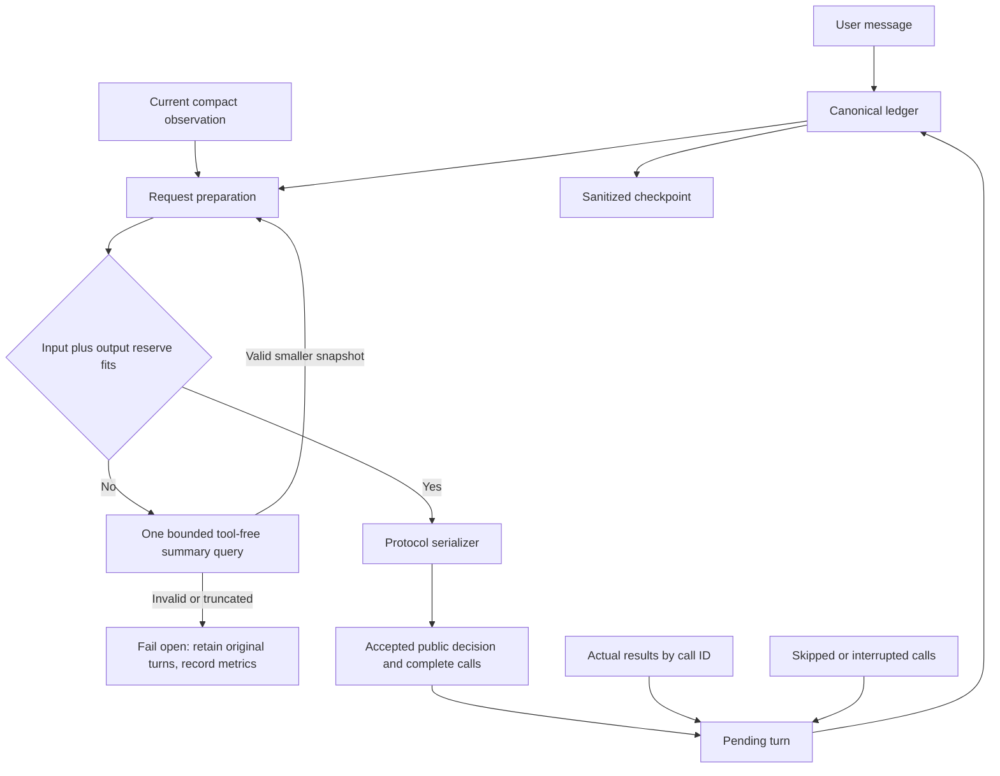

# Provider turn ledger

## Contract (2026-09-13)

A run owns a versioned canonical conversation. Each accepted decision records the
bounded evidence it was given, public commentary/metadata, complete call IDs and
inputs, and results. Results settle during execution; missing calls are marked
not executed at the next decision or run end. No result is inferred from prose.
Provider-required opaque/signed reasoning lives in a non-serialized replay map
scoped to provider + endpoint + model. Saved snapshots contain no reasoning,
screenshot bytes, credential fields or raw typed secrets. On restore/provider
switch, canonical sanitized turns remain usable as historical text with paired
results; no foreign signed block is replayed.

```text
real user messages --> append once, in order
current evidence --> prepare request --> compact if budget requires it
                         |              |
                         |              +--> one summary query, no tools
                         |                   validate snapshot, retain recent turns
                         |                   failure: fail open, keep original turns
                         v
provider response --> validate complete call IDs --> pending turn
                         |
actual tool results ----+--> settle each ID before checkpoint
                         |
skipped/aborted calls --> explicit nonexecution at turn boundary
                         v
canonical groups + current evidence --> protocol serializer --> provider
                         |
safe snapshot ----------+--> existing atomic chat checkpoint store
```



## Budget and storage

Use real provider usage when present to calibrate a conservative UTF-8 estimate;
label estimates as estimates. Configurable context-window budget reserves output
and tool-result headroom. Count system instructions, tool schemas, current state,
attachments and retained turns—not merely history. Compaction is triggered by
input pressure, not elapsed steps. Whole call/result groups are indivisible.
The latest objective, permissions, plan/goals, verified facts and unresolved
errors are pinned from runtime data, never overwritten by a summary. The pinned
objective leads every wire request, including after a failed compaction or turn
trimming.

Compaction failure is fail-open (2026-09-13): a truncated, invalid, or failed
summary never blocks the run. The original turns are retained, the failure is
recorded in metrics (`compactionFailures`, `compactionFailureReason`), and the
real provider request proceeds—an oversized request surfaces as an honest
provider error instead of a side-query stop. If turns exceed maxTurns after a
failure, whole oldest groups are dropped (recorded as
`uncompactedTurnsDropped`) so the wire stays bounded. The summary side-query
requests 16,384 output tokens; five snapshot arrays of concrete findings do not
fit a 4096-token ceiling.

Large result previews include a full-output SHA-256 and an owned retrieval ID
only after the full sanitized result was successfully saved. Retrieval returns
bounded pages and cannot access another conversation's outputs. Failed storage
must never produce an invented retrieval pointer.

## Wire formats

- Chat Completions: system first, ordered user/assistant/tool messages with exact
  native IDs. JSON fallback uses historical assistant/result text, no orphan
  native calls. Preserve raw provider-required reasoning only on compatible
  live replay.
- Ollama: system first; ordered JSON decision/result messages. No unconditional
  schema change to native tools. Local IDs correlate actions with actual results.
- Anthropic: preserve ordered block indices, tool IDs, thinking signatures and
  redacted-thinking blocks for live native replay; one tool_result per tool_use.
- Responses: preserve native output item order, call IDs, phase metadata and
  encrypted reasoning within compatible live replay. Canonical checkpoint
  excludes opaque/private fields. Retain later real user messages explicitly.

Recovery diagnostics remain typed runtime data, not new user objectives. Queued
steering messages are persisted, delivered once at a model boundary and
acknowledged by ID. A late steering message prevents final completion until it
has been delivered; it cannot grant permissions or switch providers mid-call.

## Verification

Tests cover real request arrays on successive decisions (not only parser output),
ID pairing including clipped batches/cancellation, unchanged current evidence,
repair and network retry idempotence, stable prefixes, native thinking metadata,
JSON fallback, disk snapshot redaction, provider switch, compaction failure and
success, owned output retrieval, and steering before a final action. Existing
continuity/transport suites remain applicable. The isolated live Electron GLM
fixture verifies completion and compares call count/latency, not just startup.
