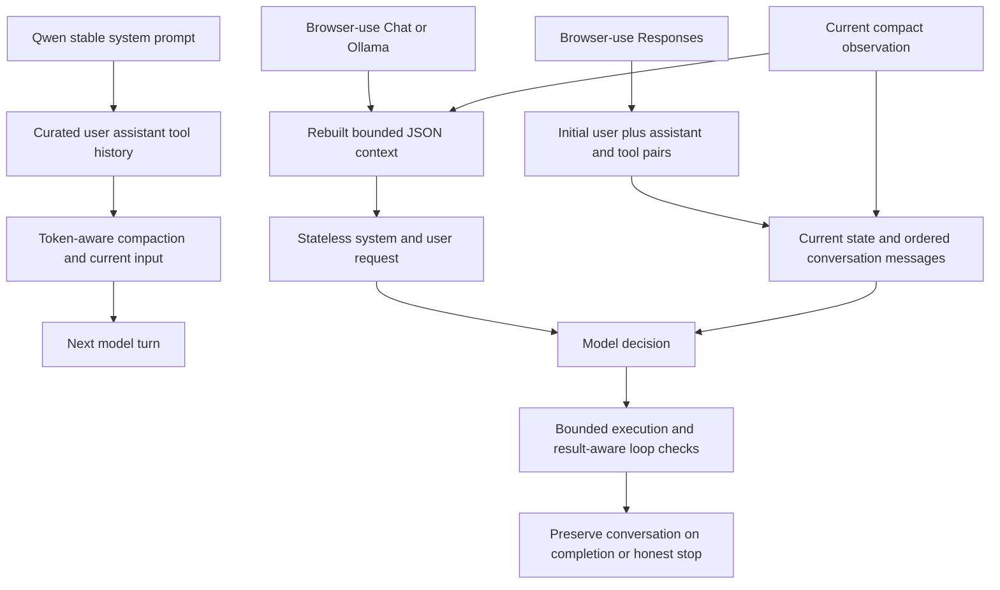

# Qwen baseline comparison — agent continuity

Date: 2026-09-13. Reference: the supplied `F:/qwen-code-main` checkout, not a generic description of a coding agent. App scope: Browser-use desktop/agent, computer tool catalog, and chat submission path. Provider/network tests below use fixtures; no user credentials or saved conversations are included here.

## Conclusion

The problem is not established as a weak-model or master-prompt-only issue. The implementation discarded required request evidence, allowed successful-but-unproductive loops to reset recovery, and advertised mechanisms that were not equivalent to the reference. Removing instructions to think aloud helps the output contract, but cannot replace real conversation continuity.

The earlier claim that a 300-character reasoning tail itself caused the overnight run was unproven. The pasted transcript demonstrates repeated investigation but is not a recording of the exact HTTP requests. Findings below distinguish source/probe proof from attribution to that run.

## Architecture map

```text
Qwen: stable prompt + curated ordered conversation
      --> assistant tool requests --> actual paired tool results
      --> token-aware compaction / preserved current context --> next turn

Browser-use Chat/Ollama: prompt + rebuilt task/state/history JSON
      --> decision --> execution --> bounded/redacted result history
      --> new system/user request (no native prior assistant turns)

Browser-use Responses: initial user item + retained assistant/tool pairs
      + current state --> decision --> retained assistant/tool pairs
      [fix: current state now also includes later conversation messages]

All local paths: actual observation --> compact current evidence
      [fix: sampled "unchanged" fingerprint no longer replaces evidence]
```



## What the model's master prompt actually is

There is no single master-prompt file shared by all providers.

| Route | Actual source and composition |
|---|---|
| xKiro GLM / Chat Completions | `openAiCompatibleProvider.cjs:providerSystemPrompt()` + `PUBLIC_FEEDBACK_INSTRUCTION`; AGI adds `computerCatalog.cjs:AGI_PROMPT`. Native schemas are a separate tools field. |
| Anthropic Messages | Same base policy, different wire format; the adapter still enables native thinking with a 1024-token budget. |
| Ollama | Separate inline system prompt in `ollamaProvider.cjs:createOllamaProvider()`; hand-maintained browser catalog plus optional AGI paragraph. |
| Responses / Astra | `responsesProvider.cjs:INSTRUCTIONS` + optional AGI paragraph. Native assistant/reasoning/tool items are retained separately. |
| Runtime guidance | `boundedRequestContext()` adds task, messages, progress, facts, recent history, plan, recovery and prior-reasoning tail. `scheduleRecovery()` and strategy checkpoints add further instructions. |

Confirmed pre-fix Chat prompt clauses:

- “Begin every response immediately with <think> … then close </think>.”
- “Immediately after </think>, issue your decision … Never write other prose outside the thinking block.”
- “never restate, reconcile, or continue it at length” versus a runtime checkpoint saying “Reconcile the original goal, current page, prior reasoning …”.
- “Batch dependent actions (navigate, then screenshot, then click, then fill)” despite later actions needing results the model had not yet received.

The Chat prompt now allows brief normal commentary with native tools, does not require synthetic thinking tags, emphasizes beginning a focused implementation with sufficient evidence, distinguishes actual user scope from recovery diagnostics, and says not to batch inputs that depend on unseen results. These are policy corrections, not an API-level fast/reasoning mode. No such GLM control was sent by the inspected request.

Qwen counterparts: `packages/core/src/core/prompts.ts` lines 271–287 (implement while gathering context; diagnose before switching), 333–349 (dedicated tools and independent concurrency), 375–382 (optional outcome-oriented plans), 430–445 (communication and secret handling), 565–657 (prompt construction/override), and 665 onward (stable/context/volatile layers). Prompt length by itself is not proof of inefficiency: Qwen also has a substantial prompt.

## Confirmed defects and status

### 1. Missing observation in a stateless request — fixed

`ollamaProvider.cjs:boundedRequestContext()` replaced the whole observation with a note asserting it had already been delivered. The Chat wire request had only `system,user`; the prior control was absent from the entire next request. Responses retains assistant/tool items but not previous observation user items, so the same shortcut was unsafe there too.

The coordinator fingerprint only samples the first 24 elements and omits indices. Probes confirmed both a changed 25th control and changing all indices leave it equal. It is an effect heuristic, not an exact observation identity.

Fix: always retain compact current evidence; fingerprint equality is only a hint. Also route explicit observation history through the normal DOM bound (a 2000-element history entry now retains 120 elements).

Qwen prerequisite: `core/llm-chat.ts:getRequestHistory`, lines 2458–2495, replays curated actual conversation. “See earlier” is valid only when the earlier content is still in the model input.

### 2. Later Responses messages lost — fixed

`responsesProvider.cjs` captured `this.initial` once, then destructured `messages` out of every later state. A probe appended a new scope message: it was absent from the whole second request. Current state now includes ordered messages; existing call/output pairing remains tested.

Important qualification: the recovery object already traveled in per-turn state, so this defect did not remove *all* recovery guidance. It removed the later conversation-message channel.

### 3. Unbounded planning and successful inspection — contained

`desktopChatAgent.cjs` could accept changing plan-only responses without advancing `step`. Probe: 13 decisions, step 0, recovery attempts 0. `maxSteps` is a checkpoint interval, not a limit. Alternating successful reads crossed six checkpoints with maxSteps=2 until explicitly cancelled.

Fix: plan-only responses advance step; a separate finite maxDecisions (default 100, configurable up to 500) counts returned decisions and non-transport provider failures. It does not count network retries, observations or checkpoints. At the limit the run records unsuccessful/unverified status and preserves the conversation for continuation. This cap limits cost; it does not make a task productive or prove completion.

### 4. Inaccurate and ineffective repeat guards — replaced for read stagnation

The earlier guard blocked a fifth click even with new fingerprints and explicit reported progress. Read-only tools escaped; intervening reads did not reset the supposedly consecutive mutation streak. Semantic hashes were lossy (equal-length fills, 200-character string prefixes) and unsuitable for an all-tool hard veto. Four loop breaks separated by successful calls still left the recovery counter at zero.

Fix: semantic duplicate handling stays advisory. A separate post-execution comparison uses SHA-256 of canonical full tool name/arguments/result for evidence-reading tools. Five identical completed results or three full AB cycles request one replan; recurrence stops honestly using a separate counter that successful duplicates cannot erase. Changed results, active jobs, intervening writes and GUI gestures do not trigger this read-stagnation guard. Arbitrary shell execution and GUI progress need richer evidence; the decision ceiling remains their backstop.

Qwen references: `tools/tool-call-repeat-key.ts:18–51` canonical full-argument hashing; `services/loopDetectionService.ts:35–169` thresholds and cap, `:706` always-on checks, `:833` result-aware exception, `:869–973` shell overview stagnation. The shell classifier is deliberately narrow (git overview commands), not a general semantic understanding of PowerShell investigations. `core/client.ts:4166–4237` distinguishes always-on checks from opt-in heuristics and actually ends the turn on detection. Do not claim Qwen enables every heuristic by default.

### 5. Attachment accumulation and hidden history growth — partially fixed

Five attachments could contribute 600,000 characters despite a nominal 300,000-character context guard. A first patch then consumed all 120,000 characters on the first attachment, leaving later files empty.

Fix: share the text-preview budget among selected text files, preserve a preview of each, and label truncation/original length. This is **not** lossless compaction or a tokenizer-enforced overall context cap. Large non-ASCII/escaped payloads and other context sections still need total request budgeting. Original attachment content is not claimed read when omitted.

### 6. Native conversation retention and compaction — remaining architectural work

GLM Chat and Ollama still rebuild a bounded snapshot instead of replaying native assistant/tool turns. Intermediate commentary is UI-only, native call/result history is not replayed as a conversation, tool details age out after 12 entries, and run history is capped at 80. Stub entries preserve step/tool but not the original evidence. A larger prior-thinking string is not a substitute for an ordered transcript or structured state summary.

Correct follow-up: one versioned conversation ledger; protocol-specific serializers with complete call/result pairs; retain public conclusions and provider-required opaque reasoning where supported; stable prefix; token-accounted compaction preserving the current user objective, active tools, verified facts, open questions and artifact pointers. Do not retain raw private reasoning as an improvised memory database.

Qwen: `core/llm-chat.ts:getRequestHistory`; `services/chatCompressionService.ts` default proportional threshold 0.85 plus output reserve, absolute buffer and failure handling. Copying just “85%” or chars/4 is not equivalent.

### 7. Native memory capability mismatch — remaining

`memoryUpdate` is consumed from parsed decision JSON, but is not an independently callable tool. Responses returns actions/commentary and does not parse that JSON metadata. The AGI paragraph nonetheless advertises optional memoryUpdate. Native tool mode therefore has no dependable structured memory-update channel. `update_plan` does work as a tool; do not conflate that with missing memory/title metadata.

A shared explicit memory tool or protocol-independent metadata contract is needed. Arbitrarily parsing commentary as state is not a safe substitute.

### 8. Active user steering — remaining

`renderer/app.js:renderChatControls` disables Send while active; `DesktopChatAgent.start` rejects a second active run. Continuations operate after completion/cancellation, not as Qwen-style queued steering. Therefore the earlier assertion that a recovery message definitely overrode the user's mid-run instruction was not established by this source.

Qwen: `core/client.ts` SteerInput contract and `:4352–4375` boundary delivery. Implement queued user instructions with explicit delivery acknowledgement, correct role/provenance and persistence; never represent a diagnostic as an actual change of user scope.

### 9. Concurrency and output retrieval — remaining

The Browser-use action batch still executes serially. Qwen partitions dependency-safe calls before concurrent execution (`core/coreToolScheduler.ts:1397–1457,4589–4642`). A browser query updates the index snapshot, so “read-only” does not automatically mean concurrency-safe here.

Long tool output is currently truncated without a general durable full-output reference/digest. Qwen's truncation and persisted-output handling provide recovery pointers. A full port needs that storage lifecycle, not merely a short stub string.

## Verification and limits

- Baseline probes and regression tests inspect real request construction and loop mechanics using controlled fixtures. They are not a live-model benchmark.
- `tests/agent-continuity-regressions.test.mjs` covers evidence presence on actual Chat/Anthropic request bodies, later Responses messages, decision/retry accounting, exact-result and AB loops, active-job/change exemptions, large input identity, and attachment/DOM bounds.
- `tests/live-agent-continuity-e2e.mjs` launches the actual isolated Electron app and drives its chat UI with real GLM on a local form; its output/evidence directory is the authority on success or failure.
- Existing broader suites still contain semantic-veto assertions that conflict with the current advisory policy. Do not silently rewrite those to manufacture a green result or describe the whole suite as passing.
- No changes to the user's selected provider/model, permission settings, credentials, active chats or tabs are part of this repair. No commit or push.

## Recorded verification outcome

- New regressions plus Responses and transport suites: **33/33 passed**.
- Full focused set: **171 tests; 161 passed, 10 failed**. Seven failures are the existing desktop-agent semantic-veto assertions; three are provider redundant-observation/screenshot/duplicate-recovery repair assertions. The current implementation is advisory on these paths. These remain open; the whole suite is not green.
- Live actual Electron + `z-ai/glm-5.3-flash`: **7 decisions, 151844ms, one correct submission, verified receipt `KITE MOSS`, no failed tool results**. Evidence: `%TEMP%/bu-continuity-live-fYyUay/result.json` and `chat.png`. This demonstrates completion on a small real browser task, **not** Qwen-level speed or overnight reliability. Screenshot reading was attempted; the image tool did not expose a visible rendering in this terminal session, so do not claim a separate visual styling inspection.
- First live-driver attempt failed because it read a running snapshot after its completion wait. The driver was corrected to poll and retain a single terminal snapshot; the second attempt above passed. It was not reported as a model failure.
- Syntax checks and scoped `git diff --check` passed (Git emitted an LF/CRLF warning for Responses).

Commands:

```text
node --test tests/agent-continuity-regressions.test.mjs tests/responses-continuity.test.mjs tests/transport-retry.test.mjs
node --test tests/agent-continuity-regressions.test.mjs tests/agent-efficiency.test.mjs tests/desktop-ollama-provider.test.mjs tests/desktop-openai-compatible-provider.test.mjs tests/desktop-ai-chat-agent.test.mjs tests/output-budget.test.mjs tests/desktop-thinking-stream.test.mjs tests/responses-continuity.test.mjs tests/transport-retry.test.mjs
node tests/live-agent-continuity-e2e.mjs
node --check desktop/agent/desktopChatAgent.cjs
node --check desktop/agent/desktopAgentCoordinator.cjs
node --check desktop/agent/ollamaProvider.cjs
node --check desktop/agent/openAiCompatibleProvider.cjs
node --check desktop/agent/responsesProvider.cjs
node --check tests/live-agent-continuity-e2e.mjs
```

## Current implementation update (continuation)

`providerTurnLedger.cjs` now provides the first implementation slice of the ordered ledger: sanitized user/current-state turns, stable native call IDs, truthful skipped-call results, bounded result previews with SHA-256, provider-compatible replay, and optional owned result storage. Chat/Ollama adapters receive the run ledger and replay prior exchanges; Responses retains its established native turn store and later-message state channel. `providerCompaction.cjs` and `agentResultStore.cjs` provide the bounded-summary and owned-result primitives, with compaction only replacing whole groups after a validated summary. Active steering is queued at the next boundary and persisted with runtime provenance.

This slice is deliberately not declared full parity: Responses' existing native replay and the new canonical ledger are not yet unified for restored opaque reasoning; structured `memoryUpdate` is still not a dedicated tool; concurrency-safe action scheduling remains serial; and the live rerun after ledger integration hit a 30-second model-label startup wait, so the earlier live success remains the authoritative live-provider result. The focused provider/continuity suite after integration is green (69/69).

## Next implementation priority

Finish the cross-provider persisted ledger/Responses unification and add token-aware compaction integration tests before further memory-reduction shortcuts. Then add structured memory updates and concurrency-safe scheduling. Current fixes remove demonstrated regressions and bound repeated work; they are not full Qwen parity.


## 2026-09-24 — Claude Code/Codex comparison findings

The local Claude Code and Codex installations expose a structured event/session
model: Claude records assistant/user/tool lifecycle events plus queue/session
state, while Codex records `turn_context`, `response_item`, `event_msg`, and
explicit `compacted` events. Their observable contract treats a tool-free
assistant response as a valid conversational answer. Browser-use instead
classified every tool-free response as `empty_decision`, injected a synthetic
user recovery notice, and asked for an executable action again. This caused a
plain question to loop instead of receiving an answer.

Browser-use also stored runtime research, skill hints, and recovery notices in
the same `messages` array as the user's conversation. The providers then sent
those internal notices back as user-role conversation turns. Runtime context is
now separated: normal user/assistant messages remain ordered conversation, and
runtime notices are bounded advisory context with explicit provenance.

The comparison found three additional concrete gaps and fixes:

1. **Recovery multiplication:** Browser-use allowed 12 recovery attempts times 8
   fresh-restart cycles. A single bad model response could therefore produce 96
   synthetic retries. Fresh restart is now one strategy change before an honest
   internal recovery context.
2. **Prompt scope:** Browser-use appended a 7k-character native AGI playbook,
   including 3D modeling instructions, to ordinary questions and code tasks.
   AGI guidance is now task-scoped: the modeling playbook appears only for 3D,
   CAD, mesh, primitive, scene, or related tasks.
3. **Tool visibility:** the actual AGI request exposes 43 tools, while the
   previous bounded context sliced tools to 40. The slice was removed so the
   model receives the complete catalog.

The answer-only, runtime-memory, recovery-bound, prompt-scope, and full-tool
regressions are covered by tests. These changes compare behavior and contracts;
they do not copy Claude Code or Codex source.
