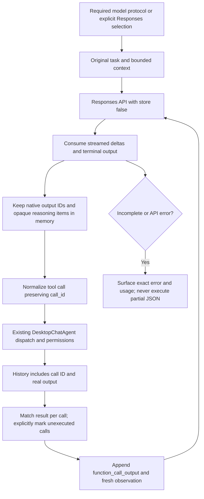

# Responses conversation continuity

The provider factory uses this adapter for explicitly requested Responses and the
GPT-6 Astra family, whose official tool-calling contract requires Responses. Other
models keep their existing transport. The selected model and connection are not
changed. A gateway rejecting the required protocol returns a clear terminal error
instead of silently downgrading or retrying an incompatible route. Gateway/live
model acceptance remains distinct from the local transport regression tests.

```text
+----------------------------+
| Initial task + tools/state |
+-------------+--------------+
              v
+----------------------------+
| Actual Responses request   |
| Retain native output items |
+-------------+--------------+
              v
+----------------------------+
| Tool call IDs -> agent loop|
| Existing approval/execution|
+-------------+--------------+
              v
+----------------------------+
| Match each call ID to      |
| actual returned tool result|
| skipped != succeeded       |
+-------------+--------------+
              v
+----------------------------+
| Replay assistant items +   |
| tool outputs + fresh state |
| No fabricated reasoning    |
+-------------+--------------+
              v
+----------------------------+
| Next native model decision |
| Keep plan unless revised   |
+----------------------------+
```



- Each native call ID survives provider normalization, action normalization and history recording. Result matching is by ID, never a guessed action-name match.
- Assistant output items, phase fields and encrypted reasoning are passed unchanged within a bounded, in-memory recent conversation. Never write opaque reasoning to durable conversation history or fabricate it. No previous_response_id dependency or server persistence; store=false.
- Request `reasoning.encrypted_content` for stateless continuation. Commentary-phase
  messages alone are not final success; only provider reasoning summaries enter
  the thought channel. Missing/duplicate tool-call IDs reject before execution.
- Return outputs for clipped/skipped calls as explicit not-executed errors. Never replay missed actions automatically. Retain complete exchange groups, not orphan call/result halves, when bounding replay.
- Initial task remains in full at the front. Subsequent state messages supply latest observation, recovery, plan/goals and relevant evidence, not an entirely restarted user task. Keep last 24 completed exchanges under 1MB before adding current image; raw response size capped.
- Tool schemas reuse existing canonical definitions. Provider system instructions are concise objectives/constraints/tool-evidence rules, not forced visible thinking or a template solution. Model owns planning; browser_done remains terminal so current completion checks still apply.
- Track actual HTTP/finish/usage data. Same 4096 output limit initially as current adapter so protocol/prompt comparison does not also silently tune budget; change only if real output shows truncation. No added supervisor model or hidden retries.
