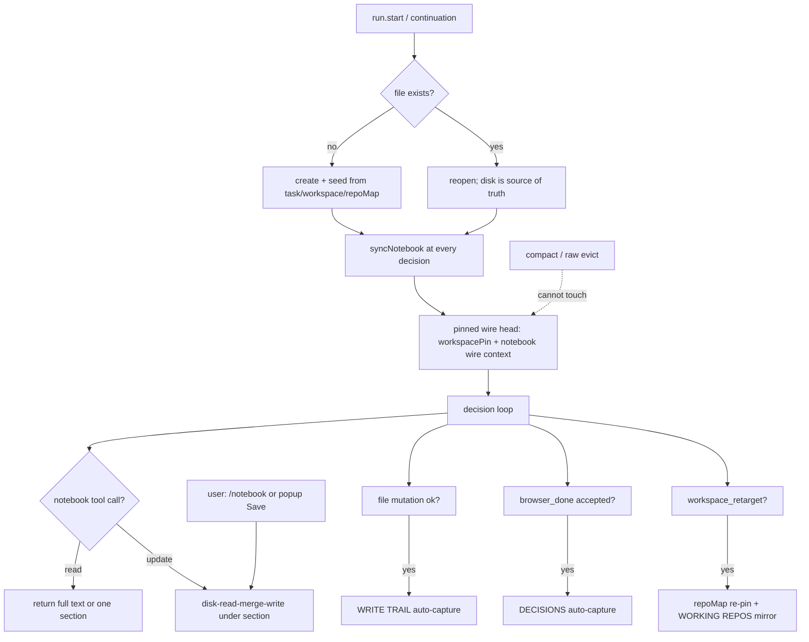

# RUN NOTEBOOK — flowchart (GEN9 persistent notebook)

Durable per-run session state that survives auto-compaction, raw eviction,
restart, and continuation. Grounded in the GEN9 defect catalog
(`F:\harness-lab\gen9\defect-catalog.md`): D1 (working repo forgotten), D2
(src-vs-dist re-derived 4x), D3/D4 (patch churn, "file already contains..."),
D5 (silent requirement drop), D8 (raw eviction past maxTurns = silent loss).

## What it holds (sections, ownership)

| Section            | Owner | Seeded / fed by |
|--------------------|-------|-----------------|
| USER RULES         | user  | user via /notebook or the desktop popup Save |
| CREDENTIALS & KEYS | user  | user (never redacted on disk; ledger sanitizer never touches the file) |
| COMMANDS           | user  | user |
| NOTES              | user  | user (`/notebook <text>` appends here) |
| WORKING REPOS      | agent | run.repoMap (workspacePin.cjs — ONE source of truth, mirrored to disk) |
| TASK REQUIREMENTS  | agent | parseNumberedRequirements(task) at seed; OPEN lines stay on the wire until done/deferred |
| PROJECT FACTS      | agent | seed hint + model `notebook` updates (the dist-serving class of fact) |
| TOOL CONTRACTS     | agent | seeded static card: computer_patch contract + ownership etiquette (N5/N6) |
| WRITE TRAIL        | agent | auto-captured on successful file mutations (N4) |
| DECISIONS          | agent | auto-captured on accepted browser_done |

## Master flow

```
+---------------------------+     +----------------------------+
| run.start(task, workspace)|     | continuation / restart     |
+------------+--------------+     +-------------+--------------+
             |                                  |
             v                                  v
+----------------------------+   +--------------------------------+
| createRunNotebook(filePath)|   | notebookPath from snapshot;    |
|  out-dir/notebook.md (CLI) |   | re-open file; if missing ->    |
|  userData/notebooks/ (app) |   | reseed from task (file=GONE)   |
+------------+---------------+   +--------------------------------+
             | both: ensureSeeded()
             v
+-------------------------------------------------------------+
| SEED (once per file): WORKING REPOS <- run.repoMap           |
| TASK REQUIREMENTS <- parseNumberedRequirements(task) [OPEN]  |
| PROJECT FACTS hint, TOOL CONTRACTS card, user sections empty |
+----------------------------+--------------------------------+
                             |
    every decision           v
+-------------------------------------------------------------+
| syncNotebook(run): ledger.setNotebookText(wireContext())      |
|  wireContext = full text (<=4096 B) OR index (<=20 lines)     |
|  + ledger.setWorkspacePin(renderRepoMapWire(run))             |
+----------------------------+--------------------------------+
                             v
+-------------------------------------------------------------+
| PINNED WIRE HEAD (rebuilt EVERY decision from live state):    |
|  { contextType, originalTask, taskLadder, workspacePin,       |
|    notebook }  <-- structurally exempt from compaction:       |
|  never stored in turns; raw-evict + compact cannot touch it   |
+-------------------------------------------------------------+

   agent writes                user edits
+---------------------+    +---------------------------+
| notebook tool        |    | /notebook (TUI append)    |
|  op=read[?section]   |    |  /notebook        -> path |
|  op=update           |    |  /notebook txt    -> NOTES|
|   section+text       |    | desktop popup Save (IPC)  |
+----------+----------+     +-------------+-------------+
           |                              |
           v                              v
+-------------------------------------------------------------+
| MERGE (disk-read-merge-atomic-write, every write):            |
|  1. read CURRENT file (user edits always win)                 |
|  2. user sections  -> user's edited content verbatim          |
|  3. agent sections -> disk content + lines the editor added   |
|  4. unknown sections (user-made headers) preserved verbatim   |
|  5. tmp write + rename                                        |
+-------------------------------------------------------------+

Auto-captures (agent side, no model action needed):
  file mutation ok  -> WRITE TRAIL: path + what + clock (N4)
  browser_done ok   -> DECISIONS: summary + verified flag
  workspace_retarget-> WORKING REPOS re-pin (repoMap source of truth)
  user msg w/ path  -> recordRepoMentions (repo map, N2)
```

## Wire-context decision (justified)

HYBRID: full notebook rides the pinned wire while <= 4096 bytes; above that an
index (section header + line count, <= 20 lines) rides and the model reads
sections on demand via the `notebook` tool (op=read, optional section).

- At seed the notebook is ~0.5-1 KB (~250-500 tokens): carrying it whole removes
  an entire read round-trip per decision and directly fixes D1/D2 (the model
  must SEE the repo pin and the dist-serving fact without choosing to read).
- The 4 KB cap bounds worst-case pinned cost at ~2 k tokens (~1.5% of a 131k
  window) — cheap relative to the ~30 minutes/run of re-derivation it prevents.
- Past the cap the index costs ~60 tokens; nothing is ever summarized away —
  the CONTENT stays on disk and is re-read at full fidelity on demand.

## Mermaid



## Integration points (file:line at time of writing)

- `desktop/agent/runNotebook.cjs` — new module (parse/merge/seed/wire).
- `desktop/agent/workspacePin.cjs` — ported from gen7-arch1 (repo pin + map).
- `desktop/agent/providerTurnLedger.cjs` — setNotebookText/setWorkspacePin; pinned
  wire head fields; compaction summarizer input carries pin + notebook index.
- `desktop/agent/desktopChatAgent.cjs` — run creation + continuation seeding,
  syncNotebook, `notebook` tool dispatch, /notebook slash, auto-captures,
  serializeRun/restore (notebookPath), toolDefinitions.
- `desktop/main.cjs` — notebookDir (userData/notebooks), notebook IPC + popup window.
- `desktop/preload.cjs` + `desktop/renderer/notebook.html` + `desktop/renderer/app.js`
  — popup editor, Save, notebook.open event.
- `cli/agent-cli.mjs` — notebookDir = --out-dir.
- `cli/tui.mjs` — /notebook command, /config row.
