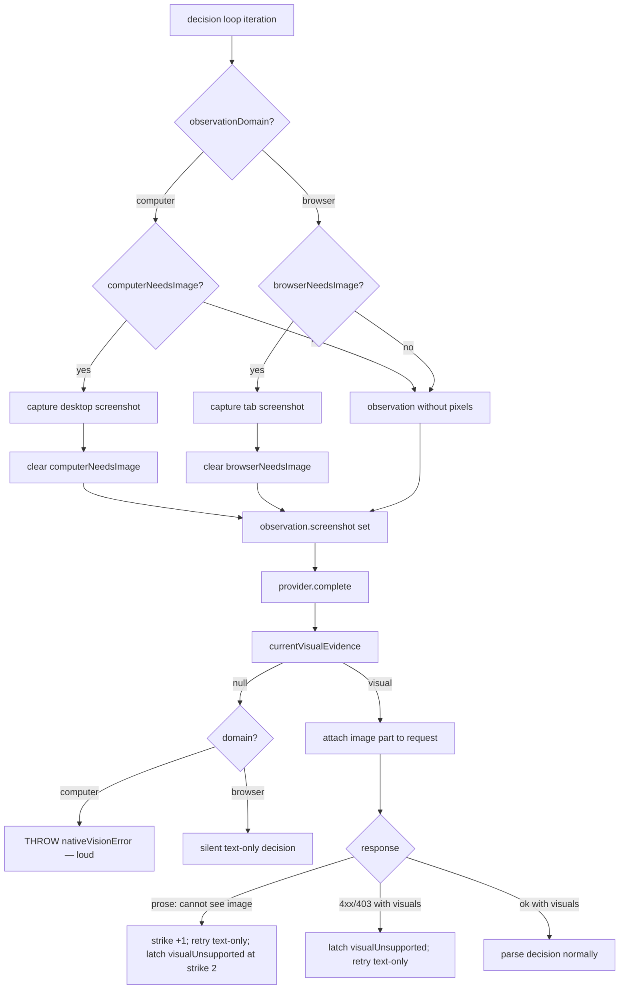

# Visual Evidence Pipeline — Flow Chart

Covers how the agent decides whether a decision carries pixels:
`desktopChatAgent.cjs` (`observeRun`, `observe`, the decision loop) →
`openAiCompatibleProvider.cjs` (`complete` visual gating) → `providers/wire.cjs`
(`currentVisualEvidence`, `declaresVisualUnsupported`).

## ASCII flow

```
                    +---------------------------+
                    | decision loop iteration   |
                    +-------------+-------------+
                                  v
              +---------------------------------------+
              | observationDomain?                    |
              +------+-------------------------+------+
                     |                         |
              computer|                  browser|
                     v                         v
   +---------------------------+   +-----------------------------+
   | computerNeedsImage true?  |   | browserNeedsImage true?     |
   | (set by any desktop       |   | (set by any executed        |
   |  mutation; init on        |   |  browser mutation)          |
   |  continuation)            |   |                             |
   +------+-------------+------+   +------+-------------+--------+
          | yes         | no             | yes         | no
          v             v                v             v
   +-------------+  (no pixels)    +-------------+  (no pixels)
   | capture     |                | capture     |
   | screenshot  |                | screenshot  |
   +------+------+                +------+------+
          | cleared flag                 | cleared flag
          v                              v
   +-------------------------------------------------------+
   | observation.screenshot = {data, mimeType, ...}         |
   +---------------------------+---------------------------+
                               v
              +----------------------------------------+
              | provider.complete(observation)         |
              +-------------------+--------------------+
                                  v
                    +---------------------------+
                    | currentVisualEvidence()   |
                    | dataUrl/base64 -> visual  |
                    +------+------+-------------+
                           | null  | visual
                           v       v
        +-------------+  (silent    +----------------------+
        | computer:   |   skip)     | attach image part    |
        | THROW loud  |             | to provider request  |
        +------+------+             +----------+-----------+
               |                               v
               |                 +---------------------------+
               |                 | response received         |
               |                 +------+------+-------------+
               |                        |     |
               |         prose "can't   |     | 400/403/413/415/422
               |         see the image" |     | with visuals attached
               |                        v     v
               |        +----------------+     +---------------------+
               |        | strike +1,           | drop image, latch   |
               |        | retry text-only;     | visualUnsupported,  |
               |        | latch at 2 strikes   | retry text-only     |
               |        +----------------+     +---------------------+
               v
     (failure surfaces as a decision error — never silent blindness)
```

## Mermaid



## Invariants

1. **No silent blindness by default**: any executed mutation in either domain
   schedules a fresh pixel capture for the next observation (`computerNeedsImage`
   / `browserNeedsImage`). A flag is cleared only by a successful capture.
2. **Computer domain fails loud**: a desktop observation that carries a
   screenshot but cannot produce a wire visual throws — it never quietly
   degrades to text.
3. **Prose never permanently disables vision on the first offence**: the
   model's own "I can't see the image" costs one strike (text-only retry for
   that decision) and latches only on repeated failures. Hard provider
   rejections (400/403/413/415/422 with visuals attached) latch immediately.
4. **Latching is the last resort**: once latched, images are never sent again
   for the provider instance's lifetime; DOM evidence continues the run.
