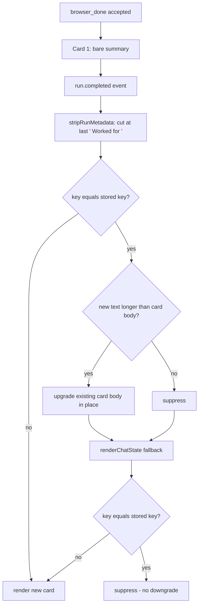
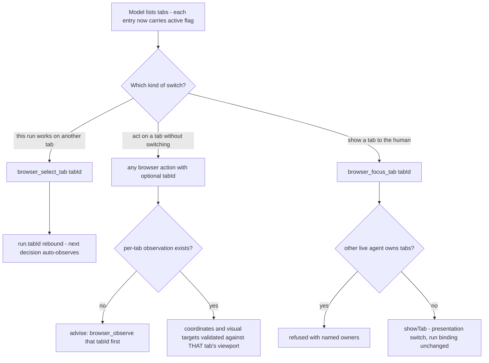
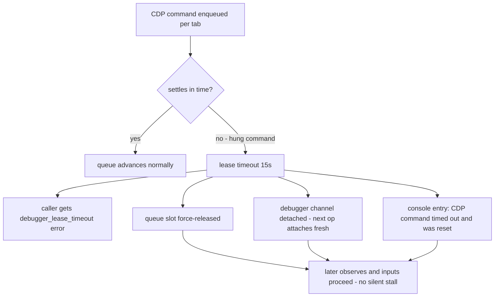
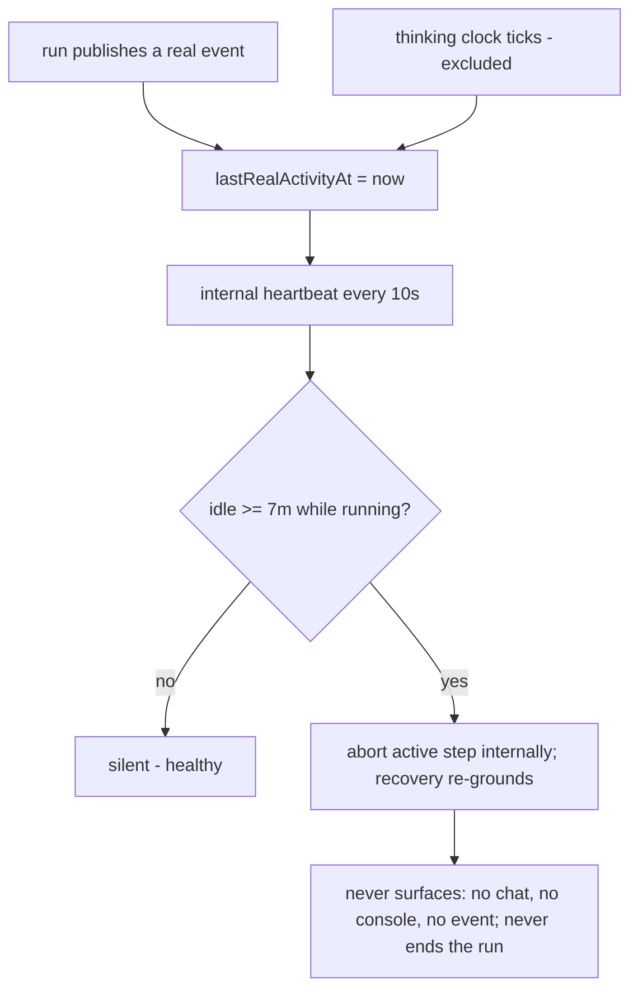

# Agent submission messages & tab control — repair flowchart

Covers two defects: (1) the terminal submission message rendering three times
in the chat transcript, and (2) the agent's inability to switch tabs / control
background tabs reliably.

## Defect 1 — triplicate submission message

```text
+--------------------+     +-----------------------------------+
| browser_done tool  |     | Card 1: bare summary              |
| result (ok)        | --> | lastKey = summary                 |
+--------------------+     +----------------+------------------+
                                           |
                                           v
+--------------------+     +-----------------------------------+
| run.completed IPC  |     | Card 2: summary + "Worked for ... |
| event              | --> | · <time>."  (2 segments, no tokens)|
+--------------------+     | OLD stripRunMetadata regex needs  |
                           | exactly 3 "·" segments => NO match|
                           | => duplicate card rendered        |
                           +----------------+------------------+
                                           |
                                           v
+--------------------+     +-----------------------------------+
| renderChatState    |     | Card 3: bare summary again        |
| durable fallback   | --> | stored key != bare => duplicate   |
+--------------------+     +-----------------------------------+

FIXED:
  run.completed " Worked for ..." tail (any segment count)
    => stripRunMetadata cuts at the LAST " Worked for " marker
    => key === stored key
    => the existing card is UPGRADED IN PLACE to the fullest text
    => exactly ONE submission card (duration · tokens-or-requests · time)
```



## Defect 2 — tab switching & background-tab control

```text
+---------------------+     +-----------------------------------+
| Model decides to    |     | OLD: browser_select_tab schema    |
| switch tabs         | --> | properties = {} (inputs map miss) |
+---------------------+     | Model sends {} => hard error,     |
                            | gives up, multi-tab work blocked  |
                            +----------------+------------------+
                                             |
                                             v
+---------------------------------------------------------------------+
| FIXED tool catalog (toolDefinitions inputs map)                      |
|  browser_select_tab {tabId}   browser_new_tab {url}                  |
|  browser_scroll {deltaX,deltaY}  browser_query/extract {selector...} |
|  + optional tabId on every tab-scoped action (observe, click, type,  |
|    fill, scroll, key, screenshot, execute, navigate, ...)            |
+----------------------------------+----------------------------------+
                                   |
        +--------------------------+--------------------------+
        v                                                     v
+---------------------------+              +--------------------------------+
| Run-scoped rebinding      |              | Direct background control      |
| browser_select_tab        |              | pass tabId per action;         |
| => run.tabId = tab        |              | per-tab observation store      |
| next decision auto-       |              | (run.observationsByTab)        |
| observes the new tab      |              | grounds coordinates/targets    |
+---------------------------+              | per tab (viewport, visuals)    |
                                           +--------------------------------+
                                                            |
                                                            v
                                            +--------------------------------+
                                            | browser_focus_tab (NEW)        |
                                            | foreground the visible tab,    |
                                            | gated: refused while another   |
                                            | live agent owns tabs           |
                                            +--------------------------------+
```



## Invariants preserved

1. `browser_select_tab` / per-action `tabId` remain background-safe: they never
   change which tab the human sees (`selectedTabId` untouched).
2. `browser_focus_tab` is the ONLY agent route to `showTab()` and is refused
   while any other live agent run owns tabs (`tabFocusPolicy`).
3. Background input still goes through the per-tab CDP dispatch path; control
   of background tabs never attaches, raises, or focuses their views.
4. The transcript keeps exactly one terminal submission card per run; the
   durable state fallback can no longer duplicate it.

## Repair 3 — the "agent sleeps while thinking" stall (2026-09-29)

Observed live: an agent working a background tab stalled on every turn with no
errors, no tool results, and a frozen thought counter; switching the app's
visible tab kicked it alive again, and the stall returned as soon as the
compositor state changed again.

```text
+---------------------------+
| Mutation lands (fill,     |
| click) => browserNeedsIma |
+------------+--------------+
             v
+---------------------------+     +-----------------------------------+
| observe() => screenshot   | --> | CDP Page.captureScreenshot        |
| on a NON-paintable tab    |     | fromSurface:true waits for a      |
+---------------------------+     | compositor frame that a detached/ |
                                  | throttled view NEVER produces     |
                                  +----------------+------------------+
                                                   v
+------------------------------------------------------------+
| DebuggerLeaseManager.run: per-tab promise queue, NO timeout |
| The hung capture holds the serialization slot FOREVER       |
| => every later Runtime.evaluate (observe), Input dispatch   |
|    (clicks, fills), and screenshot on that tab queues       |
|    silently => the run "sleeps" with no errors and no cards |
| (withinStepTimeout would only fire after up to 30 minutes)  |
+------------------------------------------------------------+

FIX: the lease bounds every operation (15s default), force-releases its slot
on timeout, resets the debugger channel, logs a visible console entry, and an
attach-epoch guard keeps a late-settling hung command from detaching a newer
lease's fresh channel.
```



Invariants preserved:
1. Serialization per tab is unchanged for healthy commands.
2. A pinned device lease is never reset by the timeout path unless it is the
   command that hung.
3. Timeouts are visible in the console panel; they are never silent.

## Repair 4 — run stall heartbeat (2026-09-29, owner-revised: 100% internal)

Question that prompted it: "does the agent have an internal heartbeat that
checks the chat didn't sleep?" Answer: only implicit deadlines existed — a
90s dead-air step timer whose pre-stream window is 7.5 minutes, firing
INVISIBLY (recoverable failures are hidden from the transcript), with a 30
minute absolute ceiling — and recovery re-hang loops made runs sit frozen
forever (loading pill, Stop button, no errors).

Owner directive after the first draft: the heartbeat must be 100% INTERNAL
and never reach the user's surface. The first draft published a transient
chat notice and console entries; those were removed.

```text
+------------------------------------+
| run.lastRealActivityAt             |
| = any published event EXCEPT the   |
| synthetic 750ms thinking ticks     |
+------------------+-----------------+
                   v
        10s internal interval (status running only)
                   |
     idle >= 7m --> abort the active step internally
                   (agent_stall_abort -> recovery re-grounds)
                   stallRecoveries++ (internal counter)
                   NO events, NO notices, NO console entries
                   NEVER terminates the run (owner directive:
                   recovery is deliberately indefinite)
```



Legitimate long waits (`browser_wait` up to 15m) touch the heartbeat on every
poll; approval/pause states skip the check by status. `heartbeatTimer` is
excluded from serialization (IPC clone safety); the previous run's timer is
cleared on continuation and at run end.

Deliberately UNBOUNDED (owner directive, 2026-10-07): both the stall
heartbeat and identical-recovery cycling (`scheduleRecovery` fingerprint
counts) must NEVER terminate a run — a repeating `observation_timeout` or a
never-streaming provider keeps re-grounding forever, which is the intended
behavior (an earlier LORDE_RECOVERY_CEILING / stall-exhaustion experiment
reintroduced a hard stop and was reverted; do not re-add it).
