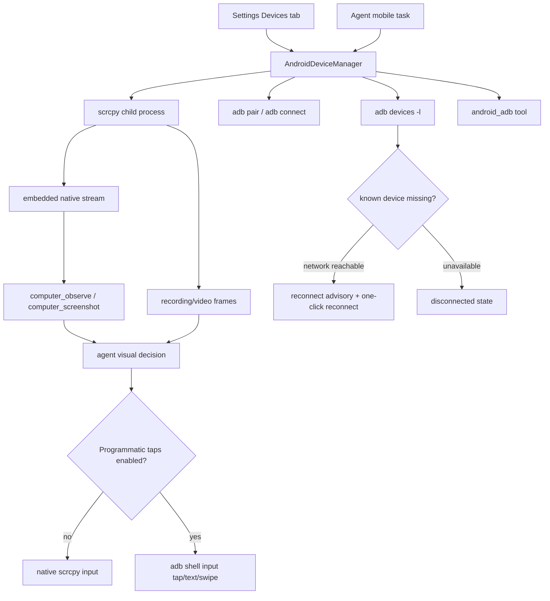

# Native Android Devices Flow

Windows-first native Android support: ADB owns discovery/pair/connect/commands;
scrcpy owns the mature mirrored surface; Browser-use owns device state, input
policy, IPC, settings, agent tools, recording, and frame evidence.

```text
+--------------------+       +--------------------+
| Settings: Devices  |       | Agent: mobile task |
+---------+----------+       +----------+---------+
          |                             |
          v                             v
+---------+-----------------------------+---------+
| AndroidDeviceManager (main process)             |
| adb discovery / pair / connect / reconnect      |
| scrcpy-server tunnel / stream / tab / tap policy|
+-----+------------------+------------------+------+
      |                  |                  |
      v                  v                  v
+-----+------+    +------+-------+    +-----+------+
| device list |    | embedded    |    | adb command |
| state/events|    | scrcpy HWND |    | execution   |
+-----+------+    +------+-------+    +-----+------+
      |                  |                  |
      +------------------+------------------+
                         v
                 +-------+--------+
                 | Browser-use    |
                 | observe/click  |
                 | record/frames  |
                 +----------------+
```



## Routes

1. `refresh` runs `adb devices -l`, merges transport state into persisted
   records, and emits `device-state`.
2. `pair` runs `adb pair host:port`, then `connect` runs `adb connect`; pairing
   codes are transient and never persisted.
3. A known wireless device that disappears is probed on a bounded cadence. A
   reachable endpoint emits `reconnect-advisory`; it is never auto-reconnected
   in a loop.
4. `stream:start` launches scrcpy with a unique title and selected serial. The
   Windows HWND path embeds/repositions the scrcpy window; failure falls back
   to a managed child window.
5. A device click routes to native scrcpy input by default. With
   `programmaticTaps=true`, the displayed coordinate is converted to device
   pixels and exactly one `adb shell input tap x y` is sent.
6. `android_adb` executes structured argv against the selected serial and
   returns command/exit/stdout/stderr evidence. It is unattended by user
   choice, but every invocation is logged.
7. `record` and `frames` reuse Browser-use desktop capture and frame extraction;
   vision models receive images, not an unwatched video blob.
