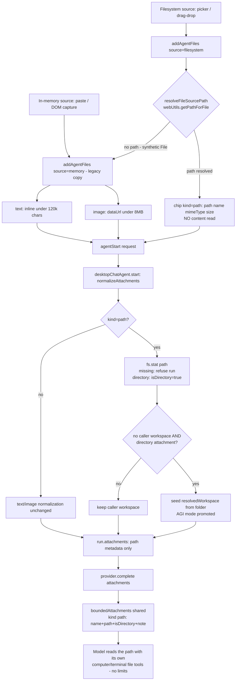

# Attachment path pipeline — Flowchart

Owner directive: filesystem-sourced attachments (file picker, drag-drop of
files OR folders) attach as **source paths**, never as content copies. The
agent reads them with its own file tools, which have no size or count limits.
In-memory/clipboard attachments (pasted images, screenshots) keep copying
content exactly as before. The UI chip is unchanged.

## ASCII flow

```
+---------------------+     +----------------------+     +---------------------------+
| Filesystem source   |     | In-memory source     |     | Composer (agentForm)      |
| picker #agent-file- |     | paste (clipboard)    |     | chips = pendingAgent-     |
| input, drag-drop    |     | files, DOM capture   |     | Attachments (UI state)    |
+----------+----------+     +----------+-----------+     +-------------+-------------+
           |                           |                                       |
           v                           |                                       |
+---------------------+                |                                       |
| addAgentFiles       |<---------------+---------------------------------------+
| (app.js)            |
| source='filesystem' |         source='memory' (default, unchanged)
+----------+----------+
           |
           v
+---------------------------------------------+
| resolveFileSourcePath(file)                 |
| webUtils.getPathForFile(file) via preload   |
+----------+----------------------------------+
           |
    path resolved?
    |            |
   YES          NO (synthetic/in-memory File)
    |            |
    v            v
+------------------------+   +-----------------------------------+
| chip {kind:'path',     |   | Legacy in-memory copy (UNCHANGED) |
|  path, name, mimeType, |   | image -> dataUrl (<8MB)           |
|  size, isDirectory?}   |   | text  -> inline content (<120k)   |
| NO content read        |   | 240k combined budget              |
+----------+-------------+   +-----------------+-----------------+
           |                                   |
           +---------------->------------------+
                              |
                              v
                 +----------------------------+
                 | agentStart IPC request     |
                 | attachments: [...]         |
                 +-------------+--------------+
                               |
                               v
                 +-----------------------------------------+
                 | desktopChatAgent.start()                |
                 | normalizeAttachments (async):           |
                 |   kind 'path' -> fs.stat(path)          |
                 |     missing -> refuse run (clear error) |
                 |     directory -> isDirectory=true       |
                 |   'text'/'image' -> as before           |
                 +------------+-------------+--------------+
                              |             |
              workspace seeded?             |
              (no caller workspace AND      |
               a directory attachment)      |
                    |                       |
                    v                       v
     +------------------------+   +---------------------------+
     | resolvedWorkspace =    |   | run.attachments           |
     | {root: dir, target:dir}|   | (path metadata, no bytes) |
     | -> AGI mode promoted   |   +-------------+-------------+
     | (computer tools on)    |                 |
     +------------------------+                 v
                                 +-------------------------------+
                                 | provider.complete(attachments)|
                                 +---------------+---------------+
                                                 |
                                                 v
                                 +-------------------------------------------+
                                 | boundedAttachments (ollamaProvider.cjs,   |
                                 | shared by ollama/openai/responses)        |
                                 | kind 'path' -> {name, path, isDirectory,  |
                                 |  size, note: read with your file tools}   |
                                 +-------------------+-----------------------+
                                                     |
                                                     v
                                 +-------------------------------------------+
                                 | Model context: path metadata + note.      |
                                 | Agent uses computer_read/computer_search/ |
                                 | computer_index/terminal on the path.      |
                                 +-------------------------------------------+
```

## Mermaid



## Invariants

1. Path attachments NEVER carry file bytes through IPC or the model context.
   The only bytes that ever travel are the metadata strings.
2. The UI chip is unchanged in structure (name + remove; Preview only when a
   dataUrl exists — path attachments have none). `chip.title` shows the source
   path so the human can see what will be read.
3. Paste/DOM capture keeps the exact legacy behavior — the 8 MB image and
   120k/240k text budgets apply ONLY to in-memory copies.
4. A path attachment that no longer exists fails the run START with a clear
   error instead of letting the agent discover it mid-run.
5. A directory attachment seeds the default workspace scope only when the
   caller declared no workspace (task text and explicit request.workspace win),
   and only then promotes the run to AGI so the computer tools can read it.
6. `serializeRun` keeps excluding attachment content AND source paths from
   persisted run snapshots (privacy: paths stay in the live chat surface only).
