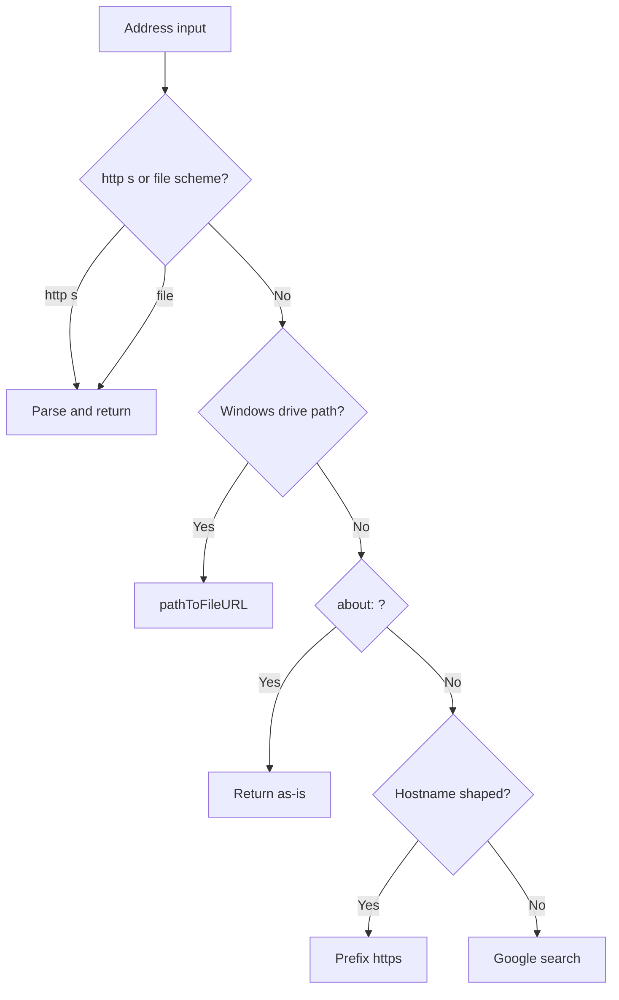
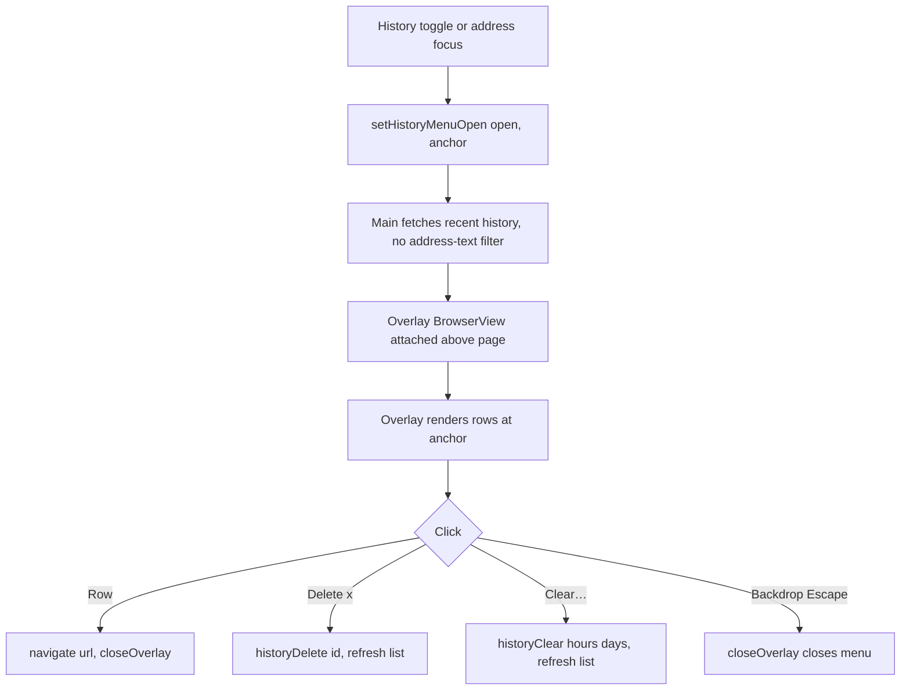

# Browser chrome: history, downloads, loading state

## Modules

- `desktop/urlUtils.cjs` — pure URL normalization shared by the main process
  and the agent controller. Single source of truth for "is this input an
  address or a search query".
- `desktop/historyStore.cjs` — atomic-JSON store (tmp + rename, schema
  versioned) for visited-page history. No file of its own beyond
  `userData/browser-use-history.json`.
- Downloads live in memory (main process) — a session-scoped registry of
  Electron `DownloadItem` summaries; completed entries are kept for the
  session only.

## URL normalization routes (the file:// defect)

```
+---------------------------+-------------------------------------+
| Input                     | Result                              |
+---------------------------+-------------------------------------+
| http(s)://...             | parsed and returned                 |
| file://...                | file URL returned (opens locally)   |
| F:\path\... or F:/x/y     | pathToFileURL (opens locally)       |
| about:blank               | returned as-is                      |
| localhost / domain.tld    | https:// prefixed                   |
| anything else             | Google search (unchanged behavior)  |
+---------------------------+-------------------------------------+
```

Before the fix, `file:///F:/BlenderRender/modern_room_cinematic.png` fell
through to the search fallback and "redirected to Google".



## History flow

```
+--------------------+     did-navigate      +----------------+
| BrowserView tab    |---------------------->| HistoryStore   |
| (main.cjs wireTab) |  skip about:blank     | .record()      |
+--------------------+                       +----------------+
                                                        |
   +-------------------+  browser-use:history-list      |
   | Renderer dropdown |<-------------------------------+
   |  (address focus)  |  browser-use:history-delete     |
   +-------------------|<--------------------------------+  one entry (x)
           |           |  browser-use:history-clear      |
           | Enter or  |<--------------------------------+  hour / hours (default 12) / days
           | click     +--> window.browserUseDesktop.navigate(url)
```

- `record(url, title)`: same URL is moved to the front with a fresh
  `visitedAt` (no duplicate rows); the store keeps the most recent 1000.
- `remove(id)` deletes exactly one entry (independent delete).
- `clearBefore({ hours, days })` deletes entries newer than the window;
  the renderer offers Last hour, Last 12 hours, Last day, and custom
  hours (default 12) / custom days inputs.

## Downloads flow

```
+--------------------+ will-download     +---------------------+
| BrowserView session|------------------> | downloadManager     |
+--------------------+                   | reserve unique path |
                                         | in Downloads folder |
                                         +---------------------+
                                              |  updated (throttled 250ms)
                                              v
                              +-----------------------------+
                              | state.downloads -> renderer |
                              | toolbar button + panel      |
                              +-----------------------------+
                                 | done        | interrupted
                                 v             v
                        console entry + toast; Open / Show in folder IPC
```

- No native save dialog: downloads land in the OS Downloads folder with a
  unique name (unattended agent runs must never block on a modal).
- Progress entries expose `{id, filename, url, path, receivedBytes,
  totalBytes, state}`; `done` and `interrupted` are terminal.
- `browser-use:downloads-open` / `downloads-show` use `shell.openPath` /
  `shell.showItemInFolder`.

## Loading state

`tabSummary` already reports `loading: webContents.isLoading()`, and
`did-start-loading` / `did-stop-loading` already push state. The renderer
only lacked the visual: a 2px indeterminate bar pinned under the browser
chrome, shown while `state.active.loading`.

## History dropdown lives in the overlay BrowserView (not chrome DOM)

The page content is a native `BrowserView`, which always paints above the
chrome renderer's DOM. A DOM-positioned dropdown under the address bar was
therefore invisible over any real page (only visible while the surface was
blank). The dropdown now renders in the topmost overlay `BrowserView`
(`overlay.html` `#history-menu`), exactly like the device menu.

```
+--------------------------+  click toggle / focus address
| chrome (app.js)          |--------------------------.
+--------------------------+                          v
        ^                    +--------------------------------------+
        | setHistoryMenuOpen | main.cjs: fetch historyStore.list(12)|
        | (open, anchor)     | overlayVisible |= historyMenuOpen     |
        |                    | publishState + overlay-state         |
        |                    +--------------------------------------+
        |                                       | state {open, anchor, entries}
        |                                       v
        |                    +--------------------------------------+
        |------------------->| overlay.js renderHistoryMenu          |
          navigate(entry.url)| rows: open / per-entry delete / Clear |
         + closeOverlay()    +--------------------------------------+
```



Consequences and fixes bundled in the same change:

- The dropdown no longer filters by the address bar's current text (that made
  the list appear empty whenever the input held a URL). It always lists recent
  history; per-entry delete and the Clear… range menu moved with it.
- Anchor: the chrome sends `{left, top, width}` in overlay coordinates
  (`address rect.bottom + 5 - 78`); the overlay clamps to its viewport.
- `closeOverlay` (backdrop click / Escape) closes the history menu too, and
  `syncBrowserViewVisibility` / `layoutOverlayView` treat
  `historyMenuOpen` as overlay-visible.
- Re-render is keyed on the entries+anchor JSON so unrelated state pushes do
  not rebuild the open menu.

Also fixed in the chrome: the address input mirrors the active tab on every
render (blank/`about:blank` clears it) and clicking New tab empties the input,
so new tabs start with a clean address bar. The downloads panel still renders
in chrome DOM and has the same native-layer limitation over page content.
