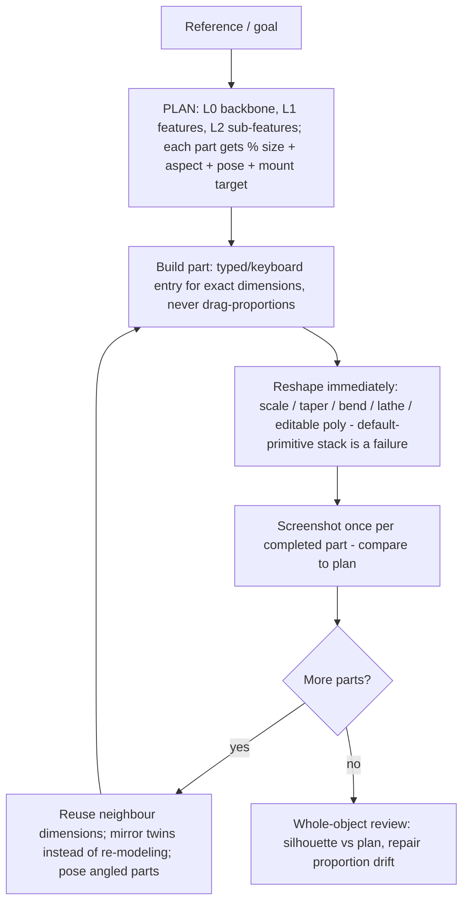

# AGI Modeling Craft — Reverse-Engineered from Procedura (`agiModelingCraft_flow_chat.md`)

## Provenance

Procedura (`F:\agentic3d\Procedura`) reliably produces clean, proportioned, non-blocky
low-poly models from a text prompt (verified live: 4/4 parts first-attempt, critic pass
clean). Its two core system prompts — `prompts/plan_system.md` (plan stage) and
`prompts/scad_part_system.md` (per-part stage) — encode a *human modeling method*. This
doc maps that method onto the browser-use agent's AGI computer-mode system guidance
(`desktop/computer/computerCatalog.cjs` → `AGI_PROMPT`), so native-app modeling (3ds Max,
Blender, etc.) stops defaulting to stacked default primitives and minimizes provider
round trips.

## What Procedura does (source → technique)

| Procedura mechanism | Technique | Where |
|---|---|---|
| Plan stage before any geometry | Decompose object into named parts: L0 backbone → L1 features → L2 sub-features; micro-detail is NOT a part | `plan_system.md` |
| "The order IS the connectivity" | Backbone first, every part attaches to an earlier part; mirror pairs grouped contiguously | `plan_system.md` |
| Per-part relative dimensions | Descriptions carry "% of whole / % of neighbour", aspect (long/thin/squat/tapered), pose (tilt/splay/axle direction) | `plan_system.md` |
| Repeat/Mirror declaration | Model the first instance; later copies are thin wrappers, never re-modeled | `plan_system.md` |
| Plan review pass | A critic validates the plan before any part is built | `plan_review_system.md` |
| "A terse blocky approximation is a failure" | Detail mandate inside the ONE pass that builds each part | `scad_part_system.md` |
| Relative size is "the biggest lever" | Read already-built neighbours' dimensions; scale the new part to them, never to round defaults | `scad_part_system.md` |
| Pose faithfulness | "Never flatten a clearly-angled part to axis-aligned" | `scad_part_system.md` |
| One part at a time, frozen | Each part placed, welded, verified before the next starts | `scad_part_system.md` + `draft-incremental.ts` |

## Process flow the AGI prompt now mandates (native 3D/drawing apps)

```
                    +---------------------------+
                    | Look at reference / goal  |
                    +-------------+-------------+
                                  v
                  +-------------------------------+
                  | PLAN (one decision, no tools) |
                  | L0 backbone -> L1 -> L2 parts |
                  | each: % size, aspect, pose,   |
                  | which earlier part it mounts  |
                  +---------------+---------------+
                                  v
                       +----------------------+
                       | Build part 1 (L0)    |
                       | typed/keyboard entry |
                       | exact dimensions     |
                       +----------+-----------+
                                  v
                     +------------------------+
              +----->| Reshape, not just place|
              |      | (scale/taper/bend/lathe|
              |      | /editable poly/spline) |
              |      +-----------+------------+
              |                  v
              |      +------------------------+
              |      | Screenshot ONCE (check |
              |      | proportion vs plan)    |
              |      +-----------+------------+
              |                  v
              |        +---------------------+
              |  next  | Next part: reuse    |
              +--------+ neighbour dims, mirror|
                       | for twins, pose it  |
                       +---------------------+
                                  v (all parts placed)
                       +----------------------+
                       | Whole-object pass:   |
                       | silhouette + detail  |
                       | vs plan, fix drift   |
                       +----------------------+
```



## Round-trip economy (the "very fast" half)

The 3ds Max session audit showed 9-12 s per provider decision and a 73 s mid-creation
pause. Guidance therefore also mandates:

1. **Typed/keyboard entry** (Create-panel Keyboard Entry rollout, Modify-panel numeric
   fields, transform type-ins) over pixel drags — exact values, one screen, fewer
   corrective decisions.
2. **Batch the stable chain** (already in AGI_PROMPT): co-emit tool-arm + parameter
   entry + placement for predictable steps; never batch an action whose coordinates
   depend on an unseen result.
3. **Screenshot at part milestones only**, not per click.

## Files

- `desktop/computer/computerCatalog.cjs` — `AGI_PROMPT` gains the modeling-craft passage.
- `tests/computer-tools.test.mjs` — asserts append behavior only; extended with a
  content regression (plan-first, anti-blocky, keyboard entry, mirror twins present).
