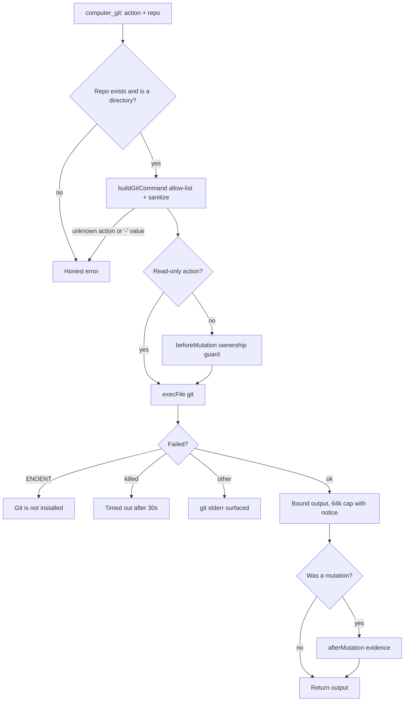

# computer_git — Flowchart

## Purpose
`computer_git` bridges the installed git binary into the computer tools with a
CLOSED allow-list of subcommands. It gives the model version-control ground
truth (status / diff / log) and the ordinary stage / commit / branch flow —
without the terminal, and with no way to smuggle flags or destructive
subcommands (reset, clean, push, pull, rebase are unreachable by design).

## Participants
- `desktop/computer/gitCommands.cjs` — pure argv builder + sanitizer (no I/O).
- `desktop/computer/computerTools.cjs` — `git()` executor: repo validation, execFile, ownership guard.
- `desktop/computer/computerCatalog.cjs` — schema, read-only classification, AGI prompt guidance.
- The installed `git` binary on PATH (required; honest ENOENT error otherwise).

## Actions
| action | args | read-only |
|---|---|---|
| status | --porcelain=v1 -b | yes |
| diff | [--staged] -- [paths…] | yes |
| log | --oneline -n <limit 1..100> [ref] | yes |
| add | -- <paths…> (≥1) | no |
| commit | -m <message> (≤4000 chars) | no |
| branch | --list, or <name> to create | no (create) / yes (list) |
| checkout | [-b] <ref> | no |

Sanitization: any model-supplied value that is empty or starts with `-` is
REFUSED (option injection is impossible); max 64 paths per call.

## Process flow (ASCII)

```
  +---------------------+
  | computer_git input  |  action, repo (+ options)
  +----------+----------+
             v
  +---------------------+   repo missing / not a directory -> honest error
  | validate repo dir   |
  +----------+----------+
             v
  +---------------------+   unknown action / bad value -> honest error
  | buildGitCommand     |   '-'-prefixed value -> refusal
  | (allow-list + sanitize) |
  +----------+----------+
             v
     +---------------+
     | read-only?    |
     +---+-------+---+
   yes  |       |  no
         v       v
  +-----------+  +---------------------------+
  | execFile  |  | beforeMutation guard      |  ownership anchored on repo
  | git ...   |  | (action='edit', path=repo)|  BEFORE the command runs
  +-----+-----+  +------------+--------------+
        |                     v
        |              +-----------+
        |              | execFile  |
        |              +-----+-----+
        v                    v
  +--------------------------------+
  | error? ENOENT -> "install git" |
  | killed -> 30s timeout          |
  | else git stderr (2k cap)       |
  +---------------+----------------+
                  | ok
                  v
  +---------------------------+   >64k chars -> truncated + notice
  | bound output (stdout)     |
  +------------+--------------+
               v
  +---------------------------+
  | afterMutation evidence    |  (mutations only)
  +---------------------------+
```

## Mermaid flow



## Guarantees
- No destructive subcommand is reachable (allow-list is closed; status/diff/log classified read-only so they never request a permission surface).
- Mutating actions take the workspace ownership guard BEFORE running.
- Every failure names what actually happened (missing binary, timeout, git's own stderr).
