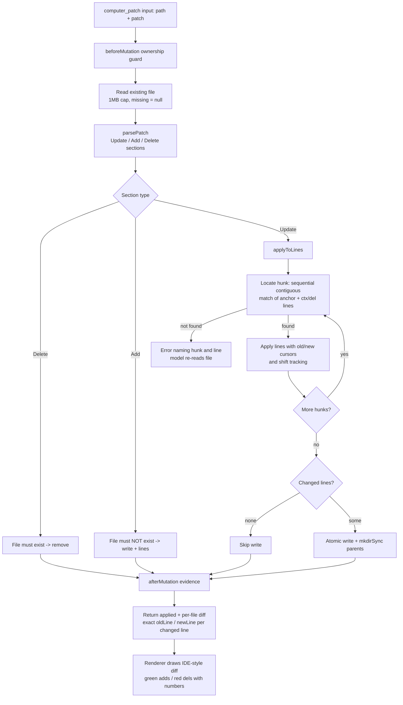

# computer_patch / applyPatch — Flowchart

## Purpose
`computer_patch` applies multi-hunk source patches to ONE text file atomically
(Codex/V4A-style format) and returns a structured diff with exact old/new line
numbers per changed line, so the renderer can draw an IDE-style view (green
adds numbered in the new file, red dels numbered in the old file).

## Participants
- `desktop/computer/computerCatalog.cjs` — tool schema (`path`, `patch` required; optional `acknowledgeExistingChanges`, `expectedHash`), AGI prompt guidance.
- `desktop/computer/computerTools.cjs` — `patch()` executor: workspace ownership guard, 1 MB size cap, atomic write.
- `desktop/computer/applyPatch.cjs` — parser + applier + diff engine (pure, no I/O).
- `desktop/renderer/app.js` — `appendPatchDiffView` renders the IDE-style diff in the inspection panel.
- `desktop/agent/desktopChatAgent.cjs` — `inspectionValue` budget for the diff output.

## Patch format contract
```
*** Begin Patch
*** Update File: <path>
@@ <anchor: one context line BEFORE the change>
-old line
+new line
 unchanged context
*** Add File: <path>
+content lines
*** Delete File: <path>
*** End Patch
```
Semantics: the optional `@@` anchor LOCATES the hunk (matched, then rendered as
leading context) and the body applies immediately after it. Hunk search is
sequential, so repeated context matches successive occurrences. No line
numbers are accepted from the model — wrong guesses are impossible.

## Limits
- MAX_FILE_BYTES = 1 MB (executor refuses larger existing files)
- MAX_PATCH_CHARS = 200 000 characters

## Process flow (ASCII)

```
  +--------------------+
  | computer_patch in  |  path, patch
  +---------+----------+
            v
  +--------------------+
  | beforeMutation     |  workspace ownership guard (action='edit')
  | (workspaceGuard)   |  -> guard token / refusal
  +---------+----------+
            v
  +--------------------+  stat file: missing -> existing=null
  | read existing file |  >1MB -> error; directory -> error
  +---------+----------+
            v
  +--------------------+  Begin/End Patch markers present?
  | parsePatch         |  split file sections (Update/Add/Delete)
  +---------+----------+  hunks: @@ anchor + ctx/del/add lines
            |              invalid directive/line -> honest error
            v
  +--------------------+  Delete: must exist -> write(path, null)
  | applyPatch         |  Add: must NOT exist -> write(+ lines)
  +---------+----------+  Update: applyToLines
            |
            v
  +--------------------+  locate hunk: sequential contiguous match of
  | applyToLines       |  [anchor? + ctx/del lines] from searchFrom
  +---------+----------+  miss -> error naming hunk + line
            |
            v
  +--------------------+  ctx: verify equal, advance both cursors
  | per line           |  del: verify equal, splice out (oldLine++)
  | old/new cursor     |  add: splice in (newLine++)
  | + shift tracking   |  shift survives across hunks so old numbers
  +---------+----------+  stay in ORIGINAL coordinates
            |
            v
  +--------------------+  no adds and no dels -> skip (no write)
  | write result       |  mkdirSync parents + atomic writeFileSync
  +---------+----------+
            v
  +--------------------+
  | afterMutation      |  workspace evidence
  +---------+----------+
            v
  +--------------------+  { applied, files: [{ path, action,
  | structured diff    |    addedLines, removedLines,
  +--------------------+    diff: [{ oldStart, newStart, lines }] }] }
```

## Mermaid flow



## Diff line model
Per changed/context line: `{ kind: 'ctx'|'add'|'del', oldLine, newLine, text }`
- `ctx`: present in both files (oldLine = newLine modulo earlier shifts)
- `del`: oldLine = line number in the ORIGINAL file, newLine = null
- `add`: newLine = line number in the NEW file, oldLine = null
A deleted line frees its slot, so the following add reuses that new-file
number (same as a unified diff).

## Failure modes (all honest, named, non-destructive)
- Patch larger than cap, file larger than cap
- Missing Begin/End markers, unknown directive, content before a directive
- Hunk context not found / ctx or del mismatch mid-hunk -> nothing is written
  for that call; the error tells the model to re-read and regenerate
- Add on existing path, Update/Delete on missing path
- Workspace guard refusal passes through unchanged
