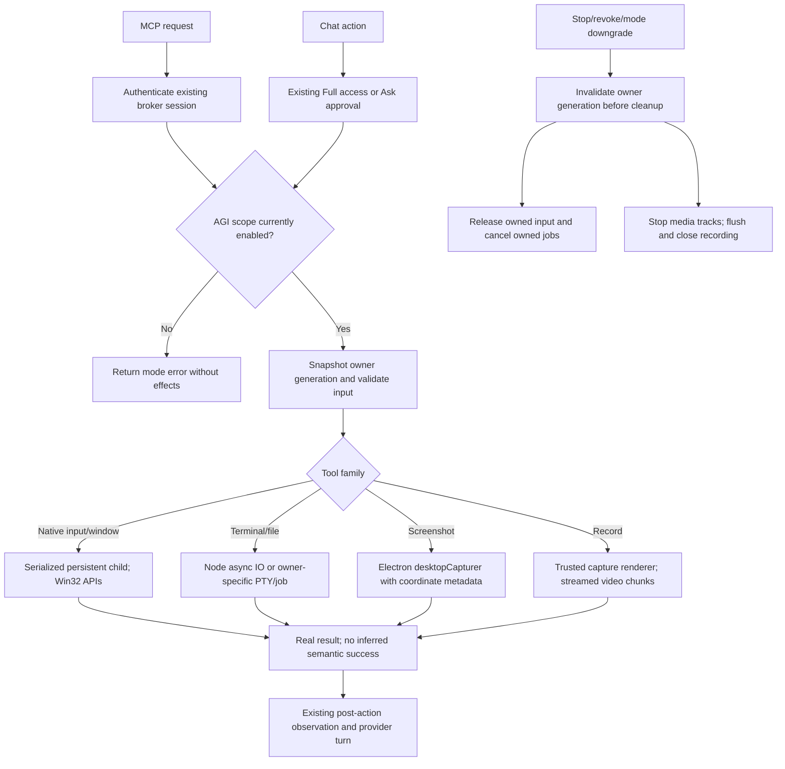
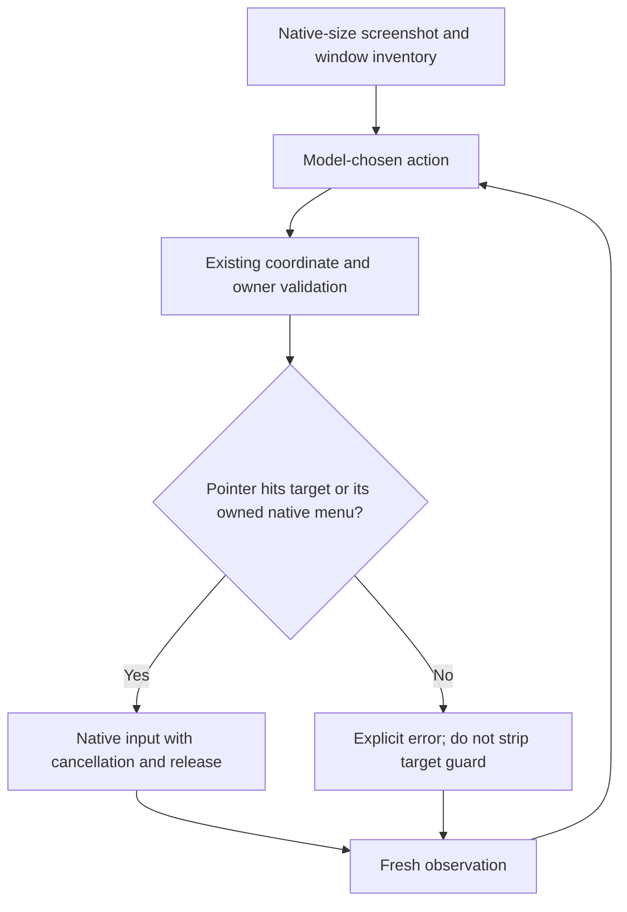
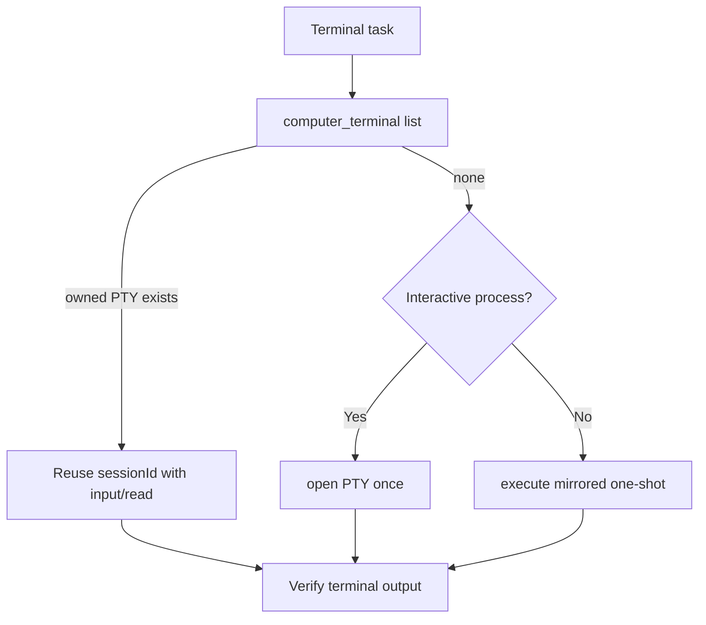
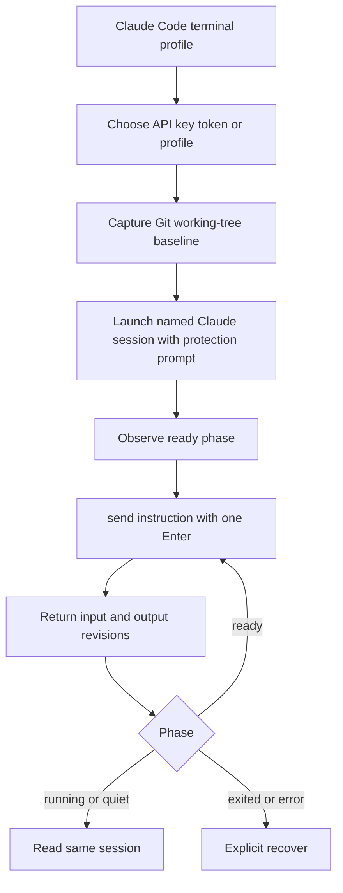
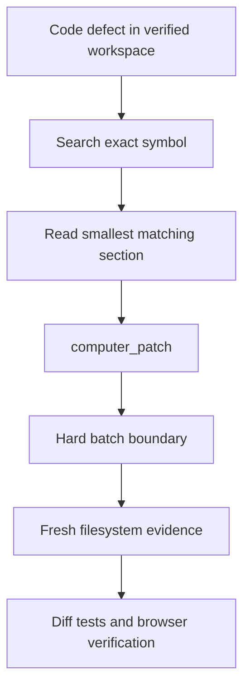

# Native computer tools

## Scope and authority

Browser-only keeps all existing browser routes and prompts. AGI adds a shared computer catalog to MCP and chat. MCP still authenticates through SessionBroker and relies on the host's permissions; chat still uses its existing Full access / Ask setting. The mode selector is not another approval surface. Computer tools never run inside a visited web page. The public GPT Action bridge retains its browser-only catalog.

```text
+----------------------+       +-----------------------+
| MCP + paired session |       | Chat + existing access|
+-----------+----------+       +------------+----------+
            +------------------------------+
                           |
                           v
              +--------------------------+
              | Mode is AGI and live?    |
              +-----+---------------+----+
                   no              yes
                    v               v
                 error     +-------------------------+
                           | Shared catalog/executor |
                           +--------+----------------+
                                    |
              +---------------------+-------------------+
              v                     v                   v
     +----------------+   +------------------+  +-------------------+
     | Native helper  |   | Node files/jobs  |  | Electron capture  |
     | Win32 input    |   | Agent-owned PTY  |  | image/MediaRecorder|
     +-------+--------+   +--------+---------+  +---------+---------+
             +--------------------+----------------------+
                                  v
                    +----------------------------+
                    | Actual result / fresh proof|
                    | Existing agent turn cycle  |
                    +----------------------------+

Cancel / revoke / downgrade --> abort owner generation --> release owned keys
                           --> cancel owned jobs --> stop/flush owned recording
```



## Algorithms

- Window focus requests use the actual enumerated HWND, restore minimized windows, and confirm foreground identity after bounded queue settlement. Where necessary, the native helper attaches its input queue temporarily, always detaching in `finally`; it skips that operation while any agent key/button is held because Windows resets keyboard state on attachment. OS-denied focus remains an error, never fabricated success.
- Legacy native coordinates are physical screen pixels. Opt-in `coordinateSpace=screenshot` takes the latest owner-bound `screenshotId` and maps image coordinates automatically: `screenX = originX + imageX * screenWidth / imageWidth`, similarly Y. Negative origins are valid. The backend retains only metadata, rejects stale/cross-owner IDs and changed display geometry, and clears mappings on owner release. Absolute SendInput coordinates are `round((x - virtualLeft) * 65535 / (virtualWidth - 1))`; use VIRTUALDESK for multi-monitor input.
- Pointer target verification allows a hit whose owner chain reaches the target window (an active popup/menu is a separate HWND, not a foreign app); separate dialogs remain explicit targets and strokes retain strict regions. Ownership is verified from Win32 window relations, not merely the same PID. Design reference: the installed `@oai/sky` Windows `computer_use_client` validates window/action data and serializes native requests; it does not score pixels as semantic progress.
- Default screenshots use physical display pixel dimensions (no silent 1600px downscale), so the desktop coordinate frame is not shrunk. Explicit resized screenshots retain their existing screenshot-ID mapping. Full-desktop capture remains visible-screen capture.
- Chat allows 100ms before automatic visual observation to avoid pressed-state frames; neither that delay nor the 40ms native input-consumption delay establishes application readiness or semantic success.

```text
Observed screenshot (native-size by default) + actual window inventory
                         |
                         v
Model chooses action -> validate coordinates/target -> existing native worker
                         |                               |
                         |                 owned native menu or target window
                         |                               |
                         +<-- fresh state after input <--+
No image-hash watchdog, guessed progress, forced batching or new planner.
```


- `computer_stroke` (with legacy `computer_pointer stroke` compatibility) executes up to 32 model-planned polylines (512 points / 10 seconds total), each with a pen lift, using real SendInput. It requires a focused windowId and an observed drawable rectangle; prevalidate every point and recheck foreground, geometry and covering windows during execution. Existing pointer actions can opt into the same target guard. No image generation, tracing, app scripts or extra model loop. See [Native visual gestures](pointerGesture_flow_chat.md) for formulas, cancellation and verification boundaries.
- Input edges are serialized. Each operation checks the owner's generation before native dispatch and after awaited work; cleanup releases only held keys/buttons associated with that owner. Long drags interpolate linearly from start to end and yield between steps so cancellation can take effect.
- Successful chat completion releases native input but preserves explicitly started background jobs, PTYs and recordings for follow-up; otherwise a task such as start a server/recording would immediately undo itself. Stop, revocation, scope downgrade and app Quit dispose the affected owner's resources. Concurrent cleanup joins one promise per owner.
- Commands run as raw PowerShell 5.1 on Windows; the tool schema declares the shell and warns against nested powershell -Command expansion. A completion promise resolves on child close (after output streams close), so execute/read race completion against one caller-selected timeout (default 10 seconds, maximum 20 seconds within the existing MCP deadline); they do not sleep after a command has already completed. Wait 0 intentionally launches background work. Fast completion returns output and exit status; long commands return a job ID plus an explicit pending-result marker, and read returns bounded output plus offsets/truncation. Explicit cancellation terminates only the job's process tree. Interactive sessions use the existing terminal broker and never attach the user's active session implicitly.
- File read uses explicit byte offsets and bounded lengths, with UTF-8 or base64 encoding; edit requires an exact unique match unless replaceAll is explicitly requested. Write/create, append, exact edit, mkdir, copy, move and delete operate on explicit real paths. Replacement defaults to exclusive creation; overwrite is an explicit tool argument, not another permission dialog. Write/edit stage bytes beside the target and rename after checking cancellation and concurrent changes, so a disk-full write cannot truncate an existing file. Moves across volumes report EXDEV instead of pretending to be atomic. Recursive directory copy/delete requires recursive=true. Search walks directories incrementally without following symlinks, matches literal names/content, pages matches, and reports scan limits rather than pretending a partial traversal was complete. Paths are not restricted to a synthetic workspace. Async operations check cancellation before starting effects.
- Capture loads only on demand. The recording renderer is sandboxed and owns no arbitrary file access; the main process validates its sender and streams ordered chunks to the chosen file with backpressure. End stops every media track and flushes before reporting a completed video. Errors report a failed/incomplete recording, not success.
- A native child failure rejects pending requests without crashing Electron main. Idle Browser-only startup does not load Koffi, launch the helper, or capture the screen.
- Browser-only has exactly the original prompt. AGI adds one short tool-awareness paragraph and the shared schemas, without new reasoning/retry loops. Native observations add desktop metadata to the existing evidence envelope; image bytes use existing provider-native image transport and never durable history.

## Terminal-first continuation

```text
+----------------------------+
| Terminal task in AGI mode  |
+-------------+--------------+
              v
+----------------------------+
| computer_terminal list     |
+------------+---------------+
     existing|       no session
             v                v
+-----------------+  +------------------------+
| read/input same |  | open interactive PTY   |
| conversation ID |  | or execute one-shot    |
+-----------------+  +------------------------+
```



The model uses direct terminal operations instead of native clicks or keyboard input to drive terminal programs. Explicit `newSession:true` is the only way to open another interactive PTY for the same conversation.

## Safe delegated coding flow

```text
+-----------------------------+
| Open profile=claude-code    |
+-------------+---------------+
              v
+-----------------------------+
| Resolve auth + Git baseline |
+-------------+---------------+
              v
+-----------------------------+
| Launch with workspace       |
| protection system prompt    |
+-------------+---------------+
              v
+-----------------------------+
| send instructions once      |
+-------------+---------------+
              v
+-----------------------------+
| Wait for accepted/submitted |
| and broker output evidence  |
+-------------+---------------+
              v
+-----------------------------+
| Running / ready / quiet /   |
| exited / error / recover    |
+-----------------------------+
```



## Launch-detection settle on computer_window list (2026-09-21, from live evidence)

A live launch test showed `start <app>` completing (exit 0) while the window
list taken one decision later contained no new window — apps show their window
seconds after the launcher exits, so an instant list races startup and reads as
a failed launch, driving launch-retry flail. `computer_window list` now accepts
`waitMs` (0..10000): poll native observations until a window id absent from the
first snapshot appears, or the bound expires. The result reports
`newWindowIds`, `waitedMs` and `settled` — one decision covers launch and
verification, and a timeout is an honest "no window appeared", never a guess.


## Focused code-edit path

Broad recursive inventory is not the default for a code fix. The model uses the
verified workspace contract to search for the exact symbol, reads the smallest
matching section, then patches once the cause is supported. Independent reads
may still be batched; a file mutation is a hard evidence boundary.

```text
+---------------------------+
| Code defect in workspace  |
+-------------+-------------+
              v
+---------------------------+
| Search exact symbol/path  |
+-------------+-------------+
              v
+---------------------------+
| Read smallest useful span |
+-------------+-------------+
              v
+---------------------------+
| computer_patch            |
+-------------+-------------+
              v
+---------------------------+
| Stop current action batch |
| and observe patch result  |
+-------------+-------------+
              v
+---------------------------+
| Verify diff/test/browser  |
+---------------------------+
```



The hard boundary applies to `computer_patch` and mutating `computer_file`
actions. Dependent reads, terminal commands, or additional patches in the same
model decision are deferred to the next decision so they cannot consume stale
filesystem evidence. New files and full rewrites retain their explicit tools;
existing text files continue to prefer `computer_patch`.
