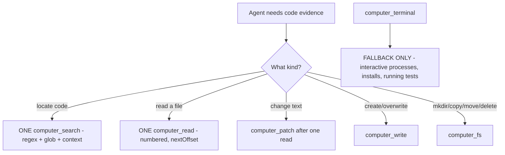

# Dedicated computer file tools — overhaul flowchart (2026-09-29)

Owner directive: stop the everything-tool `computer_file`; give the agent
independent, optimized `computer_read`, `computer_write`, and a real search
tool; make `computer_terminal` a FALLBACK, never the edit/read path (the agent
was burning minutes on terminal patches and 20-call read loops where one
dedicated call suffices).

Design references (open-source agent-tool semantics): Claude Code's
Read/Grep/Write contract (whole-file numbered reads with honest continuation,
ripgrep-backed search with context lines and files mode), ripgrep itself
(async, .gitignore-aware, binary-skipping), Cline/OpenHands file tools.

```text
+--------------------+     +--------------------------------------+
| OLD computer_file  |     | everything-tool: read/write/append/  |
| (one action enum)  | --> | edit/mkdir/copy/move/delete/stat/    |
+--------------------+     | list/search in ONE schema            |
                           | model fragments reads, reaches for   |
                           | terminal patches, slow loops         |
                           +------------------+-------------------+
                                              v
                           +--------------------------------------+
                           | NEW dedicated tools                  |
                           | computer_read  - whole file, numbered|
                           |   lines, nextOffset continuation      |
                           | computer_write - create/overwrite/    |
                           |   append, diff-attached               |
                           | computer_search - ripgrep-backed regex|
                           |   across a tree, context + files mode |
                           | computer_fs    - stat/list/mkdir/copy/|
                           |   move/delete (no content)            |
                           | computer_patch - edits (unchanged)    |
                           +------------------+-------------------+
                                              v
                           +--------------------------------------+
                           | computer_file RETIRED from the model |
                           | catalog (never offered); backend keeps|
                           | a hidden compat path for tests/sandbox|
                           +--------------------------------------+
```



## Invariants

1. The model catalog NEVER offers `computer_file`; the executor still runs it
   (tests, sandbox lanes, older MCP sessions) and marks results deprecated.
2. All mutating paths (write/fs/patch/file-compat) go through the workspace
   ownership guard; `workspaceViolation` enforces the contract for
   computer_file AND computer_fs paths/destinations.
3. Search never blocks the app: async ripgrep (`--json`), bounded walker
   fallback; node_modules/dist/build/.git and binaries are skipped.
4. Prompt rule (coding + AGI modes): terminal is a FALLBACK for interactive
   processes, installs, and running commands — never reads, searches, or edits.

## Performance gap closures (2026-09-29, owner directive: zero-regression)

Gap analysis vs Claude Code ranked the fixable harness gaps; all four closed:

1. **Prompt caching (Anthropic route)** — openAiCompatibleProvider: the system
   block is sent as a `cache_control: ephemeral` text block (tools + system +
   older history become a reusable prefix; the wire is already append-only).
   A gateway that rejects the extension is latched off for the session and the
   identical request retries without it; `BROWSER_USE_PROMPT_CACHE=off`
   disables. OpenAI-route requests are prefix-stable by construction (no
   extension sent).
2. **Pixel economics** — text-input mutations (browser_fill/browser_type) no
   longer re-arm the post-mutation screenshot under vision auto: their
   structured results (matched/changed/value) plus the DOM snapshot are the
   grounding evidence, so a 1-2MB base64 upload per decision is skipped.
   Clicks/drags/keys/navigation re-arm; vision always/never policies
   unchanged; browser_screenshot remains available to the model.
3. **Relevance-ranked observations** — over-cap pages (>120 interactive
   elements) keep the elements nearest the agent's last pointer position
   instead of the first 120 DOM nodes; original indices survive (indexed
   clicks and element snapshots stay deterministic). Pages at or under the
   cap are byte-identical to before — the common case has ZERO change.
   `selectElementsByAnchor` is exported and inlined into the page collector,
   so tests run the exact code the page runs.
4. **Tool descriptions** — deliberately NOT trimmed: with caching, the
   descriptions live inside the cached prefix (near-zero marginal cost), and
   the wordings are live-validated contracts with the model. Slimming them
   would be behavioral risk without measurable gain.
