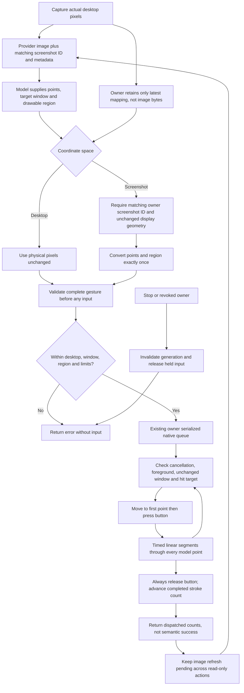
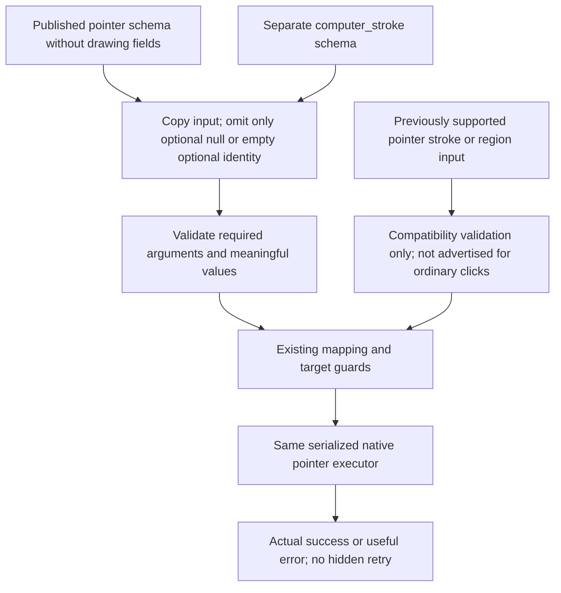
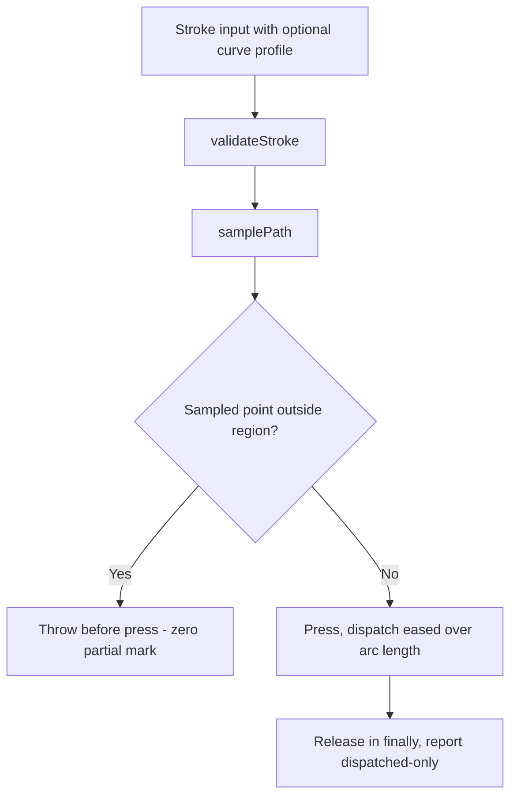
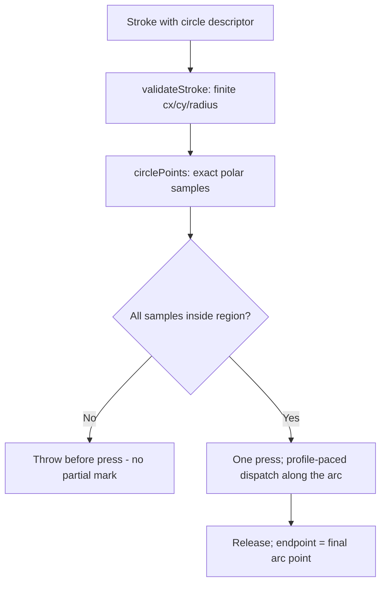

# Native visual gestures

## Scope

Additive repair for native visual work. Preserve browser-only prompts, existing permissions, straight drags, human cursor ownership and the existing agent loop. No drawing generator, image tracer, scripts in the target app, new planner, or automatic task completion. The model supplies every stroke point and the observed drawable region. A successful native dispatch is not proof of likeness or task completion.

## Routes

```text
+--------------------------+       +-----------------------------+
| Actual desktop screenshot|------>| Latest owner-scoped metadata|
| bytes -> provider image  |       | ID, origin, scale, dimensions|
+------------+-------------+       +--------------+--------------+
             |                                    |
             v                                    v
+--------------------------+       +-----------------------------+
| Model chooses native tool|------>| Validate schema and mapping |
| window, region and points|       | No guessed scale / clamping |
+--------------------------+       +--------------+--------------+
                                                 v
                             +-----------------------------------+
                             | Desktop coords or screenshot ID? |
                             +----------------+------------------+
                                              v
                             +-----------------------------------+
                             | Validate all points before effects|
                             | desktop + window + chosen region  |
                             | bounded paths, points, duration   |
                             +----------------+------------------+
                                              v
                             +-----------------------------------+
                             | Existing serialized native queue  |
                             | check owner, foreground, geometry |
                             | and top-level hit target each move|
                             +----------------+------------------+
                                              v
                             +-----------------------------------+
                             | Each path: move / down / vertices |
                             | timed linear edges / finally up   |
                             +----------------+------------------+
                                              v
                             +-----------------------------------+
                             | Exact dispatched/partial result   |
                             | fresh image on next existing turn |
                             +-----------------------------------+
Stop/revoke -> invalidate generation -> release held input -> no next segment
```



## Contracts and formulas

- Legacy pointer coordinates stay physical desktop pixels. Opt-in screenshot coordinates require the latest owner-issued `screenshotId`; unknown, another owner's, replaced or invalid mappings fail before native input. Physical display origin/size must still match. No time-based guessing and no caller-supplied scale.
- `desktopX = origin.x + imageX * scaleX`, `desktopY = origin.y + imageY * scaleY`. Region origin maps identically; width/height multiply by the corresponding scale. Round pointer points once to physical integer pixels; do not clamp out-of-bounds points.
- Screenshot point bounds are half-open: `0 <= x < imageWidth`, `0 <= y < imageHeight`. Regions must have positive size and be entirely inside the image, desktop and target window as applicable.
- Native absolute coordinates remain `round((x - virtualLeft) * 65535 / max(1, virtualWidth - 1))`, similarly y, with `VIRTUALDESK | ABSOLUTE | MOVE`. Stroke moves additionally use `MOVE_NOCOALESCE` to preserve vertices in Windows message delivery.
- New `stroke` action requires `windowId`, `region`, and 1..32 strokes, with 2..512 points per stroke, at most 512 points total and at most 10 seconds of requested movement total. Default per-stroke duration is 300ms. This is an execution bound inside the existing native deadline, not a reasoning limit.
- For each polyline, segment length `L_i = hypot(dx,dy)`; distribute duration as `duration_i = duration * L_i / sum(L)`, or equally for all-zero lengths. Each edge has `max(1,ceil(duration_i / 16))` samples and reaches its exact endpoint. No fitted curves or inferred artwork.
- All endpoints are validated before moving or pressing. Rectangles are convex, so linear interpolation stays within a validated region. The native helper also rechecks foreground identity, locked window bounds and top-level WindowFromPoint at each dispatched move. Guarded scrolling without explicit x/y checks the actual cursor position too. Reject a covering window or dialog instead of sending into it. These checks reduce mis-targeting, not an OS-level isolation guarantee against races or human movement. The rectangle remains model-selected: the executor does not recognize canvas semantics or prove that the pencil is selected.
- Button release is in `finally`; cancellation can run during awaits and prevents all later movement. Partial failures report completed strokes and warn the current stroke may be partial. Never replay the whole batch automatically.
- Keyboard and unguarded legacy pointer behavior remain unchanged. A target guard is optional for existing pointer actions, mandatory for new stroke batches; it is not a new permission panel.
- Read-only native observations cannot consume a pending screenshot refresh. A successful explicit native screenshot does consume it. Switching from browser evidence to native inspection requests native pixels. Failed/partial native GUI mutations invalidate old pixels as well.
- Native visual provider repair keeps actual image bytes, matching screenshot metadata, target-window evidence and the current task. Rejected/uninspectable native images produce a typed terminal unverified failure, not a fallback decision against empty browser DOM. Browser-only repair/fallback behavior is unchanged.
- AGI guidance treats required apps/tools/methods as part of success, not suggestions. Plan related strokes together, remember anchors/progress using existing optional memory, inspect actual output, and do not import externally generated results when the user required native-tool work.

## Follow-up: action schema separation

The reported dog-drawing run populated every pointer field, including dummy strokes and a zero-sized region, for an ordinary click. The click also targeted coordinates outside the supplied Start-button window. These are distinct defects: reduce schema ambiguity, but never remove a nonempty target-window guard to make invalid coordinates execute.

```text
+----------------------------+
| Small pointer schema       |----+  +----------------------------+
| click/move/drag/scroll      |    +->| Normalize omitted/null opts |
+----------------------------+    |  | Validate required input     |
+----------------------------+    |  +--------------+-------------+
| Separate computer_stroke   |----+                 v
| window + region + polylines|         +--------------------------+
+----------------------------+         | Existing map/guard/worker |
Legacy pointer stroke calls --------->| No alternate input engine|
                                      +--------------------------+
```



Newly advertised optional fields permit null so providers can represent absence without inventing zero geometry. Required window/region/points remain mandatory for computer_stroke. Optional nulls are removed from a copied input before existing validation; supplied nonempty handles, positive regions, coordinates and stroke data are never erased or guessed. Legacy computer_pointer stroke calls remain accepted to preserve cached MCP clients and history. The separate tool still uses existing Ask/MCP authority, cancellation and image-refresh paths. The catalog remains below 40 tools. No new planner or automatic retry is added.

A newly launched window's temporary bounds are real enumeration evidence, not a stable canvas rectangle. Do not add a fixed delay to every observation or label all small windows invalid. Native guidance distinguishes predictable launch-key batches from actions requiring a fresh post-launch observation.

## Verification

Deterministic mapping at 1920/1600, 2x DPI and negative monitor origins; stale/cross-owner IDs; nested schema/point/duration bounds; all-input prevalidation; foreground/obscuration/geometry checks; exact point ordering, cancellation and finally release; screenshot refresh after native reads; actual provider image bytes with matching metadata. Real Electron + Win32 fixture verifies native multi-stroke input and no input to another window. That fixture is an input-mechanics test, not a portrait benchmark.

## Research

- https://learn.microsoft.com/en-us/windows/win32/api/winuser/nf-winuser-sendinput — ordered events, partial acceptance, held key state and UIPI.
- https://learn.microsoft.com/en-us/windows/win32/api/winuser/ns-winuser-mouseinput — absolute desktop mapping and MOVE_NOCOALESCE.
- Reuse pinned Koffi and the existing SendInput worker; no new native library or dependency upgrade.

## Motion layer: curve sampling and velocity profiles (2026-09-21)

The stroke executor no longer walks waypoints at constant speed in straight
segments. Two optional per-stroke fields extend the schema without changing any
existing contract:

- `curve: 'catmull-rom'` — the engine samples a Catmull-Rom spline through the
  declared waypoints (density proportional to chord length, 2..48 samples per
  segment). The model declares sparse intent; the engine renders smooth marks
  the way plotters render arcs from control points. Waypoint-count semantics
  and the 512-point cap are unchanged; sampling happens engine-side.
- `profile: 'ease' | 'linear'` (default `ease`) — dispatch time warp. `ease`
  uses the minimum-jerk trajectory `10t³ - 15t⁴ + 6t⁵` over each stroke's total
  arc length, so marks start slow, move fluidly, and land gently — painting
  apps that modulate brush dynamics by pointer speed receive realistic input.
  `linear` preserves constant-speed traversal for precision edges.

```text
Model declares waypoints (+curve, profile)
        |
        v
+-------------------------------+
| validateStroke (unchanged     |
| waypoint/region/duration caps)|
+---------------+---------------+
                |
                v
+-------------------------------+
| samplePath: spline sampling   |
| every sampled point bounds-   |
| checked BEFORE any press      |
+---------------+---------------+
        exit region |
                    v  throw (no button down, no partial mark)
+-------------------------------+
| Dispatch: minimum-jerk warp   |
| over cumulative arc length;   |
| per-point check/move; finally |
| release; partial-stroke report|
+-------------------------------+
```



Safety invariants: sampling rejection happens strictly before the first
`button(true)`, so a rejected path can never leave a partial mark; the eased
walk clamps to the exact final waypoint; `linear` and the no-curve default
reproduce the previous trajectory for compatibility. Schema, validation and
the AGI prompt sentence live in computerCatalog.cjs; engine math here.

## Verification (motion layer)

`tests/desktop-motion-layer.test.mjs`: minimum-jerk monotonicity and slow-end
pacing; spline passes through waypoints and deviates from the chord; a
region-overshooting spline is rejected with zero presses; ease profiles start
slower than their middle and land gently; linear keeps constant arc-length
speed; curve/profile validation rejects unknown values.

## Parametric circle primitive (2026-09-21, from live Paint-task evidence)

A live Paint run exposed the real geometry gap: a catmull-rom spline through 4-5
waypoints is geometrically a ROUNDED POLYGON, and the model compensated by
hand-computing 36-point trigonometry tables in its reasoning channel (128s of
thinking for one shape). Plotters solve this with polar interpolation, so the
engine now does too: a stroke may declare `circle: { cx, cy, radius,
startDeg?, endDeg? }` instead of waypoints. The engine samples exact polar
points (arc length / 2px, 24..512) and dispatches them through the existing
ease/linear profile walk — zero corners, zero reasoning tokens, no trig in the
model.

```text
stroke.circle declared ──> circlePoints (exact polar sampling)
        |                         |
        |                 every sampled point inside region? ──no──> throw
        |                         | yes                              (no press, no mark)
        v                         v
   validateStroke          dispatch through ease/linear arc walk
   (closed circle must     (endpoint = last sampled arc point)
    fit its region)
```



Waypoint strokes are unchanged; `points` is now optional only when `circle` is
supplied (enforced by validateStroke, not the JSON schema). Screenshot-space
input maps cx/cy per axis and the radius by the geometric mean scale.


## Plotter-grade motion: junction velocity + brake parabolas (2026-09-21)

Ported the core of nornagon/saxi's motion planning (planning.ts, GRBL
junction-velocity algorithm) into the stroke dispatch, adapted for mouse-input
scales. The 'ease' profile is no longer a single global minimum-jerk warp — it
is a physical timeline:

- **Junction speeds** (GRBL): `vJunction = sqrt(a·c·sine/(1−sine))` from the
  turn angle between segments — straight runs at cruise, a full reversal stops.
- **Spool-up**: smoothstep ramp from rest over the first ~20% of ticks.
- **Corner braking**: approaching a junction, speed follows the brake parabola
  `v = sqrt(vJunction² + 2a·d)` — full cruise on straights, decelerating into
  each corner, crossing it slowly, accelerating out. Corners COST TIME: the
  plan may extend past the requested duration (bounded 2x + headroom) instead
  of teleporting through a corner.
- **End braking**: `v = sqrt(2a·R)` into the endpoint — the mark always lands
  exactly, never in a jump.
- 'linear' profile is unchanged: exact constant arc-length speed.

Verified live-style speed trace on an L-mark (600px, 600ms): spool-up
0.7→16.0 px/tick, cruise, corner crossing 12.6, resume 16.0, brake to the
exact endpoint — max per-tick travel never exceeds cruise.
