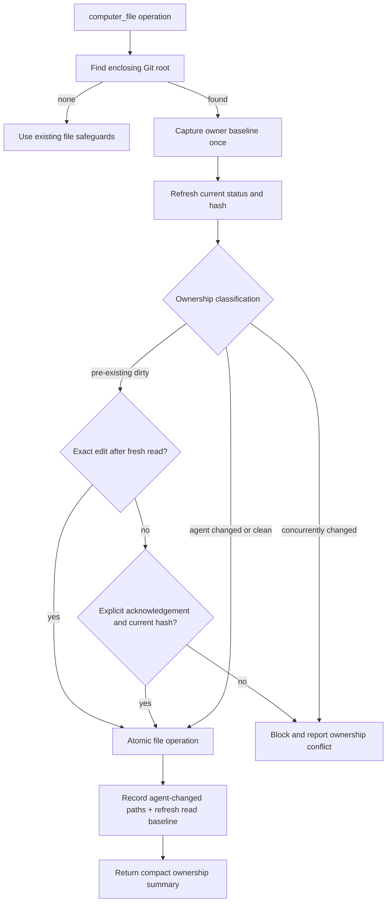

# Workspace Change Guard Flow

## Purpose

Protect pre-existing and concurrent Git working-tree edits while allowing the Browser-use agent to make exact, attributable changes in the current tree.

## Plain ASCII flow

```text
+---------------------------+
| computer_file operation   |
+-------------+-------------+
              |
              v
+---------------------------+
| Find enclosing Git root   |
+-------------+-------------+
              |
       no repo|repo
       +------+------+
       v             v
+-------------+  +---------------------------+
| Existing IO |  | Capture owner baseline    |
| safeguards  |  | status + content hashes   |
+-------------+  +-------------+-------------+
                              |
                              v
                 +---------------------------+
                 | Classify target           |
                 | pre-existing / agent /    |
                 | concurrent / clean        |
                 +-------------+-------------+
                               |
                   +-----------+-----------+
                   |                       |
                   v                       v
          +------------------+    +----------------------+
          | Safe exact edit  |    | Destructive replace |
          | after fresh read |    | delete / move       |
          +--------+---------+    +----------+-----------+
                   |                         |
                   v                         v
          +------------------+    +----------------------+
          | Atomic operation |    | Require explicit     |
          | + record path    |    | acknowledgement/hash |
          +------------------+    +----------------------+
```

## Mermaid `graph TD`



## Invariants

- Never run reset, checkout, clean, stash, commit, or delete on the user's behalf.
- A baseline is stable for one authenticated computer-tool owner.
- Exact edits require a fresh read when the path was already dirty.
- Whole-file replacement, move, and delete require an explicit acknowledgement and matching current hash.
- A hash mismatch is a concurrency error, not permission to overwrite.
- Secrets and file contents never appear in the ownership summary.
- After a successful mutation, `afterMutation` records the post-mutation hash in BOTH `agentChanges` AND the read baseline (`reads`). The agent's own mutation is its freshest view of the file — a follow-up mutation of the same path must never be refused as "changed after read" against the agent's own write. A foreign change after the mutation still mismatches both maps and stays protected.
