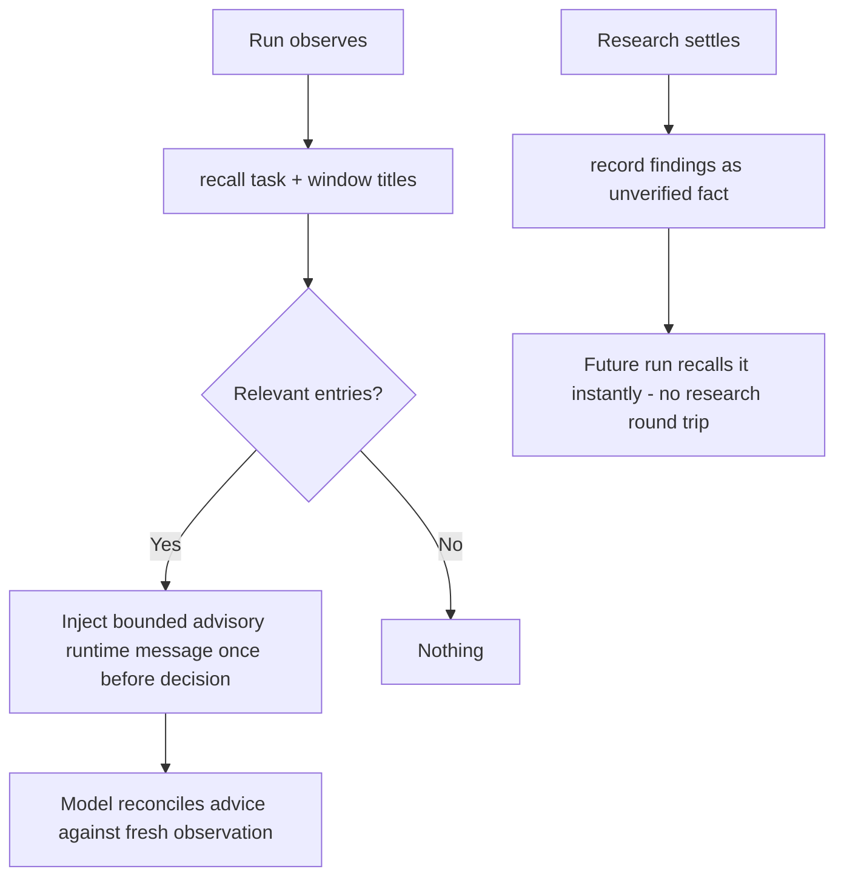

# Knowledge store (durable cross-run memory)

## Scope and authority

The knowledge store is the compounding-AGI piece: knowledge gained in one run
(research findings, later confirmed recipes) is available to every future run
with zero latency (a local file read at observation time). It is deliberately
**data, not code** — the anti-cosmetic-success invariants (INV-1/2/3 in the
research pipeline doc) mean nothing program-specific may exist in source; all
program knowledge lives here, entered at runtime, evictable, and disposable.

Program identity note: the store's `key` is a normalized text key. In v1 runs
consult and record under task-domain keys; once UIA perception (stage ④)
provides stable program identity, keys become observed program hashes. The
store API is key-agnostic, so that upgrade touches no store code.

```text
+---------------------------+        +-------------------------------+
| Run start / observation   |        | Research worker settles       |
+-------------+-------------+        +---------------+---------------+
              |                                      |
              v                                      v
+---------------------------+        +-------------------------------+
| recall(task + observed    |        | record(key, 'fact', findings, |
| program titles)           |        |  { source: 'research' })      |
| scored, bounded, advisory |        | dedupe: near-duplicate bumps  |
+-------------+-------------+        | confidence instead of duplicating|
              |                      +---------------+---------------+
              v                                      |
+----------------------------------------------------v-----------+
| knowledge.json in userData (atomic tmp+rename write, capped:   |
| 40 entries/key, 400 total, weakest-confidence-first eviction)  |
+----------------------------------------------------------------+
```



## Algorithms

- **Scoring**: token-overlap between query and entry text; final rank =
  `overlap x confidence x (verified ? 1.3 : 1) x recency`. Bounded result
  (default 3 entries, 1600 chars total) — advisory context, never a plan.
- **Deduplication**: normalized-token Jaccard >= 0.8 against an existing entry
  bumps `hits` and confidence (capped 1.0) instead of inserting a duplicate.
- **Eviction**: over caps, weakest-confidence lowest-recency entries go first.
- **Persistence**: whole-store JSON, atomic tmp+rename, written at most once
  per mutation batch. A corrupt file is replaced, never fatal.
- **Failure isolation**: every store call site in the agent is try/catch — a
  broken store degrades to "no memory", never to a failed run.

## Agent wiring (desktopChatAgent.cjs)

- Constructor option `knowledgeStore` (injectable for tests; composition root
  passes one backed by `userData/knowledge.json`).
- `deliverKnowledge(run)`: called in the decision loop next to
  `deliverResearch(run)`; injects recall results at most once per run, marked
  `source: 'runtime'`, framed as advisory (reconcile with fresh observation).
- Research settlement records the findings as an unverified fact; a later run
  that succeeds with that knowledge may confirm it (API present; auto-confirm
  waits for objective verified outcomes).

## Verification

`tests/desktop-knowledge-store.test.mjs`: recall ranking and bounded output;
dedupe bumps instead of duplicating; persistence round-trip and corrupt-file
recovery; eviction caps; agent injection reaches the first decision; research
write-back lands in the store; a throwing store never breaks a run.
