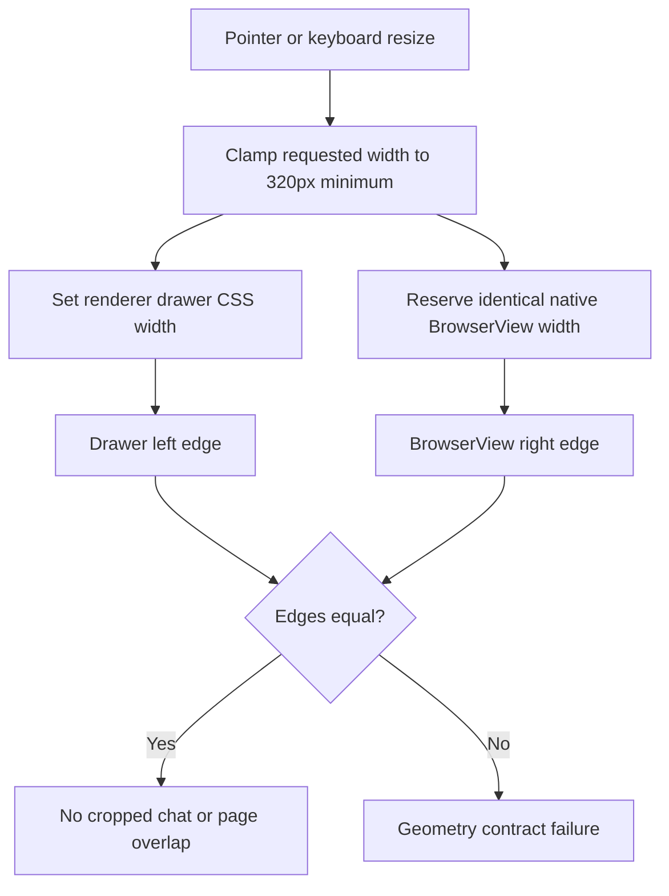
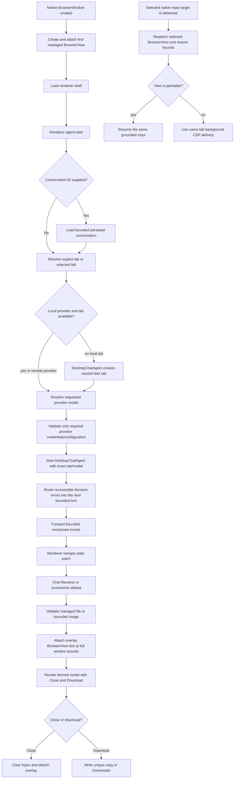
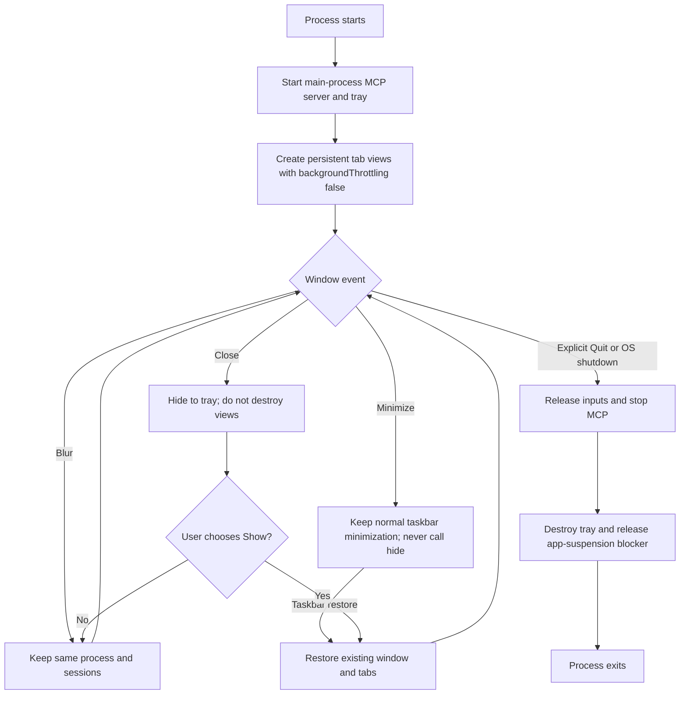
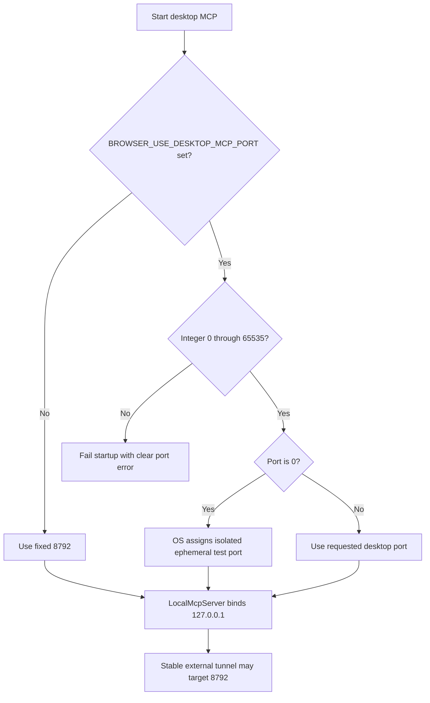
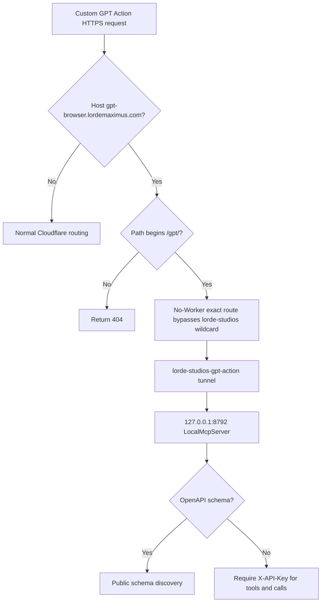
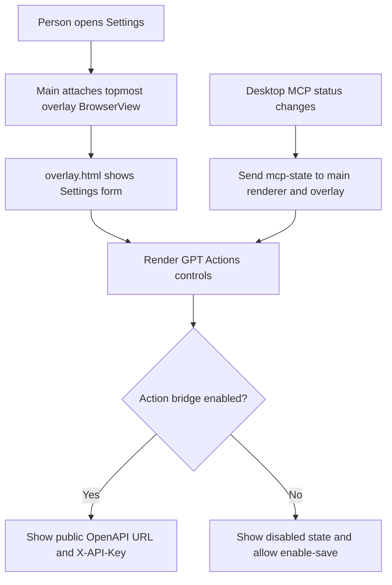
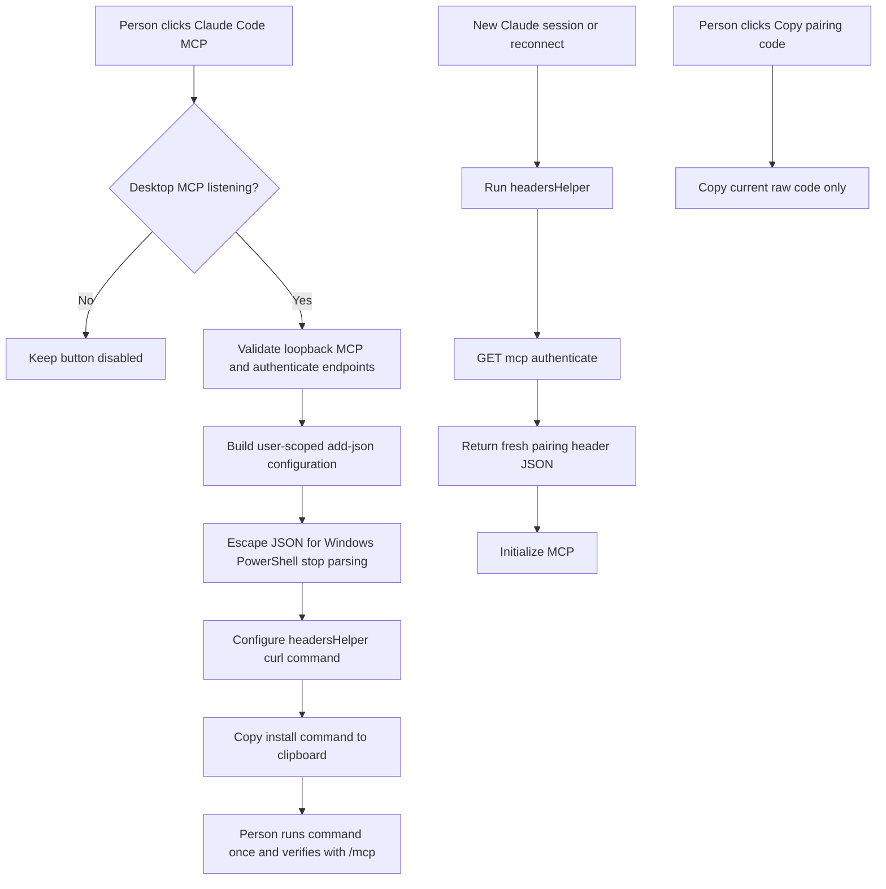
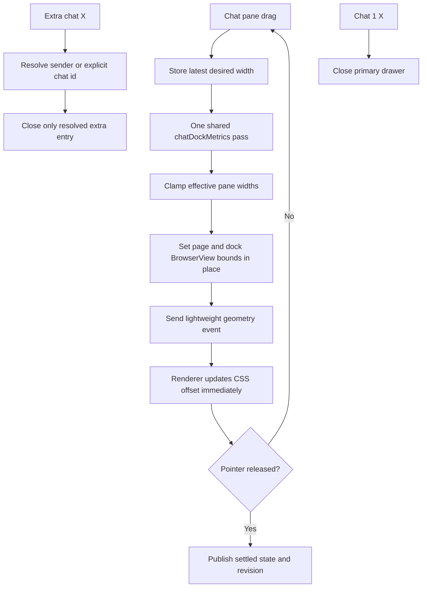
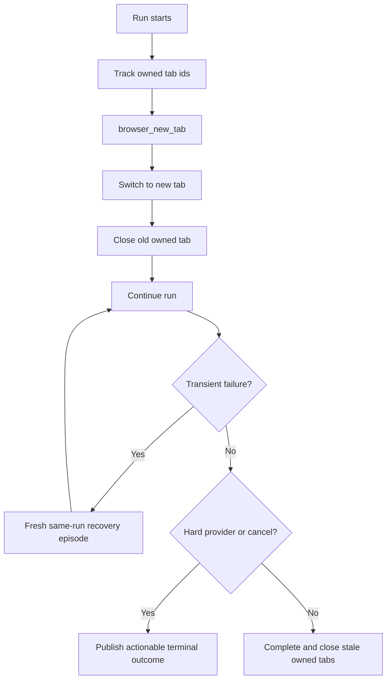
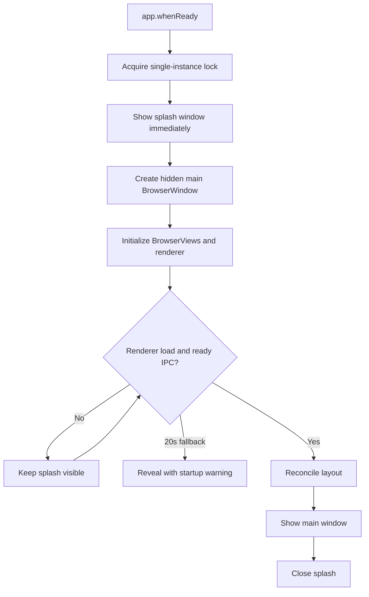

# Desktop Main Agent IPC Flowchart

## Purpose

`main.cjs` resolves a user-selected browser target, provider configuration, and
optional persisted conversation once, then starts the desktop agent without
silently changing any of them.

At Electron startup it also creates the first managed BrowserView before the
renderer becomes interactive. That keeps the native browsing surface and the
agent drawer in the same ready-state rather than accepting an action against an
empty tab registry.

The native BrowserView reservation and renderer drawer share the same 320px
minimum. A resize request is clamped once to that contract, then the native page
ends exactly where the renderer drawer begins; neither surface may cover the
other.

```text
+-----------------------+----------------------+
| Native page stage     | AI drawer            |
| width = W - drawer    | width = drawer       |
+-----------------------+----------------------+
                        ^
                        +-- visible inner-edge resize grip
```



```text
+-------------------+
| Renderer request  |
+---------+---------+
          v
+-------------------+
| Resolve tab/model |
+---------+---------+
          v
+    active local tab?
+      |        |
+     yes       no
+      v        v
+  validate   create neutral
+  config only  task tab
+      |
+      v
+  start agent
+      |
+      v
+ compact events --> renderer patches
```



## Process lifetime, background execution, and tray

The desktop main process owns the HTTP server and paired sessions. Focus, window
visibility, and the active tab are presentation state, not session lifetime.

```text
+----------------------------+
| Electron process starts    |
| Start MCP once; create tray|
+-------------+--------------+
              v
+----------------------------+     +---------------------------+
| Window visible / unfocused |<--->| Minimized in taskbar     |
| Same broker and tab views  |     | Timers remain unthrottled |
+-------------+--------------+     +-------------+-------------+
              |                                  |
              +---------------+------------------+
                              v
                 +---------------------------+
                 | Explicit Quit / OS exit? |
                 +------------+--------------+
                     no |          | yes
                        |          v
                  keep serving  release input, revoke sessions,
                                stop server, destroy tray, exit
```



Page timers stay enabled in the background. A `prevent-app-suspension` blocker
keeps normal automatic idle suspension from interrupting the service, while
allowing the display to sleep; it cannot override a crash, forced termination,
or an explicit operating-system suspend. Explicit session revocation remains
available and is never bypassed for connection stability. Window close hides to
the tray only when a tray icon was created successfully; otherwise normal close
remains available. Tray **Quit** is the explicit dismissal action.

## Desktop MCP endpoint selection

The desktop application owns a stable loopback MCP origin so a configured
external tunnel does not break after every desktop relaunch. It deliberately
does not reuse the standalone CLI daemon port. Isolated Electron tests opt into
an operating-system-selected port with an explicit environment variable.

```text
+-------------------------------------------+
| BROWSER_USE_DESKTOP_MCP_PORT is provided? |
+--------------------+----------------------+
                     |
          +----------+----------+
          |                     |
         no                    yes
          |                     |
          v                     v
+------------------+   +------------------------+
| use 127.0.0.1:8792|  | validate integer 0..65535|
+---------+---------+   +-----------+------------+
          |                         |
          |              +----------+----------+
          |              |                     |
          |             0                  valid nonzero
          |              |                     |
          |              v                     v
          |     +----------------+    +------------------+
          |     | test OS port   |    | requested port   |
          |     +--------+-------+    +--------+---------+
          +--------------+---------------------+
                         v
            +------------------------------+
            | LocalMcpServer listens only  |
            | on 127.0.0.1 at that port    |
            +------------------------------+
```



## Custom GPT Action tunnel path

The Lorde Studios Cloudflare Tunnel terminates HTTPS before forwarding only the
Action surface to the local desktop bridge. A more-specific no-Worker route
keeps the existing `lorde-studios` wildcard Worker from capturing this hostname.

```text
+---------------------------------------------+
| Custom GPT Action: gpt-browser.lordemaximus |
+--------------------------+------------------+
                           |
                    /gpt/* only
                           v
+------------------------------------------------+
| lorde-studios-gpt-action Cloudflare Tunnel     |
+--------------------------+---------------------+
                           v
+------------------------------------------------+
| 127.0.0.1:8792 LocalMcpServer /gpt/*           |
+------------------------------------------------+

other public paths --> 404
```



## Visible GPT Actions setup

Settings is a native topmost overlay BrowserView. Its visible form, not the
underlying chrome renderer's duplicate form, owns the GPT Action controls and
must receive every refreshed MCP status payload.

```text
+-------------------+      +------------------+      +---------------------+
| Settings toolbar  | ---> | activeDrawer     | ---> | overlay.html form   |
+-------------------+      | = settings       |      +----------+----------+
                           +------------------+                 |
                                                               GPT Actions
                                                                  |
                   +----------------------------------------------+---------------------+
                   | OpenAPI URL | X-API-Key | copy schema | enabled switch | Save       |
                   +----------------------------------------------+---------------------+
                                                                  ^
                                                                  |
                                           browser-use:mcp-state / initial status snapshot
```



## Claude Code MCP installation and reconnect authentication

The visible Settings overlay exposes a Claude Code-specific copy action. The
copied user-scoped configuration uses Claude Code's supported `headersHelper`
field. At every Claude session start or reconnect, the helper calls the local
Desktop authentication endpoint and receives a fresh short-lived pairing
header. A separate Settings action copies the currently displayed raw pairing
code for hosts that need manual setup.

```text
+-------------------------+
| Claude Code MCP button  |
+------------+------------+
             |
             v
+-------------------------+
| Validate MCP and        |
| authentication endpoint|
+------------+------------+
             |
             v
+-----------------------------------------------+
| claude mcp add-json --scope user              |
| browser-use-desktop                           |
| { url, headersHelper: curl authenticate }     |
+-----------------------+-----------------------+
                        |
                        v
+-------------------------+
| Copy command and show   |
| run-now feedback        |
+-------------------------+
```



## AGI computer-tool attachment

The user-selected `mcpControlMode` and `agentControlMode` default to Browser only.
The shared backend is created lazily; main passes getters into the existing MCP
and chat executors. Settings are accepted only from trusted app renderers. Scope
downgrade invalidates affected native work without restarting MCP. Existing
Full access / Ask remains the chat permission authority. Explicit app Quit awaits
native input/job and recording cleanup before disconnecting the terminal broker.
See `computer/computerTools_flow_chat.md` for ASCII/Mermaid routing and coordinates.

## Invariants

1. A validated `request.tabId` is not replaced with the selected tab. A local
   task with no available tab creates one neutral task tab inside the agent;
   remote providers do not require a local BrowserView.
2. `request.provider.model` is preferred over legacy model fields for every provider.
3. Intermediate agent events are bounded patches, not full ever-growing run histories.
4. Full state remains available through an explicit state request and terminal lifecycle events.
5. Connection preflight is an explicit Settings/test action, not a hidden gate on
   every task. Runtime model-response errors enter the agent recovery loop with
   their bounded error context.
6. A connection persists its selected provider-discovered model by connection
   ID. Runtime starts use that exact selected model rather than a generic
   hardcoded fallback or an ephemeral renderer-only selection.
7. The first BrowserView is created and selected before `did-finish-load` for
   the renderer. A visible agent drawer must never accept a task while the tab
   registry is temporarily empty solely because the renderer finished first.
8. Provider-model discovery is a bounded read-only probe. Transient endpoint
   failures receive one short retry; authentication and other non-transient
   responses remain visible instead of being retried indefinitely.
9. The main shell exposes one synchronous selected-view recovery callback to
   the BrowserView controller. It may only reattach and lay out the already
   selected tab; it cannot select another tab, close an overlay, or broaden the
   requested action. If the compositor remains unavailable, controller-level
   CDP delivery still addresses only that exact requested WebContents.
10. `continuation`, `conversationId`, and the persisted conversation snapshot
    are forwarded through every provider branch. Provider routing cannot drop
    follow-up context.
11. History persistence stores title, ordered messages, optional plan, and tool
    transcript as separate fields. Loading a title never fabricates a user turn.
12. Terminal persistence also stores a redacted bounded prior-reasoning tail and
    semantic completed-work ledger. Reopening a conversation restores strategy
    continuity without converting internal reasoning into a visible plan or
    replacing any user prompt.
13. Report and screenshot previews are owned by the native overlay BrowserView,
    not a renderer dialog beneath the active page. While a preview is open the
    overlay covers the full content window, is attached last, blurs everything
    below it, and releases its file/image payload when closed.
14. The renderer and main process both clamp the AI drawer to the same 320px
    minimum. The native page right edge must equal the drawer left edge after
    every pointer, keyboard, restored, or programmatic resize.
15. Desktop MCP bootstrap codes are short-lived recovery credentials, not
    long-lived bearer tokens. The local server maps them to one opaque
    `Mcp-Session-Id`; broker session ids remain visible only for local session
    status and cannot authorize an external request. Pairing enables the full
    MCP tool catalog without separate approval controls.
16. The desktop app defaults to `127.0.0.1:8792`, which is distinct from the
    CLI daemon's `8790` and its `8791` integration fixture. Only an explicit
    `BROWSER_USE_DESKTOP_MCP_PORT=0` may request an ephemeral desktop port for
    an isolated Electron test; a busy fixed port must fail instead of silently
    switching the external tunnel to an unknown origin.
17. `gpt-browser.lordemaximus.com/*` explicitly disables Workers so the more
    general `*.lordemaximus.com/*` `lorde-studios` route cannot intercept the
    tunnel. Only `/gpt/*` reaches the local desktop bridge; schema discovery is
    public while every Action tool request continues to require `X-API-Key`.
18. The visible Settings overlay must contain the complete GPT Actions setup;
    copies in the underlying chrome renderer are never sufficient. Both
    renderers receive `browser-use:mcp-state` so a save or bridge restart
    cannot leave the topmost Action URL, key, or schema stale.
19. The Claude Code installer copies the official user-scoped `add-json` form
    with a `headersHelper` that obtains a new short-lived pairing code from the
    loopback-only authentication endpoint on every connection. It never edits
    Claude configuration files itself or launches a shell on the person's
    behalf. Its copied command escapes the JSON quotes (`\"`) so cmd.exe,
    Git Bash, and PowerShell 7 pass the definition to the Claude CLI intact;
    the PowerShell-only `--%` stop-parsing token was removed because every
    other shell delivered it to the CLI as a literal, invalid argument.
    Settings separately exposes the current raw code for manual copy.

## Shared multi-chat dock geometry and ownership

```text
+------------------------------+
| Chat 1 / Chat 2 / Chat 3     |
| desired pane widths          |
+---------------+--------------+
                v
+------------------------------+
| One native dock metric pass  |
| clamps effective widths     |
+---------------+--------------+
                v
+------------------------------+
| Page bounds + pane bounds    |
| are applied without reattach |
+---------------+--------------+
                v
+------------------------------+
| Lightweight geometry event   |
| updates renderer CSS offsets |
+---------------+--------------+
                v
+------------------------------+
| pointerup publishes settled  |
| state and final revision     |
+------------------------------+

Chat 2/3 X -> sender-owned chat id -> close only that entry
Chat 1 X   -> primary drawer close -> activeDrawer = null
```



## Agent recovery and tab ownership

```text
+---------------------------+
| Agent run owns tab set    |
+-------------+-------------+
              v
+---------------------------+
| New tab requested         |
+-------------+-------------+
              v
+---------------------------+
| Switch target first       |
+-------------+-------------+
              v
+---------------------------+
| Close previous owned tab  |
| never close user tab      |
+---------------------------+

Transient failure -> same run id -> fresh observation -> continue.
Hard provider/cancel -> terminal reason, never fake recovery exhaustion.
```



## Splash-gated Electron startup

```text
+-----------------------------+
| app.whenReady + lock        |
+--------------+--------------+
               v
+-----------------------------+
| Show splash immediately     |
| main BrowserWindow hidden   |
+--------------+--------------+
               v
+-----------------------------+
| Initialize MCP, settings,  |
| BrowserView, and renderer  |
+--------------+--------------+
               v
+-----------------------------+
| did-finish-load + renderer |
| ready IPC both received    |
+--------------+--------------+
               v
+-----------------------------+
| Layout BrowserViews, show  |
| main window, close splash  |
+-----------------------------+
```


