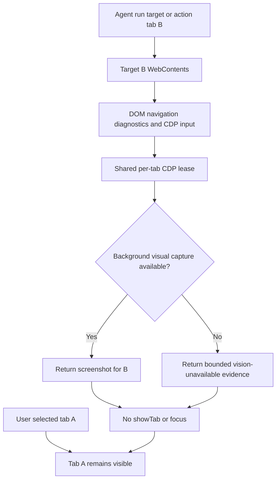

# Background tab control flow

The visible browser tab is user presentation state. AI and paired MCP actions
address their own target tab IDs and must not select or focus that tab.

```text
+------------------+      +--------------------------+
| User views tab A |      | Agent/MCP targets tab B  |
| selected + drawn |      | detached but live         |
+--------+---------+      +------------+-------------+
         |                             |
         | no selection change          | explicit tabId/binding
         v                             v
+------------------+      +--------------------------+
| A stays visible  |      | DOM, navigation, input,  |
| and interactive  |      | diagnostics use B         |
+------------------+      +------------+-------------+
                                           |
                                           v
                              +--------------------------+
                              | Shared CDP lease          |
                              | serialize B debugger work |
                              +------------+-------------+
                                           |
                         +-----------------+------------------+
                         |                                    |
                         v                                    v
            +--------------------------+      +--------------------------+
            | CDP screenshot succeeds  |      | Capability unavailable:  |
            | return B image evidence  |      | bounded DOM-first result |
            +--------------------------+      +--------------------------+
```



## Invariants

1. `selectedTabId` is presentation state only; it is never changed by background
   agent/MCP work.
2. An MCP session's bound tab and an agent run/action target remain explicit
   authorization/operation identities.
3. Agent-created tabs are background tabs unless a separately named foreground
   action is introduced.
4. Background work never attaches, raises, focuses, or reorders a BrowserView.
5. Screenshot failure is bounded and never causes implicit foreground selection.
