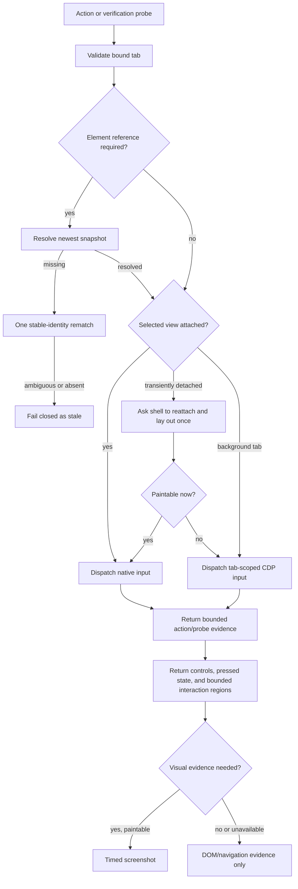
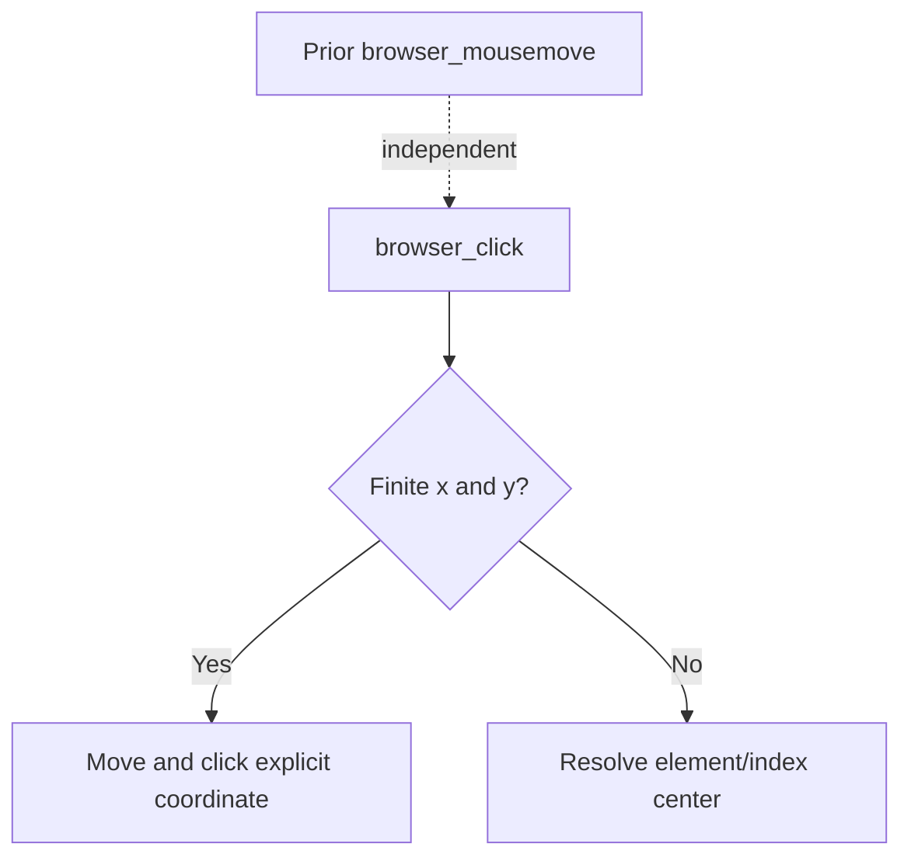
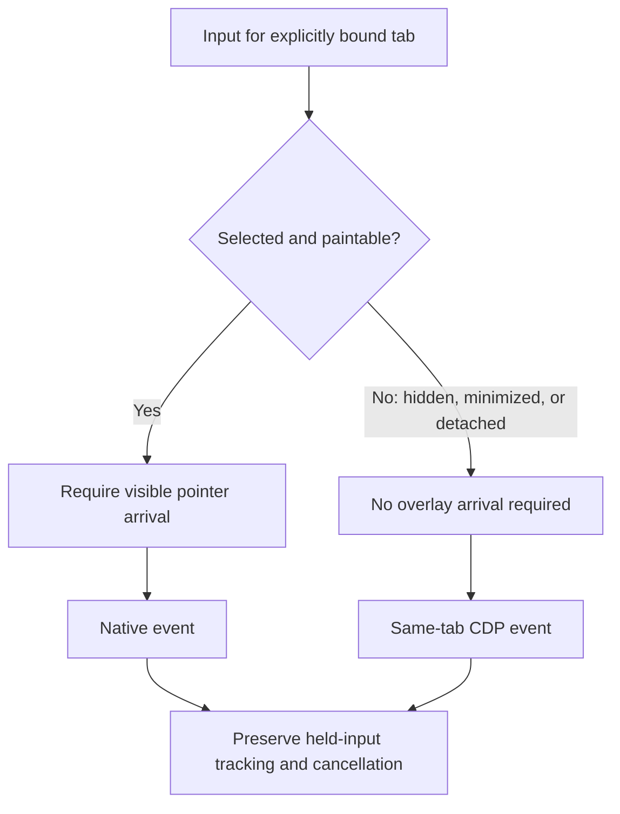
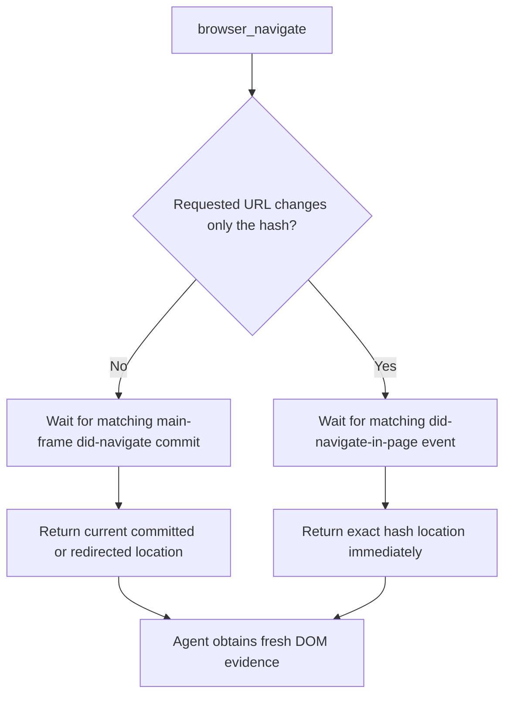
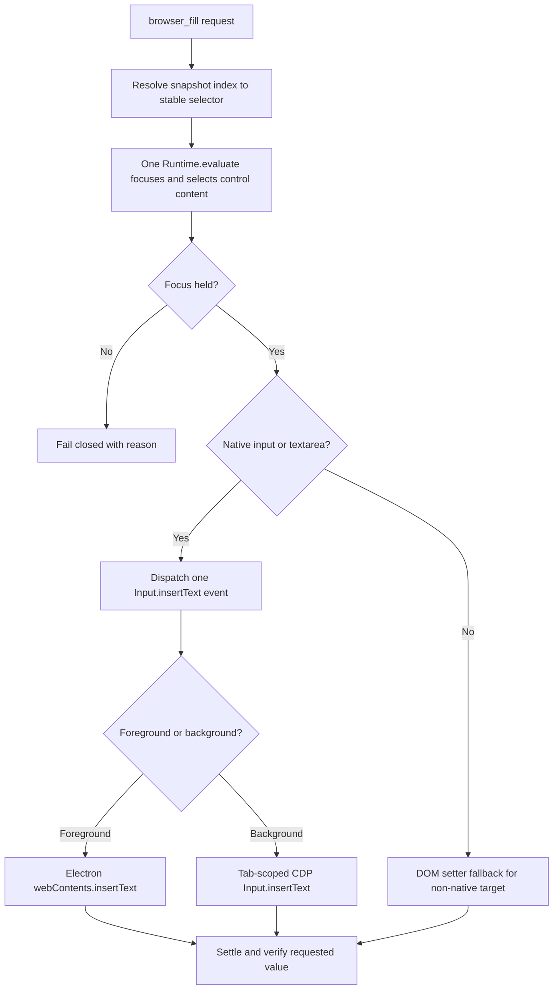

# Browser View Controller Flowchart

## Purpose

`browserViewController.cjs` safely resolves DOM references, dispatches native or background CDP input, and provides bounded DOM/screenshot evidence for the desktop agent.

```text
+--------------------+
| Agent action/probe |
+---------+----------+
          v
+--------------------+
| Validate live tab  |
+---------+----------+
          v
+  needs DOM target?
+    |           |
+   yes          no
+    v            v
+ snapshot --> stable rematch
+    |           |
+ found        stale
+    v           v
+ dispatch    return recoverable
+ input       stale result
+    |
+    v
+ capture controls + semantic
+ state + interaction regions
+    |
+    v
+ bounded verification
```



## Click target precedence

A standalone pointer move is never stored as a required destination for a later click. Each click chooses its own target: an explicit finite coordinate pair wins over optional element/index metadata, while an index-only click resolves the latest DOM snapshot center.

```text
+-----------------------------+
| browser_click action        |
+--------------+--------------+
               v
      +--------+--------+
      | finite x and y? |
      +----+--------+---+
        yes|        |no
           v        v
 +----------------+  +----------------------+
 | click explicit |  | resolve element/index|
 | coordinate     |  | center from snapshot |
 +----------------+  +----------------------+
```



## Hidden-window pointer routing

```text
+------------------------------+
| Selected tab has a surface?  |
+---------------+--------------+
       yes      |       no
        v       |        v
  await pointer |  no visible-pointer prerequisite
  native input  |  same-tab CDP input
        +-------+--------+
                v
      keep cancellation and key/button cleanup
```



A tray-hidden window cannot display a pointer overlay. Its absence must not
cancel an otherwise authorized new input operation. Actual cancellation or
interruption remains terminal, and visible-tab pointer synchronization is unchanged.

## Navigation completion

```text
+-------------------------+
| browser_navigate request|
+------------+------------+
             |
             v
 +-----------+-----------+
 | Full document route?  |
 +-----+-------------+---+
       |             |
     yes             no (same-page hash)
       |             |
       v             v
+----------------+  +---------------------------+
| did-navigate   |  | did-navigate-in-page      |
| main-frame     |  | exact requested hash      |
+-------+--------+  +-------------+-------------+
        |                         |
        +------------+------------+
                     v
          +-----------------------+
          | Return fresh location |
          +-----------------------+
```



## Invariants

1. Numeric indexes only reference the newest snapshot and are rematched once by stable identity before failing closed.
2. Selected-tab native input and background CDP input never silently shift the human-visible tab.
3. Screenshot timeouts return bounded errors; late Electron/CDP work must not alter newer agent observation revisions.
4. Mouse/key state is released on cancellation, tab close, and shutdown.
5. A same-document navigation that changes a fragment (for example
   `#details`) completes from Electron's matching `did-navigate-in-page`
   event instead of waiting for a full-document commit timeout. A fragment
   request is not reported as complete from the pre-fragment URL.
6. If the selected BrowserView is transiently absent from the window during a
   native input action, the controller asks the main shell to reattach and lay
   it out exactly once, then rechecks paintability. If Windows still provides no
   compositor surface, the same requested tab receives the input through its
   tab-scoped CDP channel. The controller never switches targets or falls
   through to an unrelated provider decision.
7. A normal observation exposes both actionable controls and a small set of
   large visible interaction regions (for example `main`, canvas, SVG, or an
   explicitly labelled/tested surface). Regions carry only a public label and
   viewport rectangle; they are coordinate grounding, not executable selectors.
8. Button state such as `aria-pressed`, `aria-selected`, and `aria-expanded` is
   retained. Dispatching a click proves only that the control received input;
   an armed drawing/placement tool is not the same evidence as a created layer.


## HTTP commit validity

A matching main-frame commit is necessary but not sufficient evidence. The
controller rejects committed HTTP status codes `>= 400` as navigation failures.
This keeps a server-side `404 Not found` from becoming a successful observation
that sends the agent into filesystem guesswork.

## Form fill (`browser_fill`) route

```text
+-----------------------+
| browser_fill request  |
+-----------+-----------+
            v
+-----------------------+
| Resolve snapshot index|
| to stable selector    |
+-----------+-----------+
            v
+-------------------------------+
| Runtime.evaluate: focus the   |
| control and select its own    |
| value in the same page turn  |
+---------------+---------------+
                v
        +-------+-------+
        | Focus held?   |
        +---+-------+---+
          no|       |yes
            v       v
     +----------+  +----------------+
     | Fail      |  | Native input?  |
     | closed    |  +---+--------+---+
     +----------+    no|        |yes
                       v        v
              +-------------+  +--------------------+
              | DOM setter  |  | One Input.insertText|
              | fallback    |  | event (native or   |
              +------+------+  | tab-scoped CDP)    |
                     |         +---------+----------+
                     +-------------------v
                              +----------------------+
                              | Settle and verify    |
                              +----------------------+
```



The route never dispatches a document-wide select-all key chord. Replacement
semantics come from selecting the target control's own content in the same
page-side evaluation that focuses it. If native focus cannot be retained, the
operation fails closed rather than risking a page-wide selection.
