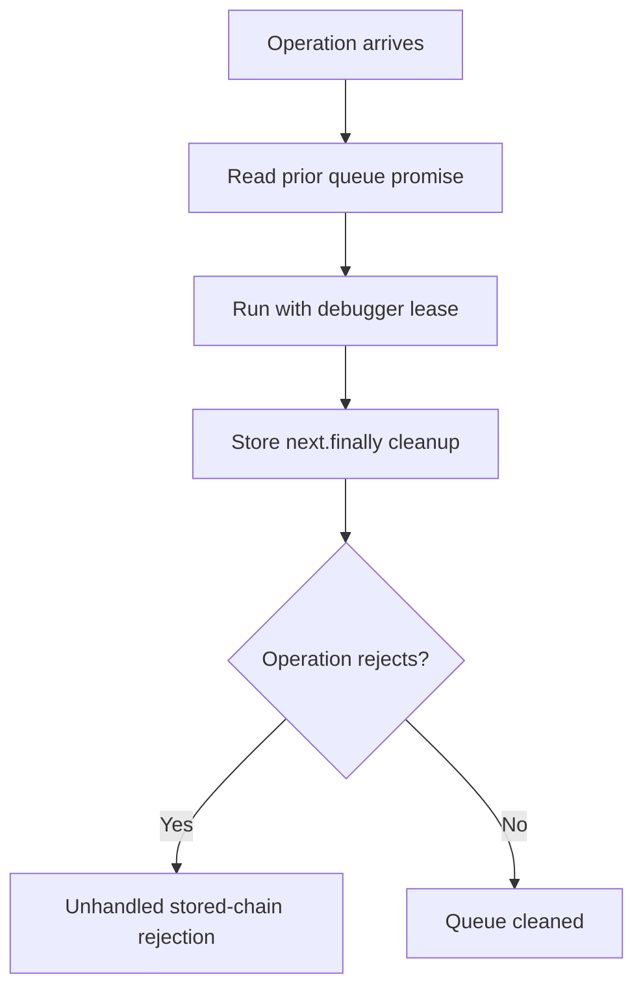
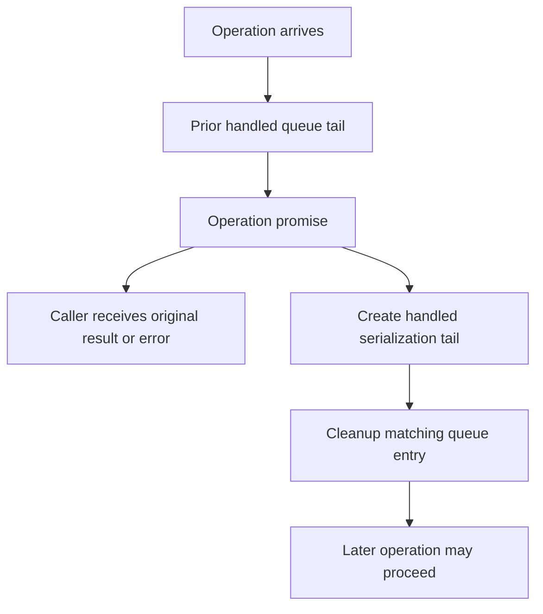

# Debugger lease manager flowchart

## Purpose

Serialize Chrome DevTools Protocol work per managed tab while preventing rejected operations from leaking as unhandled promises.

## Current flow before repair

```text
+------------------+
| Operation arrives|
+--------+---------+
         |
         v
+------------------+
| Chain after prior|
+--------+---------+
         |
         v
+------------------+
| Store next.finally|
+--------+---------+
         |
         +---- rejection can remain unhandled
```



## Repair contract

```text
+---------------------------+
| Return operation promise  |
| to requesting caller      |
+-------------+-------------+
              |
              v
+---------------------------+
| Store handled queue tail  |
| rejection becomes settled |
+-------------+-------------+
              |
              v
+---------------------------+
| Delete matching queue tail|
+---------------------------+
```



The serialized queue stores a handled promise tail. The caller still receives the original rejecting promise, while a later request can proceed after queue cleanup without a second unhandled rejection.
