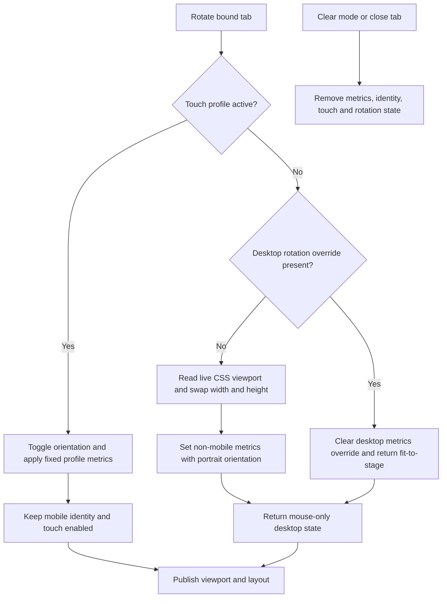

# Device emulation and desktop rotation

```text
+-------------------+
| Rotate bound tab  |
+---------+---------+
          v
+-----------------------------+
| Mobile / tablet mode?       |
+--------+--------------------+
    yes  |                 no |
         v                    v
+-----------------+   +---------------------------+
| Swap fixed CSS  |   | Read real CSS viewport     |
| width / height  |   | First rotate swaps W and H |
| Touch stays on  |   | Next rotate clears override|
+-----------------+   | Mouse identity stays intact|
                      +-------------+-------------+
                                    v
                      +----------------------------+
                      | Publish viewport geometry  |
                      | Relayout native BrowserView|
                      +----------------------------+
```



Desktop rotation must not make `isTouchMode` true. Mobile touch dispatch remains
exclusive to mobile/tablet profiles. Desktop metric overrides use device scale
factor zero to preserve native pixel ratio. No reload is needed for rotation.

## Device-canvas zoom extension (2026-10-14)

The emulator also owns the Ctrl+Scroll device-canvas zoom: per-tab zoom state
(`zooms`), per-profile persistence (`profileZooms`, seeded from
`initialZooms`, written back through `onZoomPersist`), bounds 0.5–3.0, reset
to the target profile's value on every device-mode change, and the zoom
multiplied into the fit-to-stage scale in `displayViewportFor`/`fitViewport`
(layout viewport unchanged). Touch dispatch converts device px -> visual px
with the laid-out display scale (`displayScaleFor` + `scaleTouchFrame`) because
CDP reads `Input.dispatchTouchEvent` coordinates in the surface's visual pixel
space. The full contract, the wheel-watcher mechanism, the badge, and the
coordinate proofs live in `deviceZoom_flow_chat.md`.
