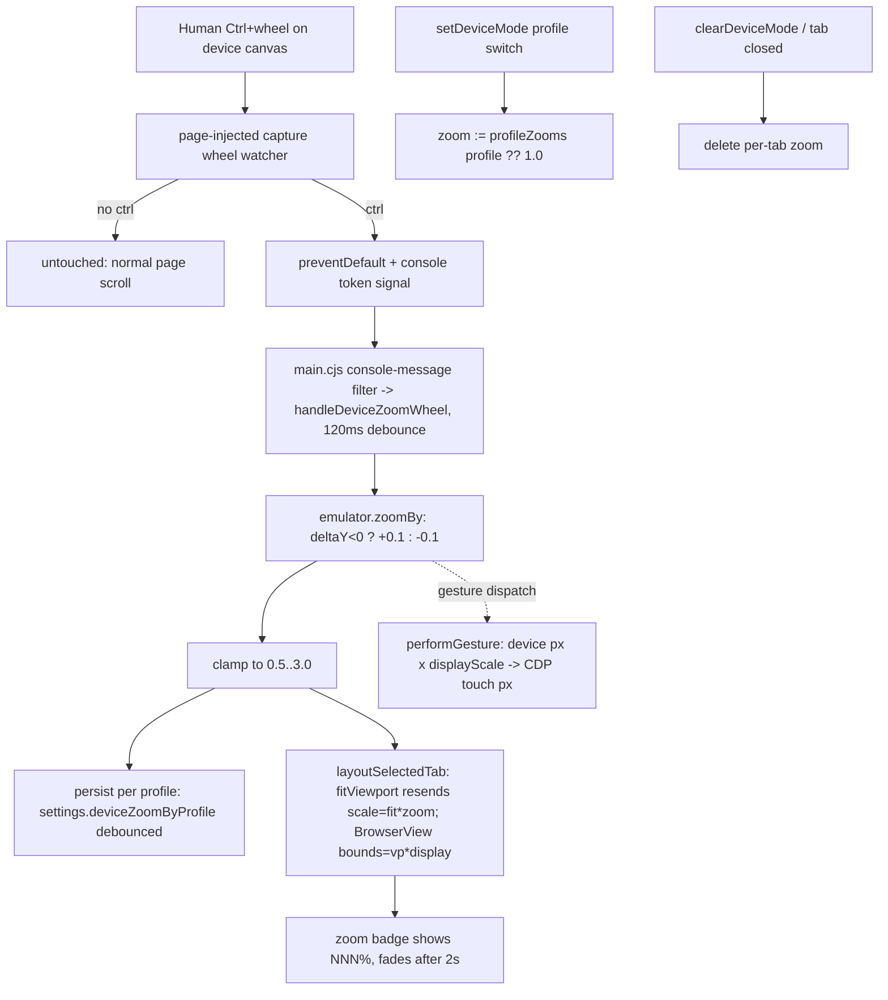

# Device Canvas Zoom — flow chat (Ctrl+Scroll zoom of the emulated device view)

Owner issue: in device mode (mobile/tablet emulation) the device canvas cannot be
zoomed by the human, and the agent mis-reads pages rendered small. Feature:
Ctrl + Scroll over the device canvas zooms the emulated viewport's DISPLAY size
(50%–300%), while the emulated page's layout viewport (device CSS pixels) is
unchanged — the page renders identically and only the display scale changes.
The agent's pointer mapping must stay correct at every zoom level.

## The coordinate-mapping architecture (where the zoom factor threads through)

There is exactly ONE screen→device transform, and it is the `scale` parameter
of CDP `Emulation.setDeviceMetricsOverride` (deviceEmulator.cjs
`fitViewport`), measured empirically (output/device-zoom-20261014/):

```
fitScale  = min(1, stageW / vp.width, stageH / vp.height)   // fit-to-stage
display   = fitScale * zoom                                 // zoom threads here
CDP call  = setDeviceMetricsOverride { width: vp.width, height: vp.height,
                                       deviceScaleFactor: vp.dpr, scale: display }
```

- The layout viewport stays `vp.width x vp.height` CSS px → `window.innerWidth`,
  DOM geometry, element rects and `Page.captureScreenshot` are INVARIANT under
  zoom. PROVEN: the browser_execute viewport report is identical at zoom
  1 / 1.5 / 2.5 (412x915, dpr 2.625).
- HUMAN input: Chromium derives the screen→device mapping from the same
  `scale`. The BrowserView is sized `floor(vp.width * display) x
  floor(vp.height * display)`, so a human click at screen position p maps to
  device px `p / display` — the zoom factor is divided out by construction.
- AGENT input (the load-bearing fix): CDP reads `Input.dispatchTouchEvent`
  coordinates in the VISUAL pixel space of the emulated surface, and the page
  receives `dispatched / (fitScale * zoom)`. At zoom 1 that is already a
  systematic `1/fitScale` drift (the owner-reported "wrong coordinates": a
  tap intended for device x=120 landed at x=132.29 at fitScale 0.9071), and
  the drift GROWS with zoom (120 → 52.92 at zoom 2.5). Fix:
  `performGesture` converts every touch point (x, y, radiusX, radiusY) from
  device px to visual px with the display scale currently laid out
  (`displayScaleFor` — the scale last sent by `fitViewport`, cached per tab).
  PROVEN after the fix: dispatched device coordinates land EXACTLY at the
  same device position at zoom 1, 1.5 and 2.5 (sub-pixel agreement).

## Process flow (ASCII)

```
+---------------------------+   Ctrl+wheel over the device frame
| page-injected wheel       |   Electron 43 'input-event' does NOT emit
| watcher (capture, main)   |   wheel events (verified live) — so the
+---------------------------+   watcher is injected with the touch overlay
            |                  and signals via a console token.
            v
+---------------------------+   ctrlKey? no -> untouched (page scrolls)
| preventDefault            |   yes -> swallow (no page scroll/zoom),
| __browser_use_device_zoom__ + direction  (console.info, filtered
+---------------------------+   out of the console UI in main.cjs)
            v
+---------------------------+
| handleDeviceZoomWheel     |   debounced 120ms (one notch at input rate)
| emulator.zoomBy(tab, dir) |   deltaY<0 => in (+0.1), deltaY>0 => out (-0.1)
+---------------------------+
            |
            v
+-------------------------------------+
| zoom = clamp(current + dir*0.1,     |   bounds 0.5 .. 3.0
|              0.5, 3.0)              |
| persist per device profile (debou.) |   settings.deviceZoomByProfile
+-------------------------------------+
            |
            v
+----------------------------+   layoutSelectedTab -> fitViewport re-sends
| display = fitScale * zoom  |   setDeviceMetricsOverride with the new scale;
| bounds = vp * display      |   viewportBoundsFor re-centres the frame.
+----------------------------+
            |
            v
+----------------------------+
| zoom badge: show "NNN%"    |   small BrowserView above the tab view,
| fade after 2s, then hide   |   0x0 when hidden (never intercepts input)
+----------------------------+

device-mode change (setDeviceMode / clear):
  zoom := profileZooms[profileId] ?? 1.0    (reset to the profile's own value;
  clearDeviceMode / forgetTab: delete per-tab zoom)
```

## Mermaid



## Routes touched

| Route | File | What changes |
| --- | --- | --- |
| Ctrl+Scroll in | desktop/main.cjs `wireTab` | `input-event` wheel interception -> `deviceEmulator.zoomBy` |
| Display scale | desktop/mcp/deviceEmulator.cjs `displayViewportFor` / `fitViewport` | `scale = fitScale * zoom` (layout viewport unchanged) |
| Frame bounds | desktop/main.cjs `viewportBoundsFor` | unchanged — follows `displayViewportFor` automatically |
| Pointer mapping (human) | (no code) | Chromium maps human input through the same `scale` |
| Pointer mapping (agent) | desktop/mcp/deviceEmulator.cjs `performGesture` + `displayScaleFor` | device px -> visual px conversion with the laid-out display scale (pre-existing 1/fit drift fixed too) |
| Persistence | settings `deviceZoomByProfile` + DeviceEmulator `initialZooms`/`onZoomPersist` | per device profile, debounced write |
| Reset | `setDeviceMode`/`clearDeviceMode`/`forgetTab` | zoom := profile's persisted value or 1.0; cleared with the tab |
| Indicator | main.cjs zoom badge BrowserView (`browser-use-zoom-badge` data: URL) | shows %, fades after 2s, 0x0 when hidden |
| Programmatic | IPC `browser-use:set-device-zoom` + preload `setDeviceZoom` | tests and future UI drive the same path |
