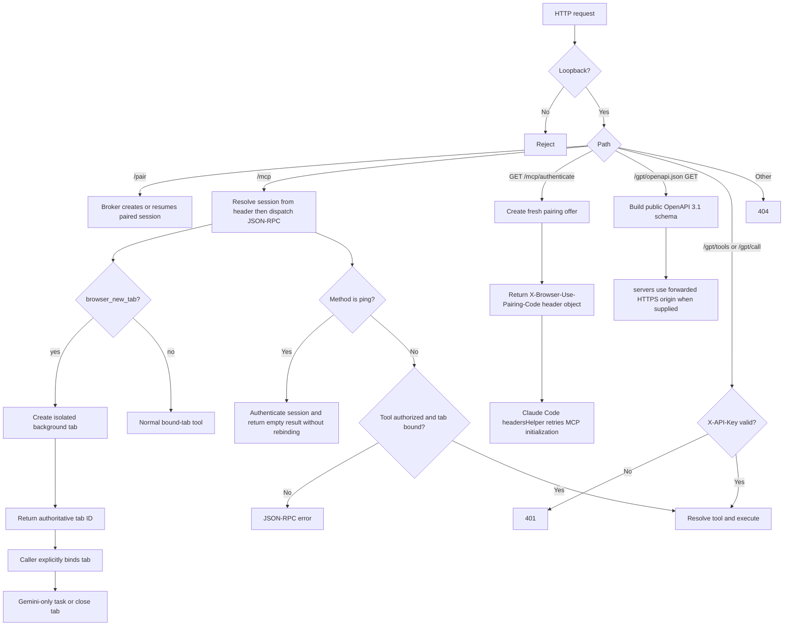

# LocalMcpServer flow

`LocalMcpServer` is the loopback HTTP boundary for paired MCP hosts and the
public-schema/private-call GPT Action surface. It owns only HTTP parsing and
protocol translation; tab selection, grants, and browser input remain delegated
to the broker and controller.

## Request paths

```text
                       +----------------------+
                       | HTTP request arrives |
                       +----------+-----------+
                                  |
              +-------------------+-------------------+
              |                                       |
              v                                       v
    +-------------------+                   +-------------------+
    | /pair             |                   | /mcp              |
    | loopback only     |                   | loopback only     |
    +---------+---------+                   +---------+---------+
              |                                       |
              v                                       v
    +-------------------+                   +-------------------+
    | broker.pair()     |                   | resolve session   |
    | return session    |                   | dispatch JSON-RPC |
    +-------------------+                   +-------------------+

              +---------------------------------------+
              | GET /mcp/authenticate                 |
              | loopback headersHelper bootstrap      |
              +-------------------+-------------------+
                                  |
                                  v
              +---------------------------------------+
              | Create fresh short-lived offer and    |
              | return only the pairing-header JSON   |
              +---------------------------------------+

              +---------------------------------------+
              | /gpt/*                                |
              +-------------------+-------------------+
                                  |
             +--------------------+--------------------+
             |                                         |
             v                                         v
 +-------------------------+               +--------------------------+
 | GET /gpt/openapi.json   |               | GET tools / POST call    |
 | public schema discovery |               | require X-API-Key        |
 +------------+------------+               +------------+-------------+
              |                                         |
              v                                         v
 +-------------------------+               +--------------------------+
 | OpenAPI 3.1 components: |               | toolDefinitions ->       |
 | schemas + ApiKeyAuth    |               | controller / agent       |
 +-------------------------+               +--------------------------+
```



```text
+----------------------+   +----------------------+   +----------------------+
| MCP ping request     |-->| Resolve/authenticate |-->| HTTP 200 result: {}  |
| retained session id  |   | same live session    |   | Keep session and tab |
+----------------------+   +----------+-----------+   +----------------------+
                                     |
                                invalid credential
                                     v
                           +----------------------+
                           | Existing auth error  |
                           | Never revive session |
                           +----------------------+
```

## Computer-tool branch

The desktop MCP catalog adds nine grouped `computer_*` tools when the backend
is configured. The catalog stays stable; every call authenticates and checks the
current MCP AGI scope before dispatch, including cached calls. Native calls have
no browser-tab prerequisite. Screenshot images use MCP image content alongside
coordinate metadata. Delegated chat runs inherit this MCP scope and owner, not
the chat composer's separate scope. Revocation cancels that owner's native work.
The public GPT Action catalog and routes remain browser-only. Full shared
ASCII/Mermaid flow: `../computer/computerTools_flow_chat.md`.

## Algorithms and invariants

- `safeKeyEqual` only accepts equal-length strings and uses a timing-safe
  comparison, so an absent or malformed `X-API-Key` never authenticates.
- The public schema base URL is
  `protocol + "://" + (X-Forwarded-Host || Host)`, with HTTPS selected only
  when the forwarded protocol is HTTPS. This lets a tunnel publish its own
  hostname while the server stays loopback-only.
- Schema construction loops over `toolDefinitions()`, excluding tab binding and
  agent-orchestration endpoints from the GPT Action catalog. Each remaining
  tool maps to `/gpt/call/<toolName>` with `ApiKeyAuth` security.
- The OpenAPI document always emits `components.schemas` (even when it is
  empty) and `components.securitySchemes.ApiKeyAuth`, so strict GPT importers
  receive the complete component shape.
- Schema discovery is intentionally public; `/gpt/tools` and every call remain
  authenticated. Raw `/mcp` is not published by the action tunnel.
- `GET /mcp/authenticate` is loopback-only and returns exactly the JSON header
  object required by Claude Code `headersHelper`. It creates a fresh
  short-lived pairing offer on every invocation, never returns a broker
  capability or transport session, and inherits the server's no-store and
  rate-limit protections.
- Standard MCP `ping` authenticates the same broker capability as other MCP
  requests and promptly returns an empty result. It requires no tab binding and
  does not create another transport, change the selected tab, extend pairing
  expiry, or revive a revoked session. Unknown/revoked-session HTTP error status
  handling is unchanged by the heartbeat repair.
