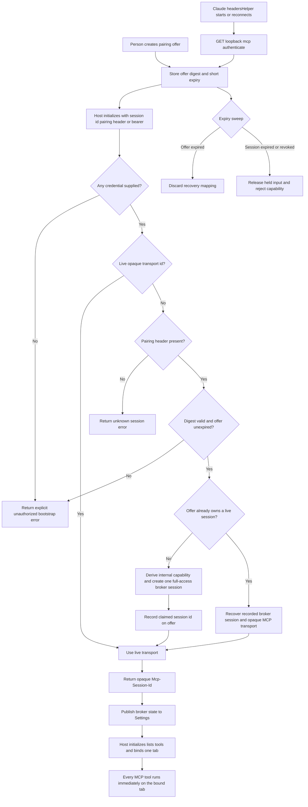

# Desktop MCP pairing and recovery flowchart

## Purpose

`sessionBroker.cjs` owns the loopback Desktop MCP trust boundary and
`localMcpServer.cjs` owns its Streamable HTTP transport. A person creates a
short-lived pairing offer in the desktop shell. A host normally sends that code
as `X-Browser-Use-Pairing-Code` while it initializes MCP; the server creates
one capability-scoped broker session and returns an opaque `Mcp-Session-Id`.
The host retains that opaque header for normal requests. The same short-lived
pairing header can safely recover that one session for the remaining short-lived
pairing offer lifetime if initialization or header retention fails, including when the client
accidentally sends a stale `Mcp-Session-Id` alongside the valid header. A
broker state change is published to the desktop renderer immediately, so the
person sees the new host in Settings with full MCP access. It never creates a
second session, changes that access scope, or rebinds a tab. The legacy `/pair`
route is retained for older hosts, but it can issue a raw bearer only on its
first claim and is not the normal connection guidance.

Claude Code uses its supported `headersHelper` reconnect hook. The helper calls
the loopback-only `GET /mcp/authenticate` endpoint, which invokes the same
`createPairingOffer()` algorithm and returns only a fresh
`X-Browser-Use-Pairing-Code` header object. Each new Claude process therefore
starts with a valid short-lived offer instead of persisting an expired code.

```text
+---------------------+    create offer     +------------------------+
| Person in Desktop UI | ------------------> | { digest, expiry,      |
|                     |                     |   claimed session? }   |
+---------------------+                     +-----------+------------+
                                                        |
                                                        v
                                     +------------------------------+
                                     | Host POST /mcp initialize    |
                                     | + session id or pairing       |
                                     +--------------+---------------+
                                                    |
                                                    v
                                     +------------------------------+
                                     | Any session id/header/bearer? |
                                     +---+----------------------+---+
                                         | yes                  | no
                                         v                      v
                         +---------------------------+   +----------------------+
                         | Valid live transport id?   |   | Return 401;          |
                         +----+------------------+----+   | no false initialize  |
                              | yes              | no     +----------------------+
                              v                  v
                +----------------------+  +--------------------------+
                | Reuse live transport |  | Pairing header present?  |
                +----------+-----------+  +----+-----------------+---+
                           |                   | yes             | no
                           |                   v                 v
                           |    +---------------------------+  +------------------+
                           |    | Valid and unexpired offer? |  | Return session  |
                           |    +---+----------------------+--+  | error           |
                           |        | yes                  | no  +------------------+
                           |        v                      v
                        +---------------------------+  +----------------------+
                        | Offer already owns a live  |  | Return 401;          |
                        | broker session?            |  | no state changes     |
                        +----+------------------+----+  +----------------------+
                             | no               | yes
                             v                  v
               +----------------------+  +--------------------------+
               | Create one full-     |  | Reuse one broker +       |
               | access session and   |  | opaque MCP transport     |
               | record its id on     |  |                           |
               | the offer            |  +------------+-------------+
               +----------+-----------+               |
                          |                            |
                          +-------------+--------------+
                                        v
                         +---------------------------+
                         | Return Mcp-Session-Id      |
                         +-------------+-------------+
                                       |
                                       v
                         +---------------------------+
                         | Publish full-access session |
                         | status to Settings          |
                         +-------------+-------------+
                                       |
                                       v
                         +---------------------------+
                         | Later MCP requests:         |
                         | authenticate -> explicit    |
                         | tab bind -> run tool        |
                         +---------------------------+
```



## State and algorithm

1. `createPairingOffer()` replaces any prior unclaimed/recoverable offer with a
   fresh random secret, stores only its SHA-256 digest and a short expiry, and
   returns the raw code once to the local renderer.
2. A normal `POST /mcp` `initialize` carries that code in
   `X-Browser-Use-Pairing-Code`. `LocalMcpServer` calls `pair(code, host)`, then
   maps the broker session to one random opaque `Mcp-Session-Id` response
   header. The broker capability never appears in the normal MCP response. An
   initialize with no `Mcp-Session-Id`, pairing header, or legacy bearer is
   rejected immediately rather than returning a misleading empty success.
3. `pair(code, host)` first checks digest and expiry. For an unclaimed offer it
   creates exactly one broker session and keeps recovery valid for the remaining
   lifetime of that short-lived offer.
   For a claimed offer inside that window it resolves that session and its
   deterministic internal capability, allowing the transport to recover the
   same opaque MCP session instead of creating a second pairing.
4. A host sends `Mcp-Session-Id` on later MCP requests. A valid live transport
   id remains authoritative. If that id is stale and the request also carries
   a valid pairing header, the server discards only the stale transport mapping
   and falls through to bounded pairing recovery in the same request. A host
   that cannot retain headers may repeat the pairing header until the offer expires;
   it is still mapped to the same broker session and transport session.
5. Recovered pairing does not alter host metadata, full-access state, tab binding, expiry,
   or held-input ownership. The recovery mapping is removed by offer expiry,
   explicit pairing cancel, shutdown/revoke-all, or when its owned session no
   longer exists. A normal session remains valid until its separate session
   expiry/revocation.
6. The legacy `/pair` endpoint can exchange an unclaimed code for a capability
   for older clients. It never re-issues that capability after the header flow
   has claimed the offer; the desktop UI directs new clients to the header flow.
7. Every broker mutation (remote pairing, bind, revoke, and expiry) emits
   a bounded desktop state event. The Settings session cards therefore update
   after an HTTP host connects and show that it has full MCP access.
   `onSessionEnded` is reserved for actual revoke, finite expiry, and shutdown.
   Switching an existing bound tab or closing it invokes `onTabBindingChanged`
   instead: release held input but retain the authenticated broker session and
   opaque MCP transport. Initial/same-tab bindings do not release input. See
   `../../mcp_connection_never_expire_flow_chat.md` for the binding-lifecycle
   ASCII and Mermaid diagrams and the regression audit.
8. `authorize()` authenticates the broker session independently of the offer.
   Once paired, every current and future MCP tool has no additional per-tool
   approval gate.
9. Claude Code `headersHelper` obtains a new offer at connection time. The raw
   code exists only in the helper response or the local Settings copy action;
   status and session cards continue to expose no secret.

## Invariants

1. A retry during the remaining pairing-offer lifetime never produces another broker
   session or another opaque MCP session.
2. An expired, cancelled, unknown, or mismatched code returns unauthorized and
   never mutates sessions or tab binding.
3. No pairing secret or capability appears in normal MCP responses, status,
   events, logs, or the session list.
4. An external agent can reconnect after a transient handshake/tool-discovery
   failure without forcing the person to manually generate another code, while
   recovery remains available only for the short pairing-offer lifetime.
5. A stale transport id cannot block a valid bounded header recovery, while a
   missing credential fails at initialize before a weak host mistakes it for a
   working connection.
6. Capability possession and explicit bound-tab identity remain the MCP
   access boundary; revocation, expiry, tab closure, and shutdown end control.
