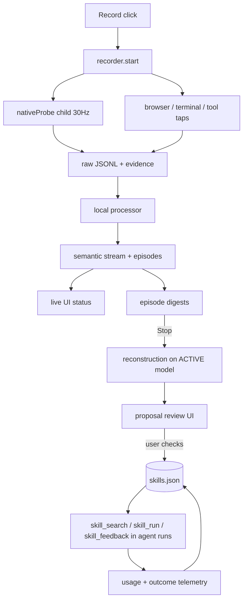

# Record & Learn / Skill Brain — Flow Chart

Real-time observation of the user's own work → conservative, human-approved,
reusable skills that the agent later executes without repeating trial-and-error.

Design constraints: the ACTIVE model (never a downgrade, never a second
selector) does all reasoning; the user's machine does all the filtering. Raw
events never reach the model individually — cost efficiency comes from local
normalization, deduplication, compression, grouping, and selective screenshots.
Nothing is remembered until the user checks it.

---

## 1. Process flowchart (ASCII)

```
            ┌────────────────────────────────────────────┐
            │ [ ● Record ]                               │
            │  recorder.start(sessionId)                 │
            └───────────────┬────────────────────────────┘
                            v
   ┌─────────────────────────────────────────────────────────────┐
   │ EVENT SOURCES (all existing infrastructure, no duplication) │
   │  nativeProbe child (koffi user32, 30 Hz poll loop)          │
   │    click edges · keystroke COUNTS (never content) ·         │
   │    foreground app/window changes                            │
   │  BrowserViewController taps: navigation, tab switches       │
   │  Terminal sessions: commands + exit status                  │
   │  Chat agent tool calls/results (user driving the agent)     │
   │  Selective screenshots: app switch, navigation, stop        │
   └──────┬──────────────────────────────────────────────┬───────┘
          v                                              v
   ┌──────────────────┐                        ┌────────────────────┐
   │ RAW EVENT STREAM │  (temp JSONL, 48 h     │ evidence store     │
   │ userData/record- │   retention, evidence  │ screenshots + DOM  │
   │ sessions/<id>    │   only, never the      │ digests (bounded)  │
   └────────┬─────────┘   model's input)        └────────────────────┘
            v
   ┌─────────────────────────────────────────────────────────────┐
   │ LOCAL EVENT PROCESSOR (pure logic, no model, no waiting)    │
   │  normalize → dedupe → compress repeats ("typed ~140 chars") │
   │  → significance score → episode grouping                    │
   │    boundary = app switch | navigation | idle > 8 s          │
   │  → SEMANTIC STREAM  "Chrome → example.com: clicked Create   │
   │     Post"                                                   │
   └──────┬──────────────────────────────────┬───────────────────┘
          v                                  v
   ┌──────────────────┐            ┌───────────────────────────────┐
   │ live status → UI │            │ episode digest (tokens, span, │
   │ (● 12 events /s, │            │ apps, domains) — compared     │
   │  current episode)│            │ against recent digests        │
   └──────────────────┘            └───────────────────────────────┘
                            (recording continues, user never waits)
                            v
            ┌────────────────────────────────┐
            │ [ ■ Stop ]                     │
            │  recorder.stop()               │
            └───────────────┬────────────────┘
                            v
   ┌─────────────────────────────────────────────────────────────┐
   │ FINAL RECONSTRUCTION (ACTIVE model, via the existing        │
   │ provider seam: descriptors → wire → selected connection)    │
   │  input: compact semantic timeline + episode digests         │
   │  chunked if large (max 3 chunks, sequential, 1 JSON each)   │
   │  output: tasks (intent, relevant vs casual) · new skill     │
   │  drafts · existing-skill matches · discarded clutter        │
   └───────────────┬─────────────────────────────────────────────┘
                   v
            ┌──────────────────────────────┐
            │ PROPOSAL REVIEW (human gate) │
            │ checkboxes + editable name / │
            │ when / steps before saving   │
            └───────┬──────────────┬───────┘
              keep  │              │ discard
                    v              v
   ┌────────────────────────┐   (raw session evidence expires)
   │ SKILL STORE            │
   │ skills.json — plain,   │
   │ human-editable, no DB  │
   └────────┬───────────────┘
            v
   ┌─────────────────────────────────────────────────────────────┐
   │ USE (later runs)                                            │
   │  agent tool skill_search → ranked digests (token overlap +  │
   │  trigger phrases + domains/apps, success-rate boost)        │
   │  agent tool skill_run  → full steps into the normal loop;   │
   │  the agent executes with existing tools, no re-learning     │
   │  agent tool skill_feedback → outcome counters + notes       │
   │  (automatic improvement: better matches, proven steps)      │
   └─────────────────────────────────────────────────────────────┘
```

## 2. Mermaid — lifecycle



## 3. Key contracts

- **Model**: every model call goes through `record/modelClient.cjs`, which
  resolves the ACTIVE provider config (the same one chat runs use) and routes
  over the unified wire seam (`agent/providers/{descriptors,wire}.cjs`). No
  hardcoded model, no second selector, no silent downgrade.
- **Privacy**: keyboard input is counted, never captured; raw evidence expires
  after 48 h; nothing persistent exists before the human approves it.
- **Context efficiency**: the model sees the semantic timeline (a few hundred
  tokens per episode), never raw events or screenshots.
- **Conservatism**: clutter (scrolling, typing bursts, idle, repeated clicks)
  is compressed or discarded locally; proposals are rejected unless grounded
  in at least one significant action.
